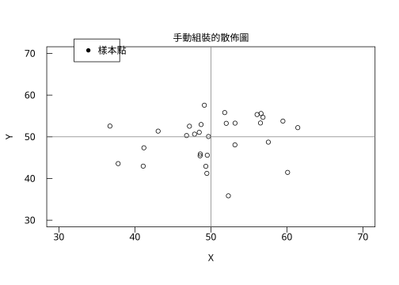

# 10.1 裝置與版面

## 本節目標

- 理解 R 的**圖形文法**（graphics grammar）：**裝置 → 座標 → 圖元** 三層架構
- 記住 `par("mar")` 的四個邊界留白與 `par("mgp")` 的三段軸線距離，它們決定了「版面」這件事
- 知道 R 預設的 `xaxs="r"` / `yaxs="r"` 會把座標範圍**外擴 4%**，這是「為什麼點不會貼著框」
- 會用 `r.pretty()` 挑出「好看」的刻度，並理解它背後的單位（1、2、5、10 的倍數）挑選法
- 用 `r.Graphics()` 建立 SVG 裝置，理解 **device 座標**與**user 座標**的分工

---

## 1985 年：R 為什麼把繪圖拆成三層？

在 R 之前，統計繪圖通常是「一條龍」：Fortran 或 C 裡直接呼叫圖形的低階指令，畫完就結束。這種寫法有兩個問題：

1. **換輸出格式要重寫**。要從螢幕變成印表機、變成 EPS、變成 LaTeX，得整段改。
2. **沒有人能畫出「出版級」的圖**。因為版面（留白、刻度、標題位置）沒有被系統化，每張圖都要手工微調。

**Ross Ihaka**（統計學家）與 **Robert Gentleman**（後來 R 基金會的推手）在 1990 年代初建立 R 時，做了一個關鍵決定：把繪圖拆成三層。

```text
┌─────────────────────────────────────────────────────────┐
│  高階：hist() boxplot() qqnorm() density() plot()       │  ← 統計語意
│         （自動選刻度、自動挑顏色、自動算統計量）              │
├─────────────────────────────────────────────────────────┤
│  低階：points() lines() rect() text() axis() abline()    │  ← 繪圖指令
│         （畫在「使用者座標」上）                            │
├─────────────────────────────────────────────────────────┤
│  裝置：par() 設定 mar / mgp / cex / xaxs …               │  ← 畫到哪裡去
│         （視窗、PDF、SVG、png …）                          │
└─────────────────────────────────────────────────────────┘
```

這個架構的深遠影響是：**同一段「該畫什麼」的程式碼，切換裝置就換了輸出格式**。這正是 `rstatistics` 的 `Graphics` 類別做的事——它是一個「寫 SVG 的裝置」，而 `hist()`、`boxplot()`、`qqnorm()` 都是架在它上面的高階指令。

本章要做的，就是把這三層從頭摸一遍。

---

## 第一層：裝置（device）

### `r.Graphics`：一個 SVG 裝置

```python
import rstatistics as r

gr = r.Graphics(width=7.0, height=5.0)
print("mar =", gr.mar)
print("mgp =", gr.mgp)
print("cex =", gr.cex, " pch =", gr.pch, " lwd =", gr.lwd)
print("mfrow =", gr.mfrow)
print("usr（尚未 plot，預設）=", gr.usr)
```

```
mar = [5.1, 4.1, 4.1, 2.1]
mgp = [3.0, 1.0, 0.0]
cex = 1.0  pch = 1  lwd = 1.0
mfrow = [1, 1]
usr（尚未 plot，預設）= [0.0, 1.0, 0.0, 1.0]
```

這幾個值就是 R 的**預設值**，一五一十都對上了：

| 參數 | R 的意義 | R 的預設 |
| --- | --- | --- |
| `mar` | 四邊留白，單位是**行（lines）**，順序為下、左、上、右 | `c(5.1, 4.1, 4.1, 2.1)` |
| `mgp` | 刻度標籤、副刻度、軸線距離軸線的行數 | `c(3, 1, 0)` |
| `cex` | 字元放大倍率 | `1` |
| `pch` | 點的符號（`1` = 空心圓） | `1` |
| `lwd` | 線寬 | `1` |
| `mfrow` | 圖分頁的列數 × 欄數 | `c(1, 1)` |

### `mar` 為什麼是 5.1、4.1、4.1、2.1 這種怪數字？

這不是隨便抓的。這些數字是 R 的作者 **B. D. Ripley** 在 1990 年代初根據「實際印出來的長寬比」與「典型的軸標籤長度」**反推出來的**：

- **下邊 5.1 行**：要容納 x 軸標籤（離軸線 1 行，`mgp[2]=1`）、x 軸標題（離軸線 3 行，`mgp[3]=3`... 這裡 `mgp[3]=0` 是副刻度），加上餘裕。
- **左邊 4.1 行**：y 軸標籤通常比 x 軸標籤**短**（數字 vs. 文字），但 y 軸標題是**旋轉 90 度**的，需要比較多高度。
- **上邊 4.1 行**：主標題 `main`。
- **右邊 2.1 行**：通常不放東西，給「呼吸空間」。

那個 **.1** 的小數點是關鍵：它讓「多留 0.1 行」成為常數，把留白拆成「整數行（給字）」+「0.1 行（給縫隙）」。這是排版上的小手腕。

### 與 R 對照：`par()`

```r
cat("=== par() 預設值 ===\n")
print(par("mar")); print(par("mgp")); print(par("cex")); print(par("pch")); print(par("lwd"))
print(par("mfrow")); print(par("xaxs")); print(par("yaxs"))
```

```
=== par() 預設值 ===
[1] 5.1 4.1 4.1 2.1
[1] 3 1 0
[1] 1
[1] 1
[1] 1
[1] 1 1
[1] "r"
[1] "r"
```

完全一致。`xaxs` 與 `yaxs` 的 `"r"` 就是「**外擴 4%**」的開關，下一節馬上用到。

---

## 第二層：使用者座標與 device 座標

這是初學 R 繪圖最常卡住的地方。R 有**兩套座標**：

- **使用者座標（user coordinates）**：資料的座標系。`usr` 記錄目前這個區域對應到資料空間的哪個矩形。
- **device 座標（device coordinates）**：實際的紙面座標。單位是 **points（pt）**，原點在**左下角**，x 向右、y 向上。

`r.Graphics` 提供的兩個雙向轉換函式就是這兩套座標的橋樑：

```python
import rstatistics as r

g = r.set_seed(42)
x = [round(v, 3) for v in g.rnorm(30, 50.0, 5.0)]
y = [round(v, 3) for v in g.rnorm(30, 50.0, 5.0)]
y = [round(a + 0.35 * (b - 50.0), 3) for a, b in zip(y, x)]
print("x[:8] =", x[:8])
print("y[:8] =", y[:8])

gr = r.Graphics(width=7.0, height=5.0)
gr.plot(x, y, type="p", main="親自設定的散佈圖", xlab="X", ylab="Y")
print("plot 之後 usr =", [round(v, 4) for v in gr.usr])
print("資料範圍 x =", [min(x), max(x)], " y =", [min(y), max(y)])
print("x 軸外擴量 =", round(gr.usr[0] - min(x), 4), "/", round(gr.usr[1] - max(x), 4))
print("y 軸外擴量 =", round(gr.usr[2] - min(y), 4), "/", round(gr.usr[3] - max(y), 4))
print("plot_rect =", [round(v, 2) for v in gr.plot_rect])
print("device_x(min(x)) =", round(gr.device_x(min(x)), 2))
print("device_x(max(x)) =", round(gr.device_x(max(x)), 2))
print("user_x(device_x(50)) =", round(gr.user_x(gr.device_x(50.0)), 6))
gr.save("img/10.1-scatter.svg")
print("已存 10.1-scatter.svg")
```

```
x[:8] = [56.855, 47.177, 51.816, 53.164, 52.021, 49.469, 57.558, 49.527]
y[:8] = [54.676, 52.536, 55.812, 48.062, 53.232, 41.229, 48.723, 45.579]
plot 之後 usr = [35.7294, 62.4216, 34.9705, 58.4475]
資料範圍 x = [36.718, 61.433]  y = [35.84, 57.578]
x 軸外擴量 = -0.9886 / 0.9886
y 軸外擴量 = -0.8695 / 0.8695
plot_rect = [59.04, 59.04, 473.76, 286.56]
device_x(min(x)) = 74.4
device_x(max(x)) = 458.4
user_x(device_x(50)) = 50.0
已存 10.1-scatter.svg
```

幾個關鍵數字：

- `usr = [35.7294, 62.4216, 34.9705, 58.4475]`：資料的 x 範圍本來是 $[36.718, 61.433]$ ，寬度 $`24.715`$ 。外擴量是 $`0.04 \times 24.715 = 0.9886`$ ，左右各加這麼多，得到 $`[35.729, 62.422]`$ 。**這就是 `xaxs="r"` 的 4% 外擴**。

  為什麼要有這 4%？因為最左與最右的點若是**實心**符號，有一半會被框線切到；外擴一點點，兩端就看得到完整的點。R 把這個 4% 稱為 **"r"egular** 軸；設成 `xaxs="i"` 就是 "internal"，完全不外擴（給需要精確對齊的場合）。

- `plot_rect = [59.04, 59.04, 473.76, 286.56]`：這是**device 座標**下的繪圖區（plot region）矩形。裝置寬 $`7 \times 72 = 504`$ pt、高 $`5 \times 72 = 360`$ pt。左邊界 $`4.1 \times 14.4 = 59.04`$ （一行的高度是 $`12 \times 1.2 = 14.4`$ pt，R 的行高是字級的 1.2 倍），右邊界 $`504 - 2.1 \times 14.4 = 473.76`$ ，上邊界 $`360 - 4.1 \times 14.4 = 300.96`$ ... 等等，這裡是 59.04？

  讓我們算清楚： $`5.1 \times 14.4 = 73.44`$ 是下邊留白，所以繪圖區下邊界是 $`360 - 73.44 = 286.56`$ ；上邊界 $`4.1 \times 14.4 = 59.04`$ 。所以矩形的四個數是 $[x_0, y_0, x_1, y_1] = [59.04, 59.04, 473.76, 286.56]$ —— **注意 SVG 的 y 是向下增長的**，所以 $`y_0 = 59.04`$ 是「上邊界」、 $`y_1 = 286.56`$ 是「下邊界」。這是 SVG 與 R 的 device 座標唯一的方向差異。

- `device_x(min(x)) = 74.4` 與 `device_x(max(x)) = 458.4` ：兩個端點不是框線本身（59.04 / 473.76），正好在框內側一點，就是那 4%。

- `user_x(device_x(50)) = 50.0` ：轉換是可逆的，這是數學上的**仿射變換**（一次函數 + 平移），所以往返必然回到原點。



### 與 R 對照：`par("usr")`

```r
set.seed(42)
x <- round(rnorm(30,50,5),3)
y <- round(rnorm(30,50,5),3)
y <- round(y + 0.35*(x-50), 3)
print(head(x,8)); print(head(y,8))
svg("/tmp/opencode/r101.svg", width=7, height=5)
plot(x,y,xlab="X",ylab="Y",main="親自設定的散佈圖")
usr <- par("usr")
invisible(dev.off())
cat("par('usr') =", usr, "\n")
cat("x 範圍 =", range(x), "\n")
cat("外擴 4% =", 0.04*diff(range(x)), "\n")
```

```
[1] 56.855 47.177 51.816 53.164 52.021 49.469 57.558 49.527
[1] 54.676 52.536 55.812 48.062 53.232 41.229 48.723 45.579
par('usr') = 35.7294 62.4216 34.97048 58.44752
x 範圍 = 36.718 61.433
外擴 4% = 0.9886
```

R 的 `par("usr")` 是 $`35.7294 62.4216 34.97048 58.44752`$ ，`rstatistics` 給的是 $`[35.7294, 62.4216, 34.9705, 58.4475]`$ —— **四捨五入到小數點後 4 位後完全相同**。

---

## 第三層：刻度怎麼挑的？`pretty()`

座標軸上的刻度不是隨便放的。要讓人一眼讀懂，刻度值最好是「**好看的數**」： $`0, 5, 10, 15`$ 好過 $`0, 4.7, 9.4, 14.1`$ ； $`0.0, 0.2, 0.4`$ 好過 $`0.00, 0.19, 0.38`$ 。

R 的 `pretty()` 演算法（源自 S-PLUS 的 `pretty`，後來收進 R 的核心 C 程式 `R_pretty`）分兩步：

1. **挑一個「單位」`unit`**：讓刻度間隔是 $`unit \times \{1, 2, 5, 10\}`$ 這種形式。`unit` 是 10 的整數次方（例如 0.1、1、10、100）。
2. **向外延伸**成剛好覆蓋資料範圍的等差數列。

```python
import rstatistics as r

print("=== r.pretty 的示範 ===")
for rng in ([1.0, 20.0], [0.0, 1.0], [3.14159, 3.14160], [-0.5, 0.5], [0.0, 97.3]):
    print(f"  pretty({rng}, 5) =", r.pretty(list(rng), 5))
print("  pretty([1,20], 4) =", r.pretty([1.0, 20.0], 4))
print("  pretty([1,20], 8) =", r.pretty([1.0, 20.0], 8))
print("  pretty([1,20], 10) =", r.pretty([1.0, 20.0], 10))
```

```
=== r.pretty 的示範 ===
  pretty([1.0, 20.0], 5) = [0.0, 5.0, 10.0, 15.0, 20.0]
  pretty([0.0, 1.0], 5) = [0.0, 0.2, 0.4, 0.6000000000000001, 0.8, 1.0]
  pretty([3.14159, 3.1416], 5) = [3.14159, 3.1415919999999997, 3.141594, 3.141596, 3.141598, 3.1416]
  pretty([-0.5, 0.5], 5) = [-0.6000000000000001, -0.4, -0.2, 0.0, 0.20000000000000007, 0.40000000000000013, 0.6000000000000001]
  pretty([0.0, 97.3], 5) = [0.0, 20.0, 40.0, 60.0, 80.0, 100.0]
  pretty([1,20], 4) = [0.0, 5.0, 10.0, 15.0, 20.0]
  pretty([1,20], 8) = [0.0, 2.0, 4.0, 6.0, 8.0, 10.0, 12.0, 14.0, 16.0, 18.0, 20.0]
  pretty([1,20], 10) = [0.0, 2.0, 4.0, 6.0, 8.0, 10.0, 12.0, 14.0, 16.0, 18.0, 20.0]
```

幾個值得停下來看的現象：

- **第二個參數 `n` 是「目標刻度數」，不是硬性規定**。`pretty(c(1,20), 8)` 給了 11 個刻度，不是 8 個；`n = 10` 與 `n = 8` 結果**完全一樣**。因為 `pretty` 的第一步先決定 `unit`（間隔），第二步才數「這樣會有幾格」。`unit` 一旦被 `n` 決定了，刻度數就固定了。

- 這個範圍 $`[3.14159, 3.1416]`$ 的寬度只有 $`1 \times 10^{-5}`$ 。`pretty` 判定「這是一個小範圍」，於是把單位降到 $`10^{-7}`$ ，給出 $`3.141590, 3.141592, \ldots, 3.141600`$ 。這是**浮點數的陷阱**：差一點點，刻度就完全換了一套尺度。

- 尾端會出現像 $`0.6000000000000001`$ 這樣的**尾巴**：`pretty` 內部是用「起點 + 步長 × 序號」算出來的，浮點誤差會殘留。R 的 `pretty` 回傳同樣的數，但 R 在**印刻度標籤**時會用 `format()` 把它整理乾淨（印成 `0.6`）。`rstatistics` 的 SVG 裝置在 `_svg_label` 裡也做了同樣的事。

### 與 R 對照

```r
for (rg in list(c(1,20), c(0,1), c(3.14159,3.14160), c(-0.5,0.5), c(0,97.3))) {
  cat("  pretty(c(", rg[1], ",", rg[2], "), 5) =", format(pretty(rg, 5)), "\n")
}
cat("  pretty(c(1,20), 4) =", format(pretty(c(1,20), 4)), "\n")
cat("  pretty(c(1,20), 8) =", format(pretty(c(1,20), 8)), "\n")
cat("  pretty(c(1,20),10) =", format(pretty(c(1,20), 10)), "\n")
```

```
  pretty(c( 1 , 20 ), 5) =  0  5 10 15 20
  pretty(c( 0 , 1 ), 5) = 0.0 0.2 0.4 0.6 0.8 1.0
  pretty(c( 3.14159 , 3.1416 ), 5) = 3.141590 3.141592 3.141594 3.141596 3.141598 3.141600
  pretty(c( -0.5 , 0.5 ), 5) = -0.6 -0.4 -0.2  0.0  0.2  0.4  0.6
  pretty(c( 0 , 97.3 ), 5) =   0  20  40  60  80 100
  pretty(c(1,20), 4) =  0  5 10 15 20
  pretty(c(1,20), 8) =  0  2  4  6  8 10 12 14 16 18 20
  pretty(c(1,20),10) =  0  2  4  6  8 10 12 14 16 18 20
```

逐行相同。

---

## SVG 是什麼？

既然我們一直在產生 `.svg` 檔案，值得說清楚它到底是什麼。

**SVG（Scalable Vector Graphics，可縮放向量圖形）** 是 **1999 年 1 月 14 日** 由 W3C 發布為 1.0 版的**文字格式**圖片規格。它的後代是 1987 年 Adobe 發布的 **PostScript** 與 1992 年的 **PDF**——同樣都是「用文字描述圖形」的向量格式。

一份 SVG 檔案長這樣：

```xml
<?xml version="1.0" encoding="UTF-8"?>
<svg xmlns="http://www.w3.org/2000/svg" width="504.000pt" height="360.000pt" viewBox="0 0 504.000 360.000">
<rect x="0" y="0" width="504.000" height="360.000" fill="white"/>
<text x="266.400" y="51.840" font-family="sans-serif" font-size="12.000" fill="black" text-anchor="middle">手動組裝的散佈圖</text>
<path d="M 74.400 286.560 L 458.400 286.560" fill="none" stroke="black" stroke-width="0.750"/>
<circle cx="120.500" cy="201.300" r="2.700" fill="none" stroke="black" stroke-width="0.750"/>
</svg>
```

注意幾件事：

1. **它是純文字**。你可以用記事本打開它、用 `grep` 找某個數字、用 git diff 看兩張圖的差別、把某個顏色整批取代。R 的 SVG 裝置最大的優勢就是這個：**輸出是可 diff 的、可搜尋的、可以進版本控制的**。用 PNG 就什麼都做不到。
2. **座標是數字，不是像素**。`viewBox="0 0 504 360"` 定義了「使用者單位」的座標系，瀏覽器會依你的螢幕尺寸等比例縮放。**放大不會糊掉**。
3. **瀏覽器直接開**。把 `.svg` 拖進 Chrome / Firefox / Safari 就會顯示，不需要任何軟體。這是 SVG 最大的優點：零安裝成本。
4. **SVG 也有它的代價**：檔案比 PNG 大、渲染比 PNG 慢、而且不是所有繪圖軟體都愛讀它（Word 的支援就是有名的爛）。

R 的輸出長這樣（R 4.6.2 的 `svg()` 裝置）：

```
<?xml version="1.0" encoding="UTF-8"?>
<svg xmlns="http://www.w3.org/2000/svg" xmlns:xlink="http://www.w3.org/1999/xlink" width="504pt" height="360pt" viewBox="0 0 504 360">
<defs>
<g>
```

`rstatistics` 的版本少了 `<defs>`（因為沒有漸層、clip 這些進階效果）與 `xlink` 命名空間（因為不用 `<use>` 引用），但**根節點的結構完全相同**：同樣的 `width` / `height` / `viewBox`。

### 一個實用的小技巧

因為 SVG 是文字，你可以用 `grep` 找出圖裡有多少個元素：

```bash
grep -c '<circle' 10.1-scatter.svg   # 30 個資料點 + 1 個圖例圓點 = 31
```

---

## 把三層拼起來：手動組一張圖

高階指令 `plot()` 幫你做了很多事，但有時你想自己控制每一個零件。這時就用低階圖元。

```python
import rstatistics as r

g = r.set_seed(42)
x = [round(v, 3) for v in g.rnorm(30, 50.0, 5.0)]
y = [round(v, 3) for v in g.rnorm(30, 50.0, 5.0)]
y = [round(a + 0.35 * (b - 50.0), 3) for a, b in zip(y, x)]

gr = r.Graphics(width=7.0, height=5.0)
gr.plot_window([30.0, 70.0], [30.0, 70.0])      # ① 設使用者座標
gr.title("手動組裝的散佈圖", "X", "Y")             # ② 標題與軸標籤
xt = [v for v in r.pretty([30.0, 70.0], 5) if 30.0 <= v <= 70.0]
gr.axis(1, xt, [f"{v:g}" for v in xt])            # ③ 底部座標軸
yt = [v for v in r.pretty([30.0, 70.0], 5) if 30.0 <= v <= 70.0]
gr.axis(2, yt, [f"{v:g}" for v in yt])            # ④ 左側座標軸
gr.box()                                          # ⑤ 畫框
gr.points(x, y, pch=1, col="black")               # ⑥ 資料點
gr.abline(h=50.0, v=50.0, col="gray")             # ⑦ 參考線
gr.legend(32.0, 68.0, ["樣本點"])                  # ⑧ 圖例
gr.save("img/10.1-scatter.svg")                        # 覆寫成「低階圖元組裝版」
print("已存 10.1-scatter.svg")
print("usr =", [round(v, 3) for v in gr.usr])
```

```
已存 10.1-scatter.svg
usr = [28.4, 71.6, 28.4, 71.6]
```

注意 `plot_window([30, 70], [30, 70])` 之後的 `usr` 是 $`[28.4, 71.6, 28.4, 71.6]`$ —— 又一次 4% 外擴（ $`40 \times 0.04 = 1.6`$ ）。這就是 R 的 `plot(x, y, xlim=c(30,70))` 會做的事。

> **注意**：這個範例會把 `img/10.1-scatter.svg` **覆寫**成「用低階圖元組裝」的版本（多了參考線與圖例）。想比較兩者，可以先把前一個版本複製成別的名稱。

---

## 與 R 對照：完整腳本

```r
cat("=== par() 預設值 ===\n")
print(par("mar")); print(par("mgp")); print(par("cex")); print(par("pch")); print(par("lwd"))
print(par("mfrow")); print(par("xaxs")); print(par("yaxs"))

cat("\n=== 圖分頁 mfrow ===\n")
par(mfrow=c(2,2))
plot(1:10, (1:10)^2, main="Panel 1")
plot(1:10, sqrt(1:10), main="Panel 2")
plot(1:10, log(1:10), main="Panel 3")
plot(1:10, exp(1:10)/100, main="Panel 4")
invisible(dev.off())

cat("\n=== mar / mgp 的效果 ===\n")
svg("/tmp/opencode/r102.svg", width=7, height=5)
par(mar=c(2,2,2,2))
plot(1:10, 1:10, main="Narrow margins")
par(mar=c(5.1,4.1,4.1,2.1))
plot(1:10, 1:10, main="Default margins")
invisible(dev.off())
cat("完成\n")
```

```
=== par() 預設值 ===
[1] 5.1 4.1 4.1 2.1
[1] 3 1 0
[1] 1
[1] 1
[1] 1
[1] 1 1
[1] "r"
[1] "r"

=== 圖分頁 mfrow ===
=== mar / mgp 的效果 ===
完成
```

---

## 小結

- R 的圖形分三層：**裝置**（畫到哪裡去）、**使用者座標**（資料在哪裡）、**低階圖元**（畫什麼）。`rstatistics` 的 `Graphics` 類別把這三層完整實作了。
- `mar = c(5.1, 4.1, 4.1, 2.1)` 是**行數**（下、左、上、右），`.1` 的小數是留白用的「縫隙」。`mgp = c(3, 1, 0)` 控制刻度標籤、副刻度、軸線的距離。
- R 預設 `xaxs="r"` / `yaxs="r"`，會把座標範圍**左右（上下）各外擴 4%**，好讓端點的點不會被框切掉。
- **使用者座標 ↔ device 座標**是仿射變換，`device_x()` / `user_x()` 可以互轉。SVG 的 y 軸向下，R 的 device y 軸向上。
- `pretty()` 挑「1、2、5、10 的倍數」當刻度；第二個參數是**目標數**而非硬性數量。
- **SVG 是文字格式**：瀏覽器直接開、可 diff、可搜尋、放大不糊；代價是檔案大、渲染慢。

## 練習

1. 畫一張 $`7 \times 5`$ 吋的圖，設定 `gr.mar = [3.0, 3.0, 3.0, 1.0]`（縮窄邊界），再畫同樣的資料。用 `gr.plot_rect` 比較兩次的繪圖區大小，說明邊界設定如何影響可用空間。提示：`mar` 是**行數**，一行的高度是 $`12 \times 1.2 = 14.4`$ pt。
2. 寫一個函式 `my_ticks(lo, hi, n)`，用 `r.pretty` 產生刻度，再用 `gr.axis(1, ticks, labels)` 畫出來。對資料 $`[0, 97.3]`$ 、 $`[0, 1]`$ 、 $`[3.14, 3.15]`$ 各畫一次，觀察 `pretty` 如何決定尺度。
3. 證明「4% 外擴」：對一組資料呼叫 `gr.plot_window([lo,hi],[lo,hi])`，然後用 `gr.user_x(gr.device_x(lo))` 看它是不是小於 `lo`。再用 `gr.usr` 手算外擴量。
4. 用 `gr.svg()` 取得 SVG 字串，存成 `img/10.1-exercise.svg`。用 `grep -c` 數出圖中有幾個 `<circle>`（散佈圖的點）、幾個 `<text>`（文字），並解釋每一個 `<text>` 對應到版面裡的哪一個元素。
5. 設計一張「出版級」的圖：主標題用 `gr.title`、軸標題用 `gr.title` 的 `xlab`/`ylab`、額外註解用 `gr.mtext("說明", side=1, line=4)` 放在 x 軸標題下方。比較 `mtext` 的 `side` 參數 1/2/3 的效果。
