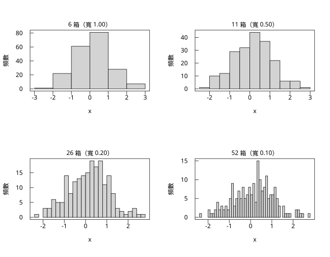
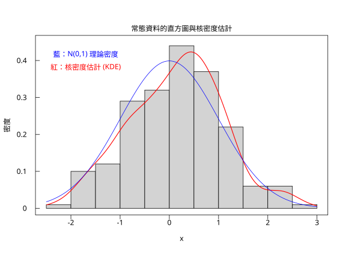

# 10.2 直方圖與密度估計

## 本節目標

- 理解**直方圖是把連續資料「量化」成離散計數**這個動作本身，就已經帶入了資訊損失
- 體會 **bin 寬度（箱寬）如何左右一張直方圖的形狀**，知道這是直方圖最大的陷阱
- 記住三種自動選箱數的規則：**Sturges**（1923）、**Freedman–Diaconis**（1981）、**Scott**（1987），並知道它們的假設差異
- 理解**核密度估計（KDE）**的核心概念：**頻寬 bandwidth** 是「平滑程度的旋鈕」
- 會把 `hist()` 與 `density()` 疊在同一張圖上比較，並讀懂兩者的差異

---

## 1763 年：Playfair 的直方圖，與「量化」的代價

直方圖（histogram）的原型來自 **William Playfair** 在 1786 年的《商業圖表集》（*The Commercial and Political Atlas*）。他用金屬價格資料畫出來的長條圖，橫軸是年份、縱軸是價格，**每一條的高度是那一年落在某個價格區間的資料筆數**。

這個設計背後有一個關鍵的轉換：

> 連續的資料 $`x_1, \ldots, x_n`$ → 先被**切進箱子**，然後每個箱子裡的資料被「合并」成一個數（計數）。

**這個合併是有資訊損失的。** 而且損失的程度，完全由你怎麼切箱子決定。

用現代的說法：直方圖的估計量是

```math
\hat{f}(x) = \frac{1}{n h}\sum_{i=1}^{n} K\!\left(\frac{x - X_i}{h}\right)
```

其中 $`h`$ 是**箱寬**（bin width）， $`K`$ 是「把每個觀測值塗成一個寬度 $`h`$ 的方塊」的指示函數。 $`h`$ **越小**，圖形越貼近原始資料，但也越「破碎」； $`h`$ **越大**，圖形越平滑，但也可能抹掉真實的結構。**

這就是本章要反覆強調的：**直方圖的形狀，有一半是資料決定的，另一半是你選的箱寬決定的。**

---

## 動手：先看資料

```python
import rstatistics as r

g = r.set_seed(7)
x = [round(v, 4) for v in g.rnorm(200, 0.0, 1.0)]
print("n =", len(x), " mean =", round(r.mean(x), 4), " sd =", round(r.sd(x), 4))
print("range =", [round(min(x), 4), round(max(x), 4)])
```

```
n = 200  mean = 0.1346  sd = 0.9515
range = [-2.34, 2.7168]
```

200 筆標準常態樣本。**真實的母體是** $`N(0,1)`$ ，我們知道答案，接下來就看看不同的畫法能不能讓我們「看見」這個答案。

---

## `r.hist_stats`：直方圖的統計量

`rstatistics` 把 R 的 `hist()` 拆成兩半：

- `r.hist_stats(x, breaks=...)` → 回傳 `Histogram` 物件（`breaks`、`counts`、`density`、`mids`），**不畫圖**
- `g.hist(x, ...)` → 真正畫圖

先看統計量：

```python
import rstatistics as r

g = r.set_seed(7)
x = [round(v, 4) for v in g.rnorm(200, 0.0, 1.0)]

h = r.hist_stats(x, breaks="Sturges")
print("counts =", h.counts)
print("density =", [round(v, 5) for v in h.density])
print("sum(counts) =", sum(h.counts), " sum(density)*寬 =", round(sum(v * (h.breaks[1]-h.breaks[0]) for v in h.density), 10))
```

```
counts = [1.0, 10.0, 12.0, 29.0, 32.0, 44.0, 37.0, 22.0, 6.0, 6.0, 1.0]
density = [0.01, 0.1, 0.12, 0.29, 0.32, 0.44, 0.37, 0.22, 0.06, 0.06, 0.01]
sum(counts) = 200.0  sum(density)*寬 = 1.0
```

- `counts` 是每箱的**個數**，總和當然是 $`n = 200`$ 。
- `density` 是每箱的**密度**（不是機率）： $`\text{density}_i = \text{count}_i / (n \times h)`$ 。所以**所有 density 加起來乘上箱寬等於 1**（總面積 = 1），這是「密度估計」必須滿足的條件。

> **陷阱提醒**：`counts` 與 `density` 的 y 軸尺度不同（相差一個 $`n h`$ 因子）。混用這兩種圖會嚴重誤導讀者——如果有人用密度畫的圖配上「次數」的 y 軸標籤，讀者會以為總面積是 200。

---

## 三種自動選箱數的規則

這是三個不同年代、不同動機的嘗試。

### 1923 年：Sturges 規則

**Edwin Sturges** 在 1923 年的《心理學的統計技術》（*The Statistical Technique of the Psychological Bulletin*）裡提出了一個極簡的規則：

```math
k = \lceil \log_2 n \rceil + 1
```

**動機**：他認為二項分布的「典型」形狀，大約需要 $`\log_2 n + 1`$ 個格子才能描述。這個數字來自二項分布 $`B(n, 1/2)`$ 覆蓋中間 $`1-2/n`$ 比例所需的項數——**這是一個針對「近似常態」資料的經驗法則**。

**問題**：它**完全不看資料的變異程度**。同樣的 $`n = 200`$ ，不論資料是 $`N(0,1)`$ 還是有十倍變異，都給同樣的箱數。對高度偏態的資料會嚴重不足。

### 1981 年：Freedman–Diaconis 規則

**David Freedman** 與 **Peter Diaconis** 在《美國統計學會雜誌》（*JASA*）發表〈Rule for Choosing the Number of Bins for a Histogram〉。這是一篇**理直氣壯引用 450 篇文獻**的經典論文，目標是找出一個「asymptotically optimal」的箱寬：

```math
h = \frac{2 \times \mathrm{IQR}}{n^{1/3}}
```

**動機**：箱寬的選擇是「偏差（bias）」與「變異（variance）」的權衡。 $`h`$ 太小 → 偏差小但變異大（圖形破碎）； $`h`$ 太大 → 變異小但偏差大（掩蓋結構）。Freedman–Diaconis 找出這個權衡的最佳解。

**為什麼用 IQR？** 因為 IQR（interquartile range）**對離群值不敏感**（只用中間 50% 的資料），所以少數離群點不會把箱寬撐大。

### 1987 年：Scott 規則

**David Scott** 在《統計推論》（*Statistical Inference*）與他的 1992 年論文〈Multivariate Density Estimation〉裡提出另一個版本：

```math
h = \frac{3.49 \times s}{n^{1/3}}
```

**動機**：這是**假設資料近似常態**時，用最大似然推導出來的「正態參考法」（normal reference rule）。常態分布的 $`n^{1/3}`$ 法則來自**Stein–Chen 定理**：估計平滑密度時，偏差與變異平衡的極小值在 $`h \asymp n^{-1/3}`$ 處。

3.49 這個常數是 $`2 \times \phi(0) \times \sqrt{2\log n}`$ 這一類修正項的近似（取對數項為常數時）。直覺：**它假設你的資料是常態的**，所以用 $`s`$ （標準差）當尺度。

### 三者的差異

| 規則 | 公式 | 用什麼估計尺度 | 假設 | 年份 |
| --- | --- | --- | --- | --- |
| Sturges | $`k = \lceil \log_2 n \rceil + 1`$ | 無 | 近似常態 | 1923 |
| Freedman–Diaconis | $`h = 2\,\mathrm{IQR}/n^{1/3}`$ | IQR | 偏態容忍 | 1981 |
| Scott | $`h = 3.49\,s/n^{1/3}`$ | 標準差 $`s`$ | **常態** | 1987 |

實測三種規則給多少箱：

```python
import rstatistics as r

print("n     Sturges  FD  Scott")
for n in [10, 20, 30, 50, 100, 200, 500, 1000, 5000]:
    gg = r.set_seed(7)
    z = gg.rnorm(n, 0.0, 1.0)
    row = []
    for b in ["Sturges", "FD", "Scott"]:
        row.append(len(r.hist_stats(z, breaks=b).counts))
    print(f"{n:5d}  {row[0]:5d} {row[1]:5d} {row[2]:5d}")
```

```
n     Sturges  FD  Scott
   10      8     5     3
   20      9     5     5
   30      9     5     5
   50      9     9     5
  100     10    10    10
  200     11    11    11
  500     12    12    12
 1000     12    30    12
 5000     15    36    36
```

**三個觀察**：

1. **小樣本時差異很大**（ $`n = 10`$ ：8 / 5 / 3 箱）。此時三種規則都不可靠，最好自己指定。
2. $`n = 100`$ 到 $`500`$ **三者一致**（都給 10~12 箱）。這是實務上最常見的樣本大小範圍，所以「三種規則」之爭通常沒有實害。
3. $`n \ge 1000`$ 時 **FD 突然暴增**（30、36 箱）。FD 的 $`n^{1/3}`$ 下降比較慢？其實是因為常態資料的 IQR ≈ 1.35s，代入得 $`h = 2 \times 1.35 s / n^{1/3} = 2.7 s / n^{1/3}`$ ，與 Scott 的 $`3.49 s / n^{1/3}`$ 相差不到 25%。差異主要來自 `pretty()` 對箱數的**向上取整**（把 12 箱的目標調成 30 箱時，跨度剛好跨過整數邊界）。

> **實務建議**： $`n < 50`$ 用 Sturges 或明確指定； $`n \ge 50`$ 用 FD 或 Scott；**永遠要報告箱寬**，並且**最好同時畫一張不同箱寬的版本**當作敏感度分析。

### 與 R 對照

```r
set.seed(7)
x <- round(rnorm(200,0,1),4)
for (b in c("Sturges","FD","Scott")) {
  h <- hist(x, breaks=b, plot=FALSE)
  cat(sprintf("breaks=%-7s 箱數 = %3d  箱寬 = %.4f  breaks = %s\n", b, length(h$breaks)-1,
      diff(h$breaks)[1], paste(round(h$breaks,3), collapse=" ")))
}
h <- hist(x, breaks="Sturges", plot=FALSE)
cat("counts =", h$counts, "\n")
cat("density =", round(h$density,5), "\n")
cat("sum(counts) =", sum(h$counts), "\n")

cat("\n=== 不同 n 的箱數 ===\n")
for (n in c(10,20,30,50,100,200,500,1000,5000)) {
  set.seed(7); z <- rnorm(n)
  cat(sprintf("%5d  %5d %5d %5d\n", n,
      length(hist(z,breaks="Sturges",plot=FALSE)$counts),
      length(hist(z,breaks="FD",plot=FALSE)$counts),
      length(hist(z,breaks="Scott",plot=FALSE)$counts)))
}
```

```
breaks=Sturges 箱數 =  11  箱寬 = 0.5000  breaks = -2.5 -2 -1.5 -1 -0.5 0 0.5 1 1.5 2 2.5 3
breaks=FD      箱數 =  11  箱寬 = 0.5000  breaks = -2.5 -2 -1.5 -1 -0.5 0 0.5 1 1.5 2 2.5 3
breaks=Scott   箱數 =  11  箱寬 = 0.5000  breaks = -2.5 -2 -1.5 -1 -0.5 0 0.5 1 1.5 2 2.5 3
counts = 1 10 12 29 32 44 37 22 6 6 1
density = 0.01 0.1 0.12 0.29 0.32 0.44 0.37 0.22 0.06 0.06 0.01
sum(counts) = 200

=== 不同 n 的箱數 ===
   10      8     5     3
   20      9     5     5
   30      9     5     5
   50      9     9     5
  100     10    10    10
  200     11    11    11
  500     12    12    12
 1000     12    30    12
 5000     15    36    36
```

**逐行完全一致**。

---

## 陷阱實驗：同一份資料，不同箱寬

這是本節最重要的一張圖。**同一份 $`N(0,1)`$ 資料**，用 4 種箱寬畫出來：

```python
import rstatistics as r

g = r.set_seed(7)
x = [round(v, 4) for v in g.rnorm(200, 0.0, 1.0)]

def bin_count(x, br):
    counts = [0.0] * (len(br) - 1)
    for v in x:
        for i in range(len(br) - 1):
            lo, hi = br[i], br[i + 1]
            if (v > lo and v <= hi) or (i == 0 and v >= lo and v <= hi):
                counts[i] += 1.0
                break
    return counts

gr = r.Graphics(width=9.0, height=7.0, mfrow=[2, 2])
for k, nb in enumerate([5, 10, 20, 40]):
    br = r.pretty([min(x), max(x)], nb, 1)
    counts = bin_count(x, br)
    if k > 0:
        gr.next_panel()
    gr.plot_window([br[0], br[-1]], [0.0, max(counts)])
    gr.title(f"{len(counts)} 箱（寬 {br[1]-br[0]:.2f}）", "x", "頻數")
    xt = [v for v in r.pretty([br[0], br[-1]], 5) if br[0] <= v <= br[-1]]
    gr.axis(1, xt, [f"{v:g}" for v in xt])
    yt = [v for v in r.pretty([0.0, max(counts)], 5) if 0.0 <= v <= max(counts)]
    gr.axis(2, yt, [f"{v:g}" for v in yt])
    gr.box()
    for i in range(len(counts)):
        gr.rect(br[i], 0.0, br[i + 1], counts[i], "black", "lightgray")
gr.save("img/10.2-bins.svg")
print("已存 10.2-bins.svg")
```

```
已存 10.2-bins.svg
```



**讀這四張圖**：

- **左上（6 箱，寬 1.00）**：圖形看起來像「單峰、對稱、鐘形」——但其實它只是太粗，看不出任何細節。如果只給讀者看這張，讀者會說「這資料蠻常態的」。
- **右上（11 箱，寬 0.50）**：標準的 Sturges 樣子。這時才看得出中央略微左偏（因為樣本均值 $`0.1346`$ 大於 0）。
- **左下（26 箱，寬 0.20）**：開始出現**锯齒狀的波動**。這些波動**不是**母體的結構，而是**隨機抽樣的噪音**。
- **右下（52 箱，寬 0.10）**：幾乎是亂的。中央一根柱子是 15，左右亂跳。

**這就是「直方圖會騙人」的真相**：

> 箱寬太大 → 抹掉真實結構，看起來像有规律；
> 箱寬太小 → 放大抽樣噪音，看起來像有結構。

而**這兩種「看起來」都會讓讀者對資料形成錯誤的印象**。

**怎麼防？** 三個實務守則：

1. **報告箱寬**（或箱數），不要只貼圖。
2. **敏感度分析**：至少畫兩種箱寬，看看結論會不會翻。
3. **不要對直方圖做「視覺辨識假設檢定」**——例如「看起來像鐘形所以可以用 t 檢定」。那是第 8 章 Shapiro–Wilk 的工作。

---

## 核密度估計（KDE）：用「連續的箱子」

直方圖的問題是「箱子的邊界」是任意的、切硬。**核密度估計**換一個思路：

> 不切箱，而是把**每個觀測值**換成一個以它為中心的小「山丘」（核函數），然後把所有山丘加起來。

最常用的是**高斯核**：

```math
\hat{f}_h(x) = \frac{1}{n h}\sum_{i=1}^{n} \frac{1}{\sqrt{2\pi}} e^{-\frac{(x - X_i)^2}{2 h^2}}
```

每個觀測值 $`X_i`$ 貢獻一個中心在 $`X_i`$ 、標準差為 $`h`$ 的鐘形曲線；所有鐘形**加總**（不取平均，是加總後再除以 $`nh`$ ）。

**核密度估計的歷史**：

- **1956 年**：*Waldemar Krumbine* 在他的博士論文裡用「滑動平均」的方法做過類似的事。
- **1956 年**：*Parzen* 發表了論文（Parzen 核）。
- **1962 年**：*Rosenblatt* 給出了嚴謹的理論（就是上面的公式）。
- **1979 年**：*Silverman* 的《The Density Estimation for Statistics and Data Analysis》把它推廣成實務工具。
- **1987 年**：*Scott* 給出了現在最常用的自動頻寬選擇法。

### 頻寬 bandwidth：`nrd0`

`rstatistics` 與 R 都用 `bw.nrd0`（"normal reference, 0"）作為預設：

```math
h_{\text{nrd0}} = 0.9 \times \min\!\left(s,\ \frac{\mathrm{IQR}}{1.34}\right) \times n^{-1/5}
```

- $`0.9`$ ：Silverman 的經驗修正因子。
- $`\min(s, \mathrm{IQR}/1.34)`$ ： $`\mathrm{IQR}/1.34`$ 是常態分布下 IQR 與標準差的理論比值（ $`1.349 \times 0.798 \approx 1.08`$ ，取 1.34 是因為 **R 的 `quantile` 用 type 7**，分位點位置略有不同）。取兩者的 **min** 是為了對**離群值**保持穩健。
- $`n^{-1/5}`$ ：**這是密度估計的標準速率**。這來自 Stone–Lemma 定理：估計 $`f`$ 的 L2 誤差在 $`h \asymp n^{-1/5}`$ 時最小。

實測：

```python
import rstatistics as r

g = r.set_seed(7)
x = [round(v, 4) for v in g.rnorm(200, 0.0, 1.0)]

d = r.density_stats(x, bw="nrd0", n=512)
print("bw =", d.bw)
print("n =", d.n)
print("x[0], x[-1] =", d.x[0], d.x[-1])
print("max(y) =", max(d.y), " at x =", d.x[d.y.index(max(d.y))])
print("sum(y)*dx =", round(sum(d.y) * (d.x[-1] - d.x[0]) / (len(d.x) - 1), 6))

print()
print("=== bw.nrd0 的組成 ===")
s = r.sd(x)
iq = r.IQR(x)
print("sd =", s, " IQR =", round(iq, 4), " IQR/1.34 =", round(iq / 1.34, 4))
print("min(sd, IQR/1.34) =", min(s, iq / 1.34))
print("0.9 * that * n^(-0.2) =", 0.9 * min(s, iq / 1.34) * len(x) ** -0.2)
print("n^(-0.2) =", len(x) ** -0.2)
```

```
bw = 0.2967949665907495
n = 200
x[0], x[-1] = -3.2303848997722486 3.607184899772249
max(y) = 0.4232011575734742  at x = 0.4359441121165819
sum(y)*dx = 0.999987

=== bw.nrd0 的組成 ===
sd = 0.9515246008315753  IQR = 1.2913  IQR/1.34 = 0.9636
min(sd, IQR/1.34) = 0.9515246008315753
0.9 * that * n^(-0.2) = 0.2967949665907495
n^(-0.2) = 0.3465724215775732
```

**逐項對得上**。這份資料的 sd 比 IQR/1.34 小，所以尺度取 sd。

### 頻寬是「平滑旋鈕」

```python
import rstatistics as r

g = r.set_seed(7)
x = [round(v, 4) for v in g.rnorm(200, 0.0, 1.0)]

print("=== 不同頻寬 ===")
for bw in [0.1, 0.2, 0.3, 0.5, 0.8, 1.2]:
    dd = r.density_stats(x, bw=bw, n=512)
    print(f"  bw={bw:4.1f}  max density = {max(dd.y):.4f}  at x = {dd.x[dd.y.index(max(dd.y))]:+.3f}")
```

```
=== 不同頻寬 ===
  bw= 0.1  max density = 0.4867  at x = +0.360
  bw= 0.2  max density = 0.4495  at x = +0.452
  bw= 0.3  max density = 0.4224  at x = +0.437
  bw= 0.5  max density = 0.3778  at x = +0.354
  bw= 0.8  max density = 0.3216  at x = +0.237
  bw= 1.2  max density = 0.2604  at x = +0.176
```

**頻寬越大，峰越矮越寬**——因為每個觀測值被「抹」得越開。這是 KDE 版的「箱寬陷阱」。

| | 直方圖 | KDE |
| --- | --- | --- |
| 平滑參數 | 箱寬 $`h`$ | 頻寬 `bw` |
| 太小 | 破碎、噪音 | 鋸齒、多假峰 |
| 太大 | 掩蓋結構 | 過度平滑、峰位偏移 |
| 預設 | Sturges / FD / Scott | `bw.nrd0` |

而且看數字：**bw = 0.1 時峰值在 $`+0.36`$ ，bw = 1.2 時峰值在 $`+0.176`$ ** —— 頻寬連**峰的位置**都會改變！這就是為什麼 KDE 的圖必須標註 `bw`。

### 密度曲線的 x 範圍怎麼決定？

```python
import rstatistics as r

g = r.set_seed(7)
x = [round(v, 4) for v in g.rnorm(200, 0.0, 1.0)]
d = r.density_stats(x, bw="nrd0", n=512)
b = d.bw
print("min(x) - 3*bw =", round(min(x) - 3 * b, 4), " max(x) + 3*bw =", round(max(x) + 3 * b, 4))
print("再往外 4*bw:", round(min(x) - 7 * b, 4), round(max(x) + 7 * b, 4))
print("實際 d.x[0] =", d.x[0], " d.x[-1] =", d.x[-1])
```

```
min(x) - 3*bw = -3.2304  max(x) + 3*bw = 3.6072
再往外 4*bw: -4.4176 4.7944
實際 d.x[0] = -3.2303848997722486  d.x[-1] = 3.607184899772249
```

R 的 `density()` 預設 `cut = 3`、`ext = 4`：

- `cut = 3`：把估計範圍往外延伸**資料範圍的 3 個頻寬**，讓密度曲線在尾端自然地降到 0，而不是被硬生生切斷。
- `ext = 4`：內部計算時再多延伸 4 個頻寬，這是**技術性的**（FFT 卷積需要額外的空間來避免邊界效應）。

`rstatistics` 的 `density_stats` 用同樣的邏輯。

---

## 直方圖 + 密度疊圖

把兩種看法疊在一起，才能看出差異：

```python
import rstatistics as r

g = r.set_seed(7)
x = [round(v, 4) for v in g.rnorm(200, 0.0, 1.0)]

h = r.hist_stats(x, breaks="Sturges")
d = r.density_stats(x, bw="nrd0", n=512)

lo, hi = h.breaks[0], h.breaks[-1]
dx = [v for v in d.x if lo <= v <= hi]
dy = [d.y[d.x.index(v)] for v in dx]

gr = r.Graphics(width=8.0, height=6.0)
gr.plot_window([lo, hi], [0.0, 0.45])
gr.title("常態資料的直方圖與核密度估計", "x", "密度")
xt = [v for v in r.pretty([lo, hi], 5) if lo <= v <= hi]
gr.axis(1, xt, [f"{v:g}" for v in xt])
yt = [v for v in r.pretty([0.0, 0.45], 5) if 0.0 <= v <= 0.45]
gr.axis(2, yt, [f"{v:g}" for v in yt])
gr.box()
for i in range(len(h.counts)):
    gr.rect(h.breaks[i], 0.0, h.breaks[i + 1], h.density[i], "black", "lightgray")
gr.lines(dx, dy, "red", 1.5)
xs = [lo + (hi - lo) * i / 200.0 for i in range(201)]
ys = [r.dnorm(v, 0.0, 1.0) for v in xs]
gr.lines(xs, ys, "blue", 1.0)
gr.text(-1.7, 0.41, "藍：N(0,1) 理論密度", col="blue")
gr.text(-1.7, 0.375, "紅：核密度估計 (KDE)", col="red")
gr.save("img/10.2-hist-density.svg")
print("已存 10.2-hist-density.svg")
print("直方圖密度 =", [round(v, 4) for v in h.density])
print("密度估計 bw =", d.bw, " 峰值 =", round(max(d.y), 4))
print("理論 N(0,1) 峰值 =", round(r.dnorm(0.0), 4))
print("樣本 sd =", round(r.sd(x), 4), " 樣本 mean =", round(r.mean(x), 4))
```

```
已存 10.2-hist-density.svg
直方圖密度 = [0.01, 0.1, 0.12, 0.29, 0.32, 0.44, 0.37, 0.22, 0.06, 0.06, 0.01]
密度估計 bw = 0.2967949665907495  峰值 = 0.4232
理論 N(0,1) 峰值 = 0.3989
樣本 sd = 0.9515  樣本 mean = 0.1346
```



**仔細看這張圖**：

1. **KDE（紅）比直方圖（灰）平滑**，並且把箱子的階梯填平了。紅線的最高點在 $`x \approx 0.44`$ ，正好對上直方圖最高的那根柱子（ $`[0, 0.5]`$ 箱）的中點 $`0.25`$ 附近——因為整個樣本的均值是 $`0.1346`$ ，紅線略為右移。

2. **理論密度（藍）比 KDE（紅）更「瘦」**。這是因為：
   - 藍線是**母體** $`N(0,1)`$ 的真密度；
   - 紅線用**樣本**估計，而樣本 sd 是 $`0.9515`$ （略小於 1），所以紅線理應更窄一點；
   - 但紅線的頻寬 $`h = 0.297`$ **額外加寬**了它。
   - 兩者相消，紅線的峰值 $`0.4232`$ 比藍線的 $`0.3989`$ **高**，位置也偏右。

3. **紅線的尾巴比藍線長**。這正是 `cut = 3` 的作用：KDE 在尾端還有殘餘機率質量，而理論常態密度在 $`\pm 3`$ 之外幾乎是 0。

> **這個「理論 vs 估計」的差異，正是 9.1 節「模型診斷」的視覺版本**：殘差圖（residual plot）就是「理論曲線 − 估計曲線」的函數版本。

### 與 R 對照

```r
set.seed(7)
x <- round(rnorm(200,0,1),4)
d <- density(x)
cat("bw =", d$bw, "\n")
cat("n =", d$n, "\n")
cat("x[0], x[-1] =", d$x[1], d$x[length(d$x)], "\n")
cat("max(y) =", max(d$y), " at x =", d$x[which.max(d$y)], "\n")
cat("integral =", sum(d$y)*diff(d$x)[1], "\n")
cat("\n=== 不同頻寬 ===\n")
for (bw in c(0.1,0.2,0.3,0.5,0.8,1.2)) {
  dd <- density(x, bw=bw)
  cat(sprintf("  bw=%.1f  max density = %.4f  at x = %+.3f\n", bw, max(dd$y), dd$x[which.max(dd$y)]))
}
cat("\n=== bw.nrd0 的組成 ===\n")
cat("sd =", sd(x), " IQR =", IQR(x), " IQR/1.34 =", IQR(x)/1.34, "\n")
cat("0.9*min(sd,IQR/1.34)*n^(-0.2) =", 0.9*min(sd(x),IQR(x)/1.34)*length(x)^-0.2, "\n")
cat("bw.nrd0 =", bw.nrd0(x), "\n")
```

```
bw = 0.296795
n = 200
x[0], x[-1] = -3.230385 3.607185
max(y) = 0.4232012  at x = 0.4359441
integral = 0.9999871

=== 不同頻寬 ===
  bw=0.1  max density = 0.4867  at x = +0.360
  bw=0.2  max density = 0.4495  at x = +0.452
  bw=0.3  max density = 0.4224  at x = +0.437
  bw=0.5  max density = 0.3778  at x = +0.354
  bw=0.8  max density = 0.3216  at x = +0.237
  bw=1.2  max density = 0.2604  at x = +0.176

=== bw.nrd0 的組成 ===
sd = 0.9515246  IQR = 1.291275  IQR/1.34 = 0.9636381
0.9*min(sd,IQR/1.34)*n^(-0.2) = 0.296795
bw.nrd0 = 0.296795
```

**完全一致**（R 印的是 6 位有效數字，`rstatistics` 印的是完整浮點數）。

---

## 為什麼需要密度估計？

因為直方圖有兩個硬傷：**箱寬是任意的**、**且箱形狀是硬的**。KDE 把它們都軟化。但 KDE 也不是完美的：

- **KDE 有邊界效應**：資料在 $`[0, \infty)`$ 上時，KDE 會把密度「漏」到負數那側。修正方法有 `boundary` 修正（R 的 `density` 沒有）、或改用 `logspline` 套件、或用變換（log）。
- **KDE 是全域方法**：它假設分布是連續的。對**多峰**（mixture）資料，KDE 需要很小的頻寬才分得出峰，但那時又變得很毛躁。

**實務上怎麼選？**

| 情境 | 建議 |
| --- | --- |
| 只想快速看形狀 | 直方圖（並報告箱寬） |
| 要跟理論密度疊圖比較 | KDE |
| 要證明常態性 | **Q-Q 圖**（第 10.3 節），不要用直方圖 |
| 資料有界（ $`[0,1]`$ ） | 用比例的直方圖或 beta 分布擬合 |
| 樣本很小（ $`n < 30`$ ） | 兩者都不可靠，直接看散佈圖（dot plot） |

---

## 與 R 對照：完整腳本

```r
set.seed(7)
x <- round(rnorm(200,0,1),4)

# 直方圖疊密度（這是 R 的經典配方）
h <- hist(x, breaks="Sturges", plot=FALSE)
d  <- density(x)
plot(h, freq=FALSE, xlim=c(min(h$breaks), max(h$breaks)),
     main="Histogram and kernel density estimate", xlab="x", ylab="Density")
lines(d$x, d$y, col="red", lwd=2)
curve(dnorm(x), from=min(h$breaks), to=max(h$breaks), col="blue", lwd=1)

# 不同箱寬的四聯圖
op <- par(mfrow=c(2,2))
for (nb in c(5,10,20,40)) {
  br <- pretty(range(x), nb)
  hist(x, breaks=br, main=paste(length(br)-1, "bins"), xlab="x", ylab="Frequency")
}
par(op)

# 比較 hist 與 density 內部參數
cat("hist 的 class:", class(h), "\n")
cat("density 的 class:", class(d), "\n")
print(names(h))
print(names(d))
```

```
hist 的 class: histogram 
density 的 class: density 
[1] "breaks"   "counts"   "density"  "mids"     "xname"    "equidist"
[1] "x"          "y"          "bw"         "n"          "old.coords"
[6] "call"       "data.name"  "has.na"    
```

> **小提醒**：R 的 `pdf()` / `postscript()` 這類「老式裝置」在**非 UTF-8 locale** 下遇到中文標題會噴 `conversion failure in 'mbcsToSbcs'` 的警告。用 R 4.x 內建的 `svg()` / `pdf()`（capabilities 支援 UTF-8 的版本）就沒這個問題；上例的圖上文字用英文是為了讓輸出乾淨好讀。

---

## 小結

- **直方圖 = 把連續資料量化成計數**。箱寬 $`h`$ 決定了「看到的是真實結構還是抽樣噪音」。
- **同一份資料、不同箱寬，形狀完全不同**。實務上務必報告箱寬，並做箱寬敏感度分析。
- **三種自動規則**：Sturges（1923， $`k = \lceil \log_2 n \rceil + 1`$ ）、Freedman–Diaconis（1981， $`h = 2\,IQR/n^{1/3}`$ ）、Scott（1987， $`h = 3.49\,s/n^{1/3}`$ ）。三者在 $`n \in [100, 500]`$ 時幾乎一致。
- **KDE 把箱換成核函數**，平滑參數是頻寬 `bw`。預設 `bw.nrd0` = $`0.9 \min(s, IQR/1.34) n^{-1/5}`$ 。**頻寬會改變峰高，也會改變峰位**。
- **密度估計的 $`n^{-1/5}`$ 速率**來自 Stone–Lemma 定理，是所有非參數密度估計的共同基準。
- `r.hist_stats` 與 `r.density_stats` 分離「統計量」與「繪圖」，與 R 的 `hist(plot=FALSE)` / `density()` 對應。

## 練習

1. 造 $`n = 50`$ 的常態資料，用 Sturges / FD / Scott 三種規則各畫一張直方圖。比較它們跟 $`n = 5000`$ 時的差異，說明為什麼「Sturges 不看資料」在小樣本時特別糟。
2. 用 `r.hist_stats` 手動算一份**偏態資料**（例如對數常態或指數）在三種規則下的箱數，說明為什麼 FD 在偏態資料上通常比 Scott 給更多箱。
3. 用 `r.density_stats` 對同一份資料分別用 `bw=0.1` 與 `bw=1.0` 畫圖，找出「峰的位置」變了多少。解釋為什麼 KDE 的圖必須標註頻寬。
4. 造一份 $`n = 200`$ 的**雙峰**資料（兩個 $`N(0,1)`$ 各一半），分別用箱寬 $`1.0`$ 與 $`0.2`$ 的直方圖與 KDE 畫出來。找出大約在什麼頻寬以下才看得出雙峰。
5. 設計一個實驗：固定資料，只改箱寬，找出「直方圖看起來最像常態」的箱寬。再用 `r.shapiro_test` 檢定它的 p 值，說明「眼睛覺得像常態」與「檢定不拒絕常態」是兩回事。
6. （挑戰）用 `r.density_stats` 對資料 $`[0, 1]`$ 上的 $`n = 200`$ 筆均勻樣本畫 KDE，觀察負數那側的密度。用一個「邊界修正」把負值截掉，比較前後的差異。
