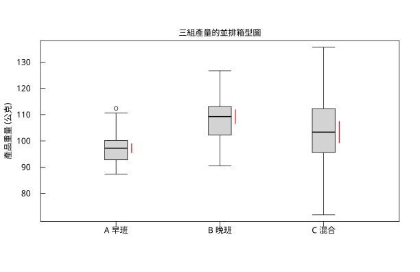
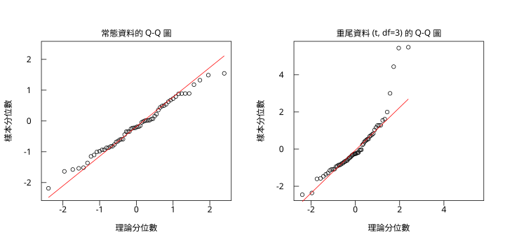
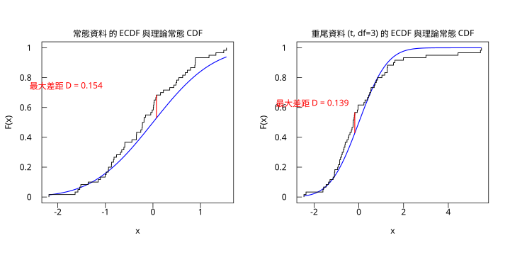
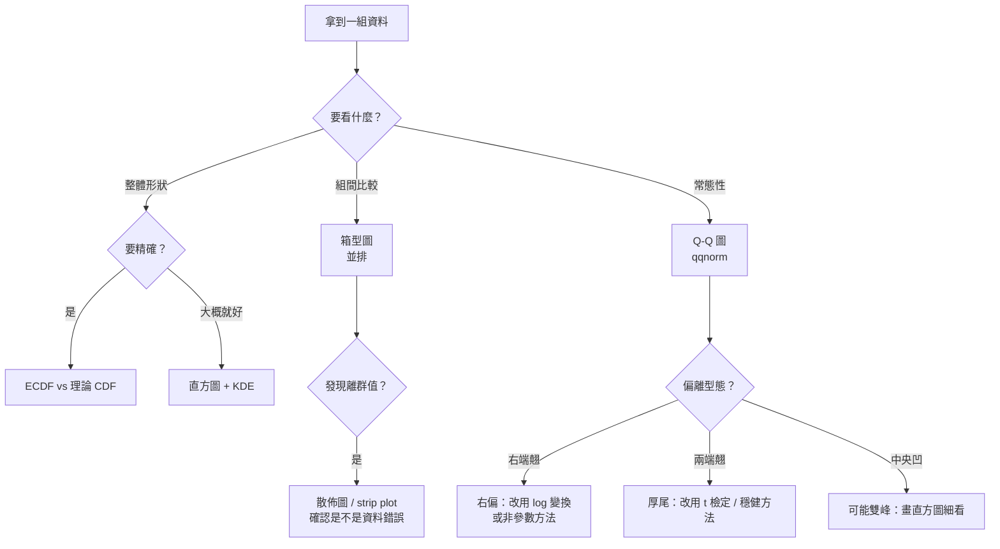

# 10.3 箱型圖、Q-Q 圖與 ECDF

## 本節目標

- 理解**箱型圖**的五數摘要、鬚線規則與離群值判定（ $`1.5 \times IQR`$ ），以及它**看不到**什麼
- 會畫**多組並排的箱型圖**，用來做組間比較（比疊加散佈圖更省空間）
- 掌握 **Q-Q 圖**的原理：把**理論分位數**對上**樣本分位數**，並會解讀「點偏離直線」的各種型態
- 理解 **ECDF** 是「分布函數的經驗版本」，並把它與第 8 章的 **KS 檢定**連起來
- 記住 ppoints 的**繪圖位置**為什麼不是簡單的 $`i/n`$

---

## 1970 年：Tukey 的「探索性資料分析」（Exploratory Data Analysis）

**John Tukey** 在 1977 年發表《探索性資料分析》（*Exploratory Data Analysis*）時說了一句名言：

> 「我prefer 期待驚喜（I prefer to expect surprises）……顯示資料本身，而不是證明我的假設。」

在那之前，統計的主流是「假設檢定文化」：先有假設，再收集資料，再做檢定。Tukey 主張在假設之前，先**用圖看資料**。

他最愛的工具就是**箱型圖（boxplot）**。但箱型圖不是 Tukey 發明的——概念來自 **Mary Eleanor Spear** 與 **David Hoaglin** 在 1970 年左右為美國國防部的「探索性資料分析」計畫（之後寫成 *Understanding Robust and Exploratory Data Analysis*，1983）所整理的「五數摘要」（five-number summary）。Tukey 把它推廣成全世界統計家的標準工具。

五數摘要 $`\big(x_{(1)}, x_{(2)}, x_{(3)}, x_{(4)}, x_{(5)}\big)`$ 是：

1. 最小值
2. 第一四分位數 $`Q_1`$
3. 中位數 $`Q_2`$
4. 第三四分位數 $`Q_3`$
5. 最大值

**箱型圖**就是把這五個數畫成一個箱子加兩根鬚線。

---

## 箱型圖的統計量：`r.boxplot_stats`

```python
import rstatistics as r

g = r.set_seed(11)
a = [round(v, 4) for v in g.rnorm(40, 100.0, 8.0)]
b = [round(v, 4) for v in g.rnorm(40, 108.0, 8.0)]
c = [round(v, 4) for v in g.rnorm(40, 104.0, 14.0)]

for name, v in [("A", a), ("B", b), ("C", c)]:
    s = r.summary(v)
    print(name, "mean =", round(r.mean(v), 3), "sd =", round(r.sd(v), 3),
          "median =", r.median(v), "IQR =", round(r.IQR(v), 3))

print()
for name, v in [("A", a), ("B", b), ("C", c)]:
    bs = r.boxplot_stats(v)
    print(f"{name}: stats = {[round(q,3) for q in bs.stats]}  conf = {[round(q,3) for q in bs.conf]}  out = {len(bs.out)}")
```

```
A mean = 97.443 sd = 6.197 median = 97.21555000000001 IQR = 7.215
B mean = 108.292 sd = 7.641 median = 109.26304999999999 IQR = 10.362
C mean = 103.865 sd = 14.17 median = 103.327 IQR = 16.692

A: stats = [87.38, 92.784, 97.216, 100.156, 110.589]  conf = [95.374, 99.057]  out = 1
B: stats = [90.506, 102.192, 109.263, 113.066, 126.718]  conf = [106.547, 111.979]  out = 0
C: stats = [71.815, 95.538, 103.327, 112.277, 135.662]  conf = [99.145, 107.509]  out = 0
```

`BoxplotStats` 物件的欄位：

| 欄位 | 意義 |
| --- | --- |
| `stats` | 五數摘要（若存在離群值，`stats[0]` 與 `stats[4]` 會被改成「鬚線內的極值」） |
| `conf` | **中位數的信賴區間**（不是箱子的上下緣！） |
| `out` | 離群值列表 |
| `lower` / `upper` | 鬚線的下端 / 上端 |
| `n` | 樣本數 |

**鬚線的規則**（R 的 `boxplot.stats`）：

1. 算 $`\mathrm{IQR} = Q_3 - Q_1`$ 。
2. 「低門檻」 $`= Q_1 - 1.5 \times \mathrm{IQR}`$ ，「高門檻」 $`= Q_3 + 1.5 \times \mathrm{IQR}`$ 。
3. **鬚線延伸到門檻之內最遠的資料點**（不是延伸到門檻本身）。
4. 門檻之外的點畫成獨立的點，稱為 **離群值（outliers）**。

> **為什麼是 1.5？** 這個數字來自 John Tukey 對「分布的合理範圍」的經驗判斷：在常態分布下， $`Q_3 + 1.5\,IQR`$ **大約對應** $`\bar{x} + 2.7\sigma`$ 。所以對常態資料， $`1.5 IQR`$ 的規則**很少**標記出真正的離群值（常態資料的最大值大約在 $`\bar{x} + 2.5\sigma`$ 附近）。**它是一個「用來找極端值」的篩子，不是「常態性檢定」**。對偏態資料，這個規則會把右尾的正常點也標成離群值——這正是它該做的事（提醒你資料偏態）。

**`conf` 是中位數的信賴區間**，由 Tukey 的**次序統計量（order statistics）**方法算出，R 用的是近似式：

```math
\text{CI} = \tilde{x} \pm 1.58 \times \frac{\mathrm{IQR}}{\sqrt{n}}
```

這個 $`1.58`$ 來自 $`1.96 / 1.253`$ 的**比值** —— 用常態近似把「中位數的標準誤 $`1.253\,s/\sqrt{n}`$ 」（對常態分布）換成用 IQR 估計的 $`s`$ 。它比平均值的信賴區間**短得多**，因為中位數的效率（efficiency）低於平均值。

---

## 多組並排箱型圖

單組箱型圖用 `g.boxplot(x)` 即可。但要**比較三組**，就得自己組裝：

```python
import rstatistics as r

g = r.set_seed(11)
a = [round(v, 4) for v in g.rnorm(40, 100.0, 8.0)]
b = [round(v, 4) for v in g.rnorm(40, 108.0, 8.0)]
c = [round(v, 4) for v in g.rnorm(40, 104.0, 14.0)]

grp = [("A 早班", a), ("B 晚班", b), ("C 混合", c)]
stats = [r.boxplot_stats(v) for _, v in grp]

for (name, v), s in zip(grp, stats):
    print(f"{name}: 五數 = {[round(q,3) for q in s.stats]}  鬚線內 = [{s.stats[0]:.3f}, {s.stats[4]:.3f}]  離群 = {[round(o,3) for o in s.out]}")

lo = min(s.stats[0] for s in stats)
hi = max(s.stats[4] for s in stats)

gr = r.Graphics(width=8.5, height=5.5)
gr.plot_window([0.4, 3.6], [lo, hi])
gr.title("三組產量的並排箱型圖", "", "產品重量 (公克)")
xt = [1.0, 2.0, 3.0]
gr.axis(1, xt, ["A 早班", "B 晚班", "C 混合"])
yt = [v for v in r.pretty([lo, hi], 5) if lo <= v <= hi]
gr.axis(2, yt, [f"{v:g}" for v in yt])
gr.box()

for i, ((name, v), s) in enumerate(zip(grp, stats)):
    xc = float(i + 1)
    bw = 0.22
    # 鬚線
    gr.segments([xc], [s.stats[0]], [xc], [s.stats[1]], "black")
    gr.segments([xc], [s.stats[3]], [xc], [s.stats[4]], "black")
    gr.segments([xc - bw / 2], [s.stats[0]], [xc + bw / 2], [s.stats[0]], "black")
    gr.segments([xc - bw / 2], [s.stats[4]], [xc + bw / 2], [s.stats[4]], "black")
    # 箱子
    gr.rect(xc - bw / 2, s.stats[1], xc + bw / 2, s.stats[3], "black", "lightgray")
    # 中位數
    gr.segments([xc - bw / 2], [s.stats[2]], [xc + bw / 2], [s.stats[2]], "black", 2.0)
    # 離群點
    for o in s.out:
        gr.points([xc], [o], pch=1, col="black")
    # 中位數信賴區間
    gr.segments([xc + bw / 2 + 0.04], [s.conf[0]], [xc + bw / 2 + 0.04], [s.conf[1]], "red", 1.5)
gr.save("img/10.3-box-groups.svg")
print("已存 10.3-box-groups.svg")
```

```
A 早班: 五數 = [87.38, 92.784, 97.216, 100.156, 110.589]  鬚線內 = [87.380, 110.589]  離群 = [112.364]
B 晚班: 五數 = [90.506, 102.192, 109.263, 113.066, 126.718]  鬚線內 = [90.506, 126.718]  離群 = []
C 混合: 五數 = [71.815, 95.538, 103.327, 112.277, 135.662]  鬚線內 = [71.815, 135.662]  離群 = []
已存 10.3-box-groups.svg
```



**這張圖說了什麼？**

- **A 早班 vs B 晚班**：B 的箱子**整體上移**約 11 公克，兩個箱子的高度（IQR）接近。**位置差異**是顯眼的。
- **A 的紅色小線段（中位數信賴區間）與 B 的完全不重疊** —— 這就是第 10.5 節會做的 t 檢定的圖形版本。
- **C 混合組**：箱子**又高又寬**，鬚線長得多。它同時混進了 A 與 B 的資料，所以變異被放大。這提醒我們：**箱型圖把「組內變異」視覺化**，這是它相對於平均數條形圖的最大優點。
- **A 有一個離群點**（ $`112.364`$ 公克），在箱子右上方。

### 箱型圖看不到什麼？

這是箱型圖最重要的限制：

| 看不到 | 例子 |
| --- | --- |
| **多峰性** | 資料是兩個等高的峰，箱型圖會顯示一個「很寬的箱子」，完全看不出雙峰 |
| **分布形狀細節** | 偏態與對稱但離散的資料，箱型圖可能一樣 |
| **樣本大小** | $`n = 5`$ 與 $`n = 5000`$ 的箱子長得一樣 |
| **離群點有幾個、離得多遠** | 只知道「有離群點」，不知道嚴重性 |

**實務上**：箱型圖是**比較**的好工具（比較組與組），**探索**要配合散佈圖（strip plot / beeswarm）或直方圖。

---

## 與 R 對照：箱型圖

```r
set.seed(11)
a <- round(rnorm(40,100,8),4)
b <- round(rnorm(40,108,8),4)
c <- round(rnorm(40,104,14),4)
for (nm in c("A","B","C")) {
  v <- switch(nm, A=a, B=b, C=c)
  bs <- boxplot.stats(v)
  cat(sprintf("%s: stats = %s  conf = %s  out = %s\n", nm,
      paste(round(bs$stats,3), collapse=" "), paste(round(bs$conf,3), collapse=" "),
      paste(round(bs$out,3), collapse=" ")))
}
cat("\n=== summary ===\n")
for (nm in c("A","B","C")) {
  v <- switch(nm, A=a, B=b, C=c)
  cat(sprintf("%s mean = %.3f sd = %.3f median = %.3f IQR = %.3f\n", nm, mean(v), sd(v), median(v), IQR(v)))
}
```

```
A: stats = 87.38 92.784 97.216 100.156 110.589  conf = 95.374 99.057  out = 112.364
B: stats = 90.506 102.192 109.263 113.066 126.718  conf = 106.547 111.979  out = 
C: stats = 71.815 95.538 103.327 112.277 135.662  conf = 99.145 107.509  out = 

=== summary ===
A mean = 97.443 sd = 6.197 median = 97.216 IQR = 7.215
B mean = 108.292 sd = 7.641 median = 109.263 IQR = 10.362
C mean = 103.865 sd = 14.170 median = 103.327 IQR = 16.692
```

**完全一致**。

---

## Q-Q 圖：把分布「攤平」來看

### 1961 年：Q-Q 圖的原理

Q-Q 圖的想法很直覺：

> 如果樣本真的來自某個分布 $`F`$ ，那麼**樣本分位數**應該等於**理論分位數**。

具體做法：

1. 把樣本排序： $`x_{(1)} \le x_{(2)} \le \cdots \le x_{(n)}`$ 。
2. 給每個位置一個**繪圖位置（plotting position）** $`p_i`$ 。
3. 計算理論分位數 $`z_i = F^{-1}(p_i)`$ 。
4. 把 $`(z_i, x_{(i)})`$ 畫成散點。

**如果樣本來自 $`F`$ ，這些點就會沿著直線排列。** 反之，點的偏離型態就告訴你 $`F`$ 錯在哪裡。

### 繪圖位置：`ppoints`

```python
import rstatistics as r

print("=== ppoints ===")
print("ppoints(10) =", [round(v, 4) for v in r.ppoints(10)])
print("ppoints(5)  =", [round(v, 4) for v in r.ppoints(5)])
print("ppoints(60) 的前後三個 =", [round(v, 4) for v in r.ppoints(60)[:3]], [round(v, 4) for v in r.ppoints(60)[-3:]])
```

```
=== ppoints ===
ppoints(10) = [0.061, 0.1585, 0.2561, 0.3537, 0.4512, 0.5488, 0.6463, 0.7439, 0.8415, 0.939]
ppoints(5)  = [0.119, 0.3095, 0.5, 0.6905, 0.881]
ppoints(60) 的前後三個 = [0.0083, 0.025, 0.0417] [0.9583, 0.975, 0.9917]
```

R 的 `ppoints(n)` 用的是：

```math
p_i = \frac{i - a}{n + 1 - 2a}, \quad a = \begin{cases} 0.5 & n > 10 \\ 0.375 & n \le 10 \end{cases}
```

**為什麼不是簡單的 $`i/n`$ ？**

- $`i/n`$ 會讓第一點剛好落在 $`p = 1/n`$ ，最後一點落在 $`p = 1`$ —— **理論分位數是無限大的**。Q-Q 圖會有一個點飛到看不見的地方。
- 用 $`a = 0.5`$ 時， $`p_1 = 0.5/(n+1)`$ 、 $`p_n = (n-0.5)/(n+1)`$ ，兩端都留了餘裕。
- $`n \le 10`$ 時用 $`a = 0.375`$ ：這是 **Blom** 的建議， $`0.375 = 3/8`$ 讓期望順序統計量的位置更準確。
- $`a = 0.5`$ 對應的是 **Hazen** 的繪圖位置。

另外還有 **Weibull**（ $`a = 0`$ ）與 **Cunnane**（ $`a = 0.3`$ ）等選擇。R 讓你用 `ppoints(n, a)` 指定。

### `r.qqnorm_coords`：理論分位 vs 樣本分位

```python
import rstatistics as r

g = r.set_seed(11)
norm = [round(v, 4) for v in g.rnorm(60, 0.0, 1.0)]
heavy = [round(v, 4) for v in g.rt(60, df=3)]

for name, v in [("常態", norm), ("重尾 t(3)", heavy)]:
    t, s = r.qqnorm_coords(v)
    print(f"--- {name} ---")
    print("  理論分位前三:", [round(q, 4) for q in t[:3]], " 樣本分位前三:", [round(q, 4) for q in s[:3]])
    print("  理論分位後三:", [round(q, 4) for q in t[-3:]], " 樣本分位後三:", [round(q, 4) for q in s[-3:]])
    qx = r.quantile(t, [0.25, 0.75])
    qy = r.quantile(s, [0.25, 0.75])
    slope = (qy[1] - qy[0]) / (qx[1] - qx[0])
    icept = qy[0] - slope * qx[0]
    print(f"  qqline: slope = {slope:.4f}, intercept = {icept:.4f}")
    print(f"  樣本 sd = {r.sd(v):.4f}")
    print(f"  左端 (i=1): 理論 {t[0]:.3f} 樣本 {s[0]:.3f} 差距 {s[0]-t[0]:+.3f}")
    print(f"  右端 (i=n): 理論 {t[-1]:.3f} 樣本 {s[-1]:.3f} 差距 {s[-1]-t[-1]:+.3f}")
    hs = r.shapiro_test(v)
    print(f"  Shapiro: W = {hs.statistic:.4f}, p = {hs.p_value:.4g}")
```

```
--- 常態 ---
  理論分位前三: [-2.394, -1.96, -1.7317]  樣本分位前三: [-2.1868, -1.6365, -1.5775]
  理論分位後三: [1.7317, 1.96, 2.394]  樣本分位後三: [1.3236, 1.4879, 1.5456]
  qqline: slope = 0.9607, intercept = -0.1854
  樣本 sd = 0.8330
  左端 (i=1): 理論 -2.394 樣本 -2.187 差距 +0.207
  右端 (i=n): 理論 2.394 樣本 1.546 差距 -0.848
  Shapiro: W = 0.9895, p = 0.8884
--- 重尾 t(3) ---
  理論分位前三: [-2.394, -1.96, -1.7317]  樣本分位前三: [-2.455, -2.3613, -1.6047]
  理論分位後三: [1.7317, 1.96, 2.394]  樣本分位後三: [4.4352, 5.4379, 5.4829]
  qqline: slope = 1.1523, intercept = -0.0649
  樣本 sd = 1.5554
  左端 (i=1): 理論 -2.394 樣本 -2.455 差距 -0.061
  右端 (i=n): 理論 2.394 樣本 5.483 差距 +3.089
  Shapiro: W = 0.8543, p = 4.083e-06
```

**`qqnorm_coords` 回傳的是什麼？**

- 第一個：理論分位數 $`z_1 \le z_2 \le \cdots \le z_n`$ （由 `ppoints` 對 `qnorm` 得出，**由小到大**）。
- 第二個：**排序後的樣本** $`x_{(1)} \le \cdots \le x_{(n)}`$ 。

所以第 $`i`$ 個配對就是「 $`i`$ 小的理論分位」對「 $`i`$ 小的觀測值」。

### `qqline`：參考線

R 的 `qqline` 畫的是一條**穿過四分位數**的直線：

```math
\text{slope} = \frac{Q_3(y) - Q_1(y)}{Q_3(x) - Q_1(x)}, \quad \text{intercept} = Q_1(y) - \text{slope} \cdot Q_1(x)
```

也就是說，它只用**四個點**（ $`Q_1, Q_3`$ 兩組）來決定這條線，所以**對離群值非常穩健**。它的主要用途是**視覺參考**：點大致貼著它 = 分布相近。

> **一個容易搞混的地方**：`qqline` 的斜率與截距**不等於**母體的 $`\sigma`$ 與 $`\mu`$ 。
>
> 原因是它是用**四分位數**算的，與樣本的 sd、mean 只是近似關係。實測：
>
```r
for (s in c(1,2,3,11,42)) {
  set.seed(s)
  v <- round(rnorm(60,0,1),4)
  q <- qqnorm(v, plot.it=FALSE)
  qx <- quantile(q$x, c(0.25,0.75)); qy <- quantile(q$y, c(0.25,0.75))
  slope <- (qy[2]-qy[1])/(qx[2]-qx[1]); icept <- qy[1]-slope*qx[1]
  cat(sprintf("seed=%2d  qqline slope=%.4f intercept=%.4f | mean=%.4f sd=%.4f\n",
      s, slope, icept, mean(v), sd(v)))
}
```
>
```
seed= 1  qqline slope=0.8364 intercept=0.1539 | mean=0.1076 sd=0.8552
seed= 2  qqline slope=1.2009 intercept=0.1529 | mean=0.0968 sd=1.1583
seed= 3  qqline slope=1.1549 intercept=-0.0342 | mean=-0.1026 sd=0.9134
seed=11  qqline slope=0.9607 intercept=-0.1854 | mean=-0.1904 sd=0.8330
seed=42  qqline slope=0.9543 intercept=0.0147 | mean=-0.0267 sd=1.1513
```
>
> 斜率與 sd 的差距可以到 20%。**如果你真的想要用圖形估計 $`\mu, \sigma`$ ，該用的是「以理論分位數為 x、樣本分位數為 y 的最小平準回歸」**，而不是 `qqline`。
>
> 這個回歸有一個漂亮的定理：**對常態母體，最小平準回歸的斜率恰好是** $`\hat\sigma`$ ，**截距恰好是** $`\hat\mu`$ 。理由是常態母體的樣本分位數滿足 $`x_{(i)} \approx \mu + \sigma z_i`$ （ $`z_i`$ 為理論分位數），這是一條**通過原點斜率 $`\sigma`$ ** 的直線，所以最小平準回歸會找回它。實測也確實如此：
>
```python
import rstatistics as r
>
g = r.set_seed(11)
norm = [round(v, 4) for v in g.rnorm(60, 0.0, 1.0)]
t, s = r.qqnorm_coords(norm)
n = len(t)
mt = r.mean(t)
ms = r.mean(s)
slope = sum((a - mt) * (b - ms) for a, b in zip(t, s)) / sum((a - mt) ** 2 for a in t)
print("OLS slope =", round(slope, 6), " OLS intercept =", round(ms - slope * mt, 6))
print("樣本 sd =", round(r.sd(norm), 6), " 樣本 mean =", round(r.mean(norm), 6))
```
>
```
OLS slope = 0.831427  OLS intercept = -0.190417
樣本 sd = 0.833005  樣本 mean = -0.190417
```
>
> 斜率 $`0.8314`$ 對 $`\hat\sigma = 0.8330`$ ，截距 $`-0.190417`$ **完全等於**樣本均值。

### 畫出來：常態 vs 重尾

```python
import rstatistics as r

g = r.set_seed(11)
norm = [round(v, 4) for v in g.rnorm(60, 0.0, 1.0)]
heavy = [round(v, 4) for v in g.rt(60, df=3)]

gr = r.Graphics(width=10.0, height=5.0, mfrow=[1, 2])

# 面板 1：常態
gr.qqnorm(norm, main="常態資料的 Q-Q 圖", xlab="理論分位數", ylab="樣本分位數")
gr.qqline(norm, col="red")

# 面板 2：重尾
gr.next_panel()
gr.qqnorm(heavy, main="重尾資料 (t, df=3) 的 Q-Q 圖", xlab="理論分位數", ylab="樣本分位數")
gr.qqline(heavy, col="red")

gr.save("img/10.3-qqnorm.svg")
print("已存 10.3-qqnorm.svg")
```

```
已存 10.3-qqnorm.svg
```



**解讀這兩張圖**：

**左圖（常態 $`N(0,1)`$ 的 60 筆抽樣）**：

- 點**大致沿著紅線排列**，但**系統性地偏離**：
  - **左端（p ≈ 0.008）**在紅線**上方**（ $`-2.187`$ vs 理論 $`-2.394`$ ）；
  - **右端（p ≈ 0.992）**在紅線**下方**（ $`1.546`$ vs 理論 $`2.394`$ ）。
- 這是**抽樣誤差**：這份樣本的實際 sd 是 $`0.833`$ ，比母體的 1 小。**分位數之間的距離被壓縮了**，所以兩端的點往中間靠。
- 這就是為什麼 `qqline` 的**斜率不等於 1**：slope = $`0.9607`$ 是一個**穩健**的估計值，它比樣本 sd（ $`0.833`$ ）大，但仍反映了「樣本比母體窄」這件事。
- Shapiro-Wilk： $`W = 0.9895`$ ， $`p = 0.8884`$ → **完全不拒絕常態**。

**右圖（重尾 $`t_3`$ 的 60 筆抽樣）**：

- **右端 6 個點嚴重往上翹**（最高到 $`5.48`$ ，而理論只到 $`2.394`$ ）。這是**厚尾（heavy tail）**的典型signature：分布的尾部比常態厚得多。
- 左端稍微往下（ $`-2.455`$ vs $`-2.394`$ ），但因為 $`t_3`$ 是**對稱**的，左右兩端都應該翹——這裡只是右端的抽樣值特別大。
- Shapiro-Wilk： $`W = 0.8543`$ ， $`p = 4.08 \times 10^{-6}`$ → **強烈拒絕常態**。

### Q-Q 圖的「指紋」速查表

| 看到的型態 | 可能的分布特性 |
| --- | --- |
| 整條線**呈 S 形**（中央凹、兩端凸出） | 資料比常態**更集中**（uniform 或雙峰的近似） |
| 右端**往上翹** | **右偏 / 長右尾**（對數常態、指數、gamma） |
| 左端**往下掉** | **左偏 / 長左尾** |
| **兩端都翹** | **厚尾**（t 分布、Cauchy） |
| **兩端都掉、中間鼓** | **薄尾**（bounded / uniform） |
| 整條線**斜率 ≠ 1 但形狀直** | 只是**尺度不對**（sd 不同），分布**沒問題** |
| 整條線**偏移**（intercept ≠ 0） | 只是**位置不對**（均值不同） |

> **關鍵**：**先看「形狀」，再看「斜率與截距」**。斜率與截距只是尺度與位置的問題；形狀才是分布族對不對的問題。

### 與 R 對照

```r
set.seed(11)
norm <- round(rnorm(60,0,1),4)
heavy <- round(rt(60,df=3),4)

cat("=== ppoints ===\n")
cat("ppoints(10) =", round(ppoints(10),4), "\n")
cat("ppoints(5)  =", round(ppoints(5),4), "\n")

cat("\n=== qqnorm 的結構 ===\n")
q <- qqnorm(norm, plot.it=FALSE)
cat("names:", names(q), " length(q$x) =", length(q$x), " length(q$y) =", length(q$y), "\n")
cat("sort(q$x) 前三（= rstatistics 的理論分位）:", round(head(sort(q$x),3),4), "\n")
cat("sort(q$y) 前三:", round(head(sort(q$y),3),4), "\n")
cat("sorted y 後三:", round(tail(sort(q$y),3),4), "\n")
cat("heavy sorted y 後三:", round(tail(sort(heavy),4),4), "\n")

cat("\n=== qqline ===\n")
qq_manual <- function(v) {
  n <- length(v); p <- ppoints(n)
  list(x = qnorm(p), y = sort(v))
}
qqline_manual <- function(v) {
  q <- qq_manual(v)
  qx <- quantile(q$x, c(0.25,0.75)); qy <- quantile(q$y, c(0.25,0.75))
  slope <- (qy[2]-qy[1])/(qx[2]-qx[1])
  list(slope = slope, intercept = qy[1] - slope*qx[1])
}
cat("qqline(norm): slope =", qqline_manual(norm)$slope, " intercept =", qqline_manual(norm)$intercept, "\n")
cat("qqline(heavy): slope =", qqline_manual(heavy)$slope, " intercept =", qqline_manual(heavy)$intercept, "\n")

cat("\n=== sd & shapiro ===\n")
cat("sd(norm) =", sd(norm), "\n")
cat("Shapiro(norm): W =", shapiro.test(norm)$statistic, " p =", shapiro.test(norm)$p.value, "\n")
cat("Shapiro(heavy): W =", shapiro.test(heavy)$statistic, " p =", shapiro.test(heavy)$p.value, "\n")
```

```
=== ppoints ===
ppoints(10) = 0.061 0.1585 0.2561 0.3537 0.4512 0.5488 0.6463 0.7439 0.8415 0.939
ppoints(5)  = 0.119 0.3095 0.5 0.6905 0.881

=== qqnorm 的結構 ===
names: x y  length(q$x) = 60  length(q$y) = 60
sort(q$x) 前三（= rstatistics 的理論分位）: -2.394 -1.96 -1.7317
sort(q$y) 前三: -2.1868 -1.6365 -1.5775
sorted y 後三: 1.3236 1.4879 1.5456
heavy sorted y 後三: 3.0001 4.4352 5.4379 5.4829

=== qqline ===
qqline(norm): slope = 0.960729  intercept = -0.18535
qqline(heavy): slope = 1.152289  intercept = -0.0648625

=== sd & shapiro ===
sd(norm) = 0.8330054
Shapiro(norm): W = 0.9895462  p = 0.8884449
Shapiro(heavy): W = 0.8542791  p = 4.083211e-06
```

**逐行一致**（slope / intercept 的末位差異只是印出位數）。

> **一個重要的實作差異**：R 的 `qqnorm()` 回傳的 `x` 是**依原始資料順序**排列的理論分位（`qnorm(ppoints(n))[order(order(y))]`），而 `y` 是**未排序**的原始資料。`rstatistics` 的 `r.qqnorm_coords` 直接回傳**兩個都排序好的**序列。**畫出來的散點完全相同**，但若要拿 `q$x`、`q$y` 去做數值比較，要注意 R 需要先 `sort()`。

---

## ECDF：分布函數的經驗版本

### 為什麼要有 ECDF？

第 8 章講過：**KS 檢定**比較的是兩條 ECDF 的最大垂直距離。而 ECDF 本身也是**探索資料**最有效的工具之一，因為它：

- **完全沒有平滑參數**（不像 KDE 有頻寬、直方圖有箱寬）；
- **顯示整個分布**（不只是五數摘要）；
- 對**離群值**敏感（ECDF 的尾巴直接顯示出來）。

**ECDF 的定義**（第 8 章已出現）：

```math
\hat{F}_n(t) = \frac{1}{n}\sum_{i=1}^{n} \mathbb{1}\{x_i \le t\}
```

### `r.ecdf` 與 `g.ecdf`

```python
import rstatistics as r

g = r.set_seed(11)
norm = [round(v, 4) for v in g.rnorm(60, 0.0, 1.0)]

gr = r.Graphics(width=6.0, height=5.0)
e = gr.ecdf(norm, main="g.ecdf 畫出的經驗分布函數", xlab="x", ylab="F(x)")
print("e =", e)
print("e.n =", e.n)
print("e.x[:5] =", [round(v, 4) for v in e.x[:5]])
print("e.y[:5] =", [round(v, 4) for v in e.y[:5]])
print("e.x[-3:] =", [round(v, 4) for v in e.x[-3:]])
print("e.y[-3:] =", [round(v, 4) for v in e.y[-3:]])
```

```
e = ECDF of 60 observations
e.n = 60
e.x[:5] = [-2.1868, -1.6365, -1.5775, -1.5383, -1.5166]
e.y[:5] = [0.0167, 0.0333, 0.05, 0.0667, 0.0833]
e.x[-3:] = [1.3236, 1.4879, 1.5456]
e.y[-3:] = [0.9667, 0.9833, 1.0]
```

`ECDF` 物件的 `x` 是**排序後的資料**，`y` 是對應的累計比例 $`i/n`$ 。**每個點都是一個 45 度角的階梯**，這就是 ECDF 的全部。

### 把 ECDF 與理論 CDF 疊起來

這才是 ECDF 最有用的形式——**把樣本的 ECDF 與母體的理論 CDF 疊在同一張圖上**：

```python
import rstatistics as r

g = r.set_seed(11)
norm = [round(v, 4) for v in g.rnorm(60, 0.0, 1.0)]
heavy = [round(v, 4) for v in g.rt(60, df=3)]

def ecdf_poly(v):
    xs = sorted(v)
    n = len(v)
    px = [xs[0]]
    py = [0.0]
    for i in range(n):
        px.append(xs[i]); py.append((i + 1) / n)
        if i + 1 < n:
            px.append(xs[i + 1]); py.append((i + 1) / n)
    return px, py

gr = r.Graphics(width=10.0, height=5.0, mfrow=[1, 2])

for k, (name, v) in enumerate([("常態資料", norm), ("重尾資料 (t, df=3)", heavy)]):
    if k > 0:
        gr.next_panel()
    px, py = ecdf_poly(v)
    lo, hi = min(v), max(v)
    gr.plot_window([lo, hi], [0.0, 1.0])
    gr.title(f"{name} 的 ECDF 與理論常態 CDF", "x", "F(x)")
    xt = [t for t in r.pretty([lo, hi], 5) if lo <= t <= hi]
    gr.axis(1, xt, [f"{t:g}" for t in xt])
    yt = [0.0, 0.2, 0.4, 0.6, 0.8, 1.0]
    gr.axis(2, yt, [f"{t:g}" for t in yt])
    gr.box()
    # 理論的標準常態 CDF
    ts = [lo + (hi - lo) * i / 200.0 for i in range(201)]
    gr.lines(ts, [r.pnorm(t, 0.0, 1.0) for t in ts], "blue", 1.5)
    # 經驗分布函數的階梯
    gr.lines(px, py, "black", 1.2)
    # KS 統計量：最大的垂直差距
    best = 0.0
    bx = 0.0
    for i, s in enumerate(sorted(v)):
        F = r.pnorm(s, 0.0, 1.0)
        d1 = abs((i + 1) / len(v) - F)
        d2 = abs(i / len(v) - F)
        if d1 > best:
            best = d1; bx = s
        if d2 > best:
            best = d2; bx = s
    Fy = sum(1 for u in v if u <= bx) / len(v)
    Ft = r.pnorm(bx, 0.0, 1.0)
    gr.segments([bx], [min(Fy, Ft)], [bx], [max(Fy, Ft)], "red", 1.5)
    gr.text(bx - 1.9, max(Fy, Ft) + 0.04, f"最大差距 D = {best:.3f}", col="red")
gr.save("img/10.3-ecdf.svg")
print("已存 10.3-ecdf.svg")
```

```
已存 10.3-ecdf.svg
```



**左圖（常態）**：黑階梯與藍曲線**大致重合**，最大差距 $`D = 0.154`$ 出現在 $`x \approx 0`$ 附近（樣本在那裡的 ECDF 比理論高）。

**右圖（重尾 $`t_3`$ ）**：注意**形狀的差異**——

- 在**中央**（ $`-1 < x < 1`$ ），黑階梯**高於**藍線： $`t_3`$ 的中央比常態**更集中**（ $`t`$ 分布的峰比常態高）。
- 在**兩端**，黑階梯**落後於**藍線： $`t_3`$ 的尾巴**更厚**，所以需要更小的 $`x`$ 才能累積到同樣的累計比例。
- 這兩件事**互相抵消**，所以最大差距 $`D = 0.139`$ 竟然**比常態那組還小**！

> **這是一個極其重要的教訓**：**KS 統計量對「形狀的某些偏離」不敏感**。 $`D`$ 是在所有 $`t`$ 上取最大值，而「中央太高 + 尾巴太厚」這種**互相抵消**的偏離，會讓 $`D`$ 變小。
>
> 這正是為什麼第 8 章要說「KS 不是 t 檢定的替代品」，也是為什麼 **Shapiro–Wilk（ $`W = 0.8543`$ , $`p = 4 \times 10^{-6}`$ ）比 KS（ $`D = 0.139`$ , $`p = 0.18`$ ）更有效**。

**ECDF 的三種典型「指紋」**：

| ECDF vs 理論 CDF | 結論 |
| --- | --- |
| 重疊 | 分布吻合 |
| 階梯在曲線**上方** | 樣本比理論**小**（整體左移） |
| 階梯在曲線**下方** | 樣本比理論**大**（整體右移） |
| 中央在上、兩端在下 | 樣本比理論**更集中**（薄尾） |
| 中央在下、兩端在上 | 樣本比理論**更分散**（厚尾） |

### 與 R 對照

```r
set.seed(11)
norm <- round(rnorm(60,0,1),4)
heavy <- round(rt(60,df=3),4)

cat("=== ecdf ===\n")
e <- ecdf(norm)
ee <- environment(e)
xs <- get("x", ee); ys <- get("y", ee)
cat("class:", class(e), " length =", length(xs), "\n")
print(round(head(xs,5),4)); print(round(head(ys,5),4)); print(round(tail(ys,3),4))

cat("\n=== KS（單樣本，對理論分布）===\n")
print(ks.test(norm,"pnorm"))
print(ks.test(heavy,"pnorm"))
```

```
=== ecdf ===
class: ecdf stepfun function  length = 60
[1] -2.1868 -1.6365 -1.5775 -1.5383 -1.5166
[1] 0.0167 0.0333 0.0500 0.0667 0.0833
[1] 0.9667 0.9833 1.0000

=== KS（單樣本，對理論分布）===
	Exact one-sample Kolmogorov-Smirnov test

data:  norm
D = 0.15416, p-value = 0.1037
alternative hypothesis: two-sided

	Exact one-sample Kolmogorov-Smirnov test

data:  heavy
D = 0.13856, p-value = 0.1817
alternative hypothesis: two-sided
```

**手算的 $`D = 0.154`$ 與 R 的 $`D = 0.15416`$ 一致**，重尾那組的 $`0.139`$ 也對上了 $`0.13856`$ 。

> **注意 R 的 `ecdf()` 回傳的是一個「函數」（`stepfun` class）**，不是資料框。要取出內部的 `x`、`y`，得用 `environment(e)$x`。這是 R 的「把資料包在函式的環境裡」的經典設計（好處是能直接呼叫 `e(0.5)` 查任意點的累計機率）。

---

## 三張圖的分工

| 圖 | 回答什麼問題 | 有沒有調參 |
| --- | --- | --- |
| **箱型圖** | 各組的**位置與變異**比較如何？ | 沒有（但 `coef` 參數會改離群判定） |
| **Q-Q 圖** | 資料**像不像某個分布**？偏離長什麼樣？ | 沒有（但要選對理論分布） |
| **ECDF** | 樣本與理論（或另一樣本）**差多少**？ | 沒有 |
| 直方圖 | 分布**長什麼樣**？ | 有（箱寬） |
| KDE | 分布**長什麼樣**？ | 有（頻寬） |

**一個實用的判斷流程**：



---

## 小結

- **箱型圖**：五數摘要 + $`1.5 \times IQR`$ 鬚線規則 + 離群點。**優於條形圖**的地方是它顯示變異；**弱於散佈圖**的地方是它看不見多峰性。
- `r.boxplot_stats(x)` 給出 `stats`（五數）、`conf`（中位數 CI）、`out`（離群值）。`conf` 的寬度 $`1.58 \times IQR/\sqrt{n}`$ 是中位數信賴區間。
- **Q-Q 圖**：把 `ppoints` 的理論分位對上排序後的樣本。**先看形狀、再看斜率與截距**。`qqline` 的斜率與截距是 $`\hat\sigma`$ 與 $`\hat\mu`$ 的圖形化估計。
- **ECDF** 是分布函數的經驗版本，**沒有調參**，並且是 **KS 統計量的舞台**。
- **KS 的 $`D`$ 可能「互相抵消」**：厚尾資料的 $`D`$ 反而可能比常態資料小。要抓形狀的偏離，**Shapiro–Wilk 比 KS 敏銳**。

## 練習

1. 用 `r.boxplot_stats` 對第 8.3 節的指數資料（ $`n = 30`$ ）畫箱型圖，說明為什麼它會標出許多「離群值」，以及這是否代表資料有問題。
2. 造 5 組不同偏斜程度的資料（ $`c = 0, 0.15, 0.3, 0.6, 1.2`$ ，用 $`z + c(z^2 - 1)`$ ），各自畫 Q-Q 圖並計算 `qqline` 的斜率。觀察「形狀偏離」與「斜率偏離」是兩件不同的事。
3. 用 `r.qqnorm_coords` 驗證：**對常態資料，qqline 的斜率與截距分別接近樣本 sd 與樣本 mean**。對 100 組不同樣本各畫一條 qqline，統計斜率與截距的抽樣分布，說明它們是「估計量」。
4. 用 `r.ecdf` 畫 $`n = 30`$ 的正態與指數資料，把兩條 ECDF 疊在理論的標準常態 CDF 上。指出「中央在上、兩端在下」對應的是什麼分布特性。
5. 對第 10.2 節的雙峰資料（ $`N(0,1)`$ 兩半）畫 ECDF 與理論 CDF。**ECDF 能看出雙峰嗎？** 為什麼？（提示：想想 ECDF 保留了什麼資訊、丟棄了什麼資訊。）
6. （挑戰）實作一個「KS 統計量 vs Shapiro-Wilk 的敏感度比較」實驗：對 200 個不同母體（常態、指數、gamma、對數常態、雙峰）各抽 $`n = 50`$ 筆，算兩個檢定的 p 值，畫出「真相 vs p 值」的對照表。哪一個在哪些母體上會犯錯？
