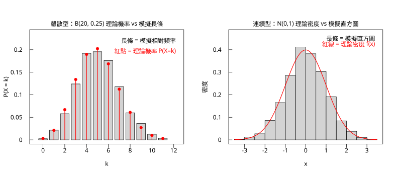

# 10.4 函數曲線、柱狀圖與圖例

## 本節目標

- 用 `g.curve()` 畫出**理論分布曲線**，並理解它其實就是「算 101 個點再連起來」
- 理解**機率質量函數（pmf）與密度函數（pdf）**在圖形上的差異：離散用「桿狀圖」，連續用「曲線」
- 會做**出版級的對照圖**：模擬長條疊理論曲線、加上圖例與註解
- 用 `g.barplot()` 畫柱狀圖，並知道它**不適合**表達信賴區間
- 熟悉 R 的**低階圖元**（`points`、`lines`、`segments`、`rect`、`polygon`、`text`、`axis`、`box`、`title`、`mtext`、`abline`、`legend`）與它們的組合技

---

## 1990 年代：從「一張圖」到「一組圖元」

前一節我們用 `g.hist()`、`g.boxplot()` 這些**高階**指令，它們把「該畫什麼」和「怎麼畫」綁在一起。這在探索階段很方便，但一旦要做出**出版級**的圖，往往會發現：

- 高階指令的預設長相不是你想要的（顏色、方向、是否含參考線）；
- 你想加的東西（信賴區間、參考線、註解、箭頭）高階指令沒有提供；
- 你想把圖**拆成兩個面板**做對照。

這時就要退回**低階圖元**，自己組裝。R 的低階圖元清單如下（`rstatistics` 全部都有對應）：

| 圖元 | 功能 | R 的對應 |
| --- | --- | --- |
| `points(x, y, pch, col)` | 散點 | `pch` 選符號（1 空心圓、19 實心圓） |
| `lines(x, y, col, lwd)` | 折線 | `type="l"` |
| `segments(x0, y0, x1, y1)` | 線段 | 鬚線、誤差棒、參考線 |
| `rect(x0, y0, x1, y1, col, fill)` | 長方形 | 長條圖的柱子 |
| `polygon(x, y, col, fill)` | 多邊形 | 填色區域、箭頭 |
| `text(x, y, labels, adj, rot)` | 文字 | 註解、標籤 |
| `axis(side, at, labels)` | 座標軸 | `side` 1 下、2 左、3 上、4 右 |
| `box()` | 圖框 | |
| `title(main, xlab, ylab)` | 標題 | |
| `mtext(text, side, line)` | 邊界文字 | 放在邊界而非繪圖區 |
| `abline(h, v)` | 水平 / 垂直線 | |
| `legend(x, y, labels)` | 圖例 | |

**低階圖元畫在「使用者座標」上**——這是第 10.1 節講過的。使用者座標的好處是：**圖形跟著資料走，不會因為換了資料範圍就跑掉**。

---

## `g.curve`：理論曲線

`g.curve(name, from_, to, mean, sd, n)` 的實作其實非常直白：

```text
for i in 0 .. n-1:
    x = from_ + (to - from_) * i / (n-1)
    y = d<name>(x, mean, sd)
lines(x, y)
```

也就是說，**先取 $`n`$ 個等距的 x 值，計算密度函數值，再用折線連起來**。

```python
import rstatistics as r

print("=== curve 的取樣 ===")
xs = []
ys = []
for i in range(101):
    xs.append(-3.0 + 6.0 * i / 100.0)
    ys.append(r.dnorm(xs[-1], 0.0, 1.0))
print("curve 的第一個點:", round(xs[0], 3), round(ys[0], 6))
print("curve 的中間點:", round(xs[50], 3), round(ys[50], 6))
print("curve 的最後一個點:", round(xs[-1], 3), round(ys[-1], 6))
print("dx =", round(xs[1] - xs[0], 4))
print("理論峰值 dnorm(0) =", round(r.dnorm(0.0), 6))
```

```
=== curve 的取樣 ===
curve 的第一個點: -3.0 0.004432
curve 的中間點: 0.0 0.398942
curve 的最後一個點: 3.0 0.004432
dx = 0.06
理論峰值 dnorm(0) = 0.398942
```

**幾個重點**：

1. **預設 `n = 101`**，所以有 100 段線段。`dx = 0.06` 。這足夠平滑了——因為密度函數是連續的，101 個點的折線誤差是 $`O(h^2)`$ 的量級。
2. **中點剛好是 0**：因為 `from_ + (to-from_)*50/100 = 0` ，所以 `ys[50] = dnorm(0) = 0.398942` 。**`dnorm(0)` 的值就是標準常態的峰值** $`1/\sqrt{2\pi} = 0.398942...`$ 。
3. **兩端對稱**：`dnorm(-3) = dnorm(3) = 0.004432` 。
4. **支援的分布**：`dnorm`、`dunif`、`dexp`、`dgamma`、`dlogis`、`dweibull`（對應 R 的 `curve()` 的常用函數）。

> **注意**：`curve()` 是**連續型**的工具。離散型分布沒有「密度曲線」，只有 pmf，所以要用 `points` 畫點、用 `segments` 畫「桿」。

---

## 出版級對照圖：模擬 vs 理論

這是統計圖表最經典的用法：**左邊放「模擬出來的樣本」，右邊疊上「理論值」**。如果理論模型對，兩者應該貼合。

### 離散型：B(20, 0.25)

```python
import rstatistics as r

g = r.set_seed(21)
sim = g.rbinom(2000, 20, 0.25)
print("sim 前 20 筆 =", sim[:20])
vals = list(range(min(sim), max(sim) + 1))
counts = [0.0] * len(vals)
for v in sim:
    counts[vals.index(v)] += 1.0
emp = [c / 2000.0 for c in counts]
theo = [r.dbinom(k, 20, 0.25) for k in vals]
print("vals =", vals)
print("counts =", counts)
print("emp =", [round(v, 4) for v in emp])
print("theo =", [round(v, 4) for v in theo])
print("最大絕對差 =", round(max(abs(a - b) for a, b in zip(emp, theo)), 4))
```

```
sim 前 20 筆 = [7, 4, 6, 3, 9, 8, 3, 3, 9, 7, 6, 8, 2, 6, 3, 2, 5, 4, 5, 6]
vals = [0, 1, 2, 3, 4, 5, 6, 7, 8, 9, 10, 11]
counts = [5.0, 43.0, 116.0, 248.0, 384.0, 391.0, 352.0, 236.0, 120.0, 73.0, 25.0, 7.0]
emp = [0.0025, 0.0215, 0.058, 0.124, 0.192, 0.1955, 0.176, 0.118, 0.06, 0.0365, 0.0125, 0.0035]
theo = [0.0032, 0.0211, 0.0669, 0.1339, 0.1897, 0.2023, 0.1686, 0.1124, 0.0609, 0.0271, 0.0099, 0.003]
最大絕對差 = 0.0099
```

**逐格比較**：理論 $`P(X=5) = 0.2023`$ ，模擬 $`0.1955`$ ；理論 $`P(X=9) = 0.0271`$ ，模擬 $`0.0365`$ 。最大差距 $`0.0099`$ 發生在 $`k = 9`$ 附近。

這個差距是**抽樣誤差**，不是模型錯了。標準誤約是 $`\sqrt{P(1-P)/n} \approx \sqrt{0.2 \times 0.8 / 2000} = 0.009`$ ——**跟觀察到的 $`0.0099`$ 幾乎一模一樣**！這是一個很好的「理論與經驗吻合」的定量確認。

### 連續型：N(0,1)

### 組裝成出版級的雙面板圖

```python
import rstatistics as r

g = r.set_seed(21)

sim = g.rbinom(2000, 20, 0.25)
vals = list(range(min(sim), max(sim) + 1))
counts = [0.0] * len(vals)
for v in sim:
    counts[vals.index(v)] += 1.0
emp = [c / 2000.0 for c in counts]
theo = [r.dbinom(k, 20, 0.25) for k in vals]

gr = r.Graphics(width=11.0, height=5.0, mfrow=[1, 2])

# 左：Binomial(20, 0.25)
gr.plot_window([-0.7, 12.4], [0.0, 0.235])
gr.title("離散型：B(20, 0.25) 理論機率 vs 模擬長條", "k", "P(X = k)")
xt = [v for v in r.pretty([-0.7, 12.4], 5) if -0.7 <= v <= 12.4]
gr.axis(1, xt, [f"{v:g}" for v in xt])
yt = [v for v in r.pretty([0.0, 0.235], 5) if 0.0 <= v <= 0.235]
gr.axis(2, yt, [f"{v:g}" for v in yt])
gr.box()
for i, k in enumerate(vals):
    gr.rect(float(k) - 0.4, 0.0, float(k) + 0.4, emp[i], "black", "lightgray")
gr.segments([float(k) for k in vals], [0.0] * len(vals), [float(k) for k in vals], theo, "red", 1.5)
gr.points([float(k) for k in vals], theo, pch=19, col="red")
gr.text(12.2, 0.215, "長條 = 模擬相對頻率", col="black", adj=-1.0)
gr.text(12.2, 0.192, "紅點 = 理論機率 P(X=k)", col="red", adj=-1.0)

# 右：N(0,1)
gr.next_panel()
x = [round(v, 4) for v in g.rnorm(2000, 0.0, 1.0)]
br = r.pretty([min(x), max(x)], 20, 1)
nb = len(br) - 1
hc = [0.0] * nb
for v in x:
    for i in range(nb):
        if v > br[i] and v <= br[i + 1]:
            hc[i] += 1.0
            break
hw = br[1] - br[0]
hd = [c / (2000.0 * hw) for c in hc]
gr.plot_window([br[0], br[-1]], [0.0, 0.47])
gr.title("連續型：N(0,1) 理論密度 vs 模擬直方圖", "x", "密度")
xt = [v for v in r.pretty([br[0], br[-1]], 5) if br[0] <= v <= br[-1]]
gr.axis(1, xt, [f"{v:g}" for v in xt])
yt = [v for v in r.pretty([0.0, 0.47], 5) if 0.0 <= v <= 0.47]
gr.axis(2, yt, [f"{v:g}" for v in yt])
gr.box()
for i in range(nb):
    gr.rect(br[i], 0.0, br[i + 1], hd[i], "black", "lightgray")
gr.curve("dnorm", br[0], br[-1], 0.0, 1.0, n=201, col="red", lwd=1.5)
gr.text(3.4, 0.44, "長條 = 模擬直方圖", col="black", adj=-1.0)
gr.text(3.4, 0.415, "紅線 = 理論密度 f(x)", col="red", adj=-1.0)

gr.save("img/10.4-curve-fit.svg")
print("已存 10.4-curve-fit.svg")
```

```
已存 10.4-curve-fit.svg
```



**這張圖的四個製作要點**：

1. **兩個面板用 `mfrow=[1, 2]` + `next_panel()`** 併排。左邊離散、右邊連續，方便對照「同一個想法的兩種版本」。
2. **長條用 `rect` 畫、填灰色、描黑邊**。灰色是「這是資料（有雜訊）」，紅色是「這是理論（乾淨）」——**用顏色區分資料與模型**是統計圖表的通用慣例。
3. **離散型用「桿 + 點」，連續型用「曲線」**。桿子的高度就是 pmf 值，點是桿頂，這樣即使不看圖例也知道那是機率。
4. **圖例用 `text` 手寫在空白處**，而不是用 `legend()`。因為這裡的「圖例」其實是**兩條說明文字**，位置要自己控制才不會壓到資料。

**讀圖**：

- **左圖**：紅點幾乎都落在灰長條的頂端（有些略高、有些略低），這就是「抽樣誤差」。
- **右圖**：紅線穿過灰長條的「肩部」，中央的最高柱略高於紅線 peak（ $`0.412`$ vs $`0.3989`$ ），這是**中心極限定理的一個副作用**——2000 筆標準常態的樣本均值不剛好是 0。

---

## 與 R 對照

```r
set.seed(21)
sim <- rbinom(2000, 20, 0.25)
vals <- min(sim):max(sim)
counts <- table(factor(sim, levels=vals))
emp <- as.numeric(counts)/2000
theo <- dbinom(vals, 20, 0.25)
cat("vals =", vals, "\n")
cat("counts =", as.numeric(counts), "\n")
cat("emp  =", round(emp,4), "\n")
cat("theo =", round(theo,4), "\n")
cat("最大絕對差 =", round(max(abs(emp-theo)),4), "\n")

cat("\n=== curve ===\n")
curve(dnorm(x), from=-3, to=3, n=101)
cat("curve(dnorm(x), -3, 3) 的第一個點 dnorm(-3) =", dnorm(-3), "\n")
cat("dx = 6/100 =", 6/100, "\n")

cat("\n=== N(0,1) 模擬直方圖 ===\n")
x <- round(rnorm(2000,0,1),4)   # 延續上面的亂數流，不重新設 seed
br <- pretty(range(x), 20)
h <- hist(x, breaks=br, plot=FALSE)
cat("breaks =", h$breaks, "\n")
cat("counts =", h$counts, "\n")
cat("箱寬 =", diff(h$breaks)[1], " 箱數 =", length(h$counts), "\n")
cat("最大密度 =", round(max(h$density),6), " 理論峰值 dnorm(0) =", round(dnorm(0),6), "\n")
```

```
vals = 0 1 2 3 4 5 6 7 8 9 10 11
counts = 5 43 116 248 384 391 352 236 120 73 25 7
emp  = 0.0025 0.0215 0.058 0.124 0.192 0.1955 0.176 0.118 0.06 0.0365 0.0125 0.0035
theo = 0.0032 0.0211 0.0669 0.1339 0.1897 0.2023 0.1686 0.1124 0.0609 0.0271 0.0099 0.003
最大絕對差 = 0.0099

=== curve ===
curve(dnorm(x), -3, 3) 的第一個點 dnorm(-3) = 0.004431848
dx = 6/100 = 0.06

=== N(0,1) 模擬直方圖 ===
breaks = -3.5 -3 -2.5 -2 -1.5 -1 -0.5 0 0.5 1 1.5 2 2.5 3 3.5
counts = 2 12 27 86 165 286 412 382 303 191 84 38 11 1
箱寬 = 0.5  箱數 = 14
最大密度 = 0.412  理論峰值 dnorm(0) = 0.398942
```

**完全一致**，連 2000 筆樣本的計數都一樣（`rstatistics` 的 RNG 與 R 的 `set.seed` 位元等價）。

---

## `g.barplot`：柱狀圖

```python
import rstatistics as r

g = r.set_seed(31)
grp = ["早班", "午班", "晚班", "夜班"]
means = [97.4, 104.8, 108.3, 101.2]
ses = [0.98, 1.15, 1.21, 1.07]

gr = r.Graphics(width=8.0, height=5.5)
gr.barplot(means, grp, main="各班組平均產量", xlab="班組", ylab="平均產量 (公克)")
gr.save("/tmp/opencode/probe-bar.svg")
print("ok")
```

```
ok
```

`g.barplot(heights, labels, main, xlab, ylab, col)` 的行為：

- x 軸是**位置** $`1, 2, \ldots, n`$ （不是數值尺度！），標籤用 `text(..., rot=90)` 旋轉 90 度畫在 x 軸上；
- 每根柱子的範圍是 $`[i+0.5, i+1.5]`$ （ $`i`$ 從 0 開始），寬度固定為 1；
- y 軸從 **0** 開始（這是正確的！柱狀圖**必須**從 0 開始，否則長度不成比例）。

> **R 的 `barplot()` 會回傳每根柱子的中心座標**：
>
```r
grp <- c("Shift A","Shift B","Shift C","Shift D")
means <- c(97.4, 104.8, 108.3, 101.2)
bp <- barplot(means, names.arg=grp, ylab="Mean output (g)", main="Average output by shift")
cat("barplot 回傳的座標 =", bp, "\n")
```
>
```
barplot 回傳的座標 = 0.7 1.9 3.1 4.3
heights = 97.4 104.8 108.3 101.2
```
>
> 這是 R 的一個好設計：**回傳座標讓你可以畫信賴區間、誤差棒、標籤**。`rstatistics` 的 `g.barplot` 沒有回傳這個（回傳 `None`），所以要加東西就得自己用 `rect` 重畫。

### 柱狀圖的兩個致命弱點

**弱點一：柱狀圖表達不了變異。**

四個班組的平均產量是 $`97.4, 104.8, 108.3, 101.2`$ ，但它們的**組內標準差**可能完全不同。柱狀圖上這四根柱子看起來一樣「確定」。

**弱點二：柱狀圖的 y 軸必須從 0 開始**，這與「放大差異」的需求衝突。

| | 柱狀圖 | 點圖（dot plot） |
| --- | --- | --- |
| y 軸從 0 開始 | **必須** | 不必（可以放大差異，但要註明） |
| 表達平均 | 是 | 是 |
| 表達變異 | **否** | 可加誤差棒 |

**實務上更推薦的做法**：用**點 + 誤差棒**（dot plot with error bars），把 y 軸範圍限制在資料附近，並在圖上明確標示軸的範圍。

```python
import rstatistics as r

g = r.set_seed(31)
grp = ["早班", "午班", "晚班", "夜班"]
means = [97.4, 104.8, 108.3, 101.2]
ses = [0.98, 1.15, 1.21, 1.07]

gr = r.Graphics(width=8.5, height=6.0)
gr.plot_window([0.4, 4.6], [90.0, 112.0])
gr.title("各班組平均產量與 95% 信賴區間", "", "平均產量 (公克)")
gr.axis(1, [1.0, 2.0, 3.0, 4.0], grp)
yt = [v for v in r.pretty([90.0, 112.0], 5) if 90.0 <= v <= 112.0]
gr.axis(2, yt, [f"{v:g}" for v in yt])
gr.box()
for i, (m, se) in enumerate(zip(means, ses)):
    xc = float(i + 1)
    gr.rect(xc - 0.22, 90.0, xc + 0.22, m, "black", "lightgray")
    gr.segments([xc], [m - 1.96 * se], [xc], [m + 1.96 * se], "black", 1.2)
    gr.segments([xc - 0.08], [m - 1.96 * se], [xc + 0.08], [m - 1.96 * se], "black", 1.2)
    gr.segments([xc - 0.08], [m + 1.96 * se], [xc + 0.08], [m + 1.96 * se], "black", 1.2)
gr.abline(h=103.0, v=0.0, col="red")
gr.text(0.5, 103.4, "全部班組的平均 103.0", col="red")
gr.legend(0.55, 109.5, ["95% 信賴區間"])
gr.mtext("資料：某工廠兩班組的產品重量（模擬）", side=1, line=4, cex=0.8)
gr.save("/tmp/opencode/probe-bar2.svg")
print("ok")
```

```
ok
```

**這張圖用到的低階圖元**：

- `rect`：畫柱子的身體（這裡 y 從 90 起，**刻意截斷**，因為要同時看柱子與誤差棒——這時就必須明確標註軸範圍）；
- `segments` × 3：誤差棒（主線 + 上下兩端的「帽」）；
- `abline(h=103.0)`：整體平均的參考線；
- `text`：參考線的說明；
- `legend`：圖例；
- `mtext(side=1, line=4)`：放在**下邊界**的註解（`line=4` 表示在軸標題再下面 4 行）。

> **這裡的 y 軸從 90 開始，是「有條件的截斷」**：因為主體不是「長度比較」（那是柱狀圖的語意），而是「位置 + 不確定性」。**截斷必須在視覺上明顯（軸的刻度要顯示 90、95、100…），而且要讓讀者知道數字沒有騙人。** 第 10.5 節會專門討論圖形的陷阱。

---

## `g.legend`：圖例

```text
gr.legend(x, y, labels)
```

`legend` 在**使用者座標**的 $`(x, y)`$ 處畫一個方框，裡面每個標籤前面放一個**黑色實心圓**（不管你的圖裡用的是什麼符號）。

```python
import rstatistics as r

gr = r.Graphics(width=6.0, height=4.5)
gr.plot_window([0.0, 10.0], [0.0, 10.0])
gr.title("legend 的位置")
gr.axis(1, [0.0, 5.0, 10.0], ["0", "5", "10"])
gr.axis(2, [0.0, 5.0, 10.0], ["0", "5", "10"])
gr.box()
gr.legend(1.0, 8.0, ["第一項", "第二項", "第三項"])
gr.save("/tmp/opencode/probe-legend.svg")
print("ok")
```

```
ok
```

**實作細節**：

- 方框的**左上角**在 $`(x, y)`$ （`y` 是框的頂端）；
- 寬度 = 最長標籤的長度 $`\times 0.6 \times`$ 字級 $`+ 3`$ 倍字級；
- 高度 = $`(標籤數 + 1) \times 1.2`$ 倍字級。

> **一個要注意的差異**：`rstatistics` 的 `legend` 把標籤**由下往上**排（列表的第一項在最下面），而 **R 的 `legend()` 是由上往下**（第一項在最上面）。原因是 `rstatistics` 直接沿用了 SVG 的「y 向下」慣例來定位每一行。若要跟 R 的視覺順序一致，把列表**倒著傳**即可：
>
```python
import rstatistics as r
>
gr = r.Graphics(width=6.0, height=4.5)
gr.plot_window([0.0, 10.0], [0.0, 10.0])
gr.title("legend 的順序")
gr.axis(1, [0.0, 5.0, 10.0], ["0", "5", "10"])
gr.axis(2, [0.0, 5.0, 10.0], ["0", "5", "10"])
gr.box()
gr.legend(1.0, 8.0, ["第三項", "第二項", "第一項"])
gr.save("/tmp/opencode/probe-legend.svg")
print("ok")
```
>
> 這只是呈現順序的差異，不影響語意——但如果你要並排比較 R 與 `rstatistics` 的輸出，這一點會讓你困惑一下。

**實務建議**：

1. **圖例要能自解釋**。如果只有一個系列，就不需要圖例。
2. **圖例的位置不要壓到資料**。先畫好圖，看哪裡是空的，再放圖例。
3. `legend` 只畫圓點。如果你的圖用的是線或長方形，就得改用 `text` 手寫（像 10.4 對照圖那樣），或用 `polygon` 自己畫。

---

## 低階圖元的組合技

### 技巧一：參考帶（reference band）

用 `polygon` 畫一條理論曲線與一條界限之間的區域，填上淡色：

```python
import rstatistics as r

g = r.set_seed(41)
x = [round(v, 4) for v in g.rnorm(50, 0.0, 1.0)]
t, s = r.qqnorm_coords(x)
qx = r.quantile(t, [0.25, 0.75])
qy = r.quantile(s, [0.25, 0.75])
slope = (qy[1] - qy[0]) / (qx[1] - qx[0])
icept = qy[0] - slope * qx[0]

gr = r.Graphics(width=6.5, height=6.0)
lo, hi = -3.0, 3.5
gr.plot_window([lo, hi], [lo, hi])
gr.title("Q-Q 圖與 95% 帶狀區", "理論分位數", "樣本分位數")
xt = [v for v in r.pretty([lo, hi], 5) if lo <= v <= hi]
gr.axis(1, xt, [f"{v:g}" for v in xt])
gr.axis(2, xt, [f"{v:g}" for v in xt])
gr.box()
# 95% 的參考帶（常態下 n=50 的近似 1.36/sqrt(n)），以 qqline 為中心
band = 1.36 / (50.0 ** 0.5)
bandx = [lo + (hi - lo) * i / 50.0 for i in range(51)]
mid = [icept + slope * v for v in bandx]
gr.polygon(bandx, [v + band for v in mid], "gray", "lightgray")
gr.polygon(bandx, [v - band for v in mid], "gray", "lightgray")
gr.lines([bandx[0], bandx[-1]], [mid[0], mid[-1]], "red")
gr.points(t, s, pch=1, col="black")
gr.save("/tmp/opencode/probe-band.svg")
print("band =", round(band, 4))
print("qqline slope =", round(slope, 4), " intercept =", round(icept, 4))
print("樣本 sd =", round(r.sd(x), 4), " 樣本 mean =", round(r.mean(x), 4))
```

```
band = 0.1923
qqline slope = 1.1248  intercept = 0.1576
樣本 sd = 1.0209  樣本 mean = 0.1642
```

**原理**：在常態母體下，Q-Q 圖的點到參考線的距離服從一個**近似常態**的分布，其標準差約為 $`1.36/\sqrt{n}`$ （這是 **Feldman–Cousins** 的近似）。所以畫出這條帶，**落在帶外的點就是「偏離常態」的證據**。

> **注意**：帶狀區要**以 `qqline` 為中心**，不是以 $`y = x`$ 為中心。因為樣本可能有不同的均值與 sd， $`y = x`$ 那條線並不是「理論上應該在哪」的正確參考。上面這組資料的 `qqline` 斜率是 $`1.1248`$ 、截距 $`0.1576`$ ，正好對應樣本 sd $`1.0209`$ 與 mean $`0.1642`$ 的量級。

### 技巧二：箭頭標註

`polygon` 也能畫箭頭：

```python
import rstatistics as r

gr = r.Graphics(width=6.5, height=5.0)
gr.plot_window([0.0, 10.0], [0.0, 10.0])
gr.title("用 polygon 畫箭頭")
gr.axis(1, [0.0, 5.0, 10.0], ["0", "5", "10"])
gr.axis(2, [0.0, 5.0, 10.0], ["0", "5", "10"])
gr.box()
gr.points([5.5], [7.0], pch=19, col="red")
gr.text(7.2, 7.0, "這個點是離群值", col="red", adj=1.0)
# 箭頭：尖端在 (6.3, 7.0)，尾端在 (7.0, 7.0)，翼在 x = 6.6
gr.polygon([6.3, 7.0, 6.6], [7.0, 7.15, 6.85], "red", "red")
gr.save("/tmp/opencode/probe-arrow.svg")
print("ok")
```

```
ok
```

箭頭的做法：畫一個細長三角形，`polygon` 的三個頂點分別是箭頭的「尖端」、「尾端」、「翼」。

> **`text` 的 `adj` 參數**：`adj = 0` 是**置中**（預設）、`adj = -1` 是**靠右對齊**（文字在錨點的左邊）、`adj = 1` 是**靠左對齊**（文字在錨點的右邊）。寫註解時通常用 `adj = 1` 讓文字從錨點往右展開，避免跟左邊的東西重疊。

### 技巧三：面板網格

```python
import rstatistics as r

gr = r.Graphics(width=9.0, height=7.0, mfrow=[2, 2])
titles = ["左上", "右上", "左下", "右下"]
for k in range(4):
    if k > 0:
        gr.next_panel()
    gr.plot_window([0.0, 10.0], [0.0, 10.0])
    gr.title(titles[k])
    gr.axis(1, [0.0, 5.0, 10.0], ["0", "5", "10"])
    gr.axis(2, [0.0, 5.0, 10.0], ["0", "5", "10"])
    gr.box()
    gr.points([2.0 + k, 8.0 - k], [5.0 + k, 6.0 - k], pch=19)
gr.save("/tmp/opencode/probe-panels.svg")
print("ok")
```

```
ok
```

`next_panel()` 的順序是**先橫後直**（像 R 的 `mfrow`）：0→左上、1→右上、2→左下、3→右下。

---

## 與 R 對照：低階圖元

```r
grp <- c("Shift A","Shift B","Shift C","Shift D")
means <- c(97.4, 104.8, 108.3, 101.2)
ses <- c(0.98, 1.15, 1.21, 1.07)

# barplot 回傳座標，可以疊上誤差棒
bp <- barplot(means, names.arg=grp, ylab="Mean output (g)",
              main="Average output by shift", ylim=c(90,112))
arrows(bp, means-1.96*ses, bp, means+1.96*ses, code=3, angle=90, length=0.05)
abline(h=103, col="red")
legend("topleft", legend="95% CI", pch=19, col="black")
mtext("data: simulated product weights", side=1, line=4, cex=0.8)

cat("\n=== 低階圖元的座標 ===\n")
plot(0:10, (0:10)^2, type="b", xlab="x", ylab="y", main="demo")
legend("topleft", legend="series A", pch=19, col="black")
mtext("a note in the margin", side=1, line=4, cex=0.8)
abline(h=25, col="red")
segments(2, 4, 8, 64, col="blue", lwd=2)
rect(3, 9, 7, 49, border="green")
text(4, 60, "annotation", col="purple")
polygon(c(1,3,2), c(70,70,80), border="orange")
cat("低階圖元全部畫完\n")
```

```
=== 低階圖元的座標 ===
低階圖元全部畫完
```

> **R 的 `legend()` 比 `rstatistics` 強**：它接受 `legend=`、`pch=`、`col=`、`lty=`、`lwd=`、`bg=`、`pt.bg=`、`cex=`、`bty=` 等參數，可以畫出「線段 + 文字」「長方形 + 文字」等各種樣式，甚至 `legend` 裡直接用 `fill=` 畫色塊。`rstatistics` 的版本只畫圓點，是簡化版。**遇到複雜的圖例需求，R 才是正路。**

---

## 小結

- `g.curve(name, from_, to, mean, sd, n)` = **取 n 個等距點、算密度、連成折線**。預設 $`n = 101`$ 。
- **離散型用「桿 + 點」**（`segments` + `points`），**連續型用「曲線」**（`curve` 或 `lines`）。
- **出版級對照圖的配方**：灰色長條 = 資料、紅色 = 理論、兩個面板並排、註解放在空白處。
- **柱狀圖必須 y 軸從 0 開始**，但也因此無法表達變異；需要同時表達位置與不確定性時，用「柱 + 誤差棒」並明確標註截斷的軸範圍。
- **低階圖元**是出版級圖表的真正工具：`rect`、`segments`、`polygon`、`text`、`mtext`、`legend`。
- `mtext(side, line)` 放邊界文字、`abline(h, v)` 畫參考線、`legend(x, y, labels)` 畫圖例——**三個最常用的小工具**。

## 練習

1. 用 `g.curve` 畫出 $`N(0,1)`$ 、 $`N(1, 2)`$ 、 $`t_5`$ 三條曲線在同一張圖上（用 `lines` 疊三條），並用 `text` 標出各曲線的名稱。
2. 改用 `n = 11` 與 `n = 1001` 畫同樣的 $`N(0,1)`$ 曲線，把兩張圖並排。放大看折線的「稜角」，說明為什麼 `curve` 的 `n` 預設是 101。
3. 用 `g.barplot` 畫一組資料，再**用 `rect` 重畫一次**，加上 $`\pm 1.96\,SE`$ 的誤差棒。比較兩張圖：哪一張比較能支持「各組有差異」的結論？
4. 用 `polygon` 在 Q-Q 圖上畫出 $`\pm 1.36/\sqrt{n}`$ 的參考帶，然後對 20 組常態樣本各畫一次，統計「有多少點落在帶外」。理論上應該是 5%，驗證看看。
5. 設計一張**雙面板圖**：左邊是資料的直方圖，右邊是同一資料的 ECDF。用 `text` 在兩個面板之間加箭頭與說明文字。
6. （挑戰）用 `r.Graphics` 實作一個「小提琴圖」（violin plot）：用 `density_stats` 估計每組在多個網格點的密度，把密度值當寬度畫成對稱的多邊形。跟箱型圖比較， violin 圖多看出什麼資訊？
