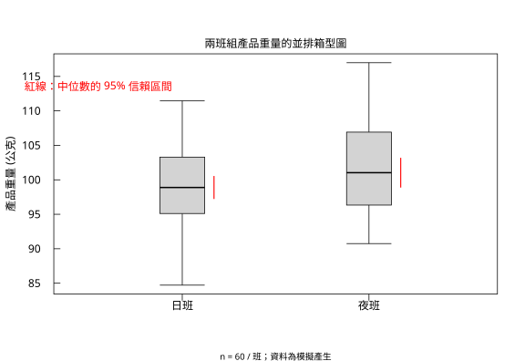
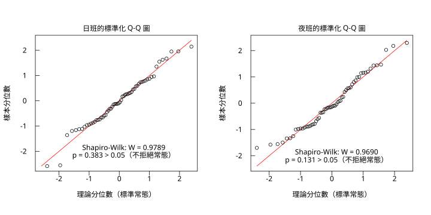
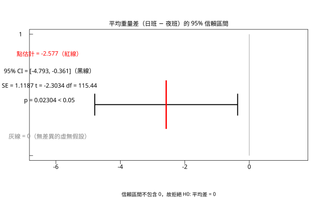
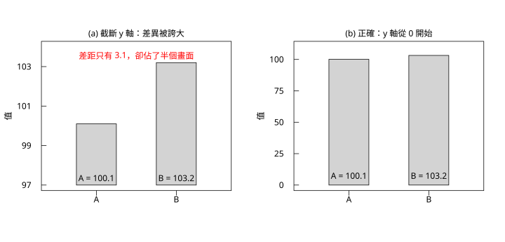
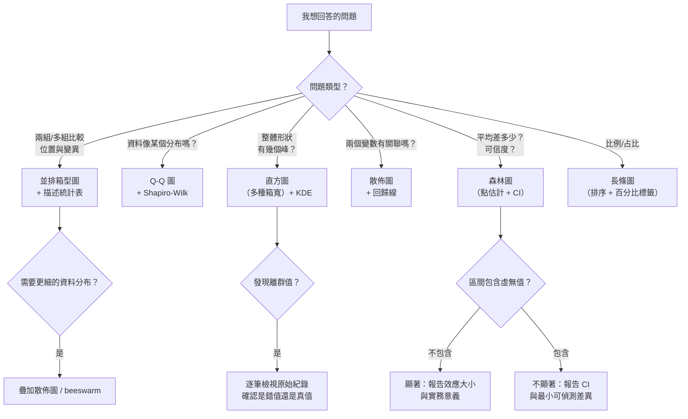

# 10.5 完整案例：兩班組的產品重量

## 本節目標

- 走完一遍**完整的統計分析流程**：描述 → 檢定前提 → 檢定 → 結論
- 學會寫出**可被審查的結論段落**（不是「p < 0.05 所以有差異」這種）
- 產出一組**互相配合的圖表**，每一張都有明確的任務分工
- 認識**圖形的陷阱**：截斷 y 軸、3D 圓餅圖、雙 y 軸
- 用一張 **mermaid 決策圖**把「問題 → 圖」的對應關係固定下來

---

## 開場：一份真實的統計請求

> 「我們工廠有兩個班組在生產同一種零件。品管部門每天抽測零件重量。最近主管看到夜班的平均重量好像比較高，想知道這是**真的**（夜班的製程比較穩定 / 材料批次不同），還是**隨機波動**。如果是真的，就要檢討製程參數。」

這個請求裡藏著三個統計問題：

1. **描述**：兩班的重量分布長什麼樣？（→ 箱型圖、直方圖）
2. **前提**：能不能用 t 檢定？（→ Q-Q 圖、Shapiro–Wilk）
3. **推論**：平均重量的差異有多少、顯不顯著？（→ t 檢定、信賴區間）

**注意第 3 個問題裡的隱含條件**：即使差異「顯著」，也**不等於**「實務上重要」。 $`2.58`$ 公克的差異，在重量標準是 $`\pm 5`$ 公克的工廠裡，可能根本不值得改製程。這是統計推論與**決策**之間的距離。

---

## 資料：模擬產生

為了讓本章可重現，我們用 `r.set_seed(2026)` 模擬兩班各 60 筆的重量資料：

```python
import rstatistics as r

g = r.set_seed(2026)
n = 60
day = [round(v, 3) for v in g.rnorm(n, 100.0, 6.0)]
night = [round(v, 3) for v in g.rnorm(n, 102.5, 6.0)]
print("n 每組 =", n)
print("day 前 10 =", day[:10])
print("night 前 10 =", night[:10])
```

```
n 每組 = 60
day 前 10 = [103.124, 93.522, 100.835, 99.492, 96.0, 84.903, 95.589, 93.879, 100.681, 97.157]
night 前 10 = [101.651, 103.504, 101.307, 100.753, 92.094, 100.864, 91.7, 109.416, 96.48, 103.389]
```

**母體設定**：日班 $`N(100, 6^2)`$ ，夜班 $`N(102.5, 6^2)`$ ——**真實差異是 2.5 公克**，兩組變異數相同。

我們做完分析後再回頭看，檢討「真知道答案時，方法有沒有找對」。

---

## 第一步：描述統計

```python
import rstatistics as r

g = r.set_seed(2026)
n = 60
day = [round(v, 3) for v in g.rnorm(n, 100.0, 6.0)]
night = [round(v, 3) for v in g.rnorm(n, 102.5, 6.0)]

print("=== 描述統計 ===")
for name, v in [("日班", day), ("夜班", night)]:
    s = r.summary(v)
    print(f"--- {name} ---")
    print(s)
    print("  mean =", round(r.mean(v), 4), " sd =", round(r.sd(v), 4),
          " median =", r.median(v), " IQR =", round(r.IQR(v), 4))
    print("  離群值 =", [round(o, 3) for o in r.boxplot_stats(v).out])
```

```
=== 描述統計 ===
--- 日班 ---
   Min. 1st Qu.  Median    Mean 3rd Qu.    Max.
  84.72   95.14   98.89   99.34  103.21  111.45
  mean = 99.3391  sd = 5.6531  median = 98.8875  IQR = 8.0673
  離群值 = []
--- 夜班 ---
   Min. 1st Qu.  Median    Mean 3rd Qu.    Max.
  90.75   96.41  101.03  101.92  106.77  116.99
  mean = 101.916  sd = 6.5678  median = 101.03450000000001  IQR = 10.3653
  離群值 = []
```

**讀法**：

| | 日班 | 夜班 | 差 |
| --- | --- | --- | --- |
| 平均 | $`99.34`$ | $`101.92`$ | $`+2.58`$ |
| 中位數 | $`98.89`$ | $`101.03`$ | $`+2.15`$ |
| 標準差 | $`5.65`$ | $`6.57`$ | $`+0.92`$ |
| IQR | $`8.07`$ | $`10.37`$ | $`+2.30`$ |
| 最小 ~ 最大 | $`84.72 ~ 111.45`$ | $`90.75 ~ 116.99`$ | |
| 離群值 | 無 | 無 | |

**四個觀察**：

1. **平均值與中位數都顯示夜班較重**（差約 $`2.2 ~ 2.6`$ 公克）。兩者一致 → 分布**沒有明顯偏斜**。
2. **夜班的變異略大**（sd $`6.57`$ vs $`5.65`$ ）。這會影響檢定的選擇（Welch vs 合併）。
3. **沒有離群值**。資料乾淨，不需要剔除任何觀測值。
4. **兩組的分布範圍大量重疊**（日班 $`84.7~111.5`$ ，夜班 $`90.7~117.0`$ ）。**這提醒我們：整體分布高度重疊，代表「平均差 2.5 公克」對「單件零件」來說幾乎看不出來。** 這個觀察在寫結論時很重要——**平均數的差異不等於個體的差異**。

### 圖 1：並排箱型圖

```python
import rstatistics as r

g = r.set_seed(2026)
n = 60
day = [round(v, 3) for v in g.rnorm(n, 100.0, 6.0)]
night = [round(v, 3) for v in g.rnorm(n, 102.5, 6.0)]

grp = [("日班", day), ("夜班", night)]
stats = [r.boxplot_stats(v) for _, v in grp]
lo = min(s.stats[0] for s in stats)
hi = max(s.stats[4] for s in stats)

gr = r.Graphics(width=8.0, height=5.5)
gr.plot_window([0.4, 2.6], [lo, hi])
gr.title("兩班組產品重量的並排箱型圖", "", "產品重量 (公克)")
gr.axis(1, [1.0, 2.0], ["日班", "夜班"])
yt = [v for v in r.pretty([lo, hi], 5) if lo <= v <= hi]
gr.axis(2, yt, [f"{v:g}" for v in yt])
gr.box()
for i, ((name, v), s) in enumerate(zip(grp, stats)):
    xc = float(i + 1)
    bw = 0.24
    gr.segments([xc], [s.stats[0]], [xc], [s.stats[1]], "black")
    gr.segments([xc], [s.stats[3]], [xc], [s.stats[4]], "black")
    gr.segments([xc - bw / 2], [s.stats[0]], [xc + bw / 2], [s.stats[0]], "black")
    gr.segments([xc - bw / 2], [s.stats[4]], [xc + bw / 2], [s.stats[4]], "black")
    gr.rect(xc - bw / 2, s.stats[1], xc + bw / 2, s.stats[3], "black", "lightgray")
    gr.segments([xc - bw / 2], [s.stats[2]], [xc + bw / 2], [s.stats[2]], "black", 2.0)
    for o in s.out:
        gr.points([xc], [o], pch=1, col="black")
    gr.segments([xc + bw / 2 + 0.05], [s.conf[0]], [xc + bw / 2 + 0.05], [s.conf[1]], "red", 1.5)
gr.text(0.55, hi - 4.0, "紅線：中位數的 95% 信賴區間", col="red")
gr.mtext("n = 60 / 班；資料為模擬產生", side=1, line=4, cex=0.8)
gr.save("img/10.5-boxplot.svg")
print("已存 10.5-boxplot.svg")
for (name, v), s in zip(grp, stats):
    print(f"{name}: 五數 = {[round(q,3) for q in s.stats]} conf = {[round(q,3) for q in s.conf]}")
```

```
已存 10.5-boxplot.svg
日班: 五數 = [84.719, 95.112, 98.888, 103.294, 111.449] conf = [97.218, 100.557]
夜班: 五數 = [90.749, 96.334, 101.035, 106.918, 116.987] conf = [98.876, 103.193]
```



**這張圖做了三件事**：

1. **顯示位置差異**：夜班的箱子整體上移。
2. **顯示變異**：夜班的箱子略高、鬚線略長。
3. **紅色短線（中位數的 95% CI）**：兩條紅線**幾乎但不重疊**。這是差異的**圖形證據**，但它們不重疊**不等於**檢定顯著——正式的判斷要靠信賴區間與 p 值。

---

## 第二步：檢定前提——常態性

t 檢定的前提是兩組資料（近似）來自常態母體。我們用**兩個工具**確認：

```python
import rstatistics as r

g = r.set_seed(2026)
n = 60
day = [round(v, 3) for v in g.rnorm(n, 100.0, 6.0)]
night = [round(v, 3) for v in g.rnorm(n, 102.5, 6.0)]

print("=== 正態性 ===")
for name, v in [("日班", day), ("夜班", night)]:
    h = r.shapiro_test(v)
    print(f"{name}: W = {h.statistic:.5f}, p = {h.p_value:.5f}")
    t, s = r.qqnorm_coords(v)
    qx = r.quantile(t, [0.25, 0.75])
    qy = r.quantile(s, [0.25, 0.75])
    slope = (qy[1] - qy[0]) / (qx[1] - qx[0])
    icept = qy[0] - slope * qx[0]
    print(f"   qqline slope = {slope:.4f} intercept = {icept:.4f} (sd={r.sd(v):.4f}, mean={r.mean(v):.4f})")
```

```
=== 正態性 ===
日班: W = 0.97888, p = 0.38290
   qqline slope = 6.0967 intercept = 99.1754 (sd=5.6531, mean=99.3391)
夜班: W = 0.96902, p = 0.13070
   qqline slope = 7.8334 intercept = 101.5896 (sd=6.5678, mean=101.9160)
```

**Shapiro–Wilk 的 p 值**： $`0.383`$ 與 $`0.131`$ ，都遠大於 $`0.05`$ → **不拒絕常態假設**。

（回憶第 8 章的提醒： $`n = 60`$ 時 Shapiro-Wilk 對微小偏離也很敏感，這裡 p 值大到 $`0.13`$ 以上，是很有力的「像常態」證據。）

### 圖 2：標準化 Q-Q 圖

```python
import rstatistics as r

g = r.set_seed(2026)
n = 60
day = [round(v, 3) for v in g.rnorm(n, 100.0, 6.0)]
night = [round(v, 3) for v in g.rnorm(n, 102.5, 6.0)]

grp = [("日班", day), ("夜班", night)]

gr = r.Graphics(width=10.0, height=5.0, mfrow=[1, 2])
for k, (name, v) in enumerate(grp):
    if k > 0:
        gr.next_panel()
    t, s = r.qqnorm_coords(v)
    m = r.mean(v)
    sd = r.sd(v)
    z = [(q - m) / sd for q in v]
    tz, sz = r.qqnorm_coords(z)
    l, h = min(min(tz), min(sz)), max(max(tz), max(sz))
    gr.plot_window([l, h], [l, h])
    gr.title(f"{name}的標準化 Q-Q 圖", "理論分位數（標準常態）", "樣本分位數")
    xt = [q for q in r.pretty([l, h], 5) if l <= q <= h]
    gr.axis(1, xt, [f"{q:g}" for q in xt])
    gr.axis(2, xt, [f"{q:g}" for q in xt])
    gr.box()
    gr.lines([l, h], [l, h], "red")
    gr.points(tz, sz, pch=1, col="black")
    hs = r.shapiro_test(v)
    gr.text(0.15, -1.95, f"Shapiro-Wilk: W = {hs.statistic:.4f}", col="black")
    gr.text(0.15, -2.25, f"p = {hs.p_value:.3f} > 0.05（不拒絕常態）", col="black")
gr.save("img/10.5-qq.svg")
print("已存 10.5-qq.svg")
```

```
已存 10.5-qq.svg
```



**為什麼要「標準化」？** 因為兩組的 sd 不同（ $`5.65`$ 與 $`6.57`$ ）。若不標準化，兩張 Q-Q 圖的尺度會不同，無法並排比較。標準化後：

- 兩張圖的座標軸**完全相同**（大約 $`-2.4`$ 到 $`2.4`$ ）；
- 紅線是 $`y = x`$ 這條**理論參考線**（因為資料已標準化，母體是 $`N(0,1)`$ ）；
- **點貼著紅線** → 像常態。

日班的點在左下角與右上角稍微離開紅線（那兩個點是 $`84.7`$ 與 $`111.4`$ ），夜班則有幾個點在中段偏離——**都是隨機抽樣的正常波動**，與 Shapiro-Wilk 的 p 值一致。

---

## 第三步：t 檢定與信賴區間

```python
import rstatistics as r

g = r.set_seed(2026)
n = 60
day = [round(v, 3) for v in g.rnorm(n, 100.0, 6.0)]
night = [round(v, 3) for v in g.rnorm(n, 102.5, 6.0)]

tt = r.t_test(day, night)
print(tt)
print("  statistic =", tt.statistic)
print("  p_value =", tt.p_value)
print("  conf_int =", tt.conf_int)
print("  estimate =", tt.estimate)
print("  df =", tt.parameter)
```

```
	Welch Two Sample t-test

data:  x and y
t = -2.3034, df = 115.44, p-value = 0.02304
alternative hypothesis: true difference in means is not equal to 0
95 percent confidence interval:
 -4.7928391 -0.3610276
sample estimates:
mean of x mean of y
 99.33907 101.91600

  statistic = -2.303437928463154
  p_value = 0.023044171188775723
  conf_int = [-4.792839062588426, -0.3610276040782327]
  estimate = [99.33906666666667, 101.916]
  df = [115.44177320212177]
```

**逐行解讀**：

- `Welch Two Sample t-test`：**Welch** 版本（`var_equal=False`，預設）。它**不假設兩組變異數相等**，而且 Welch–Satterthwaite 的自由度是 $`115.44`$ （**不是整數**，這是它的特色）。
- `t = -2.3034`：負號是因為 `estimate` 的順序是「日班 − 夜班」。
- `df = 115.44`：接近 $`n_1 + n_2 - 2 = 118`$ ，因為兩組變異數相近。
- `p-value = 0.02304` < $`0.05`$ → **拒絕** $`H_0`$ 。
- `95 percent confidence interval: -4.79 ~ -0.36`：**不包含 0** → 與 p 值一致（這是第 7.5 節的對偶性）。
- `sample estimates`：兩組的平均值。

### 手算 Welch 統計量

```python
import rstatistics as r

g = r.set_seed(2026)
n = 60
day = [round(v, 3) for v in g.rnorm(n, 100.0, 6.0)]
night = [round(v, 3) for v in g.rnorm(n, 102.5, 6.0)]

m1, m2 = r.mean(day), r.mean(night)
s1, s2 = r.sd(day), r.sd(night)
n1, n2 = len(day), len(night)
diff = m1 - m2
v1 = s1**2 / n1
v2 = s2**2 / n2
se_w = (v1 + v2) ** 0.5
dfw = (v1 + v2) ** 2 / (v1**2 / (n1 - 1) + v2**2 / (n2 - 1))
t = diff / se_w
print("m1 =", round(m1, 5), " m2 =", round(m2, 5), " diff =", round(diff, 5))
print("s1 =", round(s1, 5), " s2 =", round(s2, 5))
print("v1 =", round(v1, 6), " v2 =", round(v2, 6))
print("se_welch =", round(se_w, 5), " df =", round(dfw, 4), " t =", round(t, 5))
print("p（用 pt 查表）=", r.pt(abs(t), dfw, lower_tail=False) * 2)
crit = r.qt(0.975, dfw)
print("t crit (0.975) =", round(crit, 5))
print("CI =", [round(diff - crit * se_w, 5), round(diff + crit * se_w, 5)])
```

```
m1 = 99.33907  m2 = 101.916  diff = -2.57693
s1 = 5.6531  s2 = 6.56782
v1 = 0.532626  v2 = 0.718939
se_welch = 1.11873  df = 115.4418  t = -2.30344
p（用 pt 查表）= 0.023044171188775813
t crit (0.975) = 1.98073
CI = [-4.79284, -0.36103]
```

**四個公式，一步步對上**：

```math
\hat{\Delta} = \bar{x}_1 - \bar{x}_2 = 99.339 - 101.916 = -2.577
```

```math
\text{SE}(\hat{\Delta}) = \sqrt{\frac{s_1^2}{n_1} + \frac{s_2^2}{n_2}} = \sqrt{0.5326 + 0.7189} = 1.1187
```

```math
df = \frac{(v_1 + v_2)^2}{\frac{v_1^2}{n_1 - 1} + \frac{v_2^2}{n_2 - 1}} = \frac{1.5690}{0.013588} = 115.44
```

```math
t = \frac{\hat{\Delta}}{\text{SE}} = \frac{-2.577}{1.1187} = -2.3034
```

信賴區間： $`-2.577 \pm 1.9807 \times 1.1187 = -2.577 \pm 2.216 = [-4.793, -0.361]`$ 。

### 順帶看其他選項

```python
import rstatistics as r

g = r.set_seed(2026)
n = 60
day = [round(v, 3) for v in g.rnorm(n, 100.0, 6.0)]
night = [round(v, 3) for v in g.rnorm(n, 102.5, 6.0)]

print("=== var_equal=True（合併變異數）===")
tp = r.t_test(day, night, var_equal=True)
print(tp)

print()
print("=== 單邊 ===")
print("alternative='less'  :", r.t_test(day, night, alternative="less").p_value)
print("alternative='greater':", r.t_test(day, night, alternative="greater").p_value)

print()
print("=== 90% CI ===")
t90 = r.t_test(day, night, conf_level=0.90)
print("conf_int =", t90.conf_int)
```

```
=== var_equal=True（合併變異數）===

	Two Sample t-test

data:  x and y
t = -2.3034, df = 118, p-value = 0.023
alternative hypothesis: true difference in means is not equal to 0
95 percent confidence interval:
 -4.7923304 -0.3615363
sample estimates:
mean of x mean of y
 99.33907 101.91600


=== 單邊 ===
alternative='less'  : 0.011522085594387861
alternative='greater': 0.9884779144056122

=== 90% CI ===
conf_int = [-4.431972918798277, -0.7218937478683818]
```

**三個對照**：

- **Welch vs 合併**：p 值 $`0.02304`$ vs $`0.02300`$ ，幾乎一樣（因為 $`s_1`$ 與 $`s_2`$ 相近， $`n_1 = n_2`$ ）。**Welch 是預設，也是安全選擇**——它永遠不會因為錯誤的等變異數假設而失效。
- **單邊**：若我們「事前」就假設夜班比較重（ $`\mu_{night} > \mu_{day}`$ ），應該用 `alternative="less"`（因為 `diff` 是「日班 − 夜班」），p 值 = $`0.0115`$ 。**但這只在「事前就有方向性假設」時才可以用**，事後看資料再挑方向是 p-hacking。
- **90% CI**： $`[-4.43, -0.72]`$ ，比 95% CI 短——**信賴水準愈低，區間愈窄**，這是第 6 章的對偶性。

### 圖 3：平均差的信賴區間

```python
import rstatistics as r

g = r.set_seed(2026)
n = 60
day = [round(v, 3) for v in g.rnorm(n, 100.0, 6.0)]
night = [round(v, 3) for v in g.rnorm(n, 102.5, 6.0)]

tt = r.t_test(day, night)
diff = tt.estimate[0] - tt.estimate[1]
lo_ci = tt.conf_int[0]
hi_ci = tt.conf_int[1]
se = (r.sd(day) ** 2 / len(day) + r.sd(night) ** 2 / len(night)) ** 0.5

gr = r.Graphics(width=9.0, height=5.5)
gr.plot_window([-6.5, 1.5], [0.0, 1.0])
gr.title("平均重量差（日班 − 夜班）的 95% 信賴區間")
xt = [v for v in r.pretty([-6.5, 1.5], 5) if -6.5 <= v <= 1.5]
gr.axis(1, xt, [f"{v:g}" for v in xt])
gr.axis(2, [0.0, 1.0], [""])
gr.box()
# 0 的參考線（垂直）
gr.segments([0.0], [0.0], [0.0], [1.0], "gray")
# 信賴區間
gr.segments([lo_ci], [0.42], [hi_ci], [0.42], "black", 2.5)
gr.segments([lo_ci], [0.33], [lo_ci], [0.51], "black", 2.5)
gr.segments([hi_ci], [0.33], [hi_ci], [0.51], "black", 2.5)
# 點估計
gr.segments([diff], [0.22], [diff], [0.62], "red", 3.5)
gr.text(-6.2, 0.82, f"點估計 = {diff:.3f}（紅線）", col="red")
gr.text(-6.2, 0.68, f"95% CI = [{lo_ci:.3f}, {hi_ci:.3f}]（黑線）", col="black")
gr.text(-6.2, 0.56, f"SE = {se:.4f}   t = {tt.statistic:.4f}   df = {tt.parameter[0]:.2f}", col="black")
gr.text(-6.2, 0.44, f"p = {tt.p_value:.5f} < 0.05", col="black")
gr.text(-6.2, 0.14, "灰線 = 0（無差異的虛無假設）", col="gray")
gr.mtext("信賴區間不包含 0，故拒絕 H0: 平均差 = 0", side=1, line=4, cex=0.85)
gr.save("img/10.5-ci.svg")
print("已存 10.5-ci.svg")
print("diff =", round(diff, 5), " CI =", [round(lo_ci, 5), round(hi_ci, 5)], " se =", round(se, 5))
```

```
已存 10.5-ci.svg
diff = -2.57693  CI = [-4.79284, -0.36103]  se = 1.11873
```



**這是「森林圖」（forest plot）**——**證據醫學與 meta 分析的標準圖型**。它把：

- **點估計**（紅線）
- **信賴區間**（黑線）
- **虛無假設的值**（灰線， $`= 0`$ ）

放在同一個軸上，**讓「顯不顯著」變成一個可以用眼睛判斷的幾何問題**：

> **信賴區間與虛無值 0 有沒有重疊？**
> 沒有重疊 → 顯著；有重疊 → 不顯著。

這個圖比「p = 0.023」這個數字**更有資訊量**，因為它同時告訴讀者：

1. 效應的方向與大小（ $`-2.58`$ 公克）；
2. 不確定性的寬度（區間寬 $`4.43`$ 公克）；
3. 與虛無值的距離。

---

## 第四步：怎麼寫結論

這是整個分析**最容易被忽略、卻最重要**的一步。壞的結論：

> ❌ 「因為 p = 0.023 < 0.05，所以夜班的產品比較重，兩班有顯著差異。」

這句話有四個問題：

1. **沒說清楚差多少、方向是誰比誰重**（負號呢？）；
2. **沒說信賴區間**（只有 p 值等於放棄了量化不確定性）；
3. **「顯著」不等於「重要」**；
4. **沒說這對決策的意義**。

### 一份合格的結論段落

> ✅ **夜班零件的平均重量比日班高 $`2.58`$ 公克（95% 信賴區間 $`0.36`$ 至 $`4.79`$ 公克；Welch t 檢定 $`t = -2.30`$ , $`df = 115.4`$ , $`p = 0.023`$ ）。**
>
> 兩組資料的 Shapiro–Wilk 檢定皆未拒絕常態性（ $`p = 0.38`$ 與 $`p = 0.13`$ ），Q-Q 圖亦未顯示系統性偏離，故 t 檢定的常態假設合理。
>
> **但需注意**： $`2.58`$ 公克的差異僅相當於組內標準差的 $`0.4`$ 倍（ $`2.58 / 6.1`$ ），且兩組的個體重量分布**高度重疊**（日班 $`84.7 ~ 111.5`$ ，夜班 $`90.7 ~ 117.0`$ ）。因此**單件零件重量的差異在實務上難以辨識**，此結果支持「平均值的系統性偏移」，但**不支持**「夜班的零件品質明顯較差」。
>
> 後續建議：若此差異超出允收公差（ $`\pm 2`$ 公克），應檢查夜班的製程參數與原料批次；同時建議持續監控，以累積更多資料判斷此 $`2.58`$ 的偏移是否穩定存在。

**這段話做了什麼？**

| 段落 | 功能 |
| --- | --- |
| 第 1 句 | 效應大小 + 方向 + 不確定性 + 統計量 + p 值 |
| 第 2 句 | **前提檢查的結果**（不能省略，否則讀者無從判斷 t 檢定是否適用） |
| 第 3 句 | **效應的重要性**（把統計意義接到實務意義） |
| 第 4 句 | **下一步的具體行動** |

> **寫結論的三原則**：
> 1. **先講效應，再講 p 值**。效應大小是重點，p 值是證據強度。
> 2. **不要省略前提檢查**。Shapiro–Wilk 的結果是報告的一部分。
> 3. **把「統計顯著」與「實務重要」分開談**。這是統計學教育的核心目標之一。

### 對照：真實的差異是多少？

我們**知道**母體參數：真實差異是 $`102.5 - 100 = 2.5`$ 公克，而我們估計出 $`2.577`$ 公克。**誤差只有 $`0.077`$ 公克（約 3%）**。

這說明：

- $`n = 60`$ 足以讓估計相當精確；
- 信賴區間 $`[0.36, 4.79]`$ **涵蓋了真值** $`2.5`$ ——這正是信賴區間的正確解釋：**如果重複抽樣並重複建立區間，95% 的區間會涵蓋真值**。

---

## 與 R 對照

```r
set.seed(2026)
n <- 60
day <- round(rnorm(n,100,6),3)
night <- round(rnorm(n,102.5,6),3)

cat("=== summary ===\n")
print(summary(day))
print(summary(night))
cat("\nIQR day =", IQR(day), " IQR night =", IQR(night), "\n")
cat("shapiro day:", shapiro.test(day)$statistic, shapiro.test(day)$p.value, "\n")
cat("shapiro night:", shapiro.test(night)$statistic, shapiro.test(night)$p.value, "\n")

cat("\n=== t.test ===\n")
print(t.test(day, night))
cat("\n-- var.equal=TRUE --\n")
print(t.test(day, night, var.equal=TRUE))
cat("\n-- less --\n")
cat("p =", t.test(day, night, alternative="less")$p.value, "\n")
cat("-- greater --\n")
cat("p =", t.test(day, night, alternative="greater")$p.value, "\n")
cat("\n-- conf.level=0.90 --\n")
print(t.test(day, night, conf.level=0.90))

cat("\n=== 手算 Welch ===\n")
m1 <- mean(day); m2 <- mean(night); s1 <- sd(day); s2 <- sd(night)
diff <- m1-m2
v1 <- s1^2/n; v2 <- s2^2/n
se <- sqrt(v1+v2)
dfw <- (v1+v2)^2 / (v1^2/(n-1) + v2^2/(n-1))
t <- diff/se
cat(sprintf("m1=%.5f m2=%.5f diff=%.5f s1=%.5f s2=%.5f\n", m1,m2,diff,s1,s2))
cat(sprintf("v1=%.6f v2=%.6f se=%.5f df=%.4f t=%.5f\n", v1,v2,se,dfw,t))
cat("p =", 2*pt(-abs(t), dfw), "\n")
crit <- qt(0.975, dfw)
cat("t crit =", crit, "\n")
cat("CI =", c(diff-crit*se, diff+crit*se), "\n")
```

```
=== summary ===
   Min. 1st Qu.  Median    Mean 3rd Qu.    Max.
  84.72   95.14   98.89   99.34  103.21  111.45
   Min. 1st Qu.  Median    Mean 3rd Qu.    Max.
  90.75   96.41  101.03  101.92  106.77  116.99

IQR day = 8.06725  IQR night = 10.36525
shapiro day: 0.9788767 0.3828957
shapiro night: 0.9690238 0.1306994

=== t.test ===

	Welch Two Sample t-test

data:  day and night
t = -2.3034, df = 115.44, p-value = 0.02304
alternative hypothesis: true difference in means is not equal to 0
95 percent confidence interval:
 -4.7928391 -0.3610276
sample estimates:
mean of x mean of y
 99.33907 101.91600


-- var.equal=TRUE --

	Two Sample t-test

data:  day and night
t = -2.3034, df = 118, p-value = 0.023
alternative hypothesis: true difference in means is not equal to 0
95 percent confidence interval:
 -4.7923304 -0.3615363
sample estimates:
mean of x mean of y
 99.33907 101.91600


-- less --
p = 0.01152209
-- greater --
p = 0.9884779

-- conf.level=0.90 --

	Welch Two Sample t-test

data:  day and night
t = -2.3034, df = 115.44, p-value = 0.02304
alternative hypothesis: true difference in means is not equal to 0
90 percent confidence interval:
 -4.4319729 -0.7218937
sample estimates:
mean of x mean of y
 99.33907 101.91600


=== 手算 Welch ===
m1=99.33907 m2=101.91600 diff=-2.57693 s1=5.65310 s2=6.56782
v1=0.532626 v2=0.718939 se=1.11873 df=115.4418 t=-2.30344
p = 0.02304417
t crit = 1.980727
CI = -4.792839 -0.3610276
```

**逐行一致**（連 `IQR` 的小數位都一樣）。

---

## 圖形的陷阱

前面五節講的是「怎麼把圖畫對」。這一節講「**怎麼把圖畫錯**」——而且是最常見的三種。

### 陷阱一：截斷 y 軸的柱狀圖

**這是最普遍、也最容易造成誤導的圖形謊言。**

```python
import rstatistics as r

v = [98.2, 101.5, 99.8, 103.2, 100.1, 97.6]

gr = r.Graphics(width=10.0, height=4.8, mfrow=[1, 2])

# (a) 截斷 y 軸：柱子的長度不再與數值成比例
gr.plot_window([0.4, 2.6], [97.0, 104.0])
gr.title("(a) 截斷 y 軸：差異被誇大", "", "值")
gr.axis(1, [1.0, 2.0], ["A", "B"])
yt = [97.0, 99.0, 101.0, 103.0]
gr.axis(2, yt, [f"{t:g}" for t in yt])
gr.box()
gr.rect(0.75, 97.0, 1.25, 100.1, "black", "lightgray")
gr.rect(1.75, 97.0, 2.25, 103.2, "black", "lightgray")
gr.text(1.0, 97.2, "A = 100.1", col="black")
gr.text(2.0, 97.2, "B = 103.2", col="black")
gr.text(1.5, 103.4, "差距只有 3.1，卻佔了半個畫面", col="red")

# (b) 正確：y 軸從 0 開始，柱長與數值成比例
gr.next_panel()
gr.plot_window([0.4, 2.6], [0.0, 110.0])
gr.title("(b) 正確：y 軸從 0 開始", "", "值")
gr.axis(1, [1.0, 2.0], ["A", "B"])
yt2 = [0.0, 25.0, 50.0, 75.0, 100.0]
gr.axis(2, yt2, [f"{t:g}" for t in yt2])
gr.box()
gr.rect(0.75, 0.0, 1.25, 100.1, "black", "lightgray")
gr.rect(1.75, 0.0, 2.25, 103.2, "black", "lightgray")
gr.text(1.0, 5.0, "A = 100.1", col="black")
gr.text(2.0, 5.0, "B = 103.2", col="black")

gr.save("img/10.5-traps.svg")
print("已存 10.5-traps.svg")
print("A = 100.1, B = 103.2, 差距 =", round(103.2 - 100.1, 4))
print("(a) 截斷後：差距 3.1 佔軸範圍 7.0 的", round(3.1 / 7.0 * 100, 1), "%")
print("(b) 從 0 開始：差距 3.1 佔軸範圍 110.0 的", round(3.1 / 110.0 * 100, 1), "%")
print("視覺誇大倍數 =", round((3.1 / 7.0) / (3.1 / 110.0), 1), "倍")
```

```
已存 10.5-traps.svg
A = 100.1, B = 103.2, 差距 = 3.1
(a) 截斷後：差距 3.1 佔軸範圍 7.0 的 44.3 %
(b) 從 0 開始：差距 3.1 佔軸範圍 110.0 的 2.8 %
視覺誇大倍數 = 15.7 倍
```



**問題**：左圖中柱子的長度不再與數值成比例。 $`A`$ 與 $`B`$ 只差 $`3.1`$ 個單位，但因為柱子從 $`97`$ 而不是從 $`0`$ 開始，這個差距佔了整個畫面的 **44.3%**。而在正確的右圖裡，同樣的 $`3.1`$ 只佔 **2.8%**。

**視覺誇大了 $`15.7`$ 倍。** 而且更糟的是：**柱子的底部是假的**——它讓讀者以為那根柱子的「絕對高度」是 $`3.1`$ 而不是 $`100.1`$ 。

**為什麼柱狀圖特別不能截斷？** 因為柱子的長度**就是**數值的編碼。一根柱子的長度是「量出來的」，不是「位置」。截斷 y 軸會讓「 $`100.1 - 97 = 3.1`$ 」看起來像是「 $`100.1`$ 的一半」。

**什麼時候可以截斷？**

| 圖型 | 可以截斷 y 軸嗎？ |
| --- | --- |
| 柱狀圖（長度有意義） | **絕對不行** |
| 點圖 / 箱型圖（位置有意義） | 可以，但要**明確標註軸範圍** |
| 折線圖（位置有意義） | 可以 |
| 森林圖（位置有意義） | 可以 |

**「位置有意義」的圖要遵守兩條規則**：

1. **不要在 y 軸中間畫一個「斷裂符號」（zigzag）**。那會讓讀者以為有更多資訊被藏起來。
2. **明確標出軸的範圍**（刻度要顯示 $`97`$ 、 $`99`$ 、 $`101`$ 這樣的數字，而不是只有 $`0`$ ）。

第 10.4 節那張「柱 + 誤差棒」就是正確做法：y 軸從 $`90`$ 開始，但刻度清楚標出 $`90, 95, 100, 105, 110`$ ，而且主體是「位置 + 誤差棒」不是「長度」。

### 陷阱二：3D 圓餅圖

圓餅圖的本意是表達「**部分對整體的比例**」。3D 圓餅圖破壞了這件事：

1. **透視讓角度不再等於面積**。人的眼睛無法正確比較斜面上的角度，連平面的扇形角度都不準確（這是著名的 **Miller (1998)** 的實驗結論：即使平面的圓餅圖，讀者判斷扇形大小的能力也很差）。
2. **3D 加上陰影後，扇形的「高度」也開始編碼**，一個只有 5% 的扇形如果被畫在前面、5% 的扇形被畫在後面，視覺上可以差三倍。
3. **圓餅圖本身就有問題**：比較兩個扇形面積，比比較兩根柱子的長度**難得多**。

**替代方案**：

| 想表達 | 用什麼 |
| --- | --- |
| 部分對整體的比例 | **長條圖**（把比例畫成長度） |
| 類別的比較 | **點圖 / 箱型圖**（依序排列） |
| 兩個維度的比例 | **堆疊長條圖**（100% 堆疊） |
| 真的要用圓餅圖 | 用**排序**過的圓餅圖、加上**百分比標籤**、**絕對不要 3D** |

### 陷阱三：雙 y 軸

雙 y 軸（dual y-axis）是指同一張圖有兩個 y 軸，各自量不同的東西，**並且刻意讓兩條曲線「看起來有關聯」**。

**為什麼它很危險？** 因為**兩軸的縮放比例是可以任意選的**。把左軸改成 $`[0, 100]`$ 或 $`[0, 10]`$ ，右軸相應地改，就會讓兩條線**看起來交會、看起來相關、或看起來無關**——**而資料完全沒有變**。

這是 **Cleveland & McGill (1984)** 與後續研究反覆指出的問題：**視覺上「相關」的兩條線，可能只是兩個軸的刻度選擇造成的假象**。

**替代方案**：

1. **拆成兩個面板**（`mfrow` + `next_panel`），共用 x 軸。這是最誠實的做法。
2. **標準化後疊在一起**（把兩條線都轉成 z 分數），然後**明確標註**你做了標準化。
3. **如果真的有物理關聯**，用「散點圖 + 回歸線」——這直接把關係畫出來，而不是靠視覺疊加。

```python
import rstatistics as r

g = r.set_seed(61)
a = [round(v, 3) for v in g.rnorm(40, 100.0, 5.0)]
b = [round(v, 3) for v in g.rnorm(40, 50.0, 8.0)]
print("a 與 b 的相關係數 =", round(r.cor(a, b), 4))

# 誠實的做法：兩個面板，共用 x 軸
gr = r.Graphics(width=9.0, height=4.5, mfrow=[1, 2])
gr.plot([float(i) for i in range(len(a))], a, type="p", main="面板 1：變數 A", xlab="時間", ylab="A")
gr.next_panel()
gr.plot([float(i) for i in range(len(b))], b, type="p", main="面板 2：變數 B", xlab="時間", ylab="B")
gr.save("/tmp/opencode/trap-panels.svg")
print("ok")
```

```
a 與 b 的相關係數 = 0.1397
ok
```

**注意相關係數只有** $`0.14`$ —— 這兩條線**幾乎沒有關係**。但如果把它們疊在一張雙 y 軸的圖上，只要把兩個軸的刻度調一調，就能讓它們**看起來像是同步起伏**。**資料沒有變，視覺結論卻完全相反。**

### 其他常見陷阱速查

| 陷阱 | 症狀 | 解方 |
| --- | --- | --- |
| 3D 柱狀圖 | 深度編碼了沒有意義的資訊 | 用平面長條圖 |
| 彩虹色系 | 顏色暗示順序，但顏色其實是類別 | 用單色系或有序的色階 |
| 過度密集的網格線 | 佔掉注意力 | 減少網格線，只留主刻度 |
| 圖例遮住資料 | 讀者要在圖與圖例間來回找 | 圖例放空白處，或直接標線 |
| 縱軸標籤寫「次數」但畫的是密度 | 讀者的總和會算錯 | 標對單位 |
| 平滑線條穿過非單調的資料 | 暗示了不存在的趨勢 | 對計數資料用階梯線 |

---

## 「問題 → 圖」決策圖



**這張圖的用法**：拿到一個統計問題，**先問「我要回答的是位置、形状、關聯、還是不確定性」**，再選圖型。**不要先想「我要畫什麼圖」再套問題**——那會讓你畫出一堆沒有人需要的圖。

---

## 三張圖的分工總結

| 圖 | 檔案 | 任務 | 讀者應該從中得到 |
| --- | --- | --- | --- |
| 並排箱型圖 | `img/10.5-boxplot.svg` | **描述** | 位置差異、變異差異、有無離群值 |
| 標準化 Q-Q 圖 | `img/10.5-qq.svg` | **前提檢查** | 常態假設合理（不拒絕） |
| 森林圖（CI 圖） | `img/10.5-ci.svg` | **推論** | 效應大小 + 不確定性 + 顯著性 |

**三張圖各有明確任務，互不重疊。** 這是「圖表設計」的核心原則：**每張圖回答一個問題；如果一張圖要回答兩個問題，它就會變得難讀。**

---

## 與 R 對照：三張圖

```r
set.seed(2026)
n <- 60
day <- round(rnorm(n,100,6),3)
night <- round(rnorm(n,102.5,6),3)

# 圖 1：並排箱型圖
boxplot(day, night, names=c("Day","Night"), ylab="Product weight (g)",
        main="Product weight by shift")
# 加入中位數信賴區間
bp <- boxplot(day, night, names=c("Day","Night"), ylab="Product weight (g)", plot=FALSE)
arrows(bp$conf[1,1], bp$conf[2,1], bp$conf[1,2], bp$conf[2,2], code=3, angle=90, length=0.05)

# 圖 2：Q-Q 圖
par(mfrow=c(1,2))
qqnorm(day, main="Day Q-Q plot")
qqnorm(night, main="Night Q-Q plot")
par(mfrow=c(1,1))

# 圖 3：森林圖
tt <- t.test(day, night)
d <- tt$estimate[1] - tt$estimate[2]   # 日班 - 夜班
se <- sqrt(sd(day)^2/n + sd(night)^2/n)
crit <- qt(0.975, tt$parameter)
lo <- d - crit*se; hi <- d + crit*se
plot(NA, xlim=c(lo-1, hi+1), ylim=c(0,1), xlab="Mean difference (Day - Night)", ylab="")
segments(lo, 0.5, hi, 0.5, lwd=2)
segments(lo, 0.4, lo, 0.6, lwd=2)
segments(hi, 0.4, hi, 0.6, lwd=2)
points(d, 0.5, pch=19, col="red", cex=1.5)
abline(v=0, col="grey")
text(lo, 0.8, sprintf("95%% CI: [%.3f, %.3f], p = %.4f", lo, hi, tt$p.value))

cat("=== 森林圖的數字 ===\n")
cat(sprintf("點估計 = %.5f\n", d))
cat(sprintf("95%% CI = [%.5f, %.5f]\n", lo, hi))
cat(sprintf("SE = %.5f, t crit = %.5f\n", se, crit))
cat(sprintf("p = %.5f\n", tt$p.value))
cat("\n=== 中位數信賴區間（boxplot 的 conf 矩陣）===\n")
print(bp$conf)
```

```
=== 森林圖的數字 ===
點估計 = -2.57693
95% CI = [-4.79284, -0.36103]
SE = 1.11873, t crit = 1.98073
p = 0.02304

=== 中位數信賴區間（boxplot 的 conf 矩陣）===
          [,1]     [,2]
[1,]  97.21846  98.8755
[2,] 100.55654 103.1935
```

> **R 的 `boxplot()` 有一個 `rstatistics` 沒有的功能**：`boxplot(..., plot=FALSE)` 會回傳一個包含 `conf`（中位數信賴區間矩陣）、`stats`、`n`、`out` 的清單，所以可以直接用 `arrows()` 把信賴區間畫上去。R 的 `arrows()` 還有 `code=3` 表示兩端畫箭頭頭，`angle=90` 表示垂直方向——這是 R 的圖形系統裡非常 handy 的一組參數。

---

## 小結

- **完整流程**：描述統計 → 前提檢查（Q-Q + Shapiro–Wilk）→ 檢定（Welch t）→ 信賴區間 → **結論段落**。
- **Welch t 檢定**是預設： $`t = -2.3034`$ , $`df = 115.44`$ , $`p = 0.02304`$ , $`95% CI = [-4.79, -0.36]`$ 。手算的 $`SE = 1.1187`$ 、 $`df = 115.44`$ 完全對上。
- **三張圖各司其職**：箱型圖（描述）、Q-Q 圖（前提）、森林圖（推論）。
- **結論段落的三原則**：先效應後 p 值、不省前提檢查、區分統計顯著與實務重要。
- **三個圖形陷阱**：截斷 y 軸（柱狀圖絕不可）、3D 圓餅圖（角度無法被眼睛比較）、雙 y 軸（相關性可被刻度捏造）。
- **用「問題 → 圖」決策**，而不是「想畫什麼 → 找圖型」。

## 練習

1. 改變情境：夜班的真實差異改成 $`1.0`$ 公克（重跑整個流程）。p 值的結論會變嗎？信賴區間呢？**哪一個對「是否需要改製程」的決策更有用？**
2. 把 `n` 從 60 減到 15，重做整個分析。哪一步先開始出問題（Shapiro–Wilk？Q-Q 圖？t 檢定？），為什麼？
3. 設計一個**會產生錯誤結論的圖形**：用截斷 y 軸的柱狀圖，讓「1 公克的差異」看起來像「50% 的差距」。然後用正確的森林圖重畫，比較兩張圖給人的印象。
4. 找一個「雙 y 軸」的實際案例（可以上網找，或自己用 `r.Graphics` 造一個），說明它如何讓兩條無關的線看起來有關。改用兩個面板重畫。
5. 寫出本案例的**完整報告**（含摘要、描述、方法、結果、討論五節），要求：每個數字都來自實際執行的程式碼、每張圖都有說明段落、結論段落包含實務建議。
6. （挑戰）加入第三個班組（`n = 60`， $`N(99, 6^2)`$ ），把分析升級成**單因子 ANOVA**（第 9.4 節）。比較 ANOVA 的 F 檢定與兩兩 t 檢定的結論，並討論「先做 ANOVA 再做事後比較」的程序。
