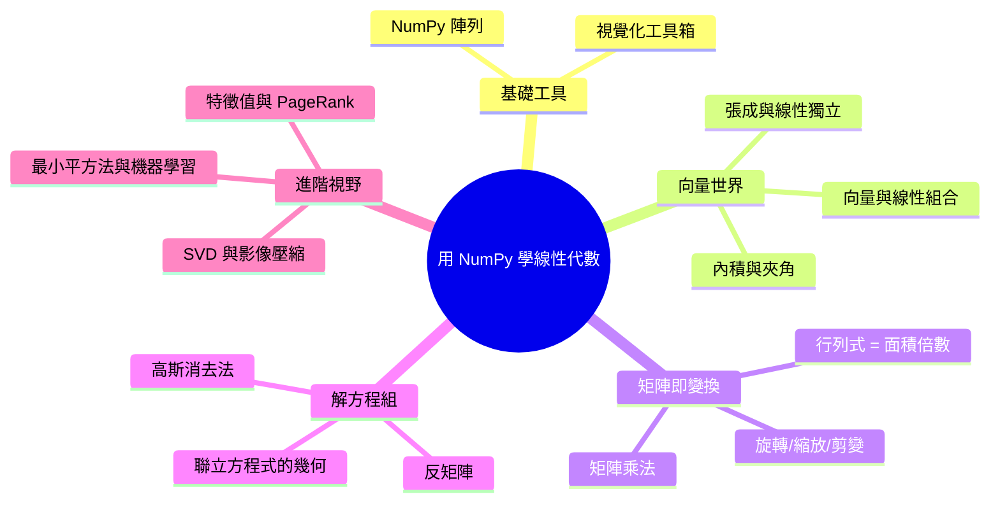

# 1.1 為什麼學線性代數

## 本節目標

- 了解線性代數在四個真實場景中的角色：機器學習、電腦遊戲、PageRank、影像處理
- 建立「**矩陣是空間的變換**」這個貫穿全書的核心直覺
- 看懂傳統課程與本書路線的差異，知道自己將怎麼學

---

## 你其實早已活在線性代數裡

如果你玩過手機上的美顏濾鏡、看過 ChatGPT 回答問題、或在遊戲裡轉動攝影視角，
那麼**每一秒都有無數次矩陣乘法在你的裝置上發生**。線性代數不是抽象的數學遊戲，
它是現代電腦處理「大量數字同時變化」的通用語言。

### 場景一：機器學習——權重就是矩陣

一個神經網路的核心運算長這樣：

$$
\mathbf{y} = W\mathbf{x} + \mathbf{b}
$$

其中 $`\mathbf{x}`$ 是輸入（例如一張圖片攤平成 784 個數字的向量），
$`W`$ 是權重矩陣， $`\mathbf{y}`$ 是輸出。訓練模型，本質上就是**不斷調整矩陣 $`W`$ 裡的數字**。

```python
import numpy as np

x = np.random.randn(784)        # 一張 28x28 圖片攤平
W = np.random.randn(128, 784)   # 某一層的權重
b = np.random.randn(128)

y = W @ x + b                   # 矩陣乘向量：這就是神經網路的一層
print(y.shape)                  # (128,)
```

一行 `W @ x`，背後是十萬次乘法與加法。學會線性代數，你才知道這行字到底「做了什麼幾何動作」。

### 場景二：電腦遊戲——旋轉與投影

遊戲引擎每秒把 3D 模型的幾十萬個頂點旋轉、平移、投影到 2D 螢幕上。
每一個動作都是一個矩陣：

| 動作 | 對應的矩陣 |
|---|---|
| 角色旋轉 | 旋轉矩陣 $`R(\theta)`$ |
| 鏡頭移動 | 平移矩陣 $`T`$ |
| 3D 變 2D 畫面 | 投影矩陣 $`P`$ |

第 3 章你會親手寫出旋轉矩陣，並用 matplotlib 看著一個方塊轉起來。

### 場景三：Google PageRank——最重要的向量

Google 早期成功的核心演算法 PageRank，最後化約成一個問題：
找出方程式 $`\mathbf{r} = M\mathbf{r}`$ 的解，其中 $`M`$ 是「網頁連結矩陣」。
這個 $`\mathbf{r}`$ 就是每個網頁的重要性分數。這是線性代數中「特徵向量」的應用（第 8 章）。

### 場景四：影像處理——圖片就是矩陣

一張灰階圖片就是一個數字矩陣，每個元素是像素亮度：

```python
import numpy as np

img = np.random.randint(0, 256, size=(5, 5))  # 5x5 的「圖片」
print(img)
brighter = np.clip(img + 50, 0, 255)          # 調亮 = 每個元素 +50
flipped = img[:, ::-1]                        # 左右翻轉 = 反向切片
```

濾鏡、銳化、壓縮（JPEG 用到 SVD，第 9 章），全部是矩陣運算。

---

## 本書的核心主張：矩陣是空間的變換

傳統教法先教你解方程式、算行列式，學了一學期卻不知道矩陣「是什麼」。
本書主張反過來：

> **一個矩陣 $`A`$ 乘上一個向量 $`\mathbf{v}`$ ，就是把向量 $`\mathbf{v}`$ 在空間中「搬動、拉伸、旋轉」。
> 矩陣不只是數字表格，它是空間的變換機。**

例如矩陣

$$
A = \begin{bmatrix} 0 & -1 \\ 1 & 0 \end{bmatrix}
$$

乘在任何向量上，都會把它**逆時針旋轉 90 度**。不信的話：

```python
import numpy as np

A = np.array([[0, -1],
              [1,  0]])
v = np.array([1, 0])
print(A @ v)    # [0 1]  —— (1,0) 被轉到了 (0,1)
```

當你用「變換」的眼光看矩陣，行列式、特徵值、秩這些抽象概念都會變成**看得見的幾何性質**：
- 行列式 = 面積被放大幾倍
- 特徵向量 = 變換後方向不變的箭頭
- 秩 = 變換後空間被壓扁到幾維

---

## 一學期課程 vs 本書路線

| 傳統一學期課程 | 本書路線 |
|---|---|
| 第 1 週起就解聯立方程式 | 第 1 章先用圖建立向量與變換直覺 |
| 行列式用公式硬算 | 行列式 = 面積縮放倍數，畫圖驗證 |
| 向量空間用公理定義 | 從「線性組合能到達哪些點」出發 |
| 手算大量習題 | NumPy 代勞計算，你專心觀察幾何 |
| 抽象概念靠背誦 | 每個概念配 matplotlib 圖解 |
| 學完不知道能幹嘛 | 每章連結 ML / 遊戲 / 影像等應用 |

---

## 本書知識地圖



---

## 小結與練習

**本節重點**
1. 線性代數是 ML、遊戲、搜尋引擎、影像處理的共同底層語言。
2. 核心直覺：**矩陣是空間的變換**，之後每一章都會回到這句話。
3. 本書用「畫圖觀察」取代「公式硬算」。

**練習**
1. 執行本節的旋轉矩陣程式，把 $`\mathbf{v}`$ 換成 `[2, 3]`，輸出是多少？畫在紙上驗證是否旋轉了 90 度。
2. 想想你常用的 App，猜猜哪一個功能背後有矩陣運算？
3. 把矩陣 $`A`$ 改成 $`\begin{bmatrix} 2 & 0 \\ 0 & 2 \end{bmatrix}`$ ，猜猜它對向量做什麼？用 NumPy 驗證。
