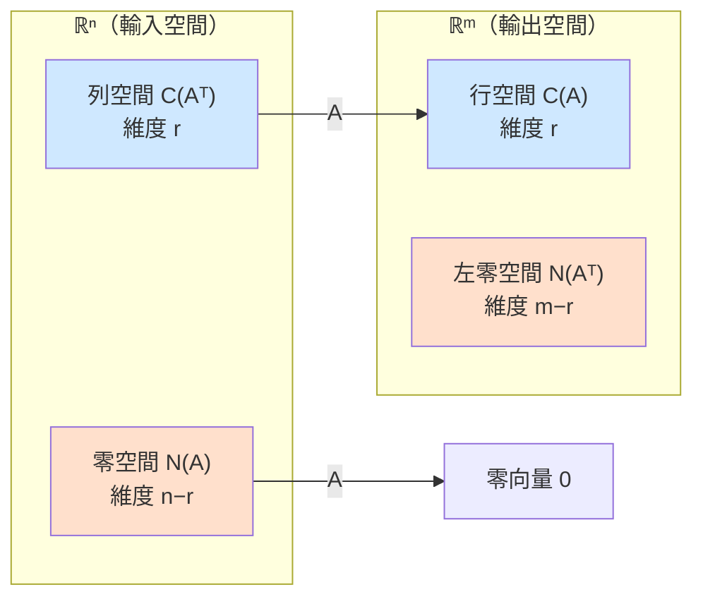

# 4.3 四個基本子空間：行、列、零、左零

## 本節目標

- 認識矩陣 $`A`$ 的四個基本子空間：列空間、行空間、零空間、左零空間
- 掌握 **rank-nullity 定理** $`r + (n-r) = n`$ 的幾何意義
- 用 `scipy.linalg.null_space` 實際求出四個子空間
- 理解四者之間的 **正交補** 關係
- 實驗：完整解剖一個 3×3 奇異矩陣

---

## 一個矩陣，四個地盤

一個 $`m \times n`$ 矩陣 $`A`$ 是 $`\mathbb{R}^n \to \mathbb{R}^m`$ 的變換：它吃進 $`n`$ 維向量、吐出 $`m`$ 維向量。
圍繞著它，有四個天然的子空間：

| 子空間 | 記號 | 定義 | 住在哪裡 |
|---|---|---|---|
| 行空間 | $`C(A)`$ | $`A`$ 的行張成的空間，即所有 $`A\mathbf{x}`$ 的落點 | $`\mathbb{R}^m`$ |
| 列空間 | $`C(A^T)`$ | $`A`$ 的列張成的空間 | $`\mathbb{R}^n`$ |
| 零空間 | $`N(A)`$ | 所有使 $`A\mathbf{x} = \mathbf{0}`$ 的解 | $`\mathbb{R}^n`$ |
| 左零空間 | $`N(A^T)`$ | 所有使 $`A^T\mathbf{y} = \mathbf{0}`$ 的解 | $`\mathbb{R}^m`$ |

用變換的語言說：**行空間是「能被抵達的輸出區域」**，零空間是「被壓成原點的輸入集合」。
如果 $`\mathbf{x}`$ 在零空間裡， $`A`$ 會把它整個抹掉 —— 這是矩陣「失去維度」的痕跡。

---

## mermaid 全景圖： $`A: \mathbb{R}^n \to \mathbb{R}^m`$



藍色的一對是「主角」：列空間裡的每個方向都被 $`A`$ 忠實送到行空間。
橙色的一對是「陰影」：零空間與左零空間是被 $`A`$ （或 $`A^T`$ ）抹成零的部分。

---

## rank-nullity 定理：被送達的 + 被抹掉的 = 全部

> **rank-nullity 定理**：對 $`m \times n`$ 矩陣 $`A`$ ，秩 $`r = \mathrm{rank}(A)`$ ，則
>
> 

$$
> r + (n - r) = n
>
$$

>
> 即： $`\dim C(A^T) + \dim N(A) = n`$ 。

幾何直覺：輸入空間 $`\mathbb{R}^n`$ 被 $`A`$ 劈成兩半 ——
**有 $`r`$ 個維度的方向被成功傳送**（列空間，對應行空間），**有 $`n - r`$ 個維度的方向被抹成零**（零空間）。
矩陣越「奇異」（秩越低），被抹掉的維度越多。

同樣的等式在輸出側也成立： $`\dim C(A) + \dim N(A^T) = m`$ 。
注意 $`\dim C(A) = \dim C(A^T) = r`$ ：**行空間與列空間維度永遠相同** —— 這正是「秩」這個數字如此基本的原因。

---

## 用 scipy 求四個子空間

NumPy 沒有現成的零空間函式，但 SciPy 有。四個子空間的基底一次到手：

```python
import numpy as np
from scipy.linalg import null_space

def four_subspaces(A, atol=1e-10):
    """回傳 A 的四個基本子空間的基底（每行一個基向量）。"""
    m, n = A.shape
    r = np.linalg.matrix_rank(A, tol=atol)

    N_A   = null_space(A)        # 零空間，住在 R^n
    N_At  = null_space(A.T)      # 左零空間，住在 R^m

    # 列空間 = A^T 的行空間；行空間 = A 的行空間
    # 技巧：null_space(A, rcond) 的正交補可用 SVD 或 QR 取得，
    # 這裡用最直白的方式：對行做 QR，前 r 個正交行即是基底。
    Q, _ = np.linalg.qr(A.T)     # Q 的前 r 行張成列空間
    C_At = Q[:, :r]
    Q2, _ = np.linalg.qr(A)      # Q2 的前 r 行張成行空間
    C_A  = Q2[:, :r]
    return {"C(A)": C_A, "C(A^T)": C_At, "N(A)": N_A, "N(A^T)": N_At}

A = np.array([[1., 2., 1.],
              [2., 4., 2.],
              [1., 2., 1.]])      # 三列成比例 -> 奇異
for name, basis in four_subspaces(A).items():
    print(f"{name} 的基底維度: {basis.shape[1]}")
```

---

## 正交補：四個子空間的兩兩配對

四個子空間不只是各自的空間，它們在各自的環境裡**互相垂直**：

$$
C(A^T) \perp N(A) \quad \text{（在 } \mathbb{R}^n \text{ 內）}，
\qquad
C(A) \perp N(A^T) \quad \text{（在 } \mathbb{R}^m \text{ 內）}
$$

為什麼 $`C(A^T) \perp N(A)`$ ？看零空間定義 $`A\mathbf{x} = \mathbf{0}`$ 展開的第 $`i`$ 條：

$$
(\text{第 } i \text{ 列}) \cdot \mathbf{x} = 0
$$

**零空間的向量與每一列都垂直**，因此與所有列張成的空間（列空間）垂直。
兩個互相垂直、維度又加起來剛好等於 $`n`$ 的子空間，我們說它們互為 **正交補**：
$`\mathbb{R}^n`$ 被乾淨地切成「列空間 + 零空間」兩塊互相垂直的地板。

```python
# 驗證正交性：C(A^T) 的每個基向量 與 N(A) 的每個基向量 內積應為 0
subs = four_subspaces(A)
G = subs["C(A^T)"].T @ subs["N(A)"]
print("C(A^T) 與 N(A) 的內積矩陣（應全為 0）:\n", np.round(G, 12))
```

---

## 實驗：一個 3×3 奇異矩陣的完整解剖

取一個設計過的奇異矩陣，逐一檢驗四個子空間與所有定理：

```python
A = np.array([[1., 2., 1.],
              [2., 4., 2.],     # = 2 * 第一列
              [1., 2., 1.]])    # = 第一列

r = np.linalg.matrix_rank(A)
m, n = A.shape
print(f"矩陣 {m}x{n}，秩 r = {r}")            # 1

subs = four_subspaces(A)
for name, B in subs.items():
    print(f"\n{name}（維度 {B.shape[1]}）基底：\n", np.round(B, 4))

# 檢驗 rank-nullity：r + (n - r) == n
print("\nrank-nullity:", r, "+", n - r, "=", n)
assert subs["C(A^T)"].shape[1] + subs["N(A)"].shape[1] == n
assert subs["C(A)"].shape[1]   + subs["N(A^T)"].shape[1] == m

# 檢驗零空間真的是零空間：A @ N(A) ≈ 0
print("A @ N(A) 的最大絕對值:", np.abs(A @ subs["N(A)"]).max())
# 檢驗正交補：兩對內積矩陣都應為零矩陣
print("正交性檢查：",
      np.allclose(subs["C(A^T)"].T @ subs["N(A)"], 0),
      np.allclose(subs["C(A)"].T   @ subs["N(A^T)"], 0))
```

這個 $`A`$ 的故事很清楚：三列全部成比例，所以**列空間是一條直線**（方向 $`(1,2,1)`$ ）；
三行也只有兩種比例關係，行空間同樣是一條直線（方向 $`(1,2,1)^T`$ 在輸出側的化身）。
零空間是二維平面（兩個獨立解，例如 $`(-2,1,0)`$ 與 $`(-1,0,1)`$ ）——
$`\mathbb{R}^3`$ 的輸入被壓到一條線上，其餘 $`3 - 1 = 2`$ 個維度全部被抹掉。

---

## 小結與練習

**本節重點**
1. 矩陣 $`A: \mathbb{R}^n \to \mathbb{R}^m`$ 有四個基本子空間：行、列、零、左零。
2. rank-nullity： $`r + (n-r) = n`$ ；「被送達的維度 + 被抹掉的維度 = 輸入維度」。
3. 行空間與列空間維度相同（都等於秩 $`r`$ ）；零空間可用 `scipy.linalg.null_space` 求得。
4. 四個子空間兩兩配對成正交補： $`C(A^T) \perp N(A)`$ 、 $`C(A) \perp N(A^T)`$ 。

**練習**
1. 對本節的 $`A`$ ，用手算找出零空間的兩個獨立解，並與 `null_space(A)` 的輸出對照（注意：基底不唯一，但張成相同）。
2. 對單位矩陣 $`I_3`$ 求四個子空間，說明為什麼零空間與左零空間都「消失」了。
3. 構造一個秩為 2 的 3×3 矩陣（例如兩列隨機、第三列為前兩列之和），用本節程式完整解剖它，畫出對應的 mermaid 圖並標上實際維度。
4. （思考題）如果 $`A\mathbf{x} = \mathbf{b}`$ 有解，為什麼 $`\mathbf{b}`$ 必定落在行空間 $`C(A)`$ 裡？這和第 3.1 節「方程組的三種命運」如何呼應？
