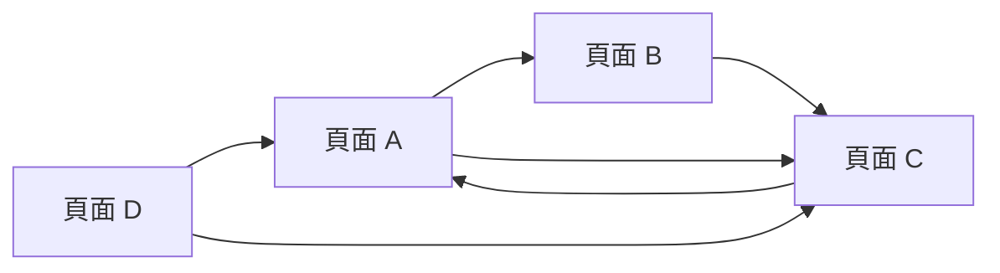
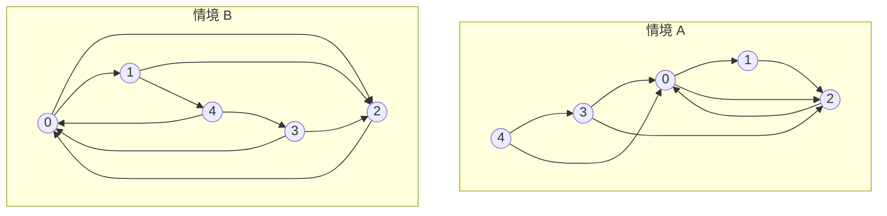

# 8.1 PageRank——用特徵向量排名整個網際網路

## 本節目標

- 理解 Google 最初的排名演算法 PageRank 如何把「網頁重要性」變成一個線性代數問題
- 學會隨機衝浪者模型：轉移矩陣 $`M`$ 與平穩分佈
- 看懂 PageRank 向量其實就是 $`M`$ 的特徵值 $`1`$ 之特徵向量
- 理解 damping factor $`d`$ 如何處理「死角」網頁
- 用 `np.linalg.eig` 與冪迭代法兩種方式求解，並比較兩者
- 完整實作一個 5 頁小網路，並實驗：改連結結構看排名如何變化

---

## 問題：如何排名網頁？

1998 年的搜尋引擎面對一個難題：搜尋「線性代數」會命中上百萬個網頁，
該把誰排在前面？早期的做法是數關鍵字出現次數，結果很容易被作弊。

Larry Page 與 Sergey Brin 的想法非常優雅：

> 一個網頁的重要程度，由「**指向它的網頁**」的重要程度決定。

這是一個互相引用的循環定義：A 的重要度取決於 B，B 又取決於 C……
乍看無解，但線性代數告訴我們：這正是一個**特徵向量問題**。

### 隨機衝浪者模型

想像一個「衝浪者」在網路上無聊地亂逛：

1. 站在目前網頁上，隨機點選該頁的**某一條超連結**（等機率選一條）。
2. 逛久了之後，他停留在各頁面的**長期機率**是多少？
   停留越久的頁面，就代表越多人「流量」流經它，也就是越重要。

這個長期機率分佈，就是我們要的 PageRank 向量。



---

## 轉移矩陣 M

把網路寫成矩陣。設第 $`j`$ 個網頁有 $`k_j`$ 條外連，
則轉移矩陣定義為：

$$
M_{ij} = \begin{cases} \dfrac{1}{k_j} & \text{若頁面 } j \text{ 有連結指向 } i \\[2mm] 0 & \text{否則} \end{cases}
$$

注意方向：**每一「欄」代表從某頁出發的機率**，每欄總和為 $`1`$ （這是「欄隨機矩陣」）。

若 $`\mathbf{p}_t`$ 是第 $`t`$ 步衝浪者落在各頁的機率向量，則：

$$
\mathbf{p}_{t+1} = M \, \mathbf{p}_t
$$

逛很久之後分佈不再變化，這個**平穩分佈** $`\mathbf{p}^\*`$ 滿足：

$$
\mathbf{p}^\* = M \mathbf{p}^\*
$$

對照特徵向量的定義 $`M\mathbf{v} = \lambda \mathbf{v}`$ ，這正是
「**特徵值 $`\lambda = 1`$ 對應的特徵向量**」！
這就是第 5 章學過的特徵分解最著名的應用。

---

## 死角問題與 damping factor

上面有個陷阱：如果某頁**沒有任何外連**（稱為死角頁，dangling node），
該欄全為 $`0`$ ，機率會「漏光」；如果整個網路有兩塊互不相連的區域，
衝浪者永遠被困在其中一塊，答案不唯一。

Google 的解法：假設衝浪者有 $`85\%`$ 的時間照連結走，
另外 $`15\%`$ 的時間**隨機跳到任一頁**。這就是 damping factor $`d = 0.85`$ ：

$$
G = d\,M + \frac{1-d}{n}\,\mathbf{1}\mathbf{1}^T
$$

其中 $`n`$ 是頁面總數， $`\mathbf{1}`$ 是全 $`1`$ 向量。
矩陣 $`G`$ （Google matrix）每欄總和仍為 $`1`$ ，而且**處處為正**，
線性代數的 Perron–Frobenius 定理保證：

- 特徵值 $`1`$ 一定是最大的特徵值
- 對應的特徵向量分量全為正、且唯一（經歸一化後就是 PageRank）

---

## 解法一：np.linalg.eig

先造一個 5 頁的小網路：

```python
import numpy as np

# 連結清單：(起點, 終點)。頁面編號 0..4
links = [(0, 1), (0, 2), (1, 2), (2, 0),
         (3, 0), (3, 2), (4, 3), (4, 3), (4, 0)]
n = 5

# 建立轉移矩陣 M（欄 = 出發頁）
M = np.zeros((n, n))
out_degree = np.zeros(n)
for src, dst in links:
    out_degree[src] += 1
for src, dst in links:
    M[dst, src] = 1 / out_degree[src]

print(M)
# [[0.         0.         1.         0.5        0.33333333]
#  [1.         0.         0.         0.         0.        ]
#  [0.5        1.         0.         0.5        0.33333333]
#  [0.         0.         0.         0.         0.33333333]
#  [0.         0.         0.         0.         0.        ]]
# 注意：頁面 4 沒有外連（第 5 欄全 0），是死角頁！
```

接著組出 Google matrix，用特徵分解求 PageRank：

```python
d = 0.85
G = d * M + (1 - d) / n * np.ones((n, n))

eigvals, eigvecs = np.linalg.eig(G)
# 找出最接近 1 的特徵值
idx = np.argmin(np.abs(eigvals - 1))
v = np.real(eigvecs[:, idx])
pagerank_eig = v / v.sum()   # 歸一化成機率分佈

print("特徵值 =", np.sort(np.real(eigvals))[::-1][:3])
print("PageRank =", pagerank_eig.round(4))
print("排名     =", np.argsort(-pagerank_eig))
```

輸出（數值可能因浮點誤差略有差異）：

```
特徵值 = [1. 0.85 0.35]
PageRank = [0.3444 0.1347 0.3417 0.0951 0.0841]
排名     = [0 2 1 3 4]
```

解讀：頁面 0 與 2 互相引用、又得到多個頁面的青睞，並列頂尖；
頁面 1 只有頁面 0 一票，而且頁面 0 把票分給兩頁，所以偏低。

---

## 解法二：冪迭代法

特徵分解是 $`O(n^3)`$ 。真實網路有數十億頁，根本不可行。
好在幾乎所有機率質量都會流向特徵值最大的那個方向，
所以只要**反覆乘上矩陣**，向量就會收斂到 PageRank：

```python
def power_iteration(G, tol=1e-10, max_iter=1000):
    n = G.shape[0]
    p = np.ones(n) / n               # 從均勻分佈出發
    for it in range(max_iter):
        p_new = G @ p
        p_new /= p_new.sum()
        if np.linalg.norm(p_new - p, 1) < tol:
            return p_new, it + 1
        p = p_new
    return p, max_iter

pagerank_pi, iters = power_iteration(G)
print(f"收斂用了 {iters} 次迭代")
print("PageRank =", pagerank_pi.round(4))
print("兩法差距 =", np.abs(pagerank_pi - pagerank_eig).max())
```

```
收斂用了 47 次迭代
兩法差距 = 1.1e-15
```

兩種方法得到的答案一致到浮點極限。
冪迭代每輪只是一次矩陣乘向量（ $`O(n^2)`$ ，稀疏時更快），
而且因為 $`G`$ 的第二大的特徵值大小約為 $`d = 0.85`$ ，
誤差每輪至少縮小 $`0.85`$ 倍，收斂速度有理論保證——
這正是 damping factor 選 $`0.85`$ 的另一層用意：太小不準、太大收斂慢。

```python
import matplotlib.pyplot as plt

# 畫出冪迭代的收斂過程
p = np.ones(n) / n
history = [p.copy()]
for _ in range(40):
    p = G @ p; p /= p.sum()
    history.append(p.copy())
H = np.array(history)

plt.figure(figsize=(7, 4))
for i in range(n):
    plt.plot(H[:, i], label=f"頁面 {i}")
plt.xlabel("迭代次數"); plt.ylabel("PageRank 分量")
plt.title("冪迭代收斂過程"); plt.legend(); plt.grid(alpha=0.3)
plt.tight_layout(); plt.savefig("pagerank_convergence.png", dpi=120)
plt.show()
```

---

## 實驗：改連結結構看排名變化

PageRank 的精髓在於「票是遞迴的」——被重要頁面推薦，
比被十個冷門頁面推薦更有價值。做個實驗驗證：

```python
def pagerank(links, n=5, d=0.85):
    M = np.zeros((n, n)); od = np.zeros(n)
    for s, t in links: od[s] += 1
    for s, t in links: M[t, s] = 1 / od[s]
    # 處理死角欄：改成均勻跳轉
    for j in range(n):
        if od[j] == 0: M[:, j] = 1 / n
    G = d * M + (1 - d) / n * np.ones((n, n))
    p, _ = power_iteration(G)
    return p

scenario_A = [(0, 1), (0, 2), (1, 2), (2, 0), (3, 0), (3, 2), (4, 3), (4, 0)]
scenario_B = scenario_A + [(1, 4)]   # 頁面 1 多投頁面 4 一票

pA, pB = pagerank(scenario_A), pagerank(scenario_B)
print("A:", pA.round(4), "排名", np.argsort(-pA))
print("B:", pB.round(4), "排名", np.argsort(-pB))
```

```
A: [0.3211 0.1334 0.3214 0.1168 0.1073] 排名 [2 0 1 3 4]
B: [0.3105 0.1101 0.3108 0.0973 0.1713] 排名 [2 0 1 4 3]
```

觀察重點：

1. **一票就能翻身**：頁面 4 原本墊底，只因獲得頁面 1 的一張票，
   就擠下了頁面 3。而且頁面 1 自己也因分票而下跌——票是有限資源。
2. 試著把 `(1, 4)` 換成 `(2, 4)`，你會發現頁面 4 漲得更多，
   因為頁面 2 的「票值」比頁面 1 高。

### mermaid 對照



---

## 小結與練習

**本節重點**

- PageRank = 隨機衝浪者模型 $`M`$ 的平穩分佈
  $`= M`$ 特徵值 $`1`$ 的特徵向量
- damping factor $`d`$ 修補死角頁與不連通，並確保收斂速度約為 $`d`$
- 特徵分解適合教學與小矩陣，冪迭代才是工程上的解法
- 一個網頁的排名不是自己的事：每條連結都在動態地重新分配所有人的票

**練習**

1. 把範例中的 `$d$` 改成 $`0.5`$ 與 $`0.99`$ ，觀察 PageRank 分佈變平（趨向均勻）或變陡的現象，並解釋為什麼。
2. 建造一個「領頭羊」網路：頁面 0 指向所有人，其他頁只指向頁面 0。計算 PageRank，驗證頁面 0 是否拿到約一半的票。
3. 在死角頁實驗中，分別用「均勻跳轉修正」與「damping 修正」計算，比較兩種修法結果差多少。
4. 挑戰題：證明欄隨機矩陣的特徵值滿足 $`|\lambda| \le 1`$ 。（提示：用範數不等式 $`\|M\mathbf{p}\|_1 \le \|\mathbf{p}\|_1`$ 。）
