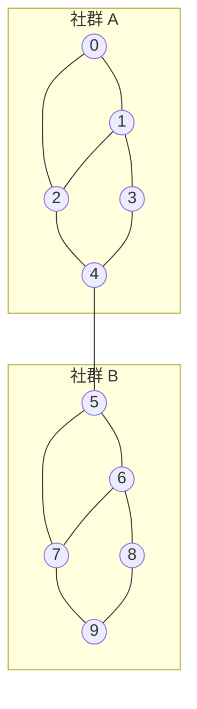

# 8.3 圖與網路的矩陣——鄰接矩陣、Laplacian 與譜聚類

## 本節目標

- 學會圖的三種矩陣表示：鄰接矩陣 $`A`$ 、度矩陣 $`D`$ 、Laplacian $`L = D - A`$
- 理解鄰接矩陣的冪 $`A^k`$ 的意義：路徑計數，並用程式驗證
- 用 Laplacian 特徵值判斷圖的連通性（algebraic connectivity）
- 概念式理解譜聚類，並對一個「兩個社群」的圖完成小型實作
- 完整分析一個社群網路範例

---

## 問題：怎麼讓電腦「看見」一個網路？

社群、交通、神經元、超連結——世界上充滿了「點與連線」的結構（圖，graph）。
第 8.1 節的 PageRank 只用了一半的工具（轉移矩陣），這一節把整套矩陣武器補齊。

### 圖的矩陣表示

一個 $`n`$ 個節點的無向圖可以用 $`n \times n`$ 的**鄰接矩陣** $`A`$ 表示：

$$
A_{ij} = \begin{cases} 1 & \text{節點 } i, j \text{ 之間有邊} \\ 0 & \text{否則} \end{cases}
$$

無向圖的 $`A`$ 是對稱矩陣；有向圖（如 8.1 的網頁連結）則不一定。
**度矩陣** $`D`$ 是對角矩陣，對角線上是各節點的連接數：

$$
D_{ii} = \sum_j A_{ij}
$$

而本節的主角 **Laplacian 矩陣**定義為兩者之差：

$$
L = D - A
$$

一個刻畫圖的幾何性質、又是半正定的對稱矩陣——它的特徵值和特徵向量
幾乎編碼了整個圖的「形狀」。

---

## 鄰接矩陣的冪：路徑計數器

矩陣乘法的定義恰好和圖論的直覺對上。 $`A^2`$ 的第 $`(i, j)`$ 元：

$$
(A^2)_{ij} = \sum_{k} A_{ik} A_{kj} = \#\{\text{從 } i \text{ 經中間點 } k \text{ 到 } j \text{ 的 2 步路徑數}\}
$$

一般化：

> $`A^k`$ 的 $`(i, j)`$ 元 $`=`$ 從節點 $`i`$ 到節點 $`j`$ 、**長度恰好為 $`k`$ ** 的路徑數。

用一個 4 節點的鏈狀圖驗證：


```python
import numpy as np

A = np.array([
    [0, 1, 0, 0],
    [1, 0, 1, 0],
    [0, 1, 0, 1],
    [0, 0, 1, 0],
])
A2 = A @ A
print("A^2 =\n", A2)
print("從 1 到 3 的 2 步路徑數 =", A2[0, 2])   # 1（1→2→3）
print("從 1 到 4 的 2 步路徑數 =", A2[0, 3])   # 0（不可能兩步走到）
```

```
A^2 =
 [[1 0 1 0]
  [0 2 0 1]
  [1 0 2 0]
  [0 1 0 1]]
從 1 到 3 的 2 步路徑數 = 1
從 1 到 4 的 2 步路徑數 = 0
```

再驗證 $`A^3`$ ，並用**暴力列舉所有路徑**做交叉檢查：

```python
from itertools import product

A3 = A @ A @ A
print("A^3[0, 3] =", A3[0, 3])   # 應為 1：1→2→3→4

# 暴力法：列舉所有長度 k 的節點序列，數有幾條是合法路徑
def count_walks(A, s, t, k):
    n = len(A)
    return sum(
        all(A[p[i], p[i + 1]] for i in range(k))
        for p in product(range(n), repeat=k + 1)
        if p[0] == s and p[-1] == t
    )

for k in range(1, 5):
    Mk = np.linalg.matrix_power(A, k)
    ok = all(Mk[s, t] == count_walks(A, s, t, k)
             for s in range(4) for t in range(4))
    print(f"k={k}: 矩陣冪與暴力列舉一致？ {ok}")
```

```
A^3[0, 3] = 1
k=1: 矩陣冪與暴力列舉一致？ True
k=2: 矩陣冪與暴力列舉一致？ True
k=3: 矩陣冪與暴力列舉一致？ True
k=4: 矩陣冪與暴力列舉一致？ True
```

兩種完全不同的方法（代數的矩陣冪 vs 組合的暴力列舉）給出相同答案，
這就是「矩陣乘法 = 路徑組合」的具體證明。
順帶一提：若 $`A^k`$ 的對角元 $`(A^k)_{ii} > 0`$ ，
代表節點 $`i`$ 有長度 $`k`$ 的**環**回到自己——這是判斷三角形、
社群內部凝聚力的常用技巧。

---

## Laplacian 與連通性

對任意向量 $`\mathbf{x}`$ ，Laplacian 有一個漂亮的二次型：

$$
\mathbf{x}^T L \mathbf{x} = \sum_{(i,j) \in E} (x_i - x_j)^2
$$

右邊是「相鄰節點的標籤差」的總和，永遠 $`\ge 0`$ ——所以 $`L`$ **半正定**，
特徵值全部 $`\ge 0`$ ，而且：

- **最小特徵值必為 $`0`$ **（取 $`\mathbf{x}`$ 為常數向量即可， $`\mathbf{x}^T L \mathbf{x} = 0`$ ）
- **特徵值 $`0`$ 的重數 $`=`$ 連通分量的個數**！

這給了一個驚人的能力：**對矩陣做特徵分解，就能知道圖斷成幾塊**。
第二大特徵值 $`\lambda_2`$ 稱為 **algebraic connectivity**
（代數連通度）： $`\lambda_2 > 0`$ 代表圖連通，而且 $`\lambda_2`$ 越大，
圖被切斷所需的「成本」越高、連接越緊密。

```python
def laplacian(A):
    return np.diag(A.sum(axis=1)) - A

# 情境一：兩個孤立的三角形（斷成兩塊）
A_disc = np.zeros((6, 6))
for i, j in [(0,1),(1,2),(2,0),(3,4),(4,5),(5,3)]:
    A_disc[i, j] = A_disc[j, i] = 1

L = laplacian(A_disc)
eigvals = np.linalg.eigvalsh(L)   # 對稱矩陣用 eigvalsh
print("特徵值 =", eigvals.round(3))
print("接近 0 的特徵值個數 =", int((eigvals < 1e-9).sum()))
```

```
特徵值 = [0. 0. 3. 3. 3. 3.]
接近 0 的特徵值個數 = 2
```

兩個 $`0`$ ，正確指出兩個連通分量。若把兩個三角形之間加一條橋邊 `(2, 3)`：

```python
A_conn = A_disc.copy()
A_conn[2, 3] = A_conn[3, 2] = 1
eigvals = np.linalg.eigvalsh(laplacian(A_conn))
print("加橋後特徵值 =", eigvals.round(3))
# 加橋後特徵值 = [0.    0.586 3.    3.414 4.    5.   ]
```

只剩一個 $`0`$ （連通了），而且 $`\lambda_2 = 0.586`$ ——
橋邊雖然只接了一條，卻讓整個圖從「必然斷裂」變成「勉強連通」，
algebraic connectivity 從 $`0`$ 跳升到 $`0.586`$ 。

---

## 譜聚類：讓特徵向量替你分社群

真實社群網路是連通的，但內部常有「社群內邊很密、社群之間只有稀疏橋」的結構。
**譜聚類（spectral clustering）**的想法：

1. 算 Laplacian $`L`$ 的特徵向量
2. 第二小特徵值對應的特徵向量 $`\mathbf{v}_2`$ （稱 Fiedler 向量）
   把節點投影成一條數線——同一社群的節點數值相近
3. 直接看 $`\mathbf{v}_2`$ 的**正負號**（或對其做 k-means）即可分群

為什麼有效？回看二次型 $`\mathbf{x}^T L \mathbf{x} = \sum (x_i - x_j)^2`$ ：
$`\mathbf{v}_2`$ 是在「與常數向量垂直」的約束下讓這個和最小的向量——
也就是**盡量讓相鄰節點取值接近、同時不退化成常數**的標籤。
被橋邊連接的兩個社群，自然分別聚在數線的兩側。

### 兩社群圖的完整實作

造一個 10 節點的圖：節點 0–4 是一個緊密社群，5–9 是另一個，中間只有一條橋：



```python
import matplotlib.pyplot as plt

edges = [(0,1),(0,2),(1,2),(1,3),(2,4),(3,4),
         (5,6),(5,7),(6,7),(6,8),(7,9),(8,9),(4,5)]
n = 10
A = np.zeros((n, n))
for i, j in edges:
    A[i, j] = A[j, i] = 1

L = laplacian(A)
eigvals, eigvecs = np.linalg.eigh(L)   # 由小到大排序
print("特徵值 =", eigvals.round(3))
# 特徵值 = [0.    0.268 1.586 2.    2.382 3.    3.    3.382 3.414 4.   ]

v2 = eigvecs[:, 1]     # Fiedler 向量
print("Fiedler 向量 =", v2.round(2))
labels = (v2 > 0).astype(int)
print("分群結果 =", labels)
# 分群結果 = [1 1 1 1 1 0 0 0 0 0]
```

正負號完美把 0–4 和 5–9 分成兩群，演算法只看矩陣、完全不知道人為社群的存在。

```python
# 視覺化：用圓形佈局畫圖，節點顏色 = 分群結果
theta = np.linspace(0, 2 * np.pi, n, endpoint=False)
pos = np.c_[np.cos(theta), np.sin(theta)]

plt.figure(figsize=(5, 5))
for i, j in edges:
    plt.plot(*pos[[i, j]].T, color="gray", zorder=1)
scatter = plt.scatter(*pos.T, c=labels, cmap="coolwarm",
                      s=600, zorder=2, edgecolors="k")
for i in range(n):
    plt.annotate(str(i), pos[i], ha="center", va="center", fontsize=11)
plt.title(f"Fiedler 向量分群（λ₂ = {eigvals[1]:.3f}）")
plt.axis("off"); plt.tight_layout()
plt.savefig("spectral_clustering.png", dpi=120); plt.show()
```

---

## 社群網路範例：更真實的結構

真實社群不是完美兩團。做一個 12 人網路：
三個小圈圈（室友團、社團團、同事團），各有少量跨團友誼：

```python
rng = np.random.default_rng(42)

groups = [range(0, 4), range(4, 8), range(8, 12)]
A = np.zeros((12, 12))

def add_edge(i, j):
    A[i, j] = A[j, i] = 1

# 圈內：每個群補成較密的隨機圖
for g in groups:
    g = list(g)
    for i in g:
        for j in g:
            if i < j and rng.random() < 0.85:
                add_edge(i, j)
# 跨圈：稀疏的弱連結
for _ in range(4):
    i = rng.choice(4);  j = rng.integers(4, 12); add_edge(i, j)
for _ in range(3):
    i = rng.integers(4, 8); j = rng.integers(8, 12); add_edge(i, j)

L = laplacian(A)
eigvals, eigvecs = np.linalg.eigh(L)
v2 = eigvecs[:, 1]
print("λ2 =", eigvals[1].round(3), "（不大 → 容易切成兩大塊）")
labels = (v2 > 0).astype(int)
print("兩大塊分群 =", labels)

# 想切三群，就多取一個特徵向量 v3，對 (v2, v3) 平面上的點做 k-means
v3 = eigvecs[:, 2]
pts = np.c_[v2, v3]
centers = pts[[0, 4, 8]].copy()          # 粗略初始中心
for _ in range(20):
    lab = np.argmin(
        ((pts[:, None, :] - centers[None, :, :]) ** 2).sum(axis=2), axis=1)
    centers = np.array([pts[lab == c].mean(axis=0) for c in range(3)])
print("三群分群 =", lab)
```

（分群輸出會依隨機邊而異，但模式穩定：先切成兩大塊，
再用 Fiedler 平面上的 k-means 恢復三個原始社群。）

解讀：

- $`\lambda_2`$ 小，代表整個網路「鬆散相連」，少剪幾條邊就斷
- Fiedler 向量 $`\mathbf{v}_2`$ 找的是**最脆弱的切面**（二分）
- 要找 $`k`$ 個社群，就取前 $`k`$ 個非零特徵向量當座標，在 $`\mathbb{R}^k`$ 裡做普通聚類
  ——這正是譜聚類的完整流程：**把圖的結構問題變成歐氏空間的幾何問題**

---

## 小結與練習

**本節重點**

- 圖的三件套： $`A`$ （誰連誰）、 $`D`$ （連幾個）、 $`L = D - A`$ （圖的形狀）
- $`A^k`$ 是路徑計數器：矩陣乘法就是「走一步」的組合
- $`L`$ 半正定；特徵值 $`0`$ 的個數 $`=`$ 連通分量數；
  $`\lambda_2`$ （algebraic connectivity）衡量「連得有多緊」
- 譜聚類：Fiedler 向量把圖切成最脆弱的兩半；
  多個特徵向量 + k-means 可推廣到 $`k`$ 個社群

**練習**

1. 對 4 節點鏈狀圖計算 $`A^4`$ ，用暴力列舉驗證 $`(A^4)_{13} = 3`$ ，並在圖上把這三條 4 步路徑畫出來。
2. 把兩社群範例中的橋邊從 1 條增加到 3 條，觀察 $`\lambda_2`$ 如何上升，並解釋「社群界線變模糊」在特徵值上的體現。
3. 用 `(A @ A > 0)` 找出範例社群網路中「朋友的朋友」對（原本不相連的），數量多嗎？這和六度分隔理論有什麼關係？
4. 挑戰題：證明 $`\mathbf{x}^T L \mathbf{x} = \sum_{(i,j)\in E}(x_i - x_j)^2`$ ，並由此說明 $`L`$ 半正定、特徵值 $`0`$ 對應常數向量。
