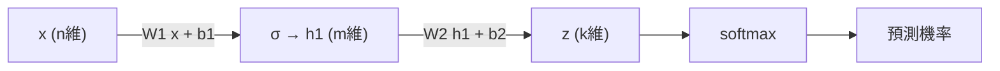

# 10.2 神經網路就是矩陣乘法

## 本節目標

- 理解一層神經網路就是一個仿射變換 $`W\mathbf{x} + \mathbf{b}`$ 加上非線性激活函數。
- 看懂多層網路 = 矩陣乘法鏈，反向傳播 = 沿著這條鏈回傳的矩陣梯度。
- 用純 NumPy 從零實作一個兩層網路分類 `make_moons` 資料，畫出準確率曲線。
- 建立維度追蹤的習慣，實驗隱藏層寬度對效果的影響。

## 10.2.1 一層網路：仿射變換 + 非線性

第 2 章說「矩陣即變換」。神經網路的一層，就是先做一個線性變換，再經過非線性「擠一下」：

$$
\mathbf{h} = \sigma(W\mathbf{x} + \mathbf{b})
$$

其中 $`W \in \mathbb{R}^{m \times n}`$ 把 $`n`$ 維輸入映射到 $`m`$ 維， $`\sigma`$ 逐元素作用（如 $`\mathrm{ReLU}(z) = \max(0, z)`$ ）。若沒有 $`\sigma`$ ，多層相乘會塌縮成一個矩陣： $`W_2 W_1 \mathbf{x}`$ 還是線性的。**非線性才讓深度有意義**。

多層就是把這個積木串起來：



## 10.2.2 資料與維度追蹤表

用 `make_moons` 產生二維非線性可分的資料，訓練一個 $`2 \to 16 \to 2`$ 的網路。

```python
import numpy as np
import matplotlib.pyplot as plt
from sklearn.datasets import make_moons

rng = np.random.default_rng(0)
X, y = make_moons(n_samples=400, noise=0.15, random_state=0)
Y = np.eye(2)[y]                       # one-hot，形狀 (400, 2)

# 維度追蹤表
#   W1: (16, 2)   b1: (16,)    x: (2,) 或 X: (N, 2)
#   h1: (N, 16)   W2: (2, 16)  b2: (2,)   z: (N, 2)
#   關鍵規則: (N, 16) @ (16, 2) -> (N, 2)，內維必須相消
```
| 符號 | 形狀 | 意義 |
|---|---|---|
| $`X`$ | $`(N, 2)`$ | 輸入，每列一筆 |
| $`W_1`$ | $`(16, 2)`$ | 第一層權重 |
| $`H_1`$ | $`(N, 16)`$ | 隱藏層輸出 |
| $`W_2`$ | $`(2, 16)`$ | 第二層權重 |
| $`Z`$ | $`(N, 2)`$ | 輸出 logits |

寫程式時隨時問自己「這個矩陣是什麼形狀」，90% 的 bug 都能在這裡抓到。

## 10.2.3 前向傳播

```python
def relu(z):
    return np.maximum(0, z)

def softmax(z):
    z = z - z.max(axis=1, keepdims=True)   # 數值穩定
    e = np.exp(z)
    return e / e.sum(axis=1, keepdims=True)

W1 = rng.normal(scale=0.5, size=(16, 2)); b1 = np.zeros(16)
W2 = rng.normal(scale=0.5, size=(2, 16)); b2 = np.zeros(2)

def forward(X):
    H1 = relu(X @ W1.T + b1)              # (N,16)
    return H1, softmax(H1 @ W2.T + b2)    # (N,2)

def loss(P, Y):
    return -np.mean(np.sum(Y * np.log(P + 1e-12), axis=1))  # 交叉熵
```

## 10.2.4 反向傳播：梯度是矩陣

鏈鎖律在矩陣世界就是「把梯度沿著乘法鏈反著乘回去」。對交叉熵 + softmax，輸出端梯度特別乾淨： $`\partial L/\partial Z = P - Y`$ 。其餘照矩陣微積分規則：

$$
\frac{\partial L}{\partial W_2} = (P - Y)^T H_1, \qquad
\frac{\partial L}{\partial H_1} = (P - Y)\, W_2
$$

注意每個梯度的形狀與它要更新的參數相同——這是反向傳播正確性的檢查哨。

```python
def backward(X, Y, H1, P):
    dZ = P - Y                        # (N,2)
    dW2 = dZ.T @ H1 / len(X)          # (2,16)
    db2 = dZ.mean(axis=0)             # (2,)
    dH1 = dZ @ W2                     # (N,16)
    dW1 = (dH1 * (H1 > 0)).T @ X / len(X)  # ReLU 逐元素掩碼
    db1 = (dH1 * (H1 > 0)).mean(axis=0)
    return dW1, db1, dW2, db2
```

## 10.2.5 訓練迴圈與準確率曲線

```python
lr, epochs = 0.5, 300
acc_hist, loss_hist = [], []

for ep in range(epochs):
    H1, P = forward(X)
    dW1, db1, dW2, db2 = backward(X, Y, H1, P)
    W1 -= lr * dW1; b1 -= lr * db1
    W2 -= lr * dW2; b2 -= lr * db2
    loss_hist.append(loss(P, Y))
    acc_hist.append(np.mean(P.argmax(axis=1) == y))

fig, ax = plt.subplots(1, 2, figsize=(10, 4))
ax[0].plot(loss_hist); ax[0].set_title("loss"); ax[0].grid(alpha=0.3)
ax[1].plot(acc_hist); ax[1].set_title("accuracy"); ax[1].grid(alpha=0.3)
plt.tight_layout(); plt.show()

print("最終準確率:", acc_hist[-1])   # 通常 > 0.95
```

## 10.2.6 實驗：改變隱藏層寬度

```python
def train(width, epochs=300, lr=0.5):
    W1 = rng.normal(scale=0.5, size=(width, 2)); b1 = np.zeros(width)
    W2 = rng.normal(scale=0.5, size=(2, width)); b2 = np.zeros(2)
    accs = []
    for ep in range(epochs):
        H1 = relu(X @ W1.T + b1)
        P = softmax(H1 @ W2.T + b2)
        dZ = P - Y
        W2 -= lr * dZ.T @ H1 / len(X); b2 -= lr * dZ.mean(axis=0)
        dH1 = dZ @ W2
        W1 -= lr * (dH1 * (H1 > 0)).T @ X / len(X)
        b1 -= lr * (dH1 * (H1 > 0)).mean(axis=0)
        accs.append(np.mean(P.argmax(axis=1) == y))
    return accs

for w in [2, 4, 16, 64]:
    print(f"width={w:3d}  最終準確率 = {train(w)[-1]:.3f}")
```

觀察重點：寬度 2 幾乎學不動（容量不足），寬度 64 收斂更快、更平滑。參數量 = $`2w + w \cdot 2 + w + 2`$ ，也是線性代數的帳。

## 小結與練習

1. 神經網路 = 矩陣乘法鏈 + 逐元素非線性；訓練 = 對每個矩陣求梯度後做梯度下降。
2. 反向傳播就是鏈鎖律的矩陣版本，梯度形狀恆等於參數形狀。
3. 把本節的 `W1.T @ ...` 模式與 10.1 節的 $`2A^T(A\mathbf{x}-\mathbf{b})`$ 對照——是同一件事。

練習：

- (a) 把 ReLU 換成 $`\tanh`$ （梯度 $`\tanh^2`$ 改寫為 $`1-h^2`$ ），比較收斂速度。
- (b) 用同一套程式（改輸入維度為 64）訓練 sklearn `digits` 資料的 0/1 二分類。
- (c) 挑戰：把網路加到三層，並替每一層寫出維度追蹤表。
