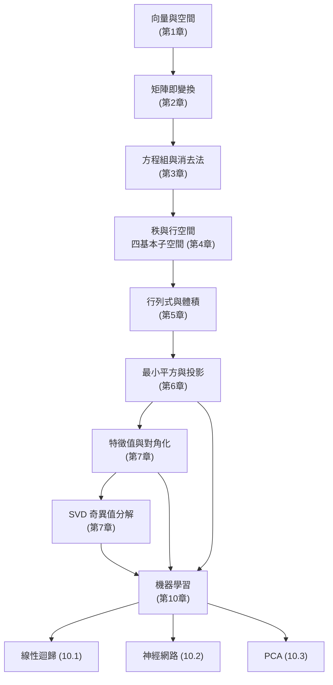
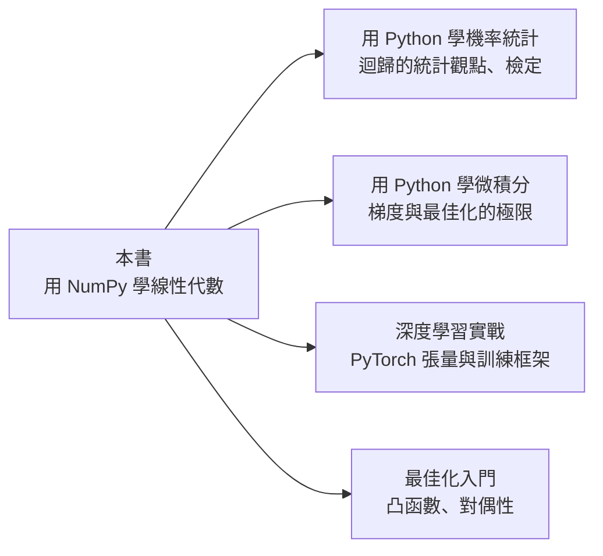

# 10.4 下一步的世界

## 本節目標

- 回顧全書：把學過的線性代數技能畫成一張地圖，看清彼此的連結。
- 認識四個值得繼續深入的主題：張量、矩陣微積分、隨機矩陣、張量分解。
- 收藏一份學習資源清單，包含「用 Lean 證明線性代數定理」的路線。
- 帶走一份挑戰題清單——學習的最好方式是自己動手做一個小專案。

## 10.4.1 全書回顧：技能地圖

三條主線值得再看一次：

- **幾何線**：向量 → 變換 → 投影 → 特徵方向。每一章都在問「這個矩陣把空間怎麼了」。
- **計算線**：NumPy 從 `@` 到 `solve` 到 `svd`，所有 ML 演算法最終都分解成這幾個操作。
- **應用線**：最小平方接迴歸、投影接神經網路的梯度、特徵值接學習率、SVD 接 PCA。

## 10.4.2 延伸主題

**張量（多維陣列）**。矩陣是 2 維，神經網路處理的批次資料是 4 維（批次 × 通道 × 高 × 寬）。捲積本質上是張量運算；PyTorch 的 API 幾乎就是 NumPy 的張量版。學好 NumPy，框架只是換了名字。

**矩陣微積分**。10.2 節的反向傳播只給了結果，背後是一套系統規則：對矩陣求導、Jacobian 的排列、 $`\frac{\partial}{\partial X}\,\mathrm{tr}(AX) = A^T`$ 這類跡函數技巧。想讀懂深度學習論文裡的推導，這是必備工具。

**隨機矩陣**。神經網路初始化的權重是隨機矩陣，它的奇異值分布決定了訊號能不能順利傳播。Xavier/He 初始化背後是隨機矩陣理論——特徵值的雪茄形分布（circular law）非常漂亮。

**張量分解**。SVD 的高維推廣（CP、Tucker 分解），用於推薦系統、壓縮深度網路、以及物理學中的量子態表示。如果你喜歡 SVD 的「秩」直覺，這是自然的下一步。

## 10.4.3 學習資源

- **Gilbert Strang《Introduction to Linear Algebra》與 MIT 18.06**：本書的幾何觀點深受 Strang 影響，他的公開課與 18.06 SC 影片是標配。進階接 18.065（Matrix Methods in Data Analysis），直接講 SVD 與資料科學。
- **3Blue1Brown《Essence of Linear Algebra》**：把「矩陣即變換」化成動畫，適合在讀第 2、7 章前後觀看，鞏固幾何直覺。
- **《用 Lean 學數學》路線**：把定理變成可被電腦驗證的證明。建議路線——先用 Lean 證「行秩 = 列秩」，再證「 $`A`$ 可對角化 $`\Leftrightarrow`$ 特徵空間維數和為 $`n`$ 」，最後挑戰「譜定理」。在證明過程中，你會被迫補齊所有「顯然」背後的細節。
- **NumPy 官方教學與 `numpy.linalg` 文件**：把每個函數對應回本書章節（`lstsq`↔第6章、`svd`↔第7章）。

## 10.4.4 與本系列其他書的銜接

- 往**機率統計**：多變量常態分布的共變異數矩陣、馬可夫鏈的特徵值 1（平穩分布）。
- 往**微積分/最佳化**：Hessian 是矩陣，正定 ↔ 局部極小，牛頓法要解線性方程組。
- 往**深度學習**：一切皆是張量運算 + 反向傳播，只是換了框架與硬體。

## 10.4.5 挑戰題清單

選幾個做成期末專案，每個都只用 NumPy 就能完成：

1. **PageRank**：用冪迭代法（反覆乘上 Google 矩陣）計算一個小圖的排名，並說明收斂速度由第二大特徵值決定。
2. **PCA 的缺失值處理**：實作「迭代 SVD 補值」——把缺失處填 0、做 SVD 低秩重建、只更新觀測位置、重複直到收斂。
3. **冪迭代與 PageRank 的變體**：對任意矩陣實作冪迭代，畫出每次迭代的 Rayleigh 商收斂到最大特徵值的過程。
4. **Krylov 子空間入門**：實作共軛梯度法解對稱正定方程組，比較與梯度下降的迭代數。
5. **影像低秩壓縮**：對一張灰階圖做分塊 SVD，畫出保留秩與失真（PSNR）的關係曲線。
6. **寫一個可微分的迷你框架**：把 10.2 的兩層網路擴充成支援任意層數、任意激活函數的小 class，並實作梯度檢查（數值微分對照）。

## 小結與練習

1. 線性代數不是一門課，而是一張地圖：投影、特徵值、SVD 是三個最常被引用的樞紐。
2. 從這張地圖通往 ML 的路只有三步：把模型寫成矩陣、把損失寫成矩陣函數、把梯度算成矩陣乘法。
3. 下一步不是「學完」，而是「做出來」——挑一個挑戰題，讓 NumPy 成為你的思考工具。

練習：

- (a) 用你自己的話寫一段 300 字的「全書摘要」，只准使用本書出現過的術語。
- (b) 把 10.1–10.3 的程式碼合併成一個 notebook，做成可展示的作品集。
- (c) 挑戰：從清單中挑一題完成，並為它寫一份 README。
