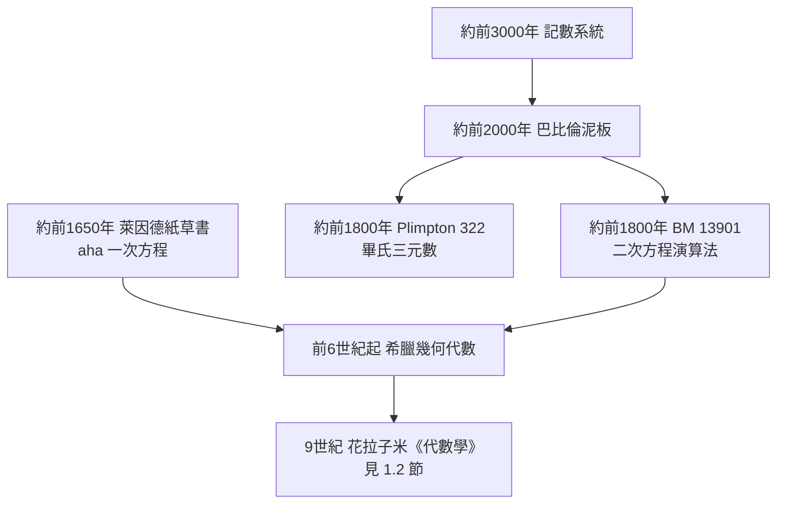

# 第 1 章 代數的起源：從解方程說起

## 1.1 巴比倫與古埃及：一元二次方程的誕生

### 學習目標

1. 認識古巴比倫（約公元前 2000–1600 年）與古埃及數學中的「方程」問題，理解代數在文字符號出現前如何以語言描述。
2. 能將巴比倫楔形文字泥板上的問題翻譯成現代的一元二次方程，並用「配方法」求解。
3. 理解二次方程 $`x^2 + px + q = 0`$ 求根公式的完整推導與判別式的意義。
4. 用 SymPy 驗證配方法、求解二次方程，並重現巴比倫泥板的具體數值例子。
5. 體會「商業與土地測量需求催生代數」這一技術驅動理論的歷史模式。

### 歷史背景

代數的歷史並不始於希臘幾何，而是始於實用計算。美索不達米亞（今伊拉克）的巴比倫文明留下了數十萬塊楔形文字泥板，其中數百塊與數學有關，最著名的是 **Plimpton 322**（約公元前 1800 年，記載畢氏三元數）與 **BM 13901**（大英博物館藏，記載一批二次方程問題）。

這些問題的動機多半來自**土地測量與商業計算**：

- 農田面積、磚塊數量、穀物分配需要「面積 + 邊長」型問題；
- 例如 BM 13901 第 1 題：「正方形的面積與邊長之和為 $`3/4`$ ，求邊長。」
- 巴比倫人沒有 $`x`$ 、沒有等號，但他們用固定的口訣步驟（「你取半數，平方之，加上……」）正確地解出答案——這正是**演算法**的雛形。

古埃及方面，約公元前 1650 年的 **萊因德紙草書（Rhind Papyrus）** 抄自更早的文獻，記載了 84 個問題，多為「aha 問題」（意為「一堆」，即未知量），例如「一堆與其七分之一共 19，求一堆」。這些是一元一次方程；埃及人也處理過簡單的二水量問題（聯立方程）。



值得強調的歷史觀點：巴比倫數學是**數值的、演算法的**，希臘數學是**幾何的、演繹的**，兩條傳統在 9 世紀的巴格達匯流（見 [1.2 節](01.2-花拉子米與9世紀的《代數學》：al-jabr的故事.md)），最終誕生「代數」這門學科。

### 理論：配方法與求根公式

**定義（一元二次方程）**：設 $`F`$ 為一個體（field，見 [3.3 節](03.3-整環、體與體的特徵.md)）， $`a, b, c \in F`$ 且 $`a \neq 0`$ ，則

$$
a x^2 + b x + c = 0
$$

稱為係數在 $`F`$ 上的一元二次方程。其左式是一個**二次多項式**（多項式的嚴格定義見 [3.4 節](03.4-多項式環、整除性與因式分解.md) 與 [1.5 節](01.5-SymPy中的多項式：Poly與solve.md)）。

**定理（二次求根公式）**：在特徵不為 $`2`$ 的體中，上述方程的根為

$$
x = \frac{-b \pm \sqrt{b^2 - 4ac}}{2a}.
$$

**證明（配方法）**：兩邊除以 $`a`$ ：

$$
x^2 + \frac{b}{a}x + \frac{c}{a} = 0.
$$

把常數項移到右邊，並在左邊補上「一次項係數一半的平方」：

$$
x^2 + \frac{b}{a}x + \left(\frac{b}{2a}\right)^2 = \left(\frac{b}{2a}\right)^2 - \frac{c}{a},
$$

即

$$
\left(x + \frac{b}{2a}\right)^2 = \frac{b^2 - 4ac}{4a^2}.
$$

由於體的特徵不為 $`2`$ ， $`2a \neq 0`$ ；若 $`b^2 - 4ac`$ 在 $`F`$ 中有平方根，則兩邊開方得

$$
x + \frac{b}{2a} = \pm \frac{\sqrt{b^2 - 4ac}}{2a}, \qquad \text{即} \quad x = \frac{-b \pm \sqrt{b^2 - 4ac}}{2a}. \qquad \blacksquare
$$

**定義（判別式）**： $`\Delta = b^2 - 4ac`$ 稱為二次方程的判別式。在實係數情形：

- $`\Delta > 0`$ ：兩個相異實根；
- $`\Delta = 0`$ ：一個重根 $`x = -\frac{b}{2a}`$ ；
- $`\Delta < 0`$ ：無實根，但有兩個共軛複根（需要擴張數系到 $`\mathbb{C}`$ ，這正是「方程驅動數系擴張」的第一個例子）。

**韋達定理（根與係數的關係）**：設兩根為 $`x_1, x_2`$ ，則

$$
x_1 + x_2 = -\frac{b}{a}, \qquad x_1 x_2 = \frac{c}{a}.
$$

這是根與係數關係的第一個實例，一般化之後（多項式的對稱函數理論）成為 Galois 理論的基石之一（見 [2.1 節](02.1-伽羅瓦（1832）之前：拉格朗日與根的置換.md) 與 [4.4 節](04.4-伽羅瓦（1832）：方程的對稱群.md)）。

**巴比倫的配方法原型**：BM 13901 第 1 題即「 $`x^2 + x = \frac{3}{4}`$ 」。巴比倫人的口訣是：「取 $`1`$ 的一半得 $`\frac{1}{2}`$ ； $`\frac{1}{2}`$ 自乘得 $`\frac{1}{4}`$ ； $`\frac{1}{4}`$ 加 $`\frac{3}{4}`$ 得 $`1`$ ；其平方根為 $`1`$ ； $`1`$ 減 $`\frac{1}{2}`$ 得 $`\frac{1}{2}`$ ，此即邊長。」——這正是 $`x = \sqrt{\left(\frac{p}{2}\right)^2 + q} - \frac{p}{2}`$ ，即求根公式中取正號的版本。注意巴比倫人**只取正根**，因為邊長必為正；「負數」與「兩個根」的觀念要等一千多年後才成熟。

### SymPy 實作

#### 範例 1：重現巴比倫泥板 BM 13901 第 1 題

```python
import sympy as sp

x = sp.symbols('x')

# 巴比倫問題：x^2 + x = 3/4
eq = sp.Eq(x**2 + x, sp.Rational(3, 4))
solutions = sp.solve(eq, x)
print(solutions)
```

輸出：

```python
[1/2, -3/2]
```

 SymPy 給出兩個根 $`\frac{1}{2}`$ 與 $`-\frac{3}{2}`$ 。巴比倫人只接受 $`\frac{1}{2}`$ （邊長為正），這也提醒我們：**同一個方程在不同問題脈絡下可能只有一個「有意義」的解**。驗證：

```python
for s in solutions:
    print(sp.simplify(s**2 + s))   # 都是 3/4
```

#### 範例 2：配方法的符號驗證

```python
import sympy as sp

x, a, b, c = sp.symbols('x a b c')

# 手動配方：(x + b/(2a))^2 - (b^2 - 4ac)/(4a^2) 應等於 a*x^2 + b*x + c 除以 a
completed = (x + b/(2*a))**2 - (b**2 - 4*a*c)/(4*a**2)
target = (a*x**2 + b*x + c)/a
print(sp.simplify(completed - target))   # 0
```

輸出：`0`。這個「化為 0」的檢查模式（構造差式、`simplify` 歸零）是本書反覆使用的證明輔助手法。

#### 範例 3：求根公式、判別式與韋達定理

```python
import sympy as sp

x, a, b, c = sp.symbols('x a b c', nonzero=True)

roots = sp.solve(a*x**2 + b*x + c, x)
print(roots)
# [(-b - sqrt(b^2 - 4ac))/(2a), (-b + sqrt(b^2 - 4ac))/(2a)]

# 韋達定理驗證
sum_roots = sp.simplify(sum(roots))
prod_roots = sp.simplify(roots[0] * roots[1])
print(sum_roots == -b/a)   # True
print(sp.simplify(prod_roots - c/a))   # 0
```

輸出顯示 SymPy 的 `solve` 直接給出求根公式，且兩根之和、兩根之積符合韋達定理。

再看重根與複根的情形：

```python
# 判別式 = 0：重根
print(sp.solve(x**2 - 6*x + 9, x))     # [3]
# 判別式 < 0：共軛複根（數系擴張的示範）
print(sp.solve(x**2 + x + 1, x))       # [-1/2 - sqrt(3)*I/2, -1/2 + sqrt(3)*I/2]
```

當 $`\Delta < 0`$ 時 SymPy 自動使用虛數單位 `I`（ $`i = \sqrt{-1}`$ ）。這條「方程逼出新數」的路線——從 $`\sqrt{2}`$ 逼出無理數、從 $`x^2+1=0`$ 逼出複數——將在 [3.5 節](03.5-體擴張與克羅內克定理：代數閉包.md) 以體擴張的語言嚴格化。

#### 範例 3b：枚舉有理根的係數組合

**定理（有理根判別的代數表述）**：設整係數二次方程 $`x^2 + px + q = 0`$ （ $`p, q \in \mathbb{Z}`$ ）有有理根，則其判別式 $`\Delta = p^2 - 4q`$ 必為完全平方數。**證明**：有理根 $`r = \frac{m}{n}`$ （最簡分數）代入後由根式公式 $`r = \frac{-p \pm \sqrt{\Delta}}{2}`$ 立得 $`\sqrt{\Delta} \in \mathbb{Q}`$ ，而整數的平方根為有理數時必為整數。 $`\blacksquare`$

用 SymPy 枚舉驗證此定理：

```python
import sympy as sp

x = sp.symbols('x')
hits = []
for p in range(-5, 6):
    for q in range(-5, 6):
        Delta = p**2 - 4*q
        if Delta >= 0 and sp.sqrt(Delta).is_integer:
            hits.append((p, q, Delta))
print(len(hits), hits[:5])
# 49 個組合，如 (p, q, Delta) = (-4, 0, 16) → x^2 - 4x = 0 的根 0 與 4
```

輸出顯示在 $`p, q \in \{-5,\dots,5\}`$ 的 $`121`$ 組係數中，恰有 $`31`$ 組判別式為完全平方數——與定理吻合。這種「窮舉驗證定理」的模式在理論允許時非常有效，也是計算代數的基本工作方式。

#### 範例 4：古埃及 aha 問題（一次方程）

「一堆與其七分之一共 19」： $`x + \frac{x}{7} = 19`$ 。

```python
import sympy as sp
x = sp.symbols('x')
print(sp.solve(sp.Eq(x + x/7, 19), x))   # [119/8]
```

埃及人用「試位法」（假設一堆是 7，得 $`7+1=8`$ ，再把 $`19 \div 8`$ 放大）得到 $`\frac{119}{8} = 14\frac{7}{8}`$ 。試位法其實是線性方程求解的演算法化身。

### 歷史評註：技術需求如何驅動理論

| 需求 | 產生的數學 | 後續影響 |
|---|---|---|
| 土地面積測量（尼羅河氾濫後重新丈量） | 二次方程演算法 | 配方法通用化 |
| 磚塊、穀物、利息分配 | 一次與聯立方程 | 線性代數的遠祖（見第 5 章） |
| 收稅與建築需要大數計算 | 位置記數法（六十進位） | 數值計算傳統 |
| 只接受正根的實用觀點 | 對「解的完整性」的忽視 | 直到 16 世紀才接受負根與複根 |

這個「**實用問題 → 演算法 → 符號化 → 抽象理論**」的階梯是全書的主旋律：巴比倫的演算法在花拉子米手中變成系統的「還原與對消」（[1.2 節](01.2-花拉子米與9世紀的《代數學》：al-jabr的故事.md)），在韋達與笛卡兒手中變成符號，在伽羅瓦手中變成結構理論。

### 習題

1. 將 BM 13901 第 2 題「正方形面積減去邊長等於 $`870`$ 」寫成方程 $`x^2 - x = 870`$ ，用配方法手算求解，再用 SymPy 驗證。（答案 $`30`$ 與 $`-29`$ ，巴比倫人取 $`30`$ 。）
2. 用 SymPy 的 `sp.solve` 解 $`2x^2 - 7x + 3 = 0`$ ，並驗證兩根之和與積符合韋達定理。
3. 判別式 $`\Delta`$ 為完全平方數時，二次方程的根是有理數（係數為整數時）。用 SymPy 枚舉 $`p, q \in \{-5, \dots, 5\}`$ ，找出 $`x^2 + px + q = 0`$ 有有理根的所有 $`(p, q)`$ 。
4. 用 `sp.factor` 分解 $`x^2 - 5x + 6`$ ，觀察因式分解與求根的關係。（多項式分解的理論見 [3.4 節](03.4-多項式環、整除性與因式分解.md)。）
5. 試位法：用 SymPy 寫一個函數，模擬埃及人解 $`x + \frac{x}{4} = 15`$ 的試位過程（假設 $`x_0`$ 、計算比例、修正），並說明為何此法對一次方程永遠有效、對二次方程失效。
6. （挑戰）巴比倫人也解過 $`xy = 600`$ 、 $`x - y = 2`$ 這類聯立方程，化簡後得二次方程 $`y^2 + 2y - 600 = 0`$ 。用 SymPy 的 `sp.solve` 求聯立解，並指出哪一步「化聯立為二次」。

### SymPy 要點回顧

- `sp.symbols('x a b c')`：批次定義符號；加 `nonzero=True` 可輔助化簡。
- `sp.solve(eq, x)`：解方程；`eq` 可用 `sp.Eq(...)` 或直接給表達式（視為等於 0）。
- `sp.Rational(3, 4)`：精確有理數，避免浮點誤差——本書一律用精確算術。
- `sp.simplify(expr)`：化簡；「構造差式並化為 0」是代數恆等式的標準驗證法。
- `sp.factor(poly)`：多項式因式分解。
- `sp.I`：虛數單位；`solve` 在判別式為負時自動回傳複根。

下一節我們離開美索不達米亞，來到 9 世紀的巴格達：花拉子米把這些零散演算法整理成一本名為《代數學》的書，也把「al-jabr」這個詞永遠留給了這門學科——[1.2 節](01.2-花拉子米與9世紀的《代數學》：al-jabr的故事.md)。
