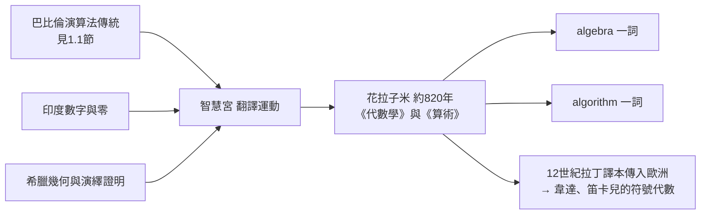

# 第 1 章 代數的起源：從解方程說起

## 1.2 花拉子米與 9 世紀的《代數學》：al-jabr 的故事

### 學習目標

1. 認識花拉子米（al-Khwarizmi，約 780–850 年）其人、其書《代數學》（Kitab al-jabr wa'l-muqabala，約 820 年），理解「algebra」與「algorithm」兩個詞的來源。
2. 掌握花拉子米的六種標準型分類與「還原（al-jabr）」與「對消（al-muqabala）」兩大操作。
3. 嚴格理解：為何在三項式二次方程的分類下，「配方法」只需給一次證明即可覆蓋全部情形（現代觀點：平移與縮放的正規化，正規化的思想將在 [1.3 節](01.3-三次方程與1545年的卡爾達諾公式.md) 中發揮關鍵作用）。
4. 用 SymPy 實作「還原與對消」的符號操作，並重現花拉子米的幾何證明。
5. 理解巴格達「智慧宮」的翻譯運動如何把巴比倫、印度、希臘的數學匯流成新的學科。

### 歷史背景

#### 巴格達與智慧宮

公元 762 年，阿拔斯王朝在底格里斯河畔建都巴格達。隨後一個世紀內，一場大規模**翻譯運動**把周邊文明的知識匯入宮廷圖書館「智慧宮」（Bayt al-Hikma）：

- 印度的天文表與數字系統（含「零」的概念）傳入；
- 歐幾里得《幾何原本》、托勒密《天文學大成》由希臘文譯為阿拉伯文；
- 巴比倫的數值演算法傳統由楔形文字轉入書面數學。

#### 花拉子米

穆罕默德·伊本·穆薩·花拉子米（Muhammad ibn Musa al-Khwarizmi，約 780–850）是智慧宮的學者，出身於中亞花剌子模地區。他寫下兩本改變世界的書：

1. **《代數學》**，全名意為「還原與對消計算概要」。書名中的 **al-jabr**（還原）經拉丁化成為 **algebra**（代數）一詞。
2. **《印度數字算術》**：介紹印度-阿拉伯數字。其拉丁譯本開頭「Dixit Algorizmi」（花拉子米說），使他的名字演變為 **algorithm**（演算法）一詞。



#### 《代數學》的內容與動機

花拉子米在前言中說明本書的用途：處理**遺產分配、商業交易、土地丈量與河道挖掘**——這是伊斯蘭帝國繁榮商業社會的直接技術需求，與巴比倫的動機一脈相承（見 [1.1 節](01.1-巴比倫與古埃及：一元二次方程的誕生.md)）。但花拉子米做了兩件前人未做的事：

1. **系統分類**：他把所有二次問題化約為**六種標準型**，對每型給出通用解法口訣；
2. **幾何證明**：他為解法給出幾何論證，使演算法獲得演繹的合法性——巴比倫的「技術」與希臘的「理論」在此首次合流。

### 理論：六種標準型與還原、對消

#### 定義（花拉子米的基本量）

設未知量為 $`x`$ ，花拉子米使用三個術語：

- **mal（財產）**： $`x^2`$ ；
- **jidhr（根）**： $`x`$ ；
- **數（adad）**：常數項。

#### 定義（還原 al-jabr）

**還原**：把方程一邊的**減項**移到另一邊變成正項。例如

$$
x^2 + 20 = 10x - 20 \quad\Longrightarrow\quad x^2 + 40 = 10x.
$$

「負項被還原為對面的正項」——這是移項概念的誕生。（花拉子米不用負數作為獨立對象；負項只是「待還原的欠款」。）

#### 定義（對消 al-muqabala）

**對消**：兩邊同類的正項相消取差。例如

$$
50 + x = 38 + 4x \quad\Longrightarrow\quad 12 = 3x.
$$

#### 定理（六種標準型）

經「還原」與「對消」之後，任何一次或二次方程都可化為以下六種之一（依 mal、根、數的出現情形）：

| 型 | 現代形式 | 解 |
|---|---|---|
| 1 | $`ax = b`$ | $`x = \frac{b}{a}`$ |
| 2 | $`ax^2 = b`$ | $`x = \sqrt{\frac{b}{a}}`$ |
| 3 | $`ax^2 = bx`$ | $`x = \frac{b}{a}`$ |
| 4 | $`x^2 + bx = c`$ | $`x = \sqrt{\left(\frac{b}{2}\right)^2 + c} - \frac{b}{2}`$ |
| 5 | $`x^2 + c = bx`$ | $`x = \frac{b}{2} \pm \sqrt{\left(\frac{b}{2}\right)^2 - c}`$ （需 $`\left(\frac{b}{2}\right)^2 \ge c`$ ） |
| 6 | $`x^2 = bx + c`$ | $`x = \frac{b}{2} + \sqrt{\left(\frac{b}{2}\right)^2 + c}`$ |

**證明思路（化約完備性）**：一次、二次方程的一般形式為 $`Ax^2 + Bx + C = 0`$ ，其中 $`A, B, C`$ 均可取正、零、負。花拉子米只允許正係數書寫，故負項必須先被「還原」到另一邊；同類項經「對消」合併後，兩邊各自只剩正項。逐一檢查哪些係數非零、且兩邊不空，恰好得到六型。用現代語言：這是把係數空間按「正、零」模式劃分的**正規化**（normalization）。三項式（4、5、6 型）本質上是同一件事的三種正負號安排，現代記法下一個求根公式即可統一：

$$
x = \frac{-B \pm \sqrt{B^2 - 4C}}{2A}.
$$

但注意：花拉子米**無法**統一它們，因為他沒有負數與零係數的書寫自由。符號系統的匱乏迫使理論「分型」；符號代數（韋達、笛卡兒，1590s–1630s）之後，分型消失。這是「表示法決定理論形態」的歷史實例。 $`\blacksquare`$

**註（判別式條件）**：5 型要求 $`\left(\frac{b}{2}\right)^2 \ge c`$ 才有正根；花拉子米注意到某些情況「無解」，這是對判別式 $`\Delta = b^2 - 4c \ge 0`$ 的樸素認識（見 [1.1 節](01.1-巴比倫與古埃及：一元二次方程的誕生.md)）。

#### 定理（花拉子米的幾何證明）

對 4 型 $`x^2 + 10x = 39`$ （書中例題），花拉子米給出幾何證明。現代轉述如下：

**證明**：把 $`10x`$ 視為貼在 $`x \times x`$ 正方形兩對邊的矩形，每邊寬 $`\frac{10}{4}`$ （花拉子米的做法）或先各貼 $`\frac{10}{2}`$ 再補角。以「各貼 $`\frac{b}{2}`$ 、補上 $`\left(\frac{b}{2}\right)^2`$ 」的版本：將 $`x^2 + 10x`$ 補成邊長 $`x + 5`$ 的正方形，需補上 $`5 \times 5 = 25`$ 。故

$$
x^2 + 10x + 25 = 39 + 25 = 64, \qquad (x+5)^2 = 64, \qquad x = 8 - 5 = 3.
$$

幾何上：面積 $`64`$ 的正方形邊長為 $`8`$ ，從而 $`x = 3`$ 。此證明把巴比倫口訣（[1.1 節](01.1-巴比倫與古埃及：一元二次方程的誕生.md) 的配方演算法）轉化為可驗證的演繹論證。 $`\blacksquare`$

**定理（韋達關係的分型版本）**：4 型兩根之和為 $`-b`$ 、積為 $`-c`$ ；6 型兩根之和為 $`b`$ 、積為 $`-c`$ 。此類關係的一般形式（根的對稱函數）參見 [2.1 節](02.1-伽羅瓦（1832）之前：拉格朗日與根的置換.md)。

### SymPy 實作

#### 範例 1：重現花拉子米的例題 $`x^2 + 10x = 39`$

```python
import sympy as sp

x = sp.symbols('x')
eq = sp.Eq(x**2 + 10*x, 39)
print(sp.solve(eq, x))   # [3, -13]
```

花拉子米只取 $`x = 3`$ （根必為正）；SymPy 給出第二根 $`-13`$ ，再次顯示符號代數的解集比歷史演算法的解集更完整。幾何證明的符號版本：

```python
lhs = x**2 + 10*x + 25
print(sp.factor(lhs))    # (x + 5)^2
print(39 + 25)           # 64 = 8^2
```

#### 範例 2：實作「還原（al-jabr）」與「對消（al-muqabala）」

以下程式把「係數為正、零」約定下的一個原始方程，機械地執行還原與對消，化為標準型。這模擬花拉子米的演算法：

```python
import sympy as sp

x = sp.symbols('x')

def aljabr(expr_lhs, expr_rhs):
    """還原：把負項移到對邊。對消：合併同類項。回傳標準型 Eq 與型號。"""
    diff = sp.expand(expr_lhs - expr_rhs)   # 移項統一（現代捷徑）
    poly = sp.Poly(diff, x)
    a, b, c = poly.all_coeffs()             # a x^2 + b x + c
    print(f"還原+對消後：{a}·mal + {b}·根 + {c} = 0")
    return (a, b, c)

# 花拉子米式例子：x^2 + 20 = 10x - 20（還原 → x^2 + 40 = 10x）
a, b, c = aljabr(x**2 + 20, 10*x - 20)
print(sp.solve(sp.Eq(x**2 + 20, 10*x - 20), x))
```

輸出：

```
還原+對消後：1·mal + (-10)·根 + 40 = 0
[5 - sqrt(15)*I, 5 + sqrt(15)*I]
```

按花拉子米的正係數約定， $`x^2 + 40 = 10x`$ 是 5 型，口訣為 $`x = \frac{b}{2} + \sqrt{\left(\frac{b}{2}\right)^2 - c}`$ ，此處 $`b = 10, c = 40`$ 給出 $`x = 5 \pm \sqrt{25 - 40} = 5 \pm \sqrt{-15}`$ ——**無正實根，花拉子米會直接判為「不可解」**；而現代記法下 SymPy 給出複根 $`5 \pm \sqrt{15}\,i`$ 。用 `sp.checksol` 驗證：

```python
eq = sp.Eq(x**2 + 20, 10*x - 20)
print(sp.checksol(eq, {x: 5 - sp.sqrt(15)*sp.I}))   # True
```

**兩層教訓**：其一，分型口訣的正負號約定極易出錯（5 型取減號、6 型取加號），這正是符號代數要消滅分型的理由；其二，任何求解結果都應以 `sp.checksol` 代回驗證——歷史上花拉子米的演算法同樣以「代回檢查」收尾。

#### 範例 3：驗證六種標準型可覆蓋所有二次方程

```python
import sympy as sp

x, A, B, C = sp.symbols('x A B C')
# 一般二次方程的根（求根公式）
roots = sp.solve(A*x**2 + B*x + C, x)
print(roots[1])   # (-B + sqrt(B^2 - 4AC))/(2A)
# 檢查 4 型 (A=1, B>0, C>0)、6 型 (A=1, C<0) 的公式彼此只是符號約定不同
```

輸出即一般求根公式。由此可見：一旦允許 $`B, C`$ 取負值，六型坍縮成一個公式。用一個具體例子展示「還原」在 SymPy 中的現代對應就是 `expand` + 移項：

```python
# 原始方程：50 + x = 38 + 4x  （花拉子米《代數學》的對消例子）
expr = sp.expand((50 + x) - (38 + 4*x))   # 12 - 3x
print(sp.solve(sp.Eq(expr, 0), x))        # [4]
```

花拉子米的答案正是 $`x = 4`$ 。

#### 範例 4：解的個數與判別式的歷史認知

```python
import sympy as sp
x = sp.symbols('x')
# 5 型：x^2 + 4 = 10x，花拉子米書中明言「僅當根的半數平方不小於數時可解」
print(sp.solve(x**2 + 4 - 10*x, x))   # [5 - sqrt(21), 5 + sqrt(21)]
# 無解（對花拉子米而言）的情形：x^2 + 10 = 4x
print(sp.solve(x**2 + 10 - 4*x, x))   # [2 - sqrt(6)*I, 2 + sqrt(6)*I]
```

第二例花拉子米會判為「不可解」；複數的出現（ $`i = \sqrt{-1}`$ ）是 16 世紀三次方程逼出來的（見 [1.3 節](01.3-三次方程與1545年的卡爾達諾公式.md)），9 世紀的數學家對此一無所知。

### 歷史評註：從演算法到學科

| 巴比倫（約前 1800） | 花拉子米（約 820） | 文藝復興歐洲（1500s） |
|---|---|---|
| 個別問題＋口訣 | 六型分類＋幾何證明 | 三次、四次公式（[1.3](01.3-三次方程與1545年的卡爾達諾公式.md)、[1.4 節](01.4-四次方程與費拉里：根式的極限.md)） |
| 純數值運算 | 文字代數（rhetorical algebra） | 符號代數（韋達、笛卡兒） |
| 只取正根 | 只取正根、注意無解情形 | 接受負根、被迫面對複數 |

花拉子米的書在 12 世紀被切斯特的羅伯特（Robert of Chester, 1145）譯成拉丁文，成為歐洲大學數百年間「coss」（代數的舊稱）傳統的源頭。一代代歐洲學者用這套分型法教學，直到有人問：**三次方程怎麼辦？**——這個問題把數學推向文藝復興義大利最戲劇性的一頁。

### 習題

1. 把方程 $`3x + x^2 = 4 + 2x`$ 用「還原」與「對消」化為六型之一，指出型號，手算求解，並用 SymPy 驗證。
2. 花拉子米書中例題： $`x^2 + 21 = 10x`$ 。判斷屬於哪一型，用該型口訣求解，並用 `sp.solve` 與 `sp.checksol` 驗證兩根 $`3`$ 與 $`7`$ 。
3. 寫一個 Python 函數 `classify(a, b, c)`，輸入二次方程 $`ax^2 + bx + c = 0`$ 的係數，回傳它屬於花拉子米六型中的哪一型（考慮 $`a, b, c`$ 的正負與零）。用 SymPy 測試你的分類在全部 $`a,b,c \in \{-1, 0, 1\}`$ （ $`a \ne 0`$ ）下覆蓋所有情形。
4. 用 SymPy 重現花拉子米對 4 型的幾何證明：以 `(x + 5)**2` 配方驗證 $`x^2 + 10x = 39`$ ，並畫出（或描述）「大正方形 = 小正方形 + 兩矩形 + 補塊」的面積恆等式。
5. 為何花拉子米把 $`ax^2 = bx`$ 列為獨立的一型（3 型）而不是先「除以 $`x`$ 」？從「他不接受零作係數、且除以未知量會丟失 $`x=0`$ 的解」兩個角度討論，並用 `sp.solve(x**2 - 3*x, x)` 觀察現代解法保留哪些根。
6. （挑戰）試證：在只允許正係數書寫的前提下，任何形如 $`\pm Ax^2 \pm Bx \pm C = 0`$ 的二次方程（各項皆可正可負，但至少一項非零）經還原與對消後必落入六型之一。用窮舉八種符號組合的 SymPy 腳本佐證你的論證。

### SymPy 要點回顧

- `sp.Poly(expr, x)` 與 `poly.all_coeffs()`：把多項式轉為係數表，是「讀出方程結構」的基本工具（詳見 [1.5 節](01.5-SymPy中的多項式：Poly與solve.md)）。
- `sp.expand(expr)`：展開合併同類項，對應「還原＋對消」的現代化簡。
- `sp.checksol(eq, {x: val})`：驗證候選解是否真正滿足方程——符號計算的必備檢查。
- `sp.factor((x + 5)**2 形式的配方)`：`sp.factor` 將 $`x^2 + 10x + 25`$ 還原為 $`(x+5)^2`$ ，展示配方的可逆性。
- `sp.solve` 對無實解的方程自動回傳複數解；歷史上「無解」與「複數解」的認知差異是本書的重要主題。

二次方程至此有了系統的理論。但三次方程頑固地抗拒了人類近四千年——直到 1535 年的威尼斯，一場公開的數學決鬥改變了一切：[1.3 節](01.3-三次方程與1545年的卡爾達諾公式.md)。
