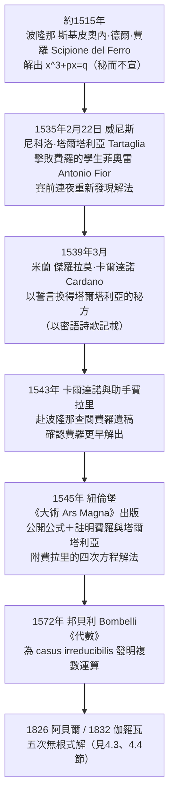

# 第 1 章 代數的起源：從解方程說起

## 1.3 三次方程與 1545 年的卡爾達諾公式

### 學習目標

1. 掌握缺二次項三次方程（depressed cubic） $`x^3 + px = q`$ 的卡爾達諾公式之完整推導。
2. 學會用 Tschirnhaus 變換（平移 $`x = y - \frac{a}{3}`$ ）把一般三次方程化為缺二次項型——「正規化」思想的再次勝利（承 [1.2 節](01.2-花拉子米與9世紀的《代數學》：al-jabr的故事.md)）。
3. 理解 **casus irreducibilis**（不可約情形）：三個實根的方程反而逼出複數——數學史上最深刻的「技術逼出理論」事件。
4. 用 SymPy 完整驗證三次方程的公式解、數值根與因式結構。
5. 了解 1535 年威尼斯數學競賽、1539 年誓言與 1545 年《大術》（Ars Magna）的來龍去脈。

### 歷史背景

#### 一場延續三千年的失敗

從巴比倫（約前 1800 年，見 [1.1 節](01.1-巴比倫與古埃及：一元二次方程的誕生.md)）到花拉子米（約 820 年，見 [1.2 節](01.2-花拉子米與9世紀的《代數學》：al-jabr的故事.md)），人類解決了二次方程。但三次方程 $`x^3 + ax^2 + bx + c = 0`$ 在近三千年間**沒有任何文明找到通用解**。古巴比倫人用數值表格逼近，希臘人用圓錐曲線的交點（門納赫穆斯，約前 350 年），波斯詩人兼數學家歐瑪爾·海亞姆（Omar Khayyam, 1048–1131）系統地用圓錐截線的交點解出各型三次方程——但這些都是**幾何作圖解**，不是「根式解」（用係數經加減乘除與開方表達的公式）。

#### 義大利數學決鬥（1515–1545）

文藝復興的義大利，數學家的聲望與教職靠**公開競賽**維持：雙方互出題目，當眾解題，敗者失去職位與名聲。這種殘酷的職業壓力成為三次方程突破的直接動力：



塔爾塔利亞認為卡爾達諾違背誓言，隔年出版《各種問題與發明》公開爭執；卡爾達諾的助手**洛多維科·費拉里（Ludovico Ferrari, 1522–1565）**代師出戰，1548 年在米蘭的公開辯論中大勝塔爾塔利亞。塔爾塔利亞晚年窮困而死；費拉里年少暴富卻在 44 歲時早逝（傳說被姊妹毒殺）。這段歷史提醒我們：**知識產權的社會結構（秘方、誓言、決鬥）塑造了理論發表的形式**——若非卡爾達諾冒著名譽風險出版，三次公式可能隨費羅一起埋進墳墓。

《大術》在數學史的地位：笛卡兒稱之為代數的奠基之作；它在扉頁上註明「費羅與塔爾塔利亞的發現」，算是文藝復興式的誠實，但塔爾塔利亞並不領情。

### 理論：卡爾達諾公式

#### 定理（化一般三次為缺二次項型）

一般三次方程

$$
x^3 + a x^2 + b x + c = 0
$$

經平移 $`x = y - \frac{a}{3}`$ 後化為缺二次項型：

$$
y^3 + p y + q = 0, \qquad p = b - \frac{a^2}{3}, \qquad q = c - \frac{ab}{3} + \frac{2a^3}{27}.
$$

**證明**：代入並展開。 $`x = y - \frac{a}{3}`$ 時

$$
\left(y - \frac{a}{3}\right)^3 + a\left(y - \frac{a}{3}\right)^2 + b\left(y - \frac{a}{3}\right) + c = y^3 + \left(b - \frac{a^2}{3}\right)y + \left(c - \frac{ab}{3} + \frac{2a^3}{27}\right),
$$

其中 $`y^2`$ 項係數為 $`-a^2 \cdot \frac{3 \cdot (-\frac{1}{3})}{} \cdots`$ ；實際上 $`y^2`$ 項來自 $`y^3`$ 展開的 $`-a y^2`$ 與 $`a y^2`$ （來自平方項），恰相消。此即「平移消去次高項」的一般規律：對 $`n`$ 次多項式，平移總能消去 $`n-1`$ 次項（詳見 [1.5 節](01.5-SymPy中的多項式：Poly與solve.md) 的 SymPy 驗證與 [3.4 節](03.4-多項式環、整除性與因式分解.md)）。 $`\blacksquare`$

#### 定理（卡爾達諾公式，1539/1545）

設缺二次項方程 $`y^3 + p y = q`$ （ $`p, q \neq 0`$ ）。令 $`y = u + v`$ ，代入：

$$
u^3 + v^3 + (3uv + p)(u + v) = q.
$$

**取 $`uv = -\frac{p}{3}`$ ** 使第三項消失，得聯立條件：

$$
u^3 + v^3 = q, \qquad u^3 v^3 = -\frac{p^3}{27}.
$$

由韋達關係（見 [1.1 節](01.1-巴比倫與古埃及：一元二次方程的誕生.md)）， $`u^3`$ 與 $`v^3`$ 是二次方程

$$
z^2 - q z - \frac{p^3}{27} = 0
$$

的兩根，故

$$
u^3, v^3 = \frac{q}{2} \pm \sqrt{\frac{q^2}{4} + \frac{p^3}{27}}.
$$

定義**卡爾達諾判別量** $`\Delta' = \frac{q^2}{4} + \frac{p^3}{27}`$ ，則一個根為

$$
\boxed{\; y = \sqrt[3]{\frac{q}{2} + \sqrt{\Delta'}} + \sqrt[3]{\frac{q}{2} - \sqrt{\Delta'}} \;}
$$

（滿足 $`uv = -\frac{p}{3}`$ 的立方根支選取後，另兩根為乘以 $`\omega = e^{2\pi i/3}`$ 的組合。） $`\blacksquare`$

**證明思路**：三個關鍵動作承襲 [1.2 節](01.2-花拉子米與9世紀的《代數學》：al-jabr的故事.md) 的精神——(1) **正規化**：平移消去二次項；(2) **變元代換**： $`y = u+v`$ 把三次問題降為二次問題（這是「降次」策略的發明，將在費拉里的四次解法中再用一次，見 [1.4 節](01.4-四次方程與費拉里：根式的極限.md)）；(3) **配對構造**：自由參數 $`uv`$ 的選取正是花拉子米「配方法」的升級版——不再補一個平方數，而是補一個約束條件。

#### 定理（casus irreducibilis：不可約情形）

取實係數三次方程 $`y^3 + py = q`$ ，判別量 $`\Delta' = \frac{q^2}{4} + \frac{p^3}{27}`$ 。當 $`p < 0`$ 且 $`|\Delta'|`$ 足夠小（精確地： $`\Delta' < 0`$ ）時，方程有**三個相異實根**，但卡爾達諾公式被迫計算 $`\sqrt{\Delta'} = \sqrt{\text{負數}}`$ ——即**先造出虛數、再讓虛數在立方根相加時互相抵消**。

**例**： $`x^3 - 15x - 4 = 0`$ 。此時 $`\Delta' = \frac{16}{4} + \frac{-3375}{27} = 4 - 125 = -121`$ ，公式給出

$$
x = \sqrt[3]{2 + \sqrt{-121}} + \sqrt[3]{2 - \sqrt{-121}} = \sqrt[3]{2 + 11i} + \sqrt[3]{2 - 11i}.
$$

但此方程有根 $`x = 4`$ （因 $`64 - 60 - 4 = 0`$ ），故必須有

$$
\sqrt[3]{2 + 11i} + \sqrt[3]{2 - 11i} = 4.
$$

**邦貝利的洞察（1572）**：形式地令 $`(2 \pm 11i) = (2 \mp i)^3`$ （驗證： $`(2-i)^3 = 8 - 12i + 6i^2 - i^3 = 2 - 11i`$ ），則兩個立方根為 $`2 + i`$ 與 $`2 - i`$ ，相加得 $`4`$ 。**虛數只是中間工具，實根由虛數構造而來**——這迫使數學家承認複數是合法的計算對象。複數的歷史正是這樣被「公式」逼出來的：不是哲學思辨，而是為了讓一條公式在所有情況下都說得通。

**定理（不可約情形的嚴格性）**：若實係數三次方程有三個相異實根，則**任何**根式表達式都必須經過複數中間量（即不存在只用實數根式的表達式）。此定理在 Galois 理論框架下的證明見 [4.3 節](04.3-阿貝爾（1826）與魯菲尼：五次方程無根式解.md) 與 [4.4 節](04.4-伽羅瓦（1832）：方程的對稱群.md)；它預示了「根式可解性由對稱群決定」的現代觀點。 $`\blacksquare`$

#### 判別式與根的型態

三次方程 $`y^3 + py + q = 0`$ 的（Galois）判別式為

$$
\Delta = -4p^3 - 27q^2 = -108\,\Delta'.
$$

- $`\Delta > 0`$ ：三個相異實根（casus irreducibilis）；
- $`\Delta = 0`$ ：重根；
- $`\Delta < 0`$ ：一實根兩共軛複根。

判別式是根的置換下不變的對稱函數（見 [2.1 節](02.1-伽羅瓦（1832）之前：拉格朗日與根的置換.md)），它將在 [4.4 節](04.4-伽羅瓦（1832）：方程的對稱群.md) 成為 Galois 群理論的核心不變量。

### SymPy 實作

#### 範例 1：驗證平移消去二次項

```python
import sympy as sp

x, y, a, b, c = sp.symbols('x y a b c')

expr = sp.expand((y - a/3)**3 + a*(y - a/3)**2 + b*(y - a/3) + c)
print(sp.collect(expr, y))
# y^3 + (b - a^2/3)*y + (c - a*b/3 + 2*a^3/27)
```

輸出確認 $`y^2`$ 項係數為 $`0`$ ，且 $`p = b - \frac{a^2}{3}`$ 、 $`q = c - \frac{ab}{3} + \frac{2a^3}{27}`$ 與定理一致。

#### 範例 2：推導卡爾達諾公式（符號層次）

```python
import sympy as sp

p, q, u, v, z = sp.symbols('p q u v z')

# 代入 y = u+v，並施加條件 uv = -p/3 消去中間項
expr2 = sp.expand(((u+v)**3 + p*(u+v) - q).subs(u*v, -p/3))
print(expr2)
# u^3 + v^3 + p*(u+v) - q （3uv(u+v) 項已因 uv=-p/3 而消失）
# u^3, v^3 是 z^2 - q z - p^3/27 的兩根
U, V = sp.solve(z**2 - q*z - p**3/27, z)
cardano = sp.cbrt(U) + sp.cbrt(V)          # 卡爾達諾公式形式
print(cardano)
```

輸出即 $`\sqrt[3]{\frac{q}{2} + \frac{\sqrt{12p^3 + 81q^2}}{18}} + \sqrt[3]{\frac{q}{2} - \frac{\sqrt{12p^3 + 81q^2}}{18}}`$ （SymPy 把 $`\sqrt{\frac{q^2}{4}+\frac{p^3}{27}}`$ 整理為 $`\frac{\sqrt{12p^3+81q^2}}{18}`$ ，與手寫形式等價）。`sp.cbrt` 是**實值**立方根（`sp.root(..., 3)` 則取複數主值支），兩者在 $`\Delta' \ge 0`$ 時一致。

用具體例子數值核對：

```python
y = sp.symbols('y')
print(sp.solve(x**3 + 3*x - 4, x))
# [1, -1/2 - sqrt(15)*I/2, -1/2 + sqrt(15)*I/2]
```

 $`x = 1`$ 是實根。此時 $`\Delta' = \frac{16}{4} + \frac{27}{27} = 5 > 0`$ ，公式給出 $`\sqrt[3]{2+\sqrt5} + \sqrt[3]{2-\sqrt5}`$ ，讀者可用 `sp.N` 驗證其值為 $`1`$ 。`sp.solve` 對一般符號係數的三次方程也會回傳根式表達，但可能選取不同的複數支（例如以 $`\omega = \frac{-1+\sqrt{3}i}{2}`$ 的旋轉組合表達另兩根）；最穩妥的核對方式是數值代入與 `sp.checksol` 驗證。

#### 範例 3：重現 casus irreducibilis——邦貝利的計算

```python
import sympy as sp

x = sp.symbols('x')
poly = x**3 - 15*x - 4                       # 邦貝利 1572 年的例子

print(sp.factor(poly))                       # (x - 4)*(x^2 + 4*x + 1)
print(sp.nroots(poly))                       # 三個實根
# [-3.732, -0.268, 4.0]  即 4, -2±sqrt(3)

print(sp.solve(poly, x))
# [4, -2 - sqrt(3), -2 + sqrt(3)]   ← SymPy 聰明地避開了複數形式！

# 卡爾達諾公式的原始形式（含複數）
cardano_form = sp.root(2 + 11*sp.I, 3) + sp.root(2 - 11*sp.I, 3)
print(sp.N(cardano_form))                    # 4.0 + 0.e-20*I  ← 正是 4
print(sp.simplify(sp.expand((2 - sp.I)**3))) # 2 - 11*I  ← 邦貝利的關鍵恆等式
```

輸出說明：

- `sp.factor` 顯示 $`(x-4)(x^2+4x+1)`$ ，故根為 $`4, -2 \pm \sqrt{3}`$ ，**三個全是實數**；
- `sp.root(2+11*I, 3)` 選取複數主支，兩項相加的數值為 $`4.0`$ ——虛部相消，**這就是 casus irreducibilis**：三個實根的方程，其公式表達必須路經複數；
- `sp.solve` 回傳的卻是乾淨的實根形式——這是因為 SymPy 內部使用了超越卡爾達諾原始形式的代數簡化。讀者可嘗試 `sp.solve(poly, x, cubics=True)`（預設）與 `sp.solve(poly, x, cubics=False)`（回傳 `CRootOf` 表示）比較。

#### 範例 4：判別式預測根的型態

```python
import sympy as sp

p, q = sp.symbols('p q')
Delta = -4*p**3 - 27*q**2
print(sp.simplify(Delta + 108*(q**2/4 + p**3/27)))   # 0，兩種判別式定義等價

for (pv, qv) in [(1, 1), (0, 2), (-15, -4)]:
    disc = -4*pv**3 - 27*qv**2
    nreal = len([r for r in sp.solve(x**3 + pv*x + qv, x) if r.is_real])
    print(f"p={pv}, q={qv}: 判別式={disc}, 實根數（重根計一次）={nreal}")
```

輸出：

```
p=1, q=1: 判別式=-31, 實根數=1
p=0, q=2: 判別式=-108, 實根數=1
p=-15, q=-4: 判別式=13068, 實根數=3
```

注意 `r.is_real` 對某些形式複雜的根可能無法立即判定；更穩健的寫法是用 `sp.real_roots(sp.Poly(x**3 + pv*x + qv, x))`（只回傳實根的精確區間表示），這也是 [1.5 節](01.5-SymPy中的多項式：Poly與solve.md) 將介紹的 `Poly` 工具之一。

#### 範例 5：歐瑪爾·海亞姆的幾何解與代數解對照

海亞姆（1100 年前後）解 $`x^3 + b^2 x = a^3`$ 用拋物線 $`x^2 = by`$ 與圓的交點。代數上這就是 $`x^3 + b^2 x = a^3`$ 的唯一正根：

```python
import sympy as sp
x = sp.symbols('x', positive=True)
a, b = sp.symbols('a b', positive=True)
sol = sp.solve(x**3 + b**2*x - a**3, x)
print(sp.N(sol[0].subs({a: 2, b: 1})))
# 1.8338...  即 x^3 + x = 8 的唯一正根
print(sp.checksol(x**3 + b**2*x - a**3, {x: sol[0]}))   # True（符號層次驗證）
```

`sp.solve` 回傳根式表達（經化簡後即卡爾達諾公式；輸出可能包含 $`\omega = \frac{-1\pm\sqrt{3}i}{2}`$ 型的旋轉因子，這是三個複數立方根支的組合）。

同一個方程，11 世紀的答案是「兩條圓錐曲線的交點」，16 世紀的答案是「一條公式」——**表示法的進步使解法從作圖變成計算**，這正是 [1.5 節](01.5-SymPy中的多項式：Poly與solve.md) 現代計算代數的前奏。

### 歷史評註：競賽驅動的理論突破

| 年代 | 事件 | 對理論的推動 |
|---|---|---|
| 約前 350 | 門納赫穆斯用圓錐曲線解三次 | 幾何傳統：解存在但非公式 |
| 1070 前後 | 海亞姆系統化圓錐曲線解法 | 分類思想（承花拉子米六型） |
| 約 1515 | 費羅解 $`x^3+px=q`$ | 第一個根式解（保密） |
| 1535 | 塔爾塔利亞擊敗菲奧雷 | 職業競賽壓力下的再發現 |
| 1545 | 卡爾達諾《大術》出版 | 公式公開＋四次解法問世 |
| 1572 | 邦貝利發明複數運算 | casus irreducibilis 逼出複數 |
| 1799–1826 | 高斯、魯菲尼、阿貝爾 | 五次方程無根式解（[4.3 節](04.3-阿貝爾（1826）與魯菲尼：五次方程無根式解.md)） |

核心模式：**實用需求（占星曆表、商業複利、決鬥賭注）→ 演算法（公式）→ 理論危機（虛數、不可約情形）→ 新數系（複數）→ 更深的理論（Galois）**。三次方程是人類第一次「用公式發現新數」。

### 習題

1. 用平移 $`x = y - \frac{a}{3}`$ 化簡 $`x^3 - 6x^2 + 11x - 6 = 0`$ ，求出缺二次項方程，用 SymPy 的 `sp.expand` 與 `sp.solve` 驗證三個根為 $`1, 2, 3`$ 。
2. 手算 $`x^3 + 3x = 4`$ 的卡爾達諾公式（ $`\Delta' = 5 > 0`$ ），再用 SymPy 驗證根為 $`x = 1`$ 。
3. 驗證邦貝利恆等式 $`(2+i)^3 = 2 + 11i`$ ，並用 `sp.root` 與 `sp.cbrt` 分別計算 $`\sqrt[3]{2+11i}`$ ，解釋兩者為何可能不同（複數立方根有三個值，主支的選取影響結果）。
4. 用 `sp.real_roots` 與 `sp.nroots` 求解 $`x^3 - 21x + 20 = 0`$ ，確認判別式為正、三實根皆可表為有理數（本例的實根碰巧全是有理數，故 SymPy 能避開複數形式——試對照 $`x^3 - 3x + 1 = 0`$ 的輸出）。
5. 證明：缺二次項三次方程 $`y^3 + py + q`$ 的三根 $`r_1, r_2, r_3`$ 滿足 $`r_1 + r_2 + r_3 = 0`$ 、 $`r_1r_2 + r_1r_3 + r_2r_3 = p`$ 、 $`r_1r_2r_3 = -q`$ （用 SymPy 的 `sp.symbols` 定義三根構造 $`\prod (y - r_i)`$ 展開比對）。
6. （挑戰）用 Galois 語言解釋（可不嚴格）：為何 $`x^3 - 15x - 4`$ 的三個實根在 $`\mathbb{Q}`$ 上生成的分裂體含有 $`\sqrt{\Delta} = \sqrt{13068} = 66\sqrt{3}`$ 這個二次量？（提示： $`\sqrt{\Delta} = \pm(r_1-r_2)(r_1-r_3)(r_2-r_3)`$ ，差積在偶置換下不變；詳見 [4.4 節](04.4-伽羅瓦（1832）：方程的對稱群.md)。）

### SymPy 要點回顧

- `sp.cbrt(z)` 與 `sp.root(z, 3)`：實值立方根與複數主支立方根，casus irreducibilis 的計算差異由此而來。
- `sp.collect(expr, y)`：按指定符號整理多項式，用於檢查特定次數項的係數。
- `sp.solve(poly, x, cubics=True/False)`：控制是否用根式表達三次根；`cubics=False` 回傳精確的 `CRootOf`（隔離區間表示）。
- `sp.nroots(poly)`：數值近似所有根（複根亦回傳），適合快速確認根的型態。
- `sp.real_roots(Poly(...))`：只回傳實根，以精確區間表示，無浮點誤差風險。
- `sp.checksol`：公式解的代回驗證（承 [1.2 節](01.2-花拉子米與9世紀的《代數學》：al-jabr的故事.md) 的教訓）。

三次方程的勝利立刻引出一個自然追問：四次呢？費拉里在 1540 年就解決了它——但四次的解法長達數頁，而這條「降次之路」的盡頭，是一堵五次方程撞不碎的牆：[1.4 節](01.4-四次方程與費拉里：根式的極限.md)。
