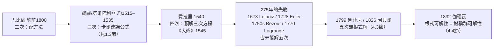

# 第 1 章 代數的起源：從解方程說起

## 1.4 四次方程與費拉里：根式的極限

### 學習目標

1. 掌握費拉里（Ferrari, 1540/1545）四次方程解法的完整架構：化為缺三次項型、引入待定平方量、構成**預解三次方程（resolvent cubic）**、拆成兩個二次因式。
2. 理解「降次鏈」 $`4 \to 3 \to 2`$ 的結構，以及它為何是根式可解性的極限（預示 [4.3 節](04.3-阿貝爾（1826）與魯菲尼：五次方程無根式解.md) 的阿貝爾–魯菲尼定理）。
3. 用 SymPy 重演費拉里的代換、驗證預解方程、求解四次方程並分析公式的膨脹程度。
4. 從公式的「複雜度爆炸」體會：根式解的存在是一種**稀有而深刻的對稱性**，而非理所當然——這正是 Galois 理論（[4.4 節](04.4-伽羅瓦（1832）：方程的對稱群.md)）要回答的問題。

### 歷史背景

#### 少年助手的逆襲

**洛多維科·費拉里（Lodovico Ferrari, 1522–1565）** 十四歲時被送進卡爾達諾在米蘭的家做僕人。卡爾達諾很快發現這個少年過目不忘、代數天賦驚人，於是收他為學生兼抄寫員。1540 年，年僅十八歲的費拉里解出了**四次方程**——這是自三次公式（[1.3 節](01.3-三次方程與1545年的卡爾達諾公式.md)）之後代數的又一躍。

1545 年，《大術》（Ars Magna）在紐倫堡出版，書末記載了費拉里的四次解法。方法的核心思想仍是「降次」：把四次問題化為一個三次問題（用卡爾達諾公式解決），再把三次化為二次，二次化為開平方。整條鏈條就是人類在 1545 年知道的全部——並且**到此為止**。



#### 為何五次方程是「牆」？

費拉里之後兩百七十五年，歐洲最好的數學家——萊布尼茨（1673）、歐拉（1728 前後）、貝祖（1750s）、拉格朗日（1770 年的鴻篇《論代數方程的解法》）——全都嘗試過五次方程的根式解，全都失敗。拉格朗日仔細分析了二、三、四次解法的共同結構（都靠「根的置換不變量」降次，見 [2.1 節](02.1-伽羅瓦（1832）之前：拉格朗日與根的置換.md)），並正確地感嘆：這套方法「在五次方程上似乎用盡了它的力量」。他沒有想到的是：**不是方法不夠好，而是根式解根本不存在**。1799 年魯菲尼給出不完整證明，1826 年阿貝爾補全（[4.3 節](04.3-阿貝爾（1826）與魯菲尼：五次方程無根式解.md)），1832 年伽羅瓦指出精確的分界線：次數 $`\le 4`$ 時方程的對稱群 $`S_n`$ （ $`n \le 4`$ ）是可解群， $`n \ge 5`$ 時不再可解（[4.4 節](04.4-伽羅瓦（1832）：方程的對稱群.md)、[2.4 節](02.4-正規子群與商群：若爾當（1870）的貢獻.md)）。

本節的任務是：**把四次解法走到底，親眼看見根式鏈的長度與重量**，從而理解「極限」一詞的分量。

### 理論：費拉里解法

#### 定理（化為缺三次項型）

一般四次方程

$$
x^4 + a x^3 + b x^2 + c x + d = 0
$$

經平移 $`x = y - \frac{a}{4}`$ 化為缺三次項型：

$$
y^4 + q y^2 + r y + s = 0, \qquad q = b - \frac{3a^2}{8}, \quad r = c - \frac{ab}{2} + \frac{a^3}{8}, \quad s = d - \frac{ac}{4} + \frac{a^2 b}{16} - \frac{3a^4}{256}.
$$

**證明**：直接代入展開； $`y^3`$ 項係數 $`-4\cdot\frac{a}{4} + a = 0`$ 相消。這與 [1.3 節](01.3-三次方程與1545年的卡爾達諾公式.md) 的三次平移是同一現象：平移永遠消去次高項。SymPy 驗證見範例 1。 $`\blacksquare`$

#### 定理（費拉里解法，1540；刊於《大術》1545）

設缺三次項方程

$$
y^4 + q y^2 + r y + s = 0.
$$

**證明（解法即證明）**：

**第一步（配方引入待定量）**：把 $`y^4 + qy^2`$ 配成平方：

$$
y^4 + qy^2 = \left(y^2 + \frac{q}{2}\right)^2 - \frac{q^2}{4},
$$

於是方程等價於

$$
\left(y^2 + \frac{q}{2}\right)^2 = \frac{q^2}{4} - ry - s.
$$

**第二步（引入參數 $`z`$ ）**：左邊是平方，右邊不是。費拉里的關鍵一步：在左邊加減一個待定量 $`z`$ ，把兩邊都湊成「平方差」：

$$
\left(y^2 + \frac{q}{2} + z\right)^2 = 2z\,y^2 - r\,y + \left(z^2 + qz + \frac{q^2}{4} - s\right).
$$

（展開核對：左邊 $`= (y^2 + \frac{q}{2})^2 + 2z(y^2 + \frac{q}{2}) + z^2`$ ，右邊加上 $`2zy^2 + qz + z^2`$ 後相等。）

**第三步（選 $`z`$ 使右邊成完全平方）**：右邊是 $`y`$ 的二次式 $`2z\,y^2 - r\,y + (\cdots)`$ 。它成為完全平方的條件是判別式為零：

$$
r^2 - 4\cdot 2z\left(z^2 + qz + \frac{q^2}{4} - s\right) = 0,
$$

整理得**預解三次方程（resolvent cubic）**：

$$
z^3 + q z^2 + \left(\frac{q^2}{4} - s\right) z - \frac{r^2}{8} = 0.
$$

這是 $`z`$ 的三次方程——由 [1.3 節](01.3-三次方程與1545年的卡爾達諾公式.md) 的卡爾達諾公式， $`z`$ 可用 $`q, r, s`$ 的根式表達。

**第四步（拆成兩個二次）**：取預解方程任一根 $`z_0`$ ，此時

$$
\left(y^2 + \frac{q}{2} + z_0\right)^2 = 2z_0\left(y - \frac{r}{4z_0}\right)^2
$$

（當 $`z_0 \neq 0`$ ； $`z_0 = 0`$ 的退化情形即 $`r = 0`$ ，方程本來就是二次的）。開平方得兩個二次方程：

$$
y^2 + \frac{q}{2} + z_0 = \pm\sqrt{2z_0}\left(y - \frac{r}{4z_0}\right),
$$

各解一個二次方程（巴比倫的配方法，[1.1 節](01.1-巴比倫與古埃及：一元二次方程的誕生.md)），得四個根。 $`\blacksquare`$

#### 定理（根式塔與降次鏈）

費拉里解法展示了一座**根式塔**（tower of radicals）：

$$
\mathbb{Q} \;\subset\; \mathbb{Q}(\sqrt{\Delta_1}) \;\subset\; \cdots \subset\; \mathbb{Q}(z_0) \;\subset\; \mathbb{Q}(z_0, \sqrt{2z_0}) \;\subset\; \mathbb{Q}(\text{四根}).
$$

每一步只做「開 $`n`$ 次方」。結構上：

- 二次：塔高 $`1`$ （開一次平方）；
- 三次：先解一個二次（ $`u^3, v^3`$ 的和與積），再開立方，塔高 $`2`$ ；
- 四次：先解一個三次（預解方程），再開兩層平方，塔高 $`3`$ 。

這座塔的「形狀」由方程對稱群的**合成列**（composition series，見 [2.4 節](02.4-正規子群與商群：若爾當（1870）的貢獻.md)）決定： $`S_4 \triangleright A_4 \triangleright V_4 \triangleright C_2 \triangleright \{e\}`$ ，商群全是循環素數階群——這正是四次可根式解的群論原因。而 $`S_5`$ 沒有這樣的合成列（單群 $`A_5`$ 擋路），故五次不可解。**費拉里的公式不是技巧的勝利，而是 $`S_4`$ 的可解性寫在紙上。**

#### 註（公式的膨脹）

一般四次方程的一個根式解，用「字典序最短」的記法也需數十個根號嵌套。SymPy 的 `sp.solve` 對四次方程回傳的表達式以**嵌套根式**寫出，展開後可達數百個符號。這種「複雜度爆炸」本身是歷史證據：**根式解不是自然的解答形式**——現代數學因此改用分裂體與 Galois 群（第 4 章）描述方程，而非追逐顯式公式。

### SymPy 實作

#### 範例 1：平移消去三次項（Tschirnhaus 變換）

```python
import sympy as sp

x, y, a, b, c, d = sp.symbols('x y a b c d')

expr = sp.expand((y - a/4)**4 + a*(y - a/4)**3 + b*(y - a/4)**2 + c*(y - a/4) + d)
print(sp.collect(expr, y))
# y^4 + (b - 3a^2/8)*y^2 + (c - a*b/2 + a^3/8)*y
#      + (d - a*c/4 + a^2*b/16 - 3*a^4/256)
```

輸出中 $`y^3`$ 項消失，且 $`y^2, y, y^0`$ 的係數與定理所列 $`q, r, s`$ 完全一致。

#### 範例 2：重演費拉里的構造與預解方程

```python
import sympy as sp

y, q, r, s, z = sp.symbols('y q r s z')

# 第一步＋第二步：構造平方差恆等式（在原方程的根上成立）
# 原方程 y^4 + q y^2 + r y + s = 0 等價於 (y^2+q/2)^2 = q^2/4 - r y - s
# 兩邊加 (2 z y^2 + q z + z^2)：左 = (y^2+q/2+z)^2
left = sp.expand((y**2 + q/2 + z)**2)
right = sp.expand(2*z*y**2 - r*y + z**2 + q*z + q**2/4 - s)
print(sp.expand(left - right))
# q*y^2 + r*y + s + y^4  ← 恰為原多項式！
```

**關鍵觀察**：左右之差**恰為原多項式** $`y^4 + qy^2 + ry + s`$ 。因此恆等式在原方程的每一個根上成立——費拉里的構造不是一般恆等式，而是「把根的條件編織進平方差」的技巧。接著推導「右邊成完全平方」的判別式條件：

```python
# 右邊 2z*y^2 - r*y + (z^2+qz+q^2/4-s) 的判別式
A, B, C = 2*z, -r, z**2 + q*z + q**2/4 - s
disc = sp.expand(B**2 - 4*A*C)
resolvent = sp.simplify(disc/8)          # = 0 即預解方程
print(resolvent)
# r^2/8 - z^3 - q*z^2 - (q^2/4 - s)*z  ← 乘以 -1 即定理中的預解三次方程
```

輸出確認預解方程為 $`z^3 + qz^2 + \left(\frac{q^2}{4} - s\right)z - \frac{r^2}{8} = 0`$ 。

#### 範例 3：完整求解一個四次方程

取《大術》風格的例子 $`x^4 + 4x + 3 = 0`$ （缺三次項、 $`q=0, r=4, s=3`$ ）：

```python
import sympy as sp

x = sp.symbols('x')
poly = x**4 + 4*x + 3

print(sp.factor(poly))            # (x + 1)^2*(x^2 - 2x + 3)
print(sp.solve(poly, x))          # [-1, 1 - sqrt(2)*I, 1 + sqrt(2)*I]
```

輸出：因式分解為 $`(x+1)^2(x^2 - 2x + 3)`$ ，根為 $`-1`$ （二重）與 $`1 \pm \sqrt{2}\,i`$ 。手算對照費拉里流程：預解方程 $`z^3 - 12z - 16 = 0`$ 有根 $`z = 4`$ ，代入第四步得

$$
(y^2 + 2)^2 = (2x - 1)^2, \qquad \text{即 } (x^2 + 2)^2 - (2x - 1)^2 = 0,
$$

驗證：

```python
print(sp.factor((x**2 + 2)**2 - (2*x - 1)**2))
# (x + 1)^2*(x^2 - 2x + 3)  ← 與原多項式的分解一致
```

費拉里的構造**精確重現**了 SymPy 的因式分解——這就是「降次拆解」的機械本質。

再看一個沒有有理根的情形：

```python
poly2 = x**4 - 2*x**3 + 3*x**2 - 4*x + 5
roots = sp.solve(poly2, x)
print(len(roots), len(str(roots[0])))
# 4 個根；單一根的根式表達式約 210 字符（含多層嵌套根號）
print([sp.N(r) for r in roots])   # 數值近似
# [-0.288 + 1.416*I, 1.288 + 0.858*I, 1.288 - 0.858*I, -0.288 - 1.416*I]（順序視版本而定）
```

**觀察**：四次根式解「存在」但單一根的表達式就長達兩百餘字符，且嵌套了多層根號——公式本身已不再是有效的數學語言。這種膨脹是拉格朗日 1770 年轉向「置換思想」（[2.1 節](02.1-伽羅瓦（1832）之前：拉格朗日與根的置換.md)）的直接原因之一。

#### 範例 4：預解方程的 Galois 預告

預解三次方程的根 $`z_0`$ 具有對稱意義：它對應四次方程四根 $`r_1, r_2, r_3, r_4`$ 的一種**配對方式**（例如 $`z_0 \sim (r_1+r_2)(r_3+r_4)`$ 型的量）。這種量在 $`S_4`$ 的某個子群 $`D_4`$ （八個置換）下不變，而 $`[S_4 : D_4] = 3`$ ——所以 $`z`$ 滿足**三次**方程。用 SymPy 驗證這個配對結構：

```python
import sympy as sp
from itertools import permutations

r1, r2, r3, r4 = sp.symbols('r1 r2 r3 r4')
# 對稱量 s1 = r1+r2+r3+r4 = 0（缺三次項型），t = (r1+r2)(r3+r4)
# 枚舉全部 24 個置換，看 t 取幾個不同值
vals = set()
for p in permutations([r1, r2, r3, r4]):
    vals.add(sp.expand((p[0]+p[1])*(p[2]+p[3])))
print(len(vals))
# 3  ← 這個「配對量」在置換下恰取 3 個值 → 滿足一個三次方程！
```

輸出 `3`：這個手工實驗正是拉格朗日 1770 年的洞察、伽羅瓦理論的胚胎——**根的可解性由「對稱量在置換下的取值個數」決定**（完整的理論見 [2.1 節](02.1-伽羅瓦（1832）之前：拉格朗日與根的置換.md)、[2.7 節](02.7-群作用、軌道與穩定子：Burnside引理.md) 與 [4.4 節](04.4-伽羅瓦（1832）：方程的對稱群.md)）。

### 歷史評註：根式的極限與理論的轉向

| 年代 | 人物 | 事件 |
|---|---|---|
| 1540 | 費拉里（18 歲） | 解出四次方程 |
| 1545 | 卡爾達諾《大術》 | 公式出版；費拉里解法附錄於書末 |
| 1548 | 米蘭公開辯論 | 費拉里擊敗塔爾塔利亞，代數權威易手 |
| 1572 | 邦貝利《代數》 | 複數運算確立（承 [1.3 節](01.3-三次方程與1545年的卡爾達諾公式.md)） |
| 1673–1770 | 萊布尼茨、歐拉、貝祖、拉格朗日 | 五次方程根式解的系統性失敗 |
| 1799/1826 | 魯菲尼、阿貝爾 | 證明五次無根式解（[4.3 節](04.3-阿貝爾（1826）與魯菲尼：五次方程無根式解.md)） |
| 1832 | 伽羅瓦 | 可解性 $`\Leftrightarrow`$ 對稱群可解（[4.4 節](04.4-伽羅瓦（1832）：方程的對稱群.md)） |

三次、四次的勝利給人的教訓與五次的失敗給人的教訓**同樣重要**：前者說明「降次」是強力策略，後者說明這一策略的燃料（對稱群的合成列）終會耗盡。看見極限的方法不是繼續蠻幹，而是問「解法的**共同結構**是什麼」——這個提問方式本身就是抽象代數的誕生。

### 習題

1. 用平移 $`x = y - \frac{a}{4}`$ 化簡 $`x^4 - 4x^3 + 6x^2 - 4x + 1 = 0`$ （提示：它本來就是 $`(x-1)^4`$ ），並用 SymPy 驗證 $`q = r = s = 0`$ 。
2. 對 $`x^4 + 4x + 3 = 0`$ 手算費拉里流程：寫出預解方程 $`z^3 - 12z - 16 = 0`$ 、求其根 $`z = 4`$ 、完成第四步的兩個二次方程，並用 `sp.solve` 與 `sp.checksol` 驗證四個根。
3. 預解方程 $`z^3 - 12z - 16 = 0`$ 能用卡爾達諾公式（[1.3 節](01.3-三次方程與1545年的卡爾達諾公式.md)）求解嗎？它的判別式是正還是負？屬於 casus irreducibilis 嗎？
4. 用範例 4 的置換枚舉程式，計算配對量 $`(r_1+r_2)^2 + (r_3+r_4)^2`$ 在 $`S_4`$ 下的取值個數；解釋為何它滿足一個次數更低的方程。
5. 用 `sp.solve` 求解 $`x^4 - 10x^2 + 9 = 0`$ （雙二次型），觀察 SymPy 是否回傳簡潔形式；說明雙二次方程為何不需要費拉里的全套機器（令 $`t = x^2`$ 即化為二次）。
6. （挑戰）用 SymPy 比較：對同一個四次方程 $`x^4 - 2x^3 + 3x^2 - 4x + 5`$ ，`sp.solve` 的根式表達與 `sp.nroots` 的數值根。把根式表達代入 `sp.N`，核對與 `nroots` 一致（在小數點後 10 位）。這個練習展示了「符號解—數值解」互證的工作流程。

### SymPy 要點回顧

- `sp.expand` + `sp.collect`：驗證平移變換與係數對照的標準組合。
- 判別式技巧：對二次式 $`Ay^2 + By + C`$ 計算 $`B^2 - 4AC`$ 並令其為零——「待定係數 + 判別式條件」是費拉里構造的核心，也是機械化推導的典範。
- `sp.factor`：因式分解直接對照「平方差拆解」的結果，可確認降次流程無誤。
- `sp.solve` 對四次方程回傳嵌套根式；用 `len(str(...))` 檢視公式規模，用 `sp.N` 與 `sp.nroots` 互證。
- 對稱量的置換枚舉（`itertools.permutations` + `set`）：拉格朗日式的手工實驗，通往 [2.6 節](02.6-置換群與SymPy的combinatorics.md) 的正式置換群工具。

四次方程之後，根式的力量已到極限。要理解「為何到極限」，我們需要一套能同時容納方程、根與對稱性的**計算工具**——下一節介紹 SymPy 的多項式系統，它將是後續所有章節的實驗儀器：[1.5 節](01.5-SymPy中的多項式：Poly與solve.md)。
