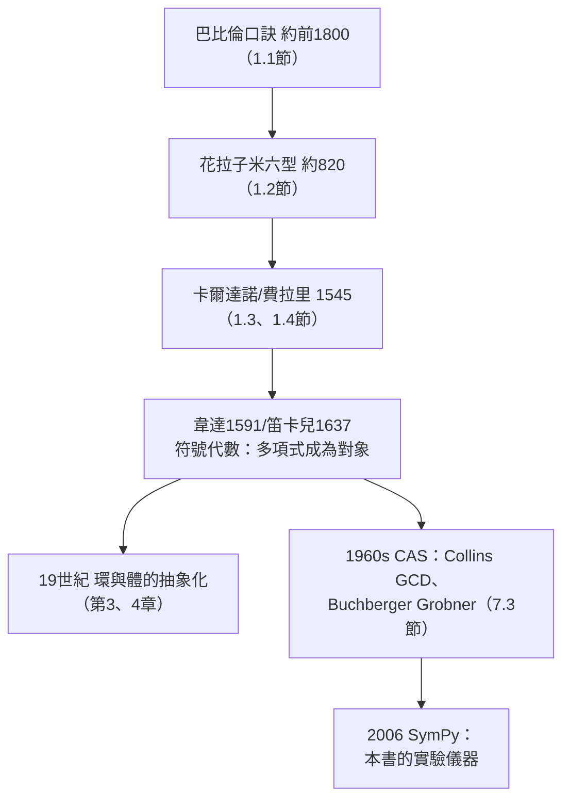

# 第 1 章 代數的起源：從解方程說起

## 1.5 SymPy 中的多項式：Poly 與 solve

### 學習目標

1. 掌握 SymPy 的 `Poly` 類：多項式的構造、係數、次數、生成元與係數域（domain）概念。
2. 掌握多項式的四則與整除結構：除法（帶餘）、最大公因式（GCD）、因式分解（`factor`、`factor_list`）。
3. 系統使用 `solve`、`roots`、`nroots`、`real_roots`、`CRootOf` 五種求根工具，理解各自適用的場景與精確度承諾。
4. 從「解方程」升級到「研究多項式」的觀點轉變——這正是從文藝復興代數走向現代抽象代數（第 3 章、第 4 章）的分水嶺。
5. 了解多項式演算法與計算機代數系統（CAS）的歷史淵源，SymPy 在其中的位置。

### 歷史背景

#### 從「方程」到「多項式」的觀點轉移

前四節的故事（[1.1](01.1-巴比倫與古埃及：一元二次方程的誕生.md)、[1.2](01.2-花拉子米與9世紀的《代數學》：al-jabr的故事.md)、[1.3](01.3-三次方程與1545年的卡爾達諾公式.md)、[1.4 節](01.4-四次方程與費拉里：根式的極限.md)）都在回答一個問題：**這個方程的根是什麼？** 但 16–17 世紀發生了一次安靜而深刻的視角轉移：

- **韋達（François Viète, 1540–1603，1591 年《分析術入門》）**：首次系統地用字母表示**已知量與未知量**，並提出「解析藝術」——把方程視為可運算的對象。他給出根與係數關係（[1.1 節](01.1-巴比倫與古埃及：一元二次方程的誕生.md) 的韋達定理的一般形式）。
- **笛卡兒（René Descartes, 1637 年《幾何學》）**：確立 $`x, y, z`$ 表未知量、 $`a, b, c`$ 表已知量的現代記法；提出因式定理（ $`a`$ 是根 $`\Leftrightarrow`$ $`(x-a)`$ 整除多項式）；引入「多項式的次數」的系統討論。
- **牛頓（1660s–1707《廣義算術》）**：多項式的除法、根的對稱函數、數值逼近方法（牛頓法），把多項式當作**代數計算的對象**而非僅僅「待解的方程」。

這個轉移的意義：一旦多項式本身成為研究對象，我們就可以問「兩個多項式的公因式是什麼」「它在整數上可分解嗎」「它在模 $`p`$ 的世界裡可分解嗎」——這些問題在 19 世紀長成環論與理想論（[3.1 節](03.1-環論的誕生：戴德金與克羅內克（1870s–1880s）.md)、[3.2 節](03.2-理想與商環：諾特（1921）的理想理論.md)），在 20 世紀長成計算機代數。

#### 計算機代數的誕生

1960 年代，多項式運算成為計算機科學的正式課題：Collins 的多項式 GCD 演算法（1966）、Buchberger 的 Gröbner 基（1965，見 [7.3 節](07.3-Buchberger（1965）：Grobner基的發明.md)）、Zassenhaus 的因式分解理論，催生了 MACSYMA、Reduce 等系統。**SymPy** 由 Ondřej Čertík 於 2006 年發起，以純 Python 寫成、完全開源，其多項式模組 `sympy.polys`（核心開發者 Mateusz Paprocki）實現了上述半個世紀的演算法積累。今天你在 Jupyter 裡敲一行 `factor(...)`，背後站著巴比倫的口訣、費拉里的降次、Collins 的 GCD 與 Buchberger 的 Grobner 基。



### 理論：多項式的形式理論

#### 定義（一元多項式）

設 $`R`$ 為帶單位的交換環（環的定義見 [3.1 節](03.1-環論的誕生：戴德金與克羅內克（1870s–1880s）.md)）。**一元多項式**是形式和

$$
f(x) = a_n x^n + a_{n-1} x^{n-1} + \cdots + a_1 x + a_0, \qquad a_i \in R,
$$

記為 $`f \in R[x]`$ 。全體這種對象在逐項加法與卷積乘法

$$
(fg)(x) = \sum_{k=0}^{m+n} \left(\sum_{i+j=k} a_i b_j\right) x^k
$$

下構成環 $`R[x]`$ 。若 $`a_n \neq 0`$ ，稱 $`n = \deg f`$ 為**次數**； $`a_n`$ 為**首項係數**；首項係數為 $`1`$ 的多項式稱為**首一的（monic）**。

**註（形式性）**： $`R[x]`$ 中的 $`x`$ 不是「未知數」，只是一個形式符號；多項式由係數序列 $`(a_0, \dots, a_n)`$ 決定。「多項式函數」與「多項式」是兩個概念（在有限體上二者不同！見 [3.3 節](03.3-整環、體與體的特徵.md)）。

#### 定理（歐幾里得除法）

設 $`F`$ 為體（或 $`R`$ 為交換環且除式首一）， $`f, g \in R[x]`$ ， $`g \neq 0`$ 。則存在唯一 $`Q, R_0 \in R[x]`$ 使

$$
f = Q g + R_0, \qquad R_0 = 0 \ \text{或}\ \deg R_0 < \deg g.
$$

**證明思路**：對 $`\deg f`$ 作數學歸納。若 $`\deg f \ge \deg g`$ ，用 $`f`$ 的首項減去 $`g`$ 的首項適當倍數，次數嚴格下降；唯一性由比較首項可得。這是「長除法」的一般化，巴比倫與中世紀算家早已在做它的數值特例。 $`\blacksquare`$

#### 定理（因式定理與餘式定理）

在歐幾里得除法中取 $`g = x - a`$ ：

$$
f = Q\,(x-a) + R_0, \qquad R_0 = f(a).
$$

故 $`f(a) = 0`$ （ $`a`$ 是根） $`\iff (x - a) \mid f`$ （ $`x-a`$ 整除 $`f`$ ）。此為**笛卡兒《幾何學》（1637）** 的結果。

#### 定理（GCD 與輾轉相除）

 $`R[x]`$ （ $`R`$ 為體的環，即 $`F[x]`$ ）中任意 $`f, g`$ 有最大公因式 $`\gcd(f, g)`$ ，且存在 $`u, v \in F[x]`$ 使

$$
u f + v g = \gcd(f, g) \quad (\text{Bézout 恆等式}).
$$

**證明思路**：對次數作輾轉相除—— $`\gcd(f, g) = \gcd(g, f \bmod g)`$ ——次數嚴格遞降，必停於零。Bézout 恆等式由回代得到。這與整數的歐幾里得輾轉相除（約公元前 300 年，《幾何原本》卷七）是同一演算法。詳見 [3.4 節](03.4-多項式環、整除性與因式分解.md)。 $`\blacksquare`$

#### 定理（唯一分解，UFD）

設 $`F`$ 為體。 $`F[x]`$ 中每個非零非常數多項式可（相差單位與次序）**唯一地**分解為不可約多項式之積：

$$
f = c\, p_1^{e_1} p_2^{e_2} \cdots p_k^{e_k}.
$$

這是 $`F[x]`$ 成為**唯一分解整環（UFD）**的內容；證明見 [3.4 節](03.4-多項式環、整除性與因式分解.md)（用歸納法 + 不可約即素性的推導，後者依賴 Bézout）。**不可約性依賴係數域**： $`x^2 - 2`$ 在 $`\mathbb{Q}`$ 上不可約、在 $`\mathbb{R}`$ 上分解； $`x^2 + 1`$ 在 $`\mathbb{R}`$ 上不可約、在 $`\mathbb{C}`$ 上分解——「能不能分解」是相對於係數域的性質，SymPy 的 domain 機制（範例 2）正是為此而設。

#### 定理（根的個數）

 $`n`$ 次多項式在體中至多有 $`n`$ 個根（計重數可恰有 $`n`$ 個，若係數域包含所有根——代數閉包，見 [3.5 節](03.5-體擴張與克羅內克定理：代數閉包.md)）。**證明思路**：每個根吃掉一個線性因式，而次數在乘法下相加。 $`\blacksquare`$

#### 求根工具的光譜

| 工具 | 精確性 | 適用場景 |
|---|---|---|
| `solve` | 符號精確 | 小次數、有根式解（[1.3](01.3-三次方程與1545年的卡爾達諾公式.md)、[1.4 節](01.4-四次方程與費拉里：根式的極限.md) 的公式） |
| `roots` | 符號精確 | 同上，但容忍「部分未解出」 |
| `factor` | 精確分解 | 找有理根與不可約因子 |
| `nroots` | 浮點近似 | 快速看根的位置（含複根） |
| `real_roots` / `CRootOf` | **精確** | 五次以上唯一可靠的符號表示（阿貝爾定理下根式解不存在，[4.3 節](04.3-阿貝爾（1826）與魯菲尼：五次方程無根式解.md)） |

### SymPy 實作

#### 範例 1：Poly 的基本操作

```python
import sympy as sp

x = sp.symbols('x')
f = sp.Poly(x**3 - 6*x**2 + 11*x - 6, x)

print(f.all_coeffs())     # [1, -6, 11, -6]  ← 由高次到低次
print(f.degree())         # 3
print(f.is_monic)         # True（首一）
print(f.gens)             # (x,)  ← 生成元
print(f.domain)           # ZZ  ← 係數域：整數環
print(sp.Poly(x**2/2 + 1, x).domain)   # QQ（有理數域）
```

輸出解讀：`all_coeffs` 從**最高次**到常數列出係數；`domain` 顯示 SymPy 自動判斷係數落在哪個環——這是本書第 3 章之後的核心概念（[3.3 節](03.3-整環、體與體的特徵.md)），SymPy 已內建了它。

#### 範例 2：歐幾里得除法與因式定理

```python
import sympy as sp

x = sp.symbols('x')
f = sp.Poly(x**3 - 6*x**2 + 11*x - 6, x)
g = sp.Poly(x - 2, x)

Q, R = sp.div(f, g)
print(Q)   # Poly(x**2 - 4*x + 3, x, domain='ZZ')
print(R)   # Poly(0, x, domain='ZZ')  ← 2 是根，(x-2) 整除 f
```

驗證餘式定理的一般形式：

```python
a = sp.symbols('a')
f2 = sp.Poly(x**3 + a*x - 2, x)
Q2, R2 = sp.div(f2, sp.Poly(x - 1, x))
print(R2.as_expr())                 # a - 1  ← 餘式 = f(1) = 1 + a - 2
print(sp.simplify(R2.as_expr() - f2.eval(1)))   # 0
```

除以 $`x-1`$ 的餘式恆等於 $`f(1) = a - 1`$ ——餘式定理的符號驗證。

#### 範例 3：GCD 與 Bézout 恆等式

```python
import sympy as sp

x = sp.symbols('x')
f = sp.Poly(x**2 - 1, x)          # (x-1)(x+1)
g = sp.Poly(x**2 + 2*x + 1, x)    # (x+1)^2

print(sp.gcd(f, g))               # Poly(x + 1, x, domain='ZZ')

# Bézout 恆等式：u*f + v*g = gcd = x + 1
u, v, d = sp.gcdex(f, g)     # gcdex 回傳 (s, t, h)：s*f + t*g = h
print(d)                          # Poly(x + 1, x, domain='QQ')
print(sp.expand(u.as_expr()*f.as_expr() + v.as_expr()*g.as_expr()))   # x + 1
```

輸出確認 $`\gcd = x+1`$ ，且存在 $`u, v`$ 使 $`u f + v g = x + 1`$ 。輾轉相除的每一步：

```python
print(sp.div(g, f))   # (Poly(1), Poly(2*x + 2))  → 下一步對 f 與 2x+2 輾轉
```

#### 範例 4：因式分解與係數域

```python
import sympy as sp

x = sp.symbols('x')
print(sp.factor(x**4 - 5*x**2 + 4))   # (x - 2)(x - 1)(x + 1)(x + 2)
print(sp.factor_list(x**4 - 5*x**2 + 4))
# (1, [(x**2 - 4, 1), (x**2 - 1, 1)])  ← 或更深的分解，視化簡層級

# 係數域決定分解深度
print(sp.factor(x**2 - 2))                        # x**2 - 2（在有理數域 QQ 上不可約！）
print(sp.factor(x**2 - 2, extension=sp.sqrt(2)))  # (x - sqrt(2))*(x + sqrt(2))  在 QQ(sqrt2) 中
print(sp.factor(x**2 + 1, modulus=2))             # (x + 1)^2  在 GF(2) 中 x^2+1=(x+1)^2！
print(sp.factor(x**2 + 1, modulus=3))             # x**2 + 1 在 GF(3) 上不可約
```

輸出說明：同一個多項式在不同係數域中的分解**完全不同**—— $`x^2+1`$ 在 $`\mathbb{Q}`$ 上不可約，在 $`\mathrm{GF}(2)`$ 中竟有重根（ $`2 = 0`$ 使 $`x^2+1 = (x+1)^2`$ ，這是特徵 $`2`$ 的奇異現象，見 [3.3 節](03.3-整環、體與體的特徵.md)），在 $`\mathrm{GF}(3)`$ 上又不可約。`factor_list` 回傳（常數因子, [（因子, 重數), ...]）的結構化輸出，適合程式處理。

#### 範例 5：五種求根工具對照

```python
import sympy as sp

x = sp.symbols('x')
p = x**3 - 3*x + 1        # casus irreducibilis：三實根，無根式實表達（1.3節）

print(sp.solve(p, x))                       # 符號解：複雜根式（含複數中間量）
print([sp.N(r) for r in sp.solve(p, x)])    # 數值化
print(sp.nroots(p))                         # 純數值，直接
print(sp.real_roots(sp.Poly(p, x)))         # [CRootOf(x**3 - 3*x + 1, 0), ...]
r0 = sp.CRootOf(p, 0)
print(r0.evalf(15))                         # -1.87938524157182  ← 精確表示的精確近似
print(r0.evalf(30))                         # 想多準就多準：-1.87938524157181676810821855465
```

輸出解讀：

- `sp.solve` 給出的根式解雖「精確」卻不能隔離實根（[1.3 節](01.3-三次方程與1545年的卡爾達諾公式.md) 的 casus irreducibilis）；
- `sp.nroots` 快但不承諾精確；
- `sp.real_roots` 回傳的 `CRootOf`（**c**omplex **root** **of**）是「第 $`k`$ 個實根」的**精確**表示：`r0.evalf(30)` 給出 30 位有效數字，且可做精確比較（如 `r0 > -2` 回傳 `True`）。

五次以上方程，`CRootOf` 是唯一可靠的表示——這正是阿貝爾–魯菲尼定理（[4.3 節](04.3-阿貝爾（1826）與魯菲尼：五次方程無根式解.md)）在軟體裡的直接體現：

```python
q = x**5 - x - 1
print(sp.solve(q, x))       # [CRootOf(x**5 - x - 1, 0), ..., CRootOf(x**5 - x - 1, 4)]
                            # 沒有任何根式！SymPy 知道根式解不存在
print(sp.nroots(q))
# [1.1673..., -0.7649 ± 0.3525*I, 0.1812 ± 1.0840*I]
```

#### 範例 6：本章的總驗收——多項式視角重看四章歷史

```python
import sympy as sp

x = sp.symbols('x')

# 1.1 巴比倫：x^2 + x = 3/4 → 看成多項式 x^2 + x - 3/4
p1 = sp.Poly(x**2 + x - sp.Rational(3, 4), x)
print(sp.factor(p1.as_expr()))          # (2*x - 1)*(2*x + 3)/4

# 1.2 花拉子米：x^2 + 10x - 39
p2 = sp.Poly(x**2 + 10*x - 39, x)
print(p2.all_coeffs(), p2.degree())    # [1, 10, -39] 2

# 1.3 卡爾達諾：x^3 - 15x - 4
p3 = sp.Poly(x**3 - 15*x - 4, x)
print(sp.factor(p3.as_expr()))          # (x - 4)*(x**2 + 4*x + 1)

# 1.4 費拉里：x^4 + 4x + 3
p4 = sp.Poly(x**4 + 4*x + 3, x)
print(sp.factor(p4.as_expr()))          # (x + 1)**2*(x**2 - 2*x + 3)

# 1.4 的後續：五次的牆
p5 = sp.Poly(x**5 - x - 1, x)
print(p5.degree(), len(sp.real_roots(p5)))   # 5 1
```

從二次到五次，`factor` 與 `real_roots` 一路相伴；而根式表達從「一條公式」走到「不存在」。本章的數學敘事，在 SymPy 中就是這五行輸出。

### 歷史評註：工具與理論的雙向驅動

| 年代 | 人物／系統 | 貢獻 |
|---|---|---|
| 約前 1800 | 巴比倫書吏 | 二次方程的演算法（[1.1 節](01.1-巴比倫與古埃及：一元二次方程的誕生.md)） |
| 約 300 | 歐幾里得 | 輾轉相除（《幾何原本》卷七）→ GCD 演算法 |
| 1637 | 笛卡兒 | 因式定理、符號記法 |
| 1799 | 高斯 | 代數基本定理的證明（[3.5 節](03.5-體擴張與克羅內克定理：代數閉包.md)） |
| 1965 | Buchberger | Grobner 基，多變元系統的通用解法（[7.3 節](07.3-Buchberger（1965）：Grobner基的發明.md)） |
| 1966 | Collins | 多項式 GCD 的有效演算法 |
| 2006– | SymPy 團隊 | 開源符號計算，把上述演算法放進每一台電腦 |

注意反方向的驅動：**為了讓計算機會做符號運算，數學家不得不把 19 世紀的抽象理論（域、理想、不可約性）變成可執行的演算法**——諾特的理想論（[3.2 節](03.2-理想與商環：諾特（1921）的理想理論.md)）在 Grobner 基中獲得了第二次生命。這是「理論支持技術」的完美案例，與本章「技術催生理論」的主旋律互為鏡像。

### 習題

1. 用 `sp.Poly` 構造 $`f = x^4 - 5x^2 + 4`$ ，印出 `all_coeffs`、`degree`、`is_monic`、`domain`；再用 `sp.div(f, x-2)` 驗證因式定理。
2. 對 $`f = x^3 + 2x^2 - x - 2`$ 與 $`g = x^2 + 3x + 2`$ ，用 `sp.gcdex` 求 $`u, v`$ 使 $`uf + vg = \gcd(f,g)`$ ，並展開驗證。
3. 在 `GF(2)`、`GF(3)`、`GF(5)` 上分別用 `sp.factor(..., modulus=p)` 分解 $`x^2 + 1`$ ；查表解釋： $`x^2+1`$ 在 $`\mathrm{GF}(p)`$ 上可約 $`\iff p = 2`$ 或 $`p \equiv 1 \pmod 4`$ 。（這是 [4.7 節](04.7-分圓體與有限體：高斯週期與密碼學應用.md) 高斯分圓理論的預告。）
4. 對 $`x^5 - x - 1`$ ：比較 `sp.solve`、`sp.nroots`、`sp.real_roots` 的輸出；用 `CRootOf(..., 0).evalf(50)` 列出唯一實根的前 50 位。
5. 寫一個函數 `vieta_check(poly_coeffs)`，輸入係數表，回傳前 $`k`$ 個初等對稱函數與係數的對照（推廣 [1.1 節](01.1-巴比倫與古埃及：一元二次方程的誕生.md) 的韋達定理），並對 $`x^3 - 6x^2 + 11x - 6`$ 驗證。根的對稱函數的一般理論見 [2.1 節](02.1-伽羅瓦（1832）之前：拉格朗日與根的置換.md)。
6. （挑戰）用 `sp.Poly(f, x, domain=sp.GF(2))` 構造 $`\mathrm{GF}(2)`$ 上的多項式環，驗證 $`x^2 + x + 1`$ 在其中不可約（用 `sp.factor`），據此說明 $`\{0, 1, \alpha, \alpha+1\}`$ （ $`\alpha^2 = \alpha + 1`$ ）構成一個四元素體——這是 [3.3 節](03.3-整環、體與體的特徵.md) 與 [3.7 節](03.7-SymPy的GF、factor與minimal_polynomial.md) 的預告。

### SymPy 要點回顧

- `sp.Poly(expr, x, domain=...)`：多項式物件；`all_coeffs`、`degree`、`is_monic`、`gens`、`domain` 讀出結構。
- `sp.div(f, g)`：歐幾里得除法，回傳（商，餘式）。
- `sp.gcd(f, g)`、`sp.gcdex(f, g)`：最大公因式與 Bézout 係數。
- `sp.factor` / `sp.factor_list`：因式分解；`modulus=p` 切換到 $`\mathrm{GF}(p)`$ ，`extension=...` 擴張係數域。
- 求根五件套：`solve`（符號根式）、`roots`（符號）、`nroots`（浮點）、`real_roots`（精確實根）、`CRootOf.evalf(n)`（精確表示的任意精度近似）。
- `poly.eval(a)`：多項式求值；餘式定理 $`R = f(a)`$ 的快速檢查。
- **工作流程**：先 `factor`（找結構），再 `real_roots`（精確隔離實根），最後 `nroots` 或 `evalf`（看數值）——符號與數值互證，貫穿全書。

至此第 1 章的敘事完結：代數從巴比倫的土地問題出發，經花拉子米的分型、文藝復興的公式競賽，在「五次的牆」前停步——而撞牆的人需要新語言。下一章，我們學習這門新語言的第一個詞彙：**群**，對稱性的語言，從拉格朗日 1770 年的根之置換說起——[2.1 節](02.1-伽羅瓦（1832）之前：拉格朗日與根的置換.md)。
