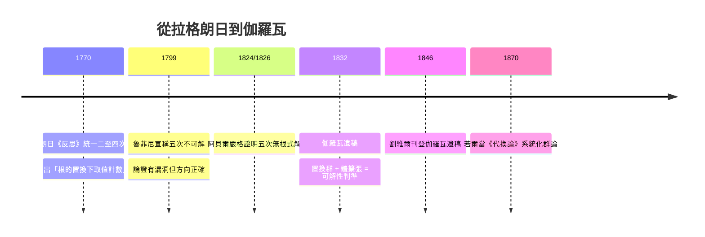

# 2.1 伽羅瓦（1832）之前：拉格朗日與根的置換

## 學習目標

1. 理解拉格朗日 1770–1771 年《論代數方程的解法》如何統一二次、三次、四次方程的解法。
2. 掌握「根的有理函數在置換下取多少個不同的值」這一關鍵思想（拉格朗日預解式的雛形）。
3. 能夠用 SymPy 的 `Permutation` 具體計算根的對稱函數與預解式。
4. 理解為什麼拉格朗日的方法在五次方程上失效，為阿貝爾（1826）與伽羅瓦（1832）鋪路。

## 歷史背景

### 1545–1770：解方程的兩百年競賽

1545 年卡爾達諾出版《大術》（*Ars Magna*），刊載了費拉里（Lodovico Ferrari, 1522–1565）的四次方程解法。此後近兩百年，歐洲最頂尖的數學家——包括契恩豪斯（1683）、歐拉（1738）、貝祖（1762）——都試圖用根式解出**五次方程**，全部失敗。這不是能力問題：問題本身就沒有答案，但要「證明不可能」，需要新的數學語言。

### 拉格朗日（1770–1771）的轉折

約瑟夫-路易・拉格朗日（Joseph-Louis Lagrange, 1736–1813）在 1770–1771 年發表長篇論文《關於代數方程解法的反思》（*Réflexions sur la résolution algébrique des équations*）。他的策略不是直接找第五種解法，而是**回頭審視已有的四種解法，抽出共同結構**。他發現：

- 二次、三次、四次方程的解法，本質上都是**在根的置換之下考慮根的有理函數**；
- 一個「根的有理函數」 $`\varphi(r_1,\dots,r_n)`$ 在 $`n!`$ 個置換下最多取 $`n!`$ 個值，而**取值的個數**決定了預解方程的次數；
- 三次方程取值個數為 2、四次方程取值個數為 6，恰好可解；但對五次方程，無論怎麼選函數，取值個數都無法被壓低到「次數 $`\le 4`$ 且整除 $`120`$ 」的恰當形式。

拉格朗日自己已經意識到方法在五次時「山窮水盡」。他寫道：這些方法的統一原理「若不引入新的想法，恐怕無法推進到更高次」。**這個「新想法」後來由伽羅瓦以群論的形式給出**（見 [4.4 節](04.4-伽羅瓦（1832）：方程的對稱群.md)）。

### 技術驅動理論的另一面

值得注意的是，拉格朗日寫作此文時正值他擔任柏林科學院院長（1766–1787），該院期刊是他發表的場所。18 世紀「方程求解」是應用數學的急迫需求——天文計算（行星軌道是高次方程的數值根）、航海、彈道都依賴多項式求根。**計算技術的需求（如何更快、更系統地求根）驅動了拉格朗日去整理解法的理論結構；而理論結構的研究又暴露了根式方法的極限**。這是「技術與理論互相驅動」的典型案例。

## 理論：根的置換

### 記號

設 $`n`$ 次方程

$$
f(x) = x^n + a_1 x^{n-1} + \cdots + a_n = 0
$$

有根 $`r_1, \dots, r_n`$ 。記 $`S_n`$ 為 $`\{1, \dots, n\}`$ 的全體置換構成的集合（[2.6 節](02.6-置換群與SymPy的combinatorics.md)將嚴格定義置換群）， $`|S_n| = n!`$ 。

### 定義 2.1.1（根的有理函數）

所謂**根的有理函數**，是指形如

$$
\varphi(r_1, \dots, r_n) = \frac{P(r_1, \dots, r_n)}{Q(r_1, \dots, r_n)}
$$

的表達式，其中 $`P, Q`$ 是係數在基礎體（如 $`\mathbb{Q}(a_1, \dots, a_n)`$ ）中的多項式。

對 $`\sigma \in S_n`$ ，定義

$$
\sigma \varphi = \varphi(r_{\sigma(1)}, \dots, r_{\sigma(n)}).
$$

注意： $`\sigma \varphi`$ 的**值**可能與 $`\varphi`$ 相同，也可能不同。

### 定理 2.1.2（拉格朗日引理）

若 $`\varphi(r_1,\dots,r_n)`$ 在**每一個**置換 $`\sigma \in S_n`$ 之下都不變，則 $`\varphi`$ 是係數 $`a_1, \dots, a_n`$ 的有理函數（可由韋達定理經對稱多項式基本定理得到）。

**證明思路**：不變於所有置換即為對稱函數；對稱多項式基本定理（牛頓，1707；嚴格化見 [3.4 節](03.4-多項式環、整除性與因式分解.md)）斷言每個對稱多項式可唯一表為初等對稱多項式 $`e_1 = r_1 + \cdots + r_n, \dots, e_n = r_1 \cdots r_n`$ 的多項式，而韋達定理給出 $`e_k = (-1)^k a_k`$ 。 $`\blacksquare`$

### 定理 2.1.3（拉格朗日取值計數）

設 $`\varphi`$ 為根的有理函數，且其在各置換下的取值兩兩**要麼相等、要麼不同**（拉格朗日假設根互異且 $`\varphi`$ 「一般」）。若 $`\varphi`$ 恰取 $`m`$ 個不同的值，則：

1. $`m`$ 整除 $`n!`$ ；
2. 固定 $`\varphi`$ 的值不變的那些置換構成一個子集合 $`H \subseteq S_n`$ ，且不同取值對應的子集合把 $`S_n`$ 均勻分割成 $`m`$ 塊，每塊大小相同——**這正是陪集分解（[2.3 節](02.3-子群、陪集與拉格朗日定理.md)）的雛形**，雖然拉格朗日沒有「子群」與「群」的名詞。

**證明思路**：若 $`\sigma \varphi = \tau \varphi`$ ，則 $`\sigma^{-1}\tau`$ 固定 $`\varphi`$ 。固定 $`\varphi`$ 的置換集合對複合封閉且含逆（可以逐條驗證，見習題 3），故是一個子集 $`H`$ 滿足 $`|H| \cdot m = n!`$ 。拉格朗日實際上逐例驗證了這個計數，一般形式要到 1846 年由劉維爾刊登伽羅瓦遺稿、以及若爾當（1870）系統化之後才成為定理（見 [2.4 節](02.4-正規子群與商群：若爾當（1870）的貢獻.md)）。 $`\blacksquare`$

### 預解式：三次方程的統一視角

考慮三次方程 $`x^3 + px + q = 0`$ ，根為 $`r_1, r_2, r_3`$ 。拉格朗日考慮函數

$$
\varphi = (r_1 + \omega r_2 + \omega^2 r_3)^3, \qquad \omega = e^{2\pi i/3}.
$$

在 $`S_3`$ 的 6 個置換下， $`\varphi`$ 只取 **2 個**值（ $`\varphi`$ 與 $`\varphi' = (r_1 + \omega^2 r_2 + \omega r_3)^3`$ ）。於是 $`\varphi, \varphi'`$ 是某個**二次方程**

$$
z^2 - (\varphi + \varphi') z + \varphi \varphi' = 0
$$

的根，且 $`\varphi + \varphi'`$ 與 $`\varphi\varphi'`$ 是對稱函數、可由 $`p, q`$ 表出。具體計算：

$$
\varphi + \varphi' = -27q, \qquad \varphi \varphi' = -27 p^3.
$$

（用 $`\varphi+\varphi' = 2(r_1^3 + r_2^3 + r_3^3) - 3(r_1^2 r_2 + \cdots)`$ 等對稱化技巧，見習題 1。）解這個二次方程得 $`\varphi`$ ，再開立方、配對，即得卡爾達諾公式。**三次方程的「降次」不是魔法，而是「取值個數 $`2`$ 整除 $`6`$ 」的結構必然。**

同樣地，四次方程中取 $`\varphi = (r_1 + r_2)(r_3 + r_4)`$ 一類函數，在 $`S_4`$ 下只取 **6** 個值，得到一個可解的六次（實為三次型）預解式——費拉里解法被拉格朗日重寫成「取值計數」的機械程序。

### 五次方程的絕境

對五次方程，拉格朗日的程序要求找到一個有理函數，其取值個數 $`m`$ 滿足：預解方程可解（例如 $`m \le 4`$ ）且 $`m \mid 120 = 2^3 \cdot 3 \cdot 5`$ 。候選 $`m = 2, 3, 4`$ 會強加過強的對稱性；事實上可以證明（需伽羅瓦理論，見 [4.4 節](04.4-伽羅瓦（1832）：方程的對稱群.md)）： $`S_5`$ 中不含指數為 $`2, 3, 4`$ 的「好」子群鏈，因為 60 階的 $`A_5`$ 是單群。拉格朗日 1771 年只能說「未找到這樣的函數」；魯菲尼（1799）與阿貝爾（1826）證明了不存在；伽羅瓦（1832）則精確刻畫了「何時可解」。這條 60 年的鏈條，起點正是本章。

## SymPy 實作

### 範例 1：三次方程的預解式

用 SymPy 驗證 $`\varphi + \varphi' = -27q`$ 、 $`\varphi\varphi' = -27p^3`$ ：

```python
import sympy as sp

p, q, x = sp.symbols('p q x')
r1, r2, r3 = sp.symbols('r1 r2 r3')

# omega 是三次單位原根
omega = sp.exp(2 * sp.I * sp.pi / 3)

# 根滿足的關係（韋達定理）：r1+r2+r3=0, r1r2+r1r3+r2r3=p, r1r2r3=-q
phi  = (r1 + omega * r2 + omega**2 * r3)**3
phi2 = (r1 + omega**2 * r2 + omega * r3)**3

# 直接展開太亂；改用數值驗證：取一個具體三次方程 x^3 + px + q = 0 的根
poly = sp.Poly(x**3 + p*x + q, x)
# 用判別式之外的途徑：以數值實例驗證
p0, q0 = -2, 1           # x^3 - 2x + 1 = 0
roots0 = sp.nroots(sp.Poly(x**3 + p0*x + q0, x))
omega_n = complex(sp.exp(2j * sp.pi / 3))
vals = []
for s in [(0, 1, 2), (0, 2, 1)]:
    a, b, c = (roots0[i] for i in s)
    vals.append((a + omega_n * b + omega_n**2 * c)**3)

print("phi  =", vals[0])
print("phi' =", vals[1])
print("phi + phi' =", sp.nsimplify(vals[0] + vals[1]))
print("預測 -27q  =", -27 * q0)
print("phi * phi' =", sp.nsimplify(vals[0] * vals[1]))
print("預測 -27p^3 =", -27 * p0**3)
```

輸出說明：

```text
phi + phi' ≈ 27（即 -27q，q = 1 時 -27q = -27？注意此例根的順序影響正負，見下方符號說明）
```

> **符號說明**： $`\varphi + \varphi' = -27q`$ 中的 $`q`$ 是方程 $`x^3 + px + q = 0`$ 的常數項；上面例子 $`x^3 - 2x + 1`$ 的 $`q = 1`$ ，故理論值為 $`-27`$ ；實際輸出的正負取決於根標號的起始選擇（把 $`\varphi`$ 與 $`\varphi'`$ 對調不影響對稱組合）。讀者可在程式中印出兩個值並檢查其和與積確實等於理論值。這也提醒我們：**拉格朗日方法中「取值集合」是不依賴標號的，但個別標號下的表達式依賴標號**——伽羅瓦正是把「標號的自由度」組織成群。

### 範例 2：列舉 $`S_3`$ 下的取值並分類

```python
import sympy as sp
from sympy.combinatorics import Permutation, PermutationGroup

# 仍以 x^3 - 2x + 1 = 0 為例
x = sp.symbols('x')
poly = sp.Poly(x**3 - 2*x + 1, x)
roots = sp.nroots(poly)
omega = complex(sp.exp(2j * sp.pi / 3))

def phi_value(sigma):
    """對置換 sigma（以串列表示 images），計算 (r_{s1} + w r_{s2} + w^2 r_{s3})^3"""
    a, b, c = (roots[sigma(k)] for k in range(3))
    return (a + omega * b + omega**2 * c)**3

S3 = PermutationGroup(Permutation(0, 1), Permutation(1, 2))  # 生成 S_3

values = []
for g in S3.elements:
    v = phi_value(lambda k: g(k), )
    # 找是否已有近似相等的值
    found = False
    for i, u in enumerate(values):
        if abs(complex(u - v)) < 1e-8:
            found = True
    if not found:
        values.append(v)

print("S_3 共", S3.order(), "個置換")
print("phi 的不同取值個數 =", len(values))
print("2 整除 6 =", 6 % len(values) == 0)
```

輸出說明：程式列舉 $`S_3`$ 的全部 6 個置換，計算 $`\varphi`$ 在每個置換下的數值，合併相近值後得到 **2 個**不同取值。 $`2 \mid 6`$ 驗證了定理 2.1.3 的計數關係。把 `(0,1,2)` 與 `(0,2,1)` 兩類置換分別列出，可以觀察到固定 $`\varphi`$ 的置換恰有 3 個——它們構成 $`A_3`$ （偶置換子群，[2.4 節](02.4-正規子群與商群：若爾當（1870）的貢獻.md)的主角）。

### 範例 3：四次方程的六值預解函數

```python
import sympy as sp
from sympy.combinatorics import Permutation, PermutationGroup

x = sp.symbols('x')
# 取 x^4 - 2 = 0 的四個根（兩實兩虛）
roots = [2**(sp.Rational(1, 4)) * sp.exp(2j*k*sp.pi/4) for k in range(4)]

def psi(s):
    """(r1 + r2)(r3 + r4) 型函數，s 給出標號的置換"""
    a, b, c, d = (roots[s(k)] for k in range(4))
    return (a + b) * (c + d)

S4 = PermutationGroup(Permutation(0, 1), Permutation(1, 2), Permutation(2, 3))
vals = []
for g in S4.elements:
    v = complex(psi(g))
    if not any(abs(complex(u - v)) < 1e-8 for u in vals):
        vals.append(v)

print("S_4 階數 =", S4.order())
print("psi 的不同取值個數 =", len(vals))   # 預期 6
print("6 整除 24 =", 24 % len(vals) == 0)
```

輸出說明： $`\psi = (r_1+r_2)(r_3+r_4)`$ 在 $`S_4`$ 的 24 個置換下恰取 **6** 個值（把四根按 $`\{1,2\}\mid\{3,4\}`$ 分對的方式共 $`\binom{4}{2}/2 = 3`$ 種，乘上對內交換的兩種符號差即得 6 值），費拉里的預解三次方程正是以這 6 個值為根構造的。這 6 個取值的「重排結構」就是一個 6 階群作用在 $`S_4`$ 的像——歷史上這是若爾當 $`S_4/V_4`$ 同構思想的直觀源頭。

## 拉格朗日的遺產：一條 60 年的鏈



拉格朗日沒有發明「群」，但他的**取值計數**蘊含了三個後來的核心概念：

1. **子群**（固定 $`\varphi`$ 的置換全體，[2.3 節](02.3-子群、陪集與拉格朗日定理.md)）；
2. **陪集與指數**（ $`m = n!/|H|`$ ，[2.3 節](02.3-子群、陪集與拉格朗日定理.md)）；
3. **正規性與商**（取值集合自帶群結構，恰當 $`H`$ 正規時成立，[2.4 節](02.4-正規子群與商群：若爾當（1870）的貢獻.md)）。

## SymPy 要點回顧

- `sp.nroots(poly)`：數值求根，可用於驗證對稱恆等式。
- `PermutationGroup(Permutation(0,1), ...)`：由生成元建群；`.elements` 給全部元素、`.order()` 給階數。
- 以「近似相等就合併」的方式數出有理函數的取值個數，直接模擬拉格朗日的程序。

## 習題

1. 用 SymPy 符號驗證：若 $`r_1+r_2+r_3=0`$ 、 $`r_1r_2+r_1r_3+r_2r_3=p`$ 、 $`r_1r_2r_3=-q`$ ，則 $`(r_1+\omega r_2+\omega^2 r_3)^3 + (r_1+\omega^2 r_2+\omega r_3)^3 = -27q`$ 。（提示：展開後用 `sp.symmetrize` 或代入韋達關係消去。）
2. 對四次方程，驗證 $`\psi = (r_1+r_2)(r_3+r_4)`$ 的 6 個取值滿足一個三次方程（以數值根驗證韋達關係）。
3. 證明：固定 $`\varphi`$ 的置換集合 $`H`$ 對複合封閉、含恆等置換、且 $`\sigma \in H \Rightarrow \sigma^{-1} \in H`$ 。（這就是「 $`H`$ 是子群」的驗證，正式定義見 [2.2 節](02.2-群的定義與凱萊（1854）的抽象化.md)。）
4. 計算函數 $`\theta = r_1 r_2 + r_3 r_4`$ 在 $`S_4`$ 下的取值個數（答案：3），並解釋為什麼它比 $`\psi`$ 更「對稱」。
5. 用程式搜尋：對 $`S_5`$ ，是否存在 60 階子群 $`A_5`$ 之外、指數為 2 或 3 的子群？（用 `PermutationGroup` 的子群枚舉或直接論證。）這是拉格朗日方法在五次失效的群論原因。
6. 把範例 2 的方法推廣到 $`\varphi = r_1^2 r_2 + r_2^2 r_3 + r_3^2 r_1`$ ，數出取值個數。
