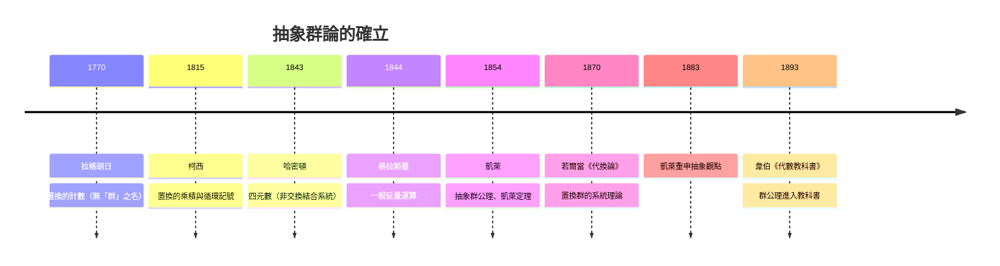

# 2.2 群的定義與凱萊（1854）的抽象化

## 學習目標

1. 熟練群的四條公理，能檢驗一個具體結構是否為群。
2. 理解凱萊 1854 年的抽象化：置換、四元數、幾何變換如何共同催生「運算律先行」的觀點。
3. 掌握凱萊定理：每個有限群都同構於一個置換群。
4. 會用 SymPy 檢驗群公理、建立群的運算表（凱萊表）。

## 歷史背景

### 從「具體運算」到「公理」

19 世紀上半葉，三條互不相干的線索同時指向「超越數與多項式的運算系統」：

1. **置換**：拉格朗日（1771）與柯西（1812、1844–1845，他引入了「置換的乘積」「循環記號」與 *permutation* 一詞）在方程論中的工作，見 [2.1 節](02.1-伽羅瓦（1832）之前：拉格朗日與根的置換.md)。
2. **數系擴張**：複數 $`\mathbb{C}`$ 被接受後（1800 年前後），數學家試圖構造「三維複數」皆失敗；哈密頓（William Rowan Hamilton, 1805–1865）在 1843 年 10 月 16 日於都柏林運河橋上刻下四元數公式 $`i^2 = j^2 = k^2 = ijk = -1`$ ——**犧牲了交換律** $`ij = -ji`$ 。這是數學史上第一次有人刻意保留結合律而放棄交換律。
3. **幾何變換**：射影幾何（彭賽列，1822）與莫比烏斯（1827）把「變換的複合」當作基本對象；格拉斯曼 1844 年的《延量論》研究一般的「延量運算」。

凱萊（Arthur Cayley, 1821–1895）在 1854 年發表《論映射理論》（*On the theory of groups, as depending on the symbolic equation $`\theta^n = 1`$ *），首次給出**抽象的群定義**：一個符號集合，帶有一個滿足封閉性、結合律、有單位元、每個元素有逆的運算。他明確說明這個概念「同時涵蓋置換、以及四元數等乘法系統」。換言之，**四元數迫使數學家把「結合但不交換」視為合法，置換提供了最重要的大例子，幾何變換則提供了「複合」這個統一運算**——抽象群論是這三股技術需求的交匯點。

有趣的是，凱萊的抽象化當時反響不大（「群」仍被默認為置換群），直到 1880 年代，若爾當《代換論》（1870）與李（Sophus Lie, 1874 起）的連續群工作使「抽象」變得必要——因為連續群的元素根本不是置換。1883 年凱萊本人再發短文重申抽象觀點，此時才被接受。

## 理論

### 定義 2.2.1（群）

一個**群** $`(G, \cdot)`$ 是集合 $`G`$ 與運算 $`\cdot : G \times G \to G`$ ，滿足：

1. **封閉性**： $`a \cdot b \in G`$ （由運算定義已含）；
2. **結合律**： $`(a \cdot b) \cdot c = a \cdot (b \cdot c)`$ ；
3. **單位元**：存在 $`e \in G`$ 使 $`e \cdot a = a \cdot e = a`$ ；
4. **逆元**：每個 $`a \in G`$ 存在 $`a^{-1}`$ 使 $`a \cdot a^{-1} = a^{-1} \cdot a = e`$ 。

若另滿足 $`a \cdot b = b \cdot a`$ （交換律），稱為**阿貝爾群**（紀念阿貝爾，見 [2.5 節](02.5-循環群與阿貝爾群：有限交換群的分類.md)）。

### 命題 2.2.2（基本性質）

- 單位元唯一；
- 逆元唯一；
- 消去律成立： $`ab = ac \Rightarrow b = c`$ ；
- $`(ab)^{-1} = b^{-1}a^{-1}`$ 。

**證明**（單位元唯一性）：設 $`e, e'`$ 皆為單位元，則 $`e = e \cdot e' = e'`$ 。其餘留作習題 1。 $`\blacksquare`$

### 凱萊定理

### 定理 2.2.3（凱萊，1854）

每個群 $`G`$ （特別是每個有限群）都同構於某個置換群。具體地，對 $`g \in G`$ 定義左乘映射 $`\lambda_g : G \to G`$ ， $`\lambda_g(h) = gh`$ ；則 $`g \mapsto \lambda_g`$ 是 $`G`$ 到對稱群 $`S_G`$ 的單射同態。

**證明**： $`\lambda_g`$ 是雙射（逆為 $`\lambda_{g^{-1}}`$ ）。複合滿足 $`\lambda_g \circ \lambda_h = \lambda_{gh}`$ （結合律保證），故是同態； $`\lambda_g = \mathrm{id}`$ 時取 $`h = e`$ 得 $`g = e`$ ，故單射。 $`\blacksquare`$

凱萊定理的意義：**抽象群再「玄」，本質上都是置換**——這保證了用 SymPy 的 `Permutation`（[2.6 節](02.6-置換群與SymPy的combinatorics.md)）可以機械化處理任何有限群。

### 凱萊表

有限群的乘法可用**運算表（凱萊表）**呈現。表是拉丁方：每行每列中每個元素恰出現一次（由消去律）。例如 4 階循環群 $`\mathbb{Z}/4`$ 與 Klein 四元群 $`V_4`$ ：

```text
Z/4:        V_4:
  0 1 2 3     e  a  b  c
0 0 1 2 3   e e  a  b  c
1 1 2 3 0   a a  e  c  b
2 2 3 0 1   b b  c  e  a
3 3 0 1 2   c c  b  a  e
```

兩者都由「對角線結構」區分： $`\mathbb{Z}/4`$ 有 4 階元， $`V_4`$ 的非單位元全是 2 階。**同構的群有不同的表現形式，但凱萊表（適當重排行列後）相同**——這是 1854 年抽象觀點的計算化身。

### 群的階與元素的階

- 群 $`G`$ 的**階** $`|G|`$ 是其元素個數（有限群）。
- 元素 $`g`$ 的**階**是最小正整數 $`n`$ 使 $`g^n = e`$ ；凱萊原文的標題符號方程 $`\theta^n = 1`$ 正是此概念。

## SymPy 實作

### 範例 1：檢驗群公理——四元數乘法群 $`\{\pm 1, \pm i, \pm j, \pm k\}`$

```python
import sympy as sp
from itertools import product

# 用符號表示八個四元數單位
E, NI = 1, -1          # 1 與 -1
I, J, K = 1j, 1j, 1j   # 先以複數表示再自訂乘法較繁瑣，改用字典乘法表

# 直接以整數編碼 8 個元素：0..7 表示 {1,-1,i,-i,j,-j,k,-k}
names = ['1', '-1', 'i', '-i', 'j', '-j', 'k', '-k']

# 建立乘法表：i^2=j^2=k^2=ijk=-1
table = {}
def mul(a, b):
    """a, b 為索引；回傳乘積索引"""
    x, y = names[a], names[b]
    sx, sy = (1 if not x.startswith('-') else -1), (1 if not y.startswith('-') else -1)
    bx, by = x.lstrip('-'), y.lstrip('-')
    if bx == '1':   px, sign = by, sx * sy
    elif by == '1': px, sign = bx, sx * sy
    elif bx == by:  px, sign = '1', -sx * sy      # i*i = -1 等
    else:
        # (i,j,k) 的循環乘法：ij=k, jk=i, ki=j；逆序得一負號
        cyc = {('i','j'):'k', ('j','k'):'i', ('k','i'):'j'}
        if (bx, by) in cyc:
            px, sign = cyc[(bx, by)], sx * sy
        else:
            px, sign = cyc[(by, bx)], -sx * sy
    result = px if sign == 1 else '-' + px
    return names.index(result)

# 檢驗群公理
G = list(range(8))
# 封閉性：mul 的定義保證；結合律：
assoc_ok = all(mul(mul(a, b), c) == mul(a, mul(b, c))
               for a, b, c in product(G, repeat=3))
# 單位元
unit_ok = all(mul(0, a) == a and mul(a, 0) == a for a in G)
# 逆元
inv_ok = all(any(mul(a, b) == 0 and mul(b, a) == 0 for b in G) for a in G)
commut = all(mul(a, b) == mul(b, a) for a, b in product(G, repeat=2))

print("結合律：", assoc_ok)
print("有單位元 1：", unit_ok)
print("每個元素有逆：", inv_ok)
print("是阿貝爾群嗎：", commut)   # False！四元數犧牲交換律
print("i*j =", names[mul(2, 4)], "，  j*i =", names[mul(4, 2)])
```

輸出說明：結合律、單位元、逆元皆成立，但 `commut` 為 **False**—— $`ij = k`$ 而 $`ji = -k`$ 。這正是 1843 年哈密頓的突破：一個「合法的乘法系統」可以不交換，但只要滿足凱萊四公理就是群。四元數群 $`Q_8`$ 從此成為教科書標準反例。

### 範例 2：凱萊定理的具體實現——把 $`Q_8`$ 實現為置換群

```python
from sympy.combinatorics import Permutation, PermutationGroup
from itertools import product

names = ['1', '-1', 'i', '-i', 'j', '-j', 'k', '-k']
def mul(a, b):
    x, y = names[a], names[b]
    sx = 1 if not x.startswith('-') else -1
    sy = 1 if not y.startswith('-') else -1
    bx, by = x.lstrip('-'), y.lstrip('-')
    if bx == '1':   px, sign = by, sx * sy
    elif by == '1': px, sign = bx, sx * sy
    elif bx == by:  px, sign = '1', -sx * sy
    else:
        cyc = {('i','j'):'k', ('j','k'):'i', ('k','i'):'j'}
        if (bx, by) in cyc:
            px, sign = cyc[(bx, by)], sx * sy
        else:
            px, sign = cyc[(by, bx)], -sx * sy
    result = px if sign == 1 else '-' + px
    return names.index(result)

# 凱萊定理：g -> 左乘置換 lambda_g
perms = []
for g in range(8):
    images = [mul(g, h) for h in range(8)]
    perms.append(Permutation(*images))

G8 = PermutationGroup(*perms)
print("左正則置換群階數 =", G8.order())          # 應為 8
print("生成元：", perms[2], perms[4])            # i 與 j 的左乘
print("lambda_i * lambda_j =", perms[2] * perms[4])
print("lambda_{ij}          =", perms[mul(2, 4)])
print("兩者相同（同態驗證） =", perms[2] * perms[4] == perms[mul(2, 4)])
```

輸出說明： $`Q_8`$ 的 8 個左乘映射實現為 $`\{0,\dots,7\}`$ 上的置換，所成群階為 8，且 $`\lambda_i\lambda_j = \lambda_{ij}`$ 精確成立——凱萊定理的可執行版本。讀者可改驗右乘 $`\rho_g(h) = hg`$ ，並比較左右正則表示的差異（習題 4）。

### 範例 3：檢查某結構**不是**群——正整數在減法下

```python
import sympy as sp

def is_group(G, op, identity=None):
    if identity is None:
        identity = next((e for e in G if all(op(e, a) == a and op(a, e) == a for a in G)), None)
    if identity is None:
        return False, "無單位元"
    if not all(any(op(a, b) == identity and op(b, a) == identity for b in G) for a in G):
        return False, "有元素無逆"
    return True, "是群"

N = list(range(1, 8))               # 正整數 1..7
ok, why = is_group(N, lambda a, b: abs(a - b))
print(ok, why)                       # False 有元素無逆

Z4 = [0, 1, 2, 3]
ok, why = is_group(Z4, lambda a, b: (a + b) % 4)
print(ok, why)                       # True 是群
```

輸出說明：正整數在減法下無單位元也無逆（ $`3 - 3 = 0 \notin`$ 集合），檢驗器正確報出失敗原因； $`\mathbb{Z}/4`$ 在加法下通過全部檢驗。把公理檢驗寫成函數，是本章之後反覆使用的工具。

## 凱萊之後：抽象化的完成



凱萊 1854 年超前時代約 25 年。**理論超前並非無代價**：直到連續變換群（李）、射影幾何群（克萊因 1872 年《愛爾蘭根綱領》）出現，數學家才被迫接受「群是一般運算系統」；克萊因的幾何綱領把幾何定義為「群作用下的不變量理論」，是抽象群論的第一個重大應用（與 [2.7 節](02.7-群作用、軌道與穩定子：Burnside引理.md)的群作用思想一脈相承）。

## SymPy 要點回顧

- 群公理可用 `itertools.product` 枚舉檢驗：結合律 $`O(n^3)`$ 、單位元與逆 $`O(n^2)`$ 。
- `Permutation(*images)`：由像的串列構造置換；`PermutationGroup(*perms)` 由生成元建群。
- 凱萊定理的實作模式：`images = [op(g, h) for h in range(n)]`，對左乘、右乘皆可用。
- 凱萊表可用巢狀串列印出，拉丁方性質是消去律的視覺化。

## 習題

1. 證明命題 2.2.2 的其餘三條：逆元唯一、消去律、 $`(ab)^{-1} = b^{-1}a^{-1}`$ 。
2. 修改範例 1 的 `mul`，改驗證 $`\mathbb{Z}/12`$ （整數模 12 加法）與模 12 乘法單位群 $`\{1,5,7,11\}`$ ；後者是 4 階群，判斷它與 $`\mathbb{Z}/4`$ 還是 $`V_4`$ 同構。
3. 寫一個函數 `isomorphic_tables(T1, T2)`，判斷兩張 $`n \times n`$ 凱萊表是否可透過重排行列變成相同（即判斷兩群是否同構的暴力法）。
4. 實作右正則表示 $`\rho_g(h) = hg`$ ，驗證 $`\rho_g \circ \rho_h = \rho_{hg}`$ （注意順序反轉！），並解釋這與反同構的關係。
5. 用凱萊定理把 $`\mathbb{Z}/5`$ 實現為 $`\{0,1,2,3,4\}`$ 上的置換群，印出 5 個置換的循環記號，觀察它們都是 5-循環（加恆等置換）。
6. （挑戰）凱萊表中每行每列是原集合的重排（拉丁方性質）。證明：此性質等價於消去律；並用程式對 $`Q_8`$ 的表驗證。

### 前後節連結

- 上一節：[2.1 伽羅瓦（1832）之前：拉格朗日與根的置換](02.1-伽羅瓦（1832）之前：拉格朗日與根的置換.md)
- 下一節：[2.3 子群、陪集與拉格朗日定理](02.3-子群、陪集與拉格朗日定理.md)
