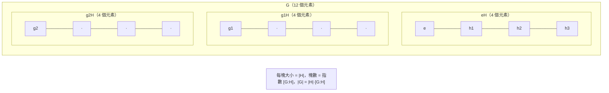

# 2.3 子群、陪集與拉格朗日定理

## 學習目標

1. 掌握子群的判定與陪集的構造。
2. 嚴格證明拉格朗日定理：子群的階整除群的階。
3. 理解拉格朗日定理的歷史角色：從拉格朗日 1771 年的「取值計數」到 1840 年代的正式定理。
4. 會用 SymPy 計算子群、陪集與指數。

## 歷史背景

### 從計數觀察到定理

[2.1 節](02.1-伽羅瓦（1832）之前：拉格朗日與根的置換.md)已經看到：拉格朗日在 1770–1771 年逐例觀察到「固定一個根函數的置換集合」均勻分割置換全體——例如固定 $`\varphi = (r_1+\omega r_2+\omega^2 r_3)^3`$ 的置換恰有 3 個（ $`\text{總數 } 6 / \text{取值數 } 2`$ ），固定 $`\psi = (r_1+r_2)(r_3+r_4)`$ 的恰有 4 個（ $`24/6`$ ）。拉格朗日當然沒有「子群」「陪集」的術語，甚至沒有一般的證明；他把這些視為計算技巧。

柯西在 1815 年與 1844–1845 年的置換系列論文中證明了若干「階數」命題，包括著名的**柯西定理**（若素數 $`p`$ 整除置換群階數 $`n!`$ 型的數，則存在 $`p`$ 階元）；若爾當在 1870 年《代換論》中把「子群」（*groupe partiel*）與指數作為基本概念系統陳述；「拉格朗日定理」的命名與一般有限群形式，是 19 世紀末教科書（如韋伯 1896）追認的。**定理以先驅者命名，但完成於抽象化之後**——這是數學史的常態：概念成熟了，舊觀察才升格為定理。

### 為什麼拉格朗日定理重要

它立刻給出「不可能性」的判定工具：

- 素數階群必為循環群（見 [2.5 節](02.5-循環群與阿貝爾群：有限交換群的分類.md)）；
- $`A_5`$ 的階 $`60 = 2^2 \cdot 3 \cdot 5`$ 可能的子群階受限，配合「單性」（無非平凡正規子群，[2.4 節](02.4-正規子群與商群：若爾當（1870）的貢獻.md)）導出五次方程不可解；
- 階數不整除就**沒有**子群——反面排除了大量搜索，是計算群論的基本剪枝。

## 理論

### 定義 2.3.1（子群）

 $`H \subseteq G`$ 稱為**子群**，記 $`H \le G`$ ，若：

1. $`e \in H`$ ；
2. $`a, b \in H \Rightarrow ab \in H`$ （封閉）；
3. $`a \in H \Rightarrow a^{-1} \in H`$ （逆封閉）。

**判別法**（一步檢驗）：非空子集 $`H \subseteq G`$ 是子群 $`\iff`$ 對任意 $`a, b \in H`$ 有 $`ab^{-1} \in H`$ 。

**證明**：必要性顯然。充分性：取 $`a \in H`$ ， $`aa^{-1} = e \in H`$ ； $`a \in H, e \in H`$ 得 $`ea^{-1} = a^{-1} \in H`$ ； $`a, b \in H`$ 得 $`a(b^{-1})^{-1} = ab \in H`$ 。 $`\blacksquare`$

### 定義 2.3.2（陪集）

對 $`H \le G`$ 、 $`g \in G`$ ，定義**左陪集**

$$
gH = \{gh : h \in H\}.
$$

### 引理 2.3.3（陪集的基本性質）

1. $`g \in gH`$ （因 $`e \in H`$ ）。
2. $`aH = bH \iff a^{-1}b \in H \iff b \in aH`$ 。
3. 任意兩個左陪集要麼相等、要麼不相交。
4. $`|gH| = |H|`$ （映射 $`h \mapsto gh`$ 是雙射）。
5. 左陪集全體分割 $`G`$ ；若 $`G`$ 有限且記左陪集個數為 $`[G:H]`$ （**指數**），則

$$
|G| = [G:H] \cdot |H|.
$$

**證明**：(2) 若 $`aH = bH`$ 則 $`b = be \in aH`$ ，故 $`b = ah`$ ， $`a^{-1}b = h \in H`$ ；反之 $`b \in aH`$ 易推 $`aH \supseteq bH`$ ，再由 (4) 得相等。(3) 由 (2)，陪集間的「相等」是等價關係。(4) 明顯。(5) 由 (2)(3)(4)， $`G`$ 被分成大小皆為 $`|H|`$ 的等價類。 $`\blacksquare`$

### 定理 2.3.4（拉格朗日定理）

設 $`G`$ 為有限群， $`H \le G`$ 。則 $`|H|`$ 整除 $`|G|`$ ，且

$$
[G : H] = \frac{|G|}{|H|}.
$$

**證明**：即引理 2.3.3(5)。 $`\blacksquare`$

### 推論 2.3.5

1. 有限群中任意元素 $`g`$ 的階整除 $`|G|`$ （取 $`H = \langle g \rangle`$ ）。
2. 素數 $`p`$ 階群必為循環群，且只有平凡子群。
3. 費馬小定理：對素數 $`p`$ 與 $`\gcd(a, p) = 1`$ ， $`a^{p-1} \equiv 1 \pmod p`$ （乘法群 $`(\mathbb{Z}/p)^\times`$ 階為 $`p-1`$ ，元素階整除之）。**群論是數論的框架**——這也是 1770 年代拉格朗日自己用置換證明過的結果。

### 警告：逆命題不成立

 $`|H|`$ 整除 $`|G|`$ **不能**保證存在那個階的子群。經典反例： $`A_4`$ （階 12）沒有 6 階子群。要保證存在，需要更強的 Sylow 定理（1872，見習題 6 與 [2.5 節](02.5-循環群與阿貝爾群：有限交換群的分類.md)）。

## SymPy 實作

### 範例 1：計算 $`S_3`$ 的全部子群與陪集

```python
from sympy.combinatorics import Permutation, PermutationGroup

# S_3 以生成元給出
S3 = PermutationGroup(Permutation(0, 1), Permutation(1, 2))
print("S_3 階數 =", S3.order())

# 子群 H = <(1 2 3)>，3 階循環群（即 A_3）
H = PermutationGroup(Permutation(0, 1, 2))
print("H 階數 =", H.order())
print("H 是 S_3 的子群：", H.is_subgroup(S3))

# 計算陪集：SymPy 提供 coset_transpose / 手動陪集
# 手動：對每個 g in S3，計算 gH
def left_coset(g, H_group, ambient):
    return frozenset(ambient.elements) & {g * h for h in H_group.elements}

cosets = []
for g in S3.elements:
    C = left_coset(g, H, S3)
    if C not in cosets:
        cosets.append(C)

print("不同左陪集個數 =", len(cosets), "（= 指數 6/3 = 2）")
for C in cosets:
    print(sorted(str(p) for p in C))
```

輸出說明：

```text
S_3 階數 = 6
H 階數 = 3
H 是 S_3 的子群： True
不同左陪集個數 = 2 （= 指數 6/3 = 2）
['(0 1 2)', '(0 2 1)', '(2)']
['(0 2)', '(1 2)', '(2)(0 1)']
```

兩個陪集恰為 $`H`$ （偶置換）與 $`(1\,2)H`$ （奇置換）—— $`S_3`$ 被均勻分割成兩塊各 3 個元素。這正是拉格朗日 1771 年在三次方程上看到的分割，如今是引理 2.3.3 的推論。

### 範例 2：拉格朗日定理的系統驗證—— $`A_4`$ 的子群階

```python
from sympy.combinatorics import Permutation, PermutationGroup
from itertools import combinations

# A_4：4 次交錯群
A4 = PermutationGroup(
    Permutation(0, 1, 2), Permutation(0, 1, 3),
)
print("A_4 階數 =", A4.order())   # 12

# 枚舉 A4 的所有循環子群，收集其階
orders = set()
for g in A4.elements:
    H = PermutationGroup(g)
    orders.add(H.order())
    # g 生成的子群可能更小；用 order 檢查
print("循環子群出現的階：", sorted(orders))

# 檢查 A4 是否有 6 階子群：暴力搜所有 6 元素子集
els = list(A4.elements)
found6 = False
# 只需檢查包含單位元、且任兩元素積仍在集合內的子集
e = Permutation(list(range(4)))
import itertools
for subset in combinations([p for p in els if p != e], 5):
    Hset = set(subset) | {e}
    closed = all((a * b) in Hset for a in Hset for b in Hset)
    if closed:
        found6 = True
        print("發現 6 階子群！", Hset)
        break
print("A_4 有 6 階子群嗎：", found6)   # 預期 False：拉格朗日逆命題反例
```

輸出說明： $`A_4`$ 階為 12，其循環子群的階只出現 1, 2, 3（單位元、三個雙對換 $`(1\,2)(3\,4)`$ 型為 2 階、八個 3-循環給出 3 階子群）；暴力搜索 6 元素封閉子集結果為 **False**。這驗證了警告段： $`12 \div 6 = 2`$ 是整數，但 6 階子群不存在。

### 範例 3：費馬小定理的群論證明的計算版

```python
import sympy as sp
from sympy.combinatorics import Permutation, PermutationGroup
from sympy.combinatorics.named_groups import CyclicGroup

p = 13
# (Z/13)^× 是 p - 1 = 12 階的循環群
G = CyclicGroup(p - 1)
print("G 階 =", G.order(), "（= p - 1 =", p - 1, "）")

# 直接用模乘法群驗證：每個 a 的階整除 p-1
for a in range(2, p):
    x, n = a % p, 1
    while x != 1:
        x = (x * a) % p
        n += 1
    print(f"a={a:2d}: 階 = {n:2d}, 整除 {p-1}: {(p-1) % n == 0}")
```

輸出說明：

```text
G 階 = 12 （= p - 1 = 12 ）
a= 2: 階 = 12, 整除 12: True
a= 3: 階 =  3, 整除 12: True
a= 4: 階 =  6, 整除 12: True
a= 5: 階 =  4, 整除 12: True
a= 6: 階 = 12, 整除 12: True
a= 7: 階 = 12, 整除 12: True
a= 8: 階 =  4, 整除 12: True
a= 9: 階 =  3, 整除 12: True
a=10: 階 =  6, 整除 12: True
a=11: 階 = 12, 整除 12: True
a=12: 階 =  2, 整除 12: True
```

對 $`p = 13`$ ，每個 $`a \in 2,\dots,12`$ 的乘法階（ $`2 \to 12`$ 、 $`5 \to 4`$ 、 $`3 \to 3`$ 等）都整除 12。這就是推論 2.3.5(3)：元素階整除群階，在 $`(\mathbb{Z}/13)^\times`$ 上的具體呈現。RSA 加密的正確性正建立在此之上（[9.4 節](09.4-量子計算中的代數：群論與Shor演算法.md)會回到這裡）。

## 陪集分割的圖示



## SymPy 要點回顧

- `PermutationGroup(...)`、`.order()`、`.elements`、`.is_subgroup(H)`。
- 陪集：`{g * h for h in H.elements}`；去重後計數即指數。
- 檢驗封閉性：`all((a*b) in Hset for a in Hset for b in Hset)`。
- 暴力枚舉子群是 $`O(2^n)`$ ，僅用於小群；SymPy 內部有更快的子群搜尋（見 [2.6 節](02.6-置換群與SymPy的combinatorics.md)）。

## 習題

1. 證明判別法（一步檢驗）：非空 $`H \subseteq G`$ ， $`a,b \in H \Rightarrow ab^{-1} \in H`$ ，則 $`H \le G`$ 。
2. 證明左陪集個數等於右陪集個數（映射 $`gH \mapsto Hg^{-1}`$ 是良定義雙射）。
3. 用範例 1 的程式計算 $`H = \langle (1\,2) \rangle \le S_3`$ 的左陪集與右陪集，列出兩者，驗證它們**不同**——這正是 $`H`$ 不正規的跡象（下一節主題）。
4. 證明：指數 2 的子群必正規（提示： $`G = H \sqcup gH = H \sqcup Hg`$ ）。
5. 計算 $`S_4`$ 中 $`\langle (1\,2\,3\,4) \rangle`$ 的指數，並列出全部陪集。
6. （Sylow 預告）驗證 $`A_4`$ 有 4 個 3 階子群、1 個 4 階正規子群 $`V_4`$ ；查閱並陳述 Sylow 第三定理，說明 $`n_3 \equiv 1 \pmod 3`$ 、 $`n_3 \mid 4`$ 如何預測 $`n_3 \in \{1, 4\}`$ 。
7. 用範例 3 的方法對 $`p = 17`$ 驗證所有元素的階整除 16，找出原根（階 16 的元素）。

### 前後節連結

- 上一節：[2.2 群的定義與凱萊（1854）的抽象化](02.2-群的定義與凱萊（1854）的抽象化.md)
- 下一節：[2.4 正規子群與商群：若爾當（1870）的貢獻](02.4-正規子群與商群：若爾當（1870）的貢獻.md)
