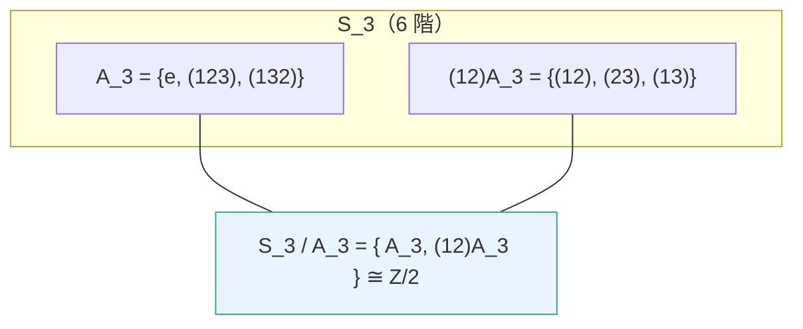

# 2.4 正規子群與商群：若爾當（1870）的貢獻

## 學習目標

1. 定義正規子群，理解其「陪集可乘」的意義。
2. 建構商群 $`G/N`$ 並證明其為群。
3. 掌握同態基本定理（第一同構定理）。
4. 理解若爾當 1870 年《代換論》如何把 1830 年代伽羅瓦的洞見變成系統理論。
5. 用 SymPy 檢驗正規性、構造商群、驗證合成列。

## 歷史背景

### 伽羅瓦的洞見與若爾當的系統化

伽羅瓦在 1831–1832 年的手稿中已經使用「把群分解為陪集」的論證：他考慮方程的置換群 $`G`$ 與其子群 $`H`$ ，並問「 $`H`$ 何時對應到一個中間體」——答案是 $`H`$ 必須使「陪集的分解與左右無關」（今日的正規性）。但伽羅瓦的手稿晦澀、未用「正規」一詞，1832 年決鬥身亡後僅在 1846 年由劉維爾整理發表。

將這些洞見鑄成系統理論的是**卡米爾・若爾當（Camille Jordan, 1838–1922）**。他 1870 年出版《代換論與代數方程》（*Traité des substitutions et des équations algébriques*），這是史上第一本群論專著。書中：

- 系統定義了置換群的**正規子群**（*groupe invariant*）、**單群**、**合成列**；
- 證明了 $`A_n`$ （ $`n \ge 5`$ ）為單群，這是五次方程不可解的群論核心；
- 提出「同構」的明確概念，並研究兩個群何時「有相同的合成列因子」（若爾當–赫爾德定理的前身，赫爾德在 1889 年完成）。

若爾當書名的「代換」（substitution）即今日的「置換」——他仍以置換為唯一對象，但組織方式已是現代的。**若爾當的動機仍是方程論（書的後半即伽羅瓦理論），但理論一旦抽象化就遠遠溢出原動機**：合成列與單群成為 20 世紀有限單群分類工程（[9.1 節](09.1-有限群的分類（1983）：百年工程.md)）的起點。

### 技術驅動：為什麼需要「正規」

拉格朗日定理（[2.3 節](02.3-子群、陪集與拉格朗日定理.md)）說 $`G`$ 被切成 $`|H|`$ 大小的陪集。但若想把「陪集的集合」本身做成一個群（例如 $`S_3/\{e\}`$ 的陪集 $`H, (1\,2)H`$ 想相乘），會發現**只有對某些 $`H`$ 才行**：

$$
(g_1N)(g_2N) := (g_1 g_2)N
$$

要良定義，必須對任意 $`n \in N`$ 、 $`g \in G`$ 有 $`gng^{-1} \in N`$ ——即 $`N`$ **正規**。工程上這好比「取模」：整數加法群中，模 $`n`$ 同餘類可以相加（ $`\mathbb{Z}/n`$ ），正是因為 $`n\mathbb{Z}`$ 在加法群中正規。**商結構是「忽略細節、保留骨架」的數學工具，正規性是它合法的條件**。

## 理論

### 定義 2.4.1（正規子群）

 $`N \le G`$ 稱為**正規子群**，記 $`N \trianglelefteq G`$ ，若

$$
\forall g \in G,\ \forall n \in N:\ gng^{-1} \in N.
$$

### 引理 2.4.2（正規的等價條件）

對子群 $`N \le G`$ ，下列等價：

1. $`gng^{-1} \in N`$ 對所有 $`g, n`$ （共軛封閉）；
2. $`gN = Ng`$ 對所有 $`g`$ （左陪集等於右陪集）；
3. $`N`$ 的左陪集分割等於右陪集分割。

**證明思路**：(1) $`\Rightarrow`$ (2)： $`gN = \{gng^{-1}\cdot g\} \subseteq Ng`$ ，雙邊計數得等號。(2) $`\Rightarrow`$ (1)： $`gng^{-1} \in gNg^{-1} = Ng g^{-1} = N`$ 。 $`\blacksquare`$

平凡正規子群： $`\{e\}`$ 與 $`G`$ 本身。指數 2 的子群必正規（[2.3 節](02.3-子群、陪集與拉格朗日定理.md)習題 4）。群中所有與 $`N`$ 共軛的子群互相同構； $`N`$ 正規 $`\iff`$ 它只有自己這一個共軛。

### 定理 2.4.3（商群）

設 $`N \trianglelefteq G`$ 。定義 $`G/N = \{gN : g \in G\}`$ ，運算 $`(g_1N)(g_2N) = (g_1g_2)N`$ 。則 $`G/N`$ 是群，階為 $`[G:N]`$ 。

**證明**：先證良定義：若 $`g_1' = g_1 n_1`$ 、 $`g_2' = g_2 n_2`$ ，則

$$
g_1' g_2' = g_1 n_1 g_2 n_2 = g_1 (g_2 g_2^{-1} n_1 g_2) n_2 \in g_1 g_2 N,
$$

（中間一步用了 $`g_2^{-1} n_1 g_2 \in N`$ ，由正規性。）結合律繼承自 $`G`$ ；單位元 $`eN = N`$ ； $`(gN)^{-1} = g^{-1}N`$ 。 $`\blacksquare`$

### 定義 2.4.4（同態與核）

 $`\varphi : G \to G'`$ 為**同態**若 $`\varphi(ab) = \varphi(a)\varphi(b)`$ 。**核** $`\ker\varphi = \{g : \varphi(g) = e'\}`$ 。

### 定理 2.4.5（第一同構定理）

 $`\ker\varphi \trianglelefteq G`$ ，且

$$
G / \ker\varphi \;\cong\; \operatorname{im}\varphi.
$$

**證明思路**： $`\ker\varphi`$ 正規由直接驗證；映射 $`\bar\varphi(g\ker\varphi) = \varphi(g)`$ 良定義（ $`\varphi`$ 在核上為 $`e'`$ ）、是雙射同態。 $`\blacksquare`$

**意義**：每個商群都來自某個同態的「合併」；反之每個同態的核給出一個「可忽略的細節層」。這是現代代數的羅塞塔石碑之一（環版見 [3.2 節](03.2-理想與商環：諾特（1921）的理想理論.md)）。

### 定義 2.4.6（單群與合成列）

- $`G`$ 是**單群**，若其正規子群只有 $`\{e\}`$ 與 $`G`$ （且 $`|G| > 1`$ ）。
- **合成列**：鏈 $`\{e\} = G_0 \trianglelefteq G_1 \trianglelefteq \cdots \trianglelefteq G_k = G`$ ，各 $`G_{i-1} \trianglelefteq G_i`$ 且商因子 $`G_i/G_{i-1}`$ 皆單群。

### 定理 2.4.7（若爾當–赫爾德）

有限群的任意兩個合成列有相同的長度與（在同構意義下、可重排的）商因子。

### 定理 2.4.8（若爾當，1870）

 $`A_n`$ 對 $`n \ge 5`$ 是單群。

**證明思路**（概要）： $`A_5`$ 的共軛類為 $`\{e\}`$ 、15 個雙對換（2 階）、20 個 3-循環（3 階）、12 與 12 個 5-循環（各半）。正規子群必為若干完整共軛類的聯集、階整除 60 且含 $`e`$ 。逐項檢查 60 的因子（2, 3, 4, 5, 6, 10, 12, 15, 20, 30）皆無法湊成「共軛類聯集 ∪ {e}」，故無非平凡正規子群； $`n > 5`$ 的情形需另證（歸納 + 3-循環生成性）。 $`\blacksquare`$

**與方程可解性的關係**： $`S_5`$ 的合成列為 $`\{e\} \trianglelefteq A_5 \trianglelefteq S_5`$ ，因子 $`\mathbb{Z}/2, A_5`$ ； $`A_5`$ 是單群但非交換素數階群，故「不可解」（可解群 = 合成因子皆循環素數階，見 [2.5 節](02.5-循環群與阿貝爾群：有限交換群的分類.md)與 [4.4 節](04.4-伽羅瓦（1832）：方程的對稱群.md)）。**五次方程無根式解的群論根源就是 $`A_5`$ 的單性。**

## SymPy 實作

### 範例 1：檢驗正規性—— $`S_3`$ 的三個子群

```python
from sympy.combinatorics import Permutation, PermutationGroup

S3 = PermutationGroup(Permutation(0, 1), Permutation(1, 2))

def is_normal(H, G):
    """檢驗 H 是否為 G 的正規子群：對所有 g in G, h in H，ghg^{-1} in H"""
    H_set = set(H.elements)
    return all(g * h * (~g) in H_set for g in G.elements for h in H.elements)

# 三個子群
A3 = PermutationGroup(Permutation(0, 1, 2))            # 3 階循環
H2 = PermutationGroup(Permutation(0, 1))               # 2 階
triv = PermutationGroup(Permutation(3))                # 平凡

for name, H in [("A_3", A3), ("<（12）>", H2), ("平凡", triv)]:
    print(f"{name}: 階 {H.order()}, 正規於 S_3：{is_normal(H, S3)}")
```

輸出說明：

```text
A_3: 階 3, 正規於 S_3：True
<（12）>: 階 2, 正規於 S_3：False
平凡: 階 1, 正規於 S_3：True
```

 $`S_3`$ 的 2 階子群不正常規：取 $`g = (2\,3)`$ 、 $`h = (1\,2)`$ ，得 $`ghg^{-1} = (1\,3) \notin H`$ 。讀者可在程式中印出共軛 $`g h g^{-1}`$ 直接觀察「左右陪集錯位」。 $`A_3`$ 正規（指數 2），故 $`S_3/A_3 \cong \mathbb{Z}/2`$ 成立——奇偶性正是這個商。

### 範例 2：構造商群 $`S_3/A_3`$ 並驗證其為 2 階循環群

```python
from sympy.combinatorics import Permutation, PermutationGroup

S3 = PermutationGroup(Permutation(0, 1), Permutation(1, 2))
A3 = PermutationGroup(Permutation(0, 1, 2))

# 陪集當作元素：兩個陪集
els = list(S3.elements)
H = set(A3.elements)
cosets = []
for g in els:
    C = frozenset(g * h for h in H)
    if C not in cosets:
        cosets.append(C)
print("陪集數 =", len(cosets))

# 陪集乘法表：C1*C2 = {ab : a in C1, b in C2}，應再是一個陪集
def coset_mul(C1, C2):
    P = frozenset(a * b for a in C1 for b in C2)
    return next(C for C in cosets if P == C)

for i, C1 in enumerate(cosets):
    for j, C2 in enumerate(cosets):
        print(f"C{i} * C{j} = C{cosets.index(coset_mul(C1, C2))}")
# 乘法表應為 Z/2 的表：C0 為單位、C1*C1 = C0
```

輸出說明：兩個陪集 $`C_0 = A_3`$ 、 $`C_1 = (1\,2)A_3`$ ，其乘法表為 $`\begin{smallmatrix} C_0 & C_1 \\ C_1 & C_0 \end{smallmatrix}`$ ——正是 $`\mathbb{Z}/2`$ 的凱萊表（[2.2 節](02.2-群的定義與凱萊（1854）的抽象化.md)）。注意：若對**非正規**的 $`H = \langle(1\,2)\rangle`$ 做同樣的乘法，`coset_mul` 會在 `next(...)` 找不到匹配陪集時拋出 `StopIteration`——**商群崩潰的程式化呈現**（習題 2 建議讀者親自體驗）。

### 範例 3： $`A_4`$ 的正規子群與合成列

```python
from sympy.combinatorics import Permutation, PermutationGroup
from itertools import combinations

A4 = PermutationGroup(Permutation(0, 1, 2), Permutation(0, 1, 3))
els = list(A4.elements)

def is_normal(H_set, G):
    return all(g * h * (~g) in H_set for g in G.elements for h in H_set)

# 找出 V4 = {e, (12)(34), (13)(24), (14)(23)}
V4 = PermutationGroup(Permutation(0,1)(2,3), Permutation(0,2)(1,3))
print("V4 階數 =", V4.order(), "，正規於 A_4：", is_normal(set(V4.elements), A4))
print("V4 正規於 S_4：",
      is_normal(set(V4.elements),
                PermutationGroup(Permutation(0,1), Permutation(1,2), Permutation(2,3))))

# A_4 的合成列：{e} <| V4 <| A4
# 商因子：V4/{e} ≅ Z/2 × Z/2（非循環素數階！）與 A4/V4 ≅ Z/3
print("A4/V4 階 =", A4.order() // V4.order())   # 3，素數階循環
print("V4 非循環：", not V4.is_cyclic)           # 故 A4 不可解的群論跡象
```

輸出說明： $`V_4`$ （克萊因四元群）在 $`A_4`$ 與 $`S_4`$ 中皆正規——這正是四次方程預解式的結構（[2.1 節](02.1-伽羅瓦（1832）之前：拉格朗日與根的置換.md)中 $`\psi`$ 的 6 個取值重排群 $`\cong S_4/V_4 \cong S_3`$ ）。合成列 $`\{e\} \trianglelefteq V_4 \trianglelefteq A_4`$ 的因子是 $`\mathbb{Z}/2 \times \mathbb{Z}/2`$ 與 $`\mathbb{Z}/3`$ ：前者非素數階循環，所以 $`A_4`$ **不可解**——四次方程雖可解，但 $`A_4`$ 的結構已經顯示張力； $`A_5`$ 則徹底崩壞。

### 範例 4：符號驗證 $`S_4/V_4 \cong S_3`$

```python
from sympy.combinatorics import Permutation, PermutationGroup

S4 = PermutationGroup(Permutation(0,1), Permutation(1,2), Permutation(2,3))
V4 = PermutationGroup(Permutation(0,1)(2,3), Permutation(0,2)(1,3))
S3 = PermutationGroup(Permutation(0,1), Permutation(1,2))

print("S4 階 =", S4.order(), "; V4 階 =", V4.order(), "; 商階 =", S4.order()//V4.order())
print("S3 階 =", S3.order())
print("兩者皆 6 階；商群作用於 {三種分對方式} 上")
# 三種把 {1,2,3,4} 分成兩對的方式：
partitions = [{(0,1),(2,3)}, {(0,2),(1,3)}, {(0,3),(1,2)}]
def act(g):
    return tuple(sorted(
        tuple(sorted(tuple(sorted((g(a), g(b)))) for (a, b) in P)) for P in partitions
    ))
seen = {}
for g in S4.elements:
    seen.setdefault(act(g), []).append(g)
print("像的個數 =", len(seen), "（應為 6，即 S3 的元素個數）")
print("每個像的纖維大小 =", {k: len(v) for k, v in list(seen.items())[:1]})
```

輸出說明： $`S_4`$ 作用在「三種兩兩配對方式」上，核恰為 $`V_4`$ （保持所有配對方式的置換），像有 6 個且行為與 $`S_3`$ 相同。這是第一同構定理的具體化： $`S_4/V_4 \cong S_3`$ 。歷史上，這個「6 值函數 + 3 種配對」正是拉格朗日預解式與伽羅瓦理論的交會點。

## 商結構的直觀圖



## SymPy 要點回顧

- 正規性檢驗：`all(g*h*~g in H for g in G.elements for h in H.elements)`。
- 商群需手動構造陪集與乘法（SymPy 無內建 `quotient_group`；`PermutationGroup` 有相關輔助如 `coset_table`）。
- `Permutation(a, b)(c, d)` 記號可寫出多循環的合成。
- `~g` 是逆置換；`g * h` 是複合（SymPy 約定：`g*h` 先作用 `h` 再 `g`，注意與手算的順序慣例對照）。

## 習題

1. 證明： $`N \trianglelefteq G`$ 時 $`gN = Ng`$ ；並找出 $`S_3`$ 中 $`H = \langle(1\,2)\rangle`$ 的一組 $`g`$ 使 $`gH \ne Hg`$ 。
2. 把範例 2 的程式改用 $`H = \langle(1\,2)\rangle`$ （非正規），觀察陪集乘法如何「溢出」所有陪集，解釋為何無法定義商群。
3. 證明第一同構定理（定理 2.4.5）的細節： $`\bar\varphi`$ 良定義、單射、滿射、保運算。
4. 用程式驗證 $`A_5`$ 的共軛類大小為 $`1, 15, 20, 12, 12`$ ，並驗證 60 的每個非平凡因子都無法表示成「若干完整共軛類 ∪ $`\{e\}`$ 」的元素個數和——從而完成定理 2.4.8 在 $`A_5`$ 情形的機器證明。
5. 求 $`S_4`$ 的全部正規子群（答案： $`\{e\}, V_4, A_4, S_4`$ ），並寫出 $`S_4`$ 的合成列。
6. 證明：群 $`G`$ 的兩個正規子群的交集正規；兩個正規子群生成的子群正規。
7. （若爾當–赫爾德預告）驗證 $`S_3`$ 的兩個不同合成列 $`\{e\} \trianglelefteq A_3 \trianglelefteq S_3`$ 與 $`\{e\} \trianglelefteq \langle(2\,3)\rangle \trianglelefteq S_3`$ ——第二條成立嗎？若不成立，說明缺了什麼條件。

### 前後節連結

- 上一節：[2.3 子群、陪集與拉格朗日定理](02.3-子群、陪集與拉格朗日定理.md)
- 下一節：[2.5 循環群與阿貝爾群：有限交換群的分類](02.5-循環群與阿貝爾群：有限交換群的分類.md)
