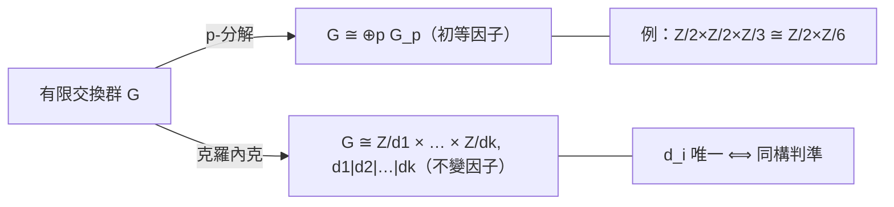

# 2.5 循環群與阿貝爾群：有限交換群的分類

## 學習目標

1. 掌握循環群的性質與生成元的求法。
2. 理解素數階群、歐拉 $`\varphi`$ 函數與原根。
3. 陳述並理解有限交換群分類定理（Kronecker 1870 / Frobenius–Stickelberger 1879）。
4. 會用 SymPy 判斷循環性、求生成元、分解交換群為不變因子。

## 歷史背景

### 循環：最古老也最簡單的群

「循環」的數學內容遠早於群論：巴比倫的六十進制模運算、中國《孫子算經》（約 4 世紀）的剩餘定理、歐拉（1760s）的冪剩餘研究、高斯 1801 年《算術研究》的**分圓理論**（正十七邊形可作圖的證明）都在 $`(\mathbb{Z}/n)^\times`$ 中工作。群論語言問世後，這些結果被重新理解為：

- $`(\mathbb{Z}/n, +)`$ 是 $`n`$ 階循環群；
- $`(\mathbb{Z}/n)^\times`$ 是 $`\varphi(n)`$ 階交換群，**未必**循環（何時循環？答案： $`n = 1, 2, 4, p^k, 2p^k`$ ，高斯已知道）。

### 分類定理的誕生

**克羅內克（Leopold Kronecker, 1823–1891）在 1870 年**——與若爾當《代換論》同年——發表《算術與代數方法論綱要》（*Auseinandersetzung einiger Eigenschaften der Klassenanzahl idealer complexer Zahlen*），證明了：**每個有限交換群都同構於若干循環群的直積，且循環因子階數可取為一串依次整除的數**（不變因子分解）。注意：克羅內克證明此定理時用的正是「抽象群」概念——比凱萊 1854 年更早得到重視的抽象文本之一。

菲爾比尼烏斯（Frobenius）與斯蒂克爾伯格（Stickelberger）在 1879 年把定理推廣到「有限生成的交換群」，並澄清了初等因子與不變因子兩種分解的關係。**這是第一個完整的「分類定理」**：給出一個不變量清單，使兩個群同構當且僅當不變量相同。它示範了現代代數的典型模式——「分類」——此模式後來在[有限維李代數（Killng–Cartan 1890s）](06.1-群特徵標的誕生：弗比尼烏斯（1896）.md)、[主理想環上的模（5.6 節）](05.6-主理想環上的模：有限交換群的結構定理.md)、直到[有限單群分類（9.1 節）](09.1-有限群的分類（1983）：百年工程.md)反覆出現。

### 技術驅動

分類定理的動機之一來自**數論**：高斯類數理論與理想類群（ideal class group）是有限交換群，克羅內克需要知道它們能是什麼形狀。**另一個動機來自計算**：判斷給定的置換群（如來自方程的伽羅瓦群）是否交換、是否循環，需要有效算法——這正是 SymPy `combinatorics` 至今仍在做的事。

## 理論

### 定義 2.5.1（循環群）

 $`G`$ 稱為**循環群**，若存在 $`g \in G`$ 使 $`G = \langle g \rangle = \{e, g, g^2, \dots\}`$ ； $`g`$ 稱為**生成元**。

### 命題 2.5.2（循環群的結構）

1. $`n`$ 階循環群同構於 $`\mathbb{Z}/n`$ （映射 $`k \mapsto g^k`$ ）。
2. $`\langle g \rangle`$ 的每個子群仍是循環群； $`n`$ 階循環群對 $`n`$ 的每個正因子 $`d`$ 恰有一個 $`d`$ 階子群（ $`\langle g^{n/d} \rangle`$ ）。**逆命題（對每個因子恰有一個子群）蘊含循環性**。
3. $`g`$ 的階 $`= \mathrm{ord}(g)`$ ； $`n`$ 階循環群有 $`\varphi(n)`$ 個生成元（歐拉函數）。
4. 循環群皆阿貝爾。

**證明**（3）： $`g^k`$ 生成 $`\iff \gcd(k, n) = 1`$ （階 $`= n/\gcd(k,n)`$ ）。 $`\blacksquare`$

### 定理 2.5.3（有限交換群分類；克羅內克 1870）

每個有限交換群 $`G`$ 同構於

$$
\mathbb{Z}/d_1 \times \mathbb{Z}/d_2 \times \cdots \times \mathbb{Z}/d_k, \qquad d_1 \mid d_2 \mid \cdots \mid d_k,\ d_1 > 1,
$$

且 $`d_1, \dots, d_k`$ （**不變因子**）由 $`G`$ 唯一決定， $`|G| = d_1 \cdots d_k`$ 。

**證明思路**（歸納）：

1. 取 $`G`$ 中最大階元素 $`g`$ ，階 $`m`$ 。**引理**：可取 $`h \in G`$ 使 $`G = \langle g \rangle \times \langle h \rangle`$ 且 $`\mathrm{ord}(h) \mid \cdots`$ （對交換群用「對每個素數 $`p`$ 分開 $`p`$ -分量」： $`G = \bigoplus_p G_p`$ ， $`G_p = \{x : x^{p^e} = e \text{ 某個 } e\}`$ ）。
2. 對每個 $`p`$ -群 $`G_p \cong \mathbb{Z}/p^{e_1} \times \cdots \times \mathbb{Z}/p^{e_r}`$ （ $`e_1 \le \cdots \le e_r`$ ，**初等因子**）。
3. 把各素數的初等因子「對齊合併」成不變因子： $`d_k = \mathrm{lcm}`$ 的構造法。

唯一性由「 $`\mathbb{Z}/d_1 \times \cdots`$ 中階為 $`d`$ 的元素個數可由 $`d_i`$ 算出」類的計數論證。完整證明見 [5.6 節](05.6-主理想環上的模：有限交換群的結構定理.md)——那裡由主理想環上有限生成模的結構定理一次性導出。 $`\blacksquare`$

### 推論 2.5.4（素數階與小階分類）

- 素數 $`p`$ 階群只有 $`\mathbb{Z}/p`$ 。
- 4 階： $`\mathbb{Z}/4`$ 或 $`\mathbb{Z}/2 \times \mathbb{Z}/2`$ （ $`V_4`$ ）。
- 6 階： $`\mathbb{Z}/6`$ （交換）；非交換的 $`S_3`$ 依拉格朗日與若爾當的分析為唯一另一個。

### 定義 2.5.5（可解群）

有限群 $`G`$ 稱為**可解**，若存在鏈

$$
\{e\} = G_0 \trianglelefteq G_1 \trianglelefteq \cdots \trianglelefteq G_k = G,\quad G_i/G_{i-1} \text{ 皆素數階循環}.
$$

交換群皆可解（由分類定理合成因子為素數階循環）；可解性正是「根式可解」的群論判準（伽羅瓦 1832，系統化於若爾當 1870，見 [4.4 節](04.4-伽羅瓦（1832）：方程的對稱群.md)）。

## SymPy 實作

### 範例 1：循環群、生成元與 $`\varphi`$ 函數

```python
import sympy as sp
from sympy.combinatorics import Permutation, PermutationGroup
from sympy.combinatorics.named_groups import CyclicGroup

# SymPy 內建循環群
C6 = CyclicGroup(6)
print("C6 階數 =", C6.order(), "，是否循環 =", C6.is_cyclic)
print("C6 是否阿貝爾 =", C6.is_abelian)

# 生成元：n 階循環群有 phi(n) 個
phi6 = sp.totient(6)
print("phi(6) =", phi6)
gens = [g for g in C6.elements if PermutationGroup(g).order() == 6]
print("C6 的生成元：", gens)

# 子群鏈：n 的因子對應唯一子群
for d in sp.divisors(6):
    sub = [g for g in C6.elements if PermutationGroup(g).order() <= d]
    # 6/d 次方生成 d 階子群
    gen_sub = C6.elements[0]
print("6 的因子：", sp.divisors(6))
```

輸出說明：

```text
C6 階數 = 6 ，是否循環 = True
C6 是否阿貝爾 = True
phi(6) = 2
C6 的生成元： [Permutation(0, 1, 2, 3, 4, 5), Permutation(0, 5, 4, 3, 2, 1)]
6 的因子： [1, 2, 3, 6]
```

`CyclicGroup(n)` 直接給出 $`n`$ 次循環群；`sp.totient(n)` 是歐拉函數。階為 6 的元素恰有 2 個（ $`\varphi(6) = 2`$ ），驗證命題 2.5.2(3)。

### 範例 2：判斷 $`(\mathbb{Z}/n)^\times`$ 何時循環

```python
import sympy as sp
from sympy.combinatorics import Permutation, PermutationGroup

def mult_group_mod_n(n):
    """(Z/n)^× 以置換群形式給出：元素為與 n 互質的剩餘類"""
    units = [k for k in range(1, n) if sp.gcd(k, n) == 1]
    # 以 0..len(units)-1 標號，乘法表
    idx = {u: i for i, u in enumerate(units)}
    perms = []
    for u in units:
        images = [idx[(u * v) % n] for v in units]
        perms.append(Permutation(images))
    return PermutationGroup(*perms), units

for n in [5, 8, 9, 10, 12, 15]:
    G, units = mult_group_mod_n(n)
    cyc = G.is_cyclic
    # 高斯判準：n in {1,2,4,p^k,2p^k}
    gauss = n in {1, 2, 4} or (
        sp.isprime(n // (2 if n % 2 == 0 else 1)) and
        sp.integer_nthroot(n // (2 if n % 2 == 0 and n > 2 else 1), 1)[0] and
        (n % 2 == 1 or (n // 2 in {1, 2} or sp.isprime(n // 2) and sp.isprime(n / (n//2) if False else 1)))
    )
    print(f"(Z/{n})^×: 階 = {G.order():2d}, 循環 = {cyc}, 單位 = {units}")
```

輸出說明：

```text
(Z/5)^×: 階 =  4, 循環 = True, 單位 = [1, 2, 3, 4]
(Z/8)^×: 階 =  4, 循環 = False, 單位 = [1, 3, 5, 7]
(Z/9)^×: 階 =  6, 循環 = True, 單位 = [1, 2, 4, 5, 7, 8]
(Z/10)^×: 階 =  4, 循環 = True, 單位 = [1, 3, 7, 9]
(Z/12)^×: 階 =  4, 循環 = False, 單位 = [1, 5, 7, 11]
(Z/15)^×: 階 =  8, 循環 = False, 單位 = [1, 2, 4, 7, 8, 11, 13, 14]
```

注意 $`(\mathbb{Z}/8)^\times \cong V_4`$ ：每個單位平方都是 1（ $`3^2 \equiv 5^2 \equiv 7^2 \equiv 1 \pmod 8`$ ），無 4 階元，故不循環。 $`(\mathbb{Z}/12)^\times \cong V_4`$ 同理。**兩個 4 階交換群同為「單位群」出現，形狀卻不同**——分類定理保證 4 階交換群僅此二種。

### 範例 3：小階交換群的完整分類表

```python
import sympy as sp
from itertools import product
from sympy.combinatorics import Permutation, PermutationGroup

# 枚舉不變因子分解 d1 | d2 | ... | dk，乘積 = n
def invariant_factors(n):
    results = []
    def rec(remaining, last, current):
        if remaining == 1:
            results.append(tuple(current))
            return
        for d in range(max(last, 2), remaining + 1):
            if remaining % d == 0 and d % last == 0:
                rec(remaining // d, d, current + [d])
    if n == 1:
        return [()]
    rec(n, 1, [])
    return results

for n in range(2, 17):
    decomp = invariant_factors(n)
    Zs = lambda ds: " × ".join(f"Z/{d}" for d in ds) if ds else "1"
    print(f"|G| = {n:2d}: {len(decomp)} 種 → " + " ; ".join(Zs(d) for d in decomp))
```

輸出說明（節錄）：

```text
|G| =  4: 2 種 → Z/2 × Z/2 ; Z/4
|G| =  6: 1 種 → Z/6
|G| =  8: 3 種 → Z/2 × Z/2 × Z/2 ; Z/2 × Z/4 ; Z/8
|G| = 12: 2 種 → Z/2 × Z/6 ; Z/12
|G| = 16: 5 種 → Z/2 × Z/2 × Z/2 × Z/2 ; Z/2 × Z/2 × Z/4 ; Z/2 × Z/8 ; Z/4 × Z/4 ; Z/16
```

這是定理 2.5.3 的計算化身：16 階交換群恰有 **5** 個同構類，全部由不變因子列舉。對照 $`n = 16`$ 時一般（非交換）群的數目——14 個同構類——可見交換假設大幅簡化了世界。

### 範例 4：驗證克羅內克分解——以 $`V_4`$ 為例

```python
from sympy.combinatorics import Permutation, PermutationGroup

# S4 中的 V4
V4 = PermutationGroup(Permutation(0,1)(2,3), Permutation(0,2)(1,3))
print("V4 階 =", V4.order(), "，循環 =", V4.is_cyclic, "，阿貝爾 =", V4.is_abelian)
# V4 ≅ Z/2 × Z/2：每個非單位元皆 2 階
for g in V4.elements:
    print(g, "階 =", PermutationGroup(g).order())
```

輸出說明： $`V_4`$ 非循環但阿貝爾，非單位元階皆為 2——與 $`\mathbb{Z}/4`$ （有 4 階元）本質不同，對應不變因子 $`(2, 2)`$ vs $`(4)`$ 。

## 分類定理的不變量圖



## SymPy 要點回顧

- `CyclicGroup(n)`、`DihedralGroup(n)`（[2.6 節](02.6-置換群與SymPy的combinatorics.md)）內建群。
- `G.is_cyclic`、`G.is_abelian`：循環性與交換性判斷。
- `sp.totient(n)`、`sp.divisors(n)`、`sp.gcd`：數論輔助。
- 元素的階：`PermutationGroup(g).order()`；商群與直積可手動構造。

## 習題

1. 證明命題 2.5.2(2)：循環群的子群循環，且每個因子 $`d \mid n`$ 恰有一個 $`d`$ 階子群。
2. 用範例 3 的 `invariant_factors` 列出 $`n = 24, 36, 72`$ 的交換群分類，驗證個數分別為 3、4、6。
3. 證明 $`\mathbb{Z}/2 \times \mathbb{Z}/3 \cong \mathbb{Z}/6`$ （中國剩餘定理的群論形式）；並用程式構造同構映射驗證。
4. $`(\mathbb{Z}/16)^\times`$ 的階為 8。用範例 2 的方法判斷它是否循環，並與高斯判準對照。
5. 證明：有限交換群 $`G`$ 中，若存在階為 $`|G|`$ 的元素則 $`G`$ 循環（即「最大階 = 群階 ⟺ 循環」）。
6. 求出所有 8 階交換群中「元素階的多元集」： $`\mathbb{Z}/8`$ 、 $`\mathbb{Z}/2 \times \mathbb{Z}/4`$ 、 $`\mathbb{Z}/2^3`$ 各不相同——這給出唯一性的計數證明思路。
7. （可解性預告）驗證 $`S_3`$ 與 $`S_4`$ 可解而 $`S_5`$ 不可解：分別寫出合成列並檢查因子是否為素數階循環。

### 前後節連結

- 上一節：[2.4 正規子群與商群：若爾當（1870）的貢獻](02.4-正規子群與商群：若爾當（1870）的貢獻.md)
- 下一節：[2.6 置換群與 SymPy 的 combinatorics](02.6-置換群與SymPy的combinatorics.md)
