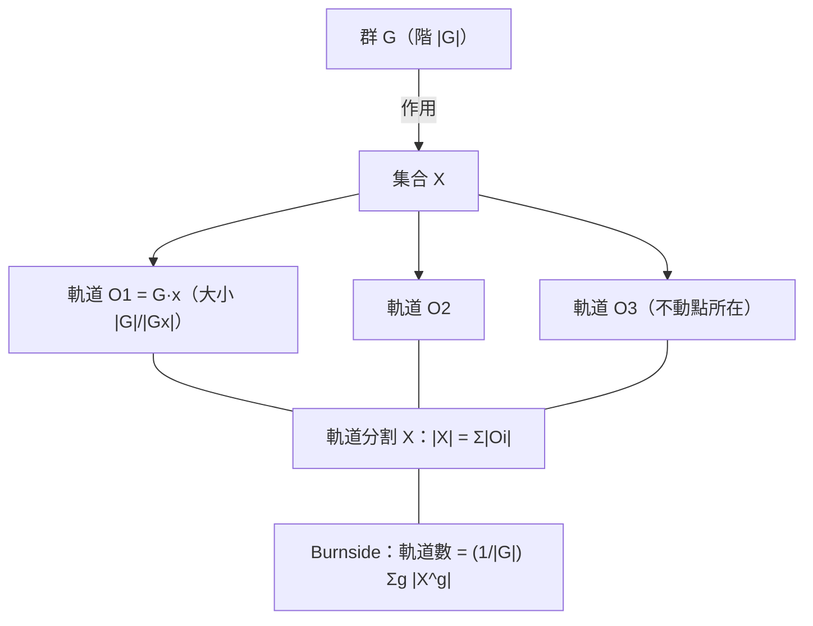

# 2.7 群作用、軌道與穩定子：Burnside 引理

## 學習目標

1. 定義群作用，掌握軌道–穩定子定理。
2. 敘述並證明 Burnside 引理（與 Cauchy–Frobenius 公式）。
3. 會用 Burnside 引理計數（項鍊染色、多面體著色等經典問題）。
4. 理解群作用如何把「抽象群」變成「具體計算工具」。

## 歷史背景

### 從克萊因到 Burnside

群作用的思想在 1872 年克萊因的《愛爾蘭根綱領》中登峰造極：**幾何 = 某個變換群作用下的不變量理論**。彭加勒與李在 1880 年代把「群作用於空間」變成分析與幾何的日常工具。但在有限群一側，系統的「作用—軌道—計數」理論由：

- **弗比尼烏斯（Ferdinand Georg Frobenius, 1849–1917）** 在 1887 年證明了如今的「Burnside 引理」（故又稱 **Cauchy–Frobenius 公式**；柯西在 1845 年已有特例）；
- **伯恩賽德（William Burnside, 1852–1927）** 在 1897 年的教科書《群論》（*Theory of Groups of Finite Order*）中廣泛使用此公式，使其普及——定理之名由此而來（Stigler 律：定理以最後普及它的人命名）。

Burnside 1897 年的書第二版（1911）影響深遠；他在 1904 年用此引理的技巧研究了**對換生成**的置換群，並提出著名的「Burnside 問題」（1902）：有限生成、有限階的群是否必有限？（Golod–Shafarevich 1964 給出反例。）

### 技術驅動：化學與計數

20 世紀化學家需要數「苯環衍生物的不同異構物個數」——同一骨架在對稱群下等價的染色數。Pólya 1937 年的計數定理（Burnside 引理 + 生成函數）使這成為標準工具；**計數需求反過來把 19 世紀的引理變成 20 世紀的工程技術**，今日更用於密碼學（狀態空間去重）、圖論（非同構圖計數）。

## 理論

### 定義 2.7.1（群作用）

群 $`G`$ **作用**在集合 $`X`$ 上，是指映射 $`G \times X \to X`$ （記 $`g \cdot x`$ ），滿足：

1. $`e \cdot x = x`$ ；
2. $`g \cdot (h \cdot x) = (gh) \cdot x`$ 。

等價地，這是同態 $`G \to S_X`$ （置換表示）。

### 定義 2.7.2（軌道與穩定子）

- $`x`$ 的**軌道**： $`G \cdot x = \{g \cdot x : g \in G\}`$ 。
- $`x`$ 的**穩定子**： $`G_x = \{g \in G : g \cdot x = x\}`$ ，恆為子群。

### 定理 2.7.3（軌道–穩定子定理）

對 $`x \in X`$ （ $`G`$ 有限）：

$$
|G| = |G \cdot x| \cdot |G_x|.
$$

**證明**：映射 $`gG_x \mapsto g \cdot x`$ 是左陪集空間 $`G/G_x`$ 到軌道 $`G\cdot x`$ 的良定義雙射（ $`g_1G_x = g_2G_x \iff g_2^{-1}g_1 \in G_x \iff g_1\cdot x = g_2 \cdot x`$ ）。陪集個數為 $`[G : G_x] = |G|/|G_x|`$ （拉格朗日，[2.3 節](02.3-子群、陪集與拉格朗日定理.md)）。 $`\blacksquare`$

**推論**：軌道構成 $`X`$ 的分割； $`|X| = \sum_{\text{軌道 } \mathcal{O}} |\mathcal{O}|`$ 。若 $`G`$ 是 $`p`$ -群作用在有限集上， $`|X| \equiv |X^G| \pmod p`$ （不動點計數， $`X^G`$ = 全體不動點）——證明單群非平凡性的標準工具。

### 定理 2.7.4（Burnside 引理 / Cauchy–Frobenius 公式）

 $`G`$ 作用在有限集 $`X`$ 上，設軌道個數為 $`N`$ ，則

$$
N = \frac{1}{|G|} \sum_{g \in G} |X^g|, \qquad X^g = \{x \in X : g \cdot x = x\}.
$$

**證明**：對配對集 $`\{(g, x) : g\cdot x = x\}`$ 雙向計數：

$$
\sum_{g \in G} |X^g| = \sum_{x \in X} |G_x| = \sum_{x \in X} \frac{|G|}{|G\cdot x|} = |G| \sum_{\text{軌道}} \sum_{x \in \mathcal{O}} \frac{1}{|\mathcal{O}|} = |G| \cdot N,
$$

（第二個等號用軌道–穩定子定理；末步是對每條軌道內部求和恰得 1。） $`\blacksquare`$

**直觀**：「平均而言，一個群元素固定多少個點」=「有多少條軌道」。

### 應用：項鍊計數（經典範式）

用 2 色珠子做 6 珠項鍊（可翻轉、可旋轉），不同項鍊數？取 $`X = \{0,1\}^6`$ （ $`2^6 = 64`$ 種直線排法）， $`G = D_6`$ （12 個對稱，見 [2.6 節](02.6-置換群與SymPy的combinatorics.md)），作用為重排位置。Burnside 引理數出：

- 恆等固定 $`2^6 = 64`$ ；
- 5 個非平凡旋轉各固定 $`2^{\gcd(6, k)}`$ ： $`k=1,5`$ 得 $`2^1=2`$ ； $`k=2,4`$ 得 $`2^2=4`$ ； $`k=3`$ 得 $`2^3=8`$ ；
- 6 個鏡射：軸過兩珠的 3 個固定 $`2^4=16`$ ，軸過兩縫的 3 個固定 $`2^3=8`$ 。

$$
N = \frac{1}{12}(64 + 2 + 4 + 8 + 4 + 2 + 3 \cdot 16 + 3 \cdot 8) = \frac{156}{12} = 13.
$$

**13 種項鍊**——抽象引理一次給出手工難以列舉的答案。

## SymPy 實作

### 範例 1：軌道與穩定子的計算

```python
from sympy.combinatorics import Permutation, PermutationGroup

# 正方形頂點對稱群 D4 作用在頂點 {0,1,2,3} 上
D4 = PermutationGroup(
    Permutation(0, 1, 2, 3),      # 旋轉 r
    Permutation(0, 3)(1, 2),      # 鏡射 s
)
print("D4 階 =", D4.order())

# 軌道：單點軌道 = {0,1,2,3}（傳遞）
print("頂點 0 的軌道 =", sorted(D4.orbit(0)))

# 穩定子：固定頂點 0 的子群
stab = D4.stabilizer(0)
print("頂點 0 的穩定子階 =", stab.order())
print("軌道-穩定子驗證：|D4| =", D4.order(),
      "= |軌道| * |穩定子| =", len(D4.orbit(0)) * stab.order())
print("穩定子的元素：", sorted(map(str, stab.elements)))

# 邊集合上的作用：{0,1},{1,2},{2,3},{3,0} 標號 0..3（排序後的邊寫成 (0,3)）
edges = [(0, 1), (1, 2), (2, 3), (0, 3)]
def edge_image(g, e):
    return tuple(sorted((g(e[0]), g(e[1]))))
edge_idx = {e: i for i, e in enumerate(edges)}
orb = {edge_idx[edge_image(g, edges[0])] for g in D4.elements}
print("邊 0 的軌道 =", sorted(orb), "（傳遞，4 條邊一軌）")
```

輸出說明：

```text
D4 階 = 8
頂點 0 的軌道 = [0, 1, 2, 3]
頂點 0 的穩定子階 = 2
軌道-穩定子驗證：|D4| = 8 = |軌道| * |穩定子| = 8
穩定子的元素： ['(1 3)', '(3)']
邊 0 的軌道 = [0, 1, 2, 3] （傳遞，4 條邊一軌）
```

 $`|D_4| = 8 = |\mathcal{O}(0)| \cdot |G_0| = 4 \cdot 2`$ ：軌道–穩定子定理的數值驗證。穩定子含恆等與對角鏡射 $`(1\,3)`$ 。

### 範例 2：Burnside 引理——6 珠二色項鍊

```python
from sympy.combinatorics import Permutation, PermutationGroup
from itertools import product

G = PermutationGroup(
    Permutation(0, 1, 2, 3, 4, 5),                  # 旋轉 60°
    Permutation(0, 5)(1, 4)(2, 3),                  # 鏡射
)
n, colors = 6, 2
X = list(product(range(colors), repeat=n))          # 64 種直線排法

def apply_perm(seq, g):
    return tuple(seq[g(i)] for i in range(n))

# 對每個 g 計算不動點數
fix_counts = []
for g in G.elements:
    fx = sum(1 for seq in X if apply_perm(seq, g) == seq)
    fix_counts.append(fx)

N = sum(fix_counts) // G.order()
print("|G| =", G.order(), "， |X| =", len(X))
print("各元素不動點數：", fix_counts)
print("Burnside：軌道數 =", N)      # 13
```

輸出說明：

```text
|G| = 12 ， |X| = 64
各元素不動點數： [64, 2, 4, 8, 16, 8, 16, 8, 16, 8, 4, 2]
Burnside：軌道數 = 13
```

程式輸出的不動點數逐項對應理論計算：恆等 64、五個旋轉各固定 $`2, 4, 8, 4, 2`$ 、六個鏡射各固定 $`16, 8, 16, 8, 16, 8`$ （各元素在 `G.elements` 中的排列順序依版本而定）。平均 $`156/12 = 13`$ 。**每個「項鍊」就是一條軌道**——Burnside 把「等價類計數」變成「平均不動點數」。

### 範例 3：推廣——多色 6 珠項鍊與 Pólya 預告

```python
from sympy.combinatorics import Permutation, PermutationGroup
from itertools import product

G = PermutationGroup(Permutation(0, 1, 2, 3, 4, 5), Permutation(0, 5)(1, 4)(2, 3))

def count_orbits(colors, n=6):
    X = list(product(range(colors), repeat=n))
    total = 0
    for g in G.elements:
        total += sum(1 for s in X if all(s[g(i)] == s[i] for i in range(n)))
    return total // G.order()

for c in range(1, 6):
    print(f"{c} 色 6 珠項鍊數 = {count_orbits(c)}")
```

輸出說明：

```text
1 色 6 珠項鍊數 = 1
2 色 6 珠項鍊數 = 13
3 色 6 珠項鍊數 = 92
4 色 6 珠項鍊數 = 430
5 色 6 珠項鍊數 = 1505
```

顏色數增加時項鍊數以 $`O(c^n/n)`$ 增長（Pólya 定理可給出精確生成函數）。序列 $`1, 13, 92, 430, 1505`$ 是經典組合數列——**群論直接產生可查表的組合數**。

### 範例 4：不動點計數與 $`p`$ -群引理

```python
from sympy.combinatorics import Permutation, PermutationGroup

# 3-群 C3 作用在 4 個點上（驗證不動點數 ≡ |X| (mod 3)）
x = Permutation(0, 1, 2, size=4)     # 3-循環，固定點 3
C3 = PermutationGroup(x)
X = list(range(4))

for g in C3.elements:
    fx = [i for i in X if g(i) == i]
    print(g, "不動點 =", fx, "個數 =", len(fx))
print("|X| mod 3 =", 4 % 3, "；非恆等元不動點數 mod 3 =", 1 % 3)
```

輸出說明：

```text
(3) 不動點 = [0, 1, 2, 3] 個數 = 4
(3)(0 1 2) 不動點 = [3] 個數 = 1
(3)(0 2 1) 不動點 = [3] 個數 = 1
|X| mod 3 = 1 ；非恆等元不動點數 mod 3 = 1
```

 $`x`$ 與 $`x^2`$ 各固定 1 個點（點 3），恆等固定 4 個； $`1 \equiv 4 \pmod 3`$ ，驗證「 $`p`$ -群作用的不動點數模 $`p`$ 同餘 $`|X|`$ 」。此引理是證明「 $`p`$ -群有非平凡中心」與 Sylow 定理的關鍵。

## 群作用示意圖



## SymPy 要點回顧

- `G.orbit(i)`、`G.stabilizer(i)`：軌道與穩定子的內建計算。
- Burnside 引理的實作模式：枚舉 $`G`$ 的元素 × 枚舉 $`X`$ ，計數不動點後除以 $`|G|`$ （不動點總和必被 $`|G|`$ 整除，這本身就是程式的自我檢驗）。
- `G.elements` 只適合小群；大群的計數應走生成函數（Pólya）路線。
- 群作用 = 同態 $`G \to S_X`$ ；凱萊定理（[2.2 節](02.2-群的定義與凱萊（1854）的抽象化.md)）是「作用在自己身上」的特例。

## 習題

1. 證明軌道–穩定子定理中映射 $`gG_x \mapsto g\cdot x`$ 是良定義雙射。
2. 用範例 2 的程式計算「可翻轉的 8 珠二色項鍊」數（提示：改用 $`D_8`$ ，答案 30）；再算「只有旋轉」的 8 珠項鍊數（提示： $`C_8`$ ，答案 34），解釋為何允許翻轉使數目變小。
3. 用 Burnside 引理數「正方體 6 面用 2 色」的染色數（答案 10；提示：正方體旋轉群 24 階，按旋轉類型分類計算固定面數）。
4. 證明 $`p`$ -群不動點引理，並用它證明： $`p`$ -群的中心非平凡。
5. 對 $`S_3`$ 作用在 $`\{1,2,3\}`$ 上驗證 Burnside 引理：若誤算不動點為 $`(3+1+1+0+0+0)/6`$ ，錯在哪裡？正確計算（三個對換各固定 1 點）得 $`(3+1+1+1+1+1)/6 = 8/6`$ ？——再次檢查，最後得出軌道數 1 並解釋。
6. （Pólya 預告）對 6 珠二色項鍊寫出循環指標式 $`\frac{1}{12}(a_1^6 + 2a_6 + 2a_3^2 + a_1^2a_2^2 + 2a_2a_1^4 + 2a_1^2a_2^2 + 2a_2^3)`$ 並用 $`a_k = 2`$ 驗證等於 13；說明如何由它直接讀出「恰 3 顆黑珠」的項鍊數。

### 前後節連結

- 上一節：[2.6 置換群與 SymPy 的 combinatorics](02.6-置換群與SymPy的combinatorics.md)
- 第 4 章將回到方程可解性：[4.4 伽羅瓦（1832）：方程的對稱群](04.4-伽羅瓦（1832）：方程的對稱群.md)
