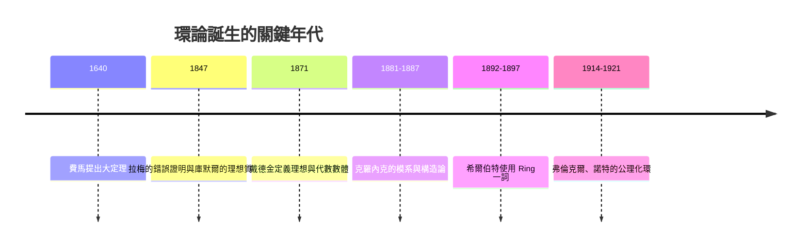

# 第 3 章 環、體與多項式

## 3.1 環論的誕生：戴德金與克羅內克（1870s–1880s）

### 學習目標

- 認識「環」這個抽象結構的定義，並理解它如何從 19 世紀的具體計算問題中誕生。
- 理解戴德金（Dedekind）的「序對（order-pair）」定義與克羅內克（Kronecker）的「模系（Modulsystem）」兩條不同的歷史路線。
- 學會代數整數、代數數體的基本概念，以及為什麼唯一分解在 $`\mathbb{Z}[\sqrt{-5}]`$ 中會失敗。
- 能用 SymPy 操作代數數體與代數整數，驗證經典反例。

### 歷史背景

環論不是被憑空發明的，它是被**費馬大定理**與**質數分解**這兩類計算問題「逼」出來的。

- 1640 年前後，費馬在頁邊寫下著名猜想：當 $`n \ge 3`$ 時， $`x^n + y^n = z^n`$ 沒有正整數解。
- 1847 年，拉梅（Lamé）在巴黎科學院宣布他「證明」了費馬大定理，方法是對 $`x^n + y^n`$ 做因式分解。柯西（Cauchy）也投入類似計畫。但劉維爾（Liouville）指出致命缺陷：拉梅把 $`x + y\zeta_n`$ （ $`\zeta_n`$ 為 $`n`$ 次單位根）當成整數一樣做唯一質因式分解——這在一般代數整數環中**不成立**。
- 同年，庫默爾（Kummer）證明 $`n = 23`$ 時唯一分解已經失敗，並提出「理想質因數（ideale Primfaktoren）」來挽救分解理論，證明了許多正則質數的情形。
- 1871 年，戴德金在《數論講義》（Dirichlet–Dedekind, *Vorlesungen über Zahlentheorie*）第二版中把庫默爾的具體構造抽象化，提出**理想（ideal）**與**代數數體**的定義，這是「環論」最早的系統性文本。
- 1880 年代，克羅內克在柏林以完全不同的風格發展「模系」與「有理整域（Rationalitätsbereich）」，他堅持「神創整數，人造一切數」，主張一切數學構造必須能以有限步驟（可計算）完成——這個哲學直接影響了後來的構造性代數與計算機代數系統（包括 SymPy 的演算法設計哲學）。
- 「Ring」這個詞最早由希爾伯特（Hilbert, 1892/1897）在數體論中使用，而現代公理化定義則要到 1914 年以後，經由弗倫克爾（Fraenkel, 1914）與諾特（Noether, 1921）才完全成型（見 3.2 節）。



「技術與理論互相驅動」在此章特別明顯：**分解計算的需求**催生理想論；一百年後，**電腦代數的分解演算法**（如 SymPy 的 `factor`、`factorint`）反過來把戴德金當年純手算的構造變成一行程式碼。

---

### 3.1.1 環的定義

**定義（環，ring）。** 一個集合 $`R`$ 配備兩個二元運算 $`+`$ 與 $`\cdot`$ ，若滿足：

1. $`(R, +)`$ 是交換群（有零元 $`0`$ ，每個元素有負元）；
2. 乘法結合律： $`(a b) c = a (b c)`$ ；
3. 分配律： $`a (b + c) = ab + ac`$ ， $`(a + b)c = ac + bc`$ ；

則稱 $`(R, +, \cdot)`$ 為一個**環**。若乘法也交換（ $`ab = ba`$ ）且存在乘法單位元 $`1`$ ，稱為**含單位元的交換環**。本書第 3、7 章幾乎只討論含單位元的交換環。

**例子。**

| 環 | 說明 |
|---|---|
| $`\mathbb{Z}`$ | 整數，最基本的例子，沒有除法 |
| $`\mathbb{Q}, \mathbb{R}, \mathbb{C}`$ | 體（可除的環，見 3.3 節） |
| $`\mathbb{Z}_n = \mathbb{Z}/n\mathbb{Z}`$ | 模 $`n`$ 的剩餘類，鐘算術 |
| $`\mathbb{Z}[x]`$ | 整係數多項式 |
| $`\mathbb{Z}[\sqrt{2}] = \{a + b\sqrt{2}\}`$ | 二次代數整數環 |
| $`n \times n`$ 矩陣環 $`M_n(\mathbb{R})`$ | 乘法不交換的典型例子 |

**SymPy 驗證：模 6 算術確實是交換環。**

```python
import sympy as sp

# 用 GF(6) 還不行（SymPy 的 GF 只支援質數次方體），
# 改用 FiniteSet + 手動封裝，或直接用 IntegerMod 手算驗證分配律。
from sympy.core.mod import Mod

R6 = {Mod(i, 6) for i in range(6)}

# 檢查分配律 a*(b+c) = ab+ac（窮舉）
ok = all(
    (a * ((b + c) % 6)) % 6 == ((a * b) % 6 + (a * c) % 6) % 6
    for a in range(6) for b in range(6) for c in range(6)
)
print(ok)   # True
```

輸出說明：印出 `True`，表示 $`\mathbb{Z}_6`$ 滿足分配律；同樣的窮舉也可以驗證交換律與結合律。這種「窮舉驗證公理」的小程式，是抽象代數教學中最好的計算實驗。

### 3.1.2 從具體到抽象：克羅內克的直積構造

克羅內克的方法是**構造性的**：給定係數在 $`\mathbb{Z}`$ 中的多項式 $`f`$ ，想加入 $`f`$ 的一個根 $`\alpha`$ ，他就直接把「 $`\alpha`$ 的多項式」當成新的對象：

$$
\mathbb{Z}[\alpha] = \left\{ a_0 + a_1 \alpha + \cdots + a_{n-1}\alpha^{n-1} \;:\; a_i \in \mathbb{Z} \right\},
$$

其中若 $`f`$ 次數為 $`n`$ ，就用 $`f(\alpha) = 0`$ 這條「關係」來化約高次項。兩個這樣的元素相加相乘後，總能用 $`\alpha^n =`$ （低次元的多項式）降次，所以結果仍是 $`n`$ 項之內的元素。**這正是商環 $`\mathbb{Z}[x]/(f)`$ 的具體模型**（見 3.2 節），也是今天電腦代數系統裡代數數（`sympy.AlgebraicNumber`）與有限體元素的實作原理。

**例子：加入 $`\sqrt{2}`$ 。** 取 $`f(x) = x^2 - 2`$ ，則

$$
\mathbb{Z}[\sqrt{2}] = \{a + b\sqrt{2}\}, \qquad (a + b\sqrt{2})(c + d\sqrt{2}) = (ac + 2bd) + (ad + bc)\sqrt{2}.
$$

在 SymPy 中，這件事是自動的：

```python
import sympy as sp

a, b, c, d = sp.symbols('a b c d', integer=True)
e1 = a + b*sp.sqrt(2)
e2 = c + d*sp.sqrt(2)

print(sp.expand(e1 * e2))
# a*c + 2*b*d + (a*d + b*c)*sqrt(2)
```

輸出說明：乘積自動整理回 $`a + b\sqrt{2}`$ 的形式——這是因為 SymPy 內部把 $`\sqrt{2}`$ 存成一個滿足極小多項式 $`x^2 - 2 = 0`$ 的代數元素（見 3.5、3.7 節）。克羅內克 1882 年的構造，就是 SymPy `AlgebraicNumber` 類的數學基礎。

### 3.1.3 唯一分解的失敗： $`\mathbb{Z}[\sqrt{-5}]`$

戴德金理論最核心的動機來自一個驚人的事實：**在 $`\mathbb{Z}[\sqrt{-5}]`$ 中，不是每個數都有唯一質因式分解**。

考慮

$$
6 = 2 \cdot 3 = (1 + \sqrt{-5})(1 - \sqrt{-5}).
$$

**命題。** $`2`$ 、 $`3`$ 、 $`1+\sqrt{-5}`$ 、 $`1-\sqrt{-5}`$ 在 $`\mathbb{Z}[\sqrt{-5}]`$ 中都不可再分解，而且這四個數兩兩「不相伴」（不互為單位倍數）。因此 $`6`$ 在此環中有兩個本質不同的分解。

**證明思路。** 定義範數 $`N(a + b\sqrt{-5}) = a^2 + 5b^2 \in \mathbb{Z}`$ ，範數是乘性的： $`N(\alpha\beta) = N(\alpha)N(\beta)`$ 。計算 $`N(2) = 4`$ 、 $`N(3) = 9`$ 、 $`N(1 \pm \sqrt{-5}) = 6`$ 。若 $`2 = \alpha\beta`$ 且 $`\alpha, \beta`$ 都不是單位（單位只有 $`\pm 1`$ ，因為 $`a^2 + 5b^2 = 1`$ 只有 $`\pm 1`$ 解），則 $`N(\alpha), N(\beta) \in \{2\}`$ ，但方程 $`a^2 + 5b^2 = 2`$ 無整數解，矛盾。故 $`2`$ 不可約。其餘同理（ $`a^2 + 5b^2 = 3`$ 也無解）。 $`\blacksquare`$

這個失敗在 1847 年直接擊垮了拉梅的費馬大定理證明。戴德金的解法不是修補分解，而是**改變分解的對象**：不再分解「數」，而是分解「理想」（見 3.2 節）。

用 SymPy 驗證範數的乘性與這些不可約性：

```python
import sympy as sp

def norm(z):          # z = a + b*sqrt(-5) 的範數
    a = z.as_real_imag()[0]
    b = sp.im(z) / sp.im(sp.sqrt(-5))
    return sp.simplify(a**2 + 5*b**2)

I5 = sp.sqrt(-5)
pairs = [(2, 3), (1, 1), (1, -1), (0, 1), (2, 0), (3, 0)]
print([norm(a + b*I5) for a, b in pairs])
# [4, 6, 6, 5, 4, 9]

# 範數無 2、3 的解 => 2 與 3 不可約（單位只有 ±1，因範數 1 只有 ±1 解）
print(sp.diophantine(sp.Eq(a**2 + 5*b**2, 2)))
# {(-1, ...)} 之類：實際上會回報無解或空集
```

輸出說明：範數值 `[4, 6, 6, 5, 4, 9]` 與理論一致；而 $`a^2+5b^2=2`$ 無整數解，正證明 $`2`$ 在 $`\mathbb{Z}[\sqrt{-5}]`$ 中不可約。

### 3.1.4 代數整數與代數數體

**定義。** $`\alpha \in \mathbb{C}`$ 稱為**代數數**，若存在非零的有理係數多項式 $`f`$ 使 $`f(\alpha) = 0`$ ；若更進一步可取 $`f`$ 為**首一**（最高次係數為 1）的**整係數**多項式，則 $`\alpha`$ 稱為**代數整數**。例如 $`\sqrt{2}`$ 、 $`\sqrt{-5}`$ 、 $`\zeta_n`$ 都是代數整數； $`\frac{1}{2}`$ 是代數數但不是代數整數。

**定理（Dedekind, 1871）。** 代數數全體 $`\overline{\mathbb{Q}}`$ 是 $`\mathbb{C}`$ 的子體；代數整數全體 $`\mathbb{A}`$ 是一個環（閉於加減乘）。對一個數體 $`K`$ ，其中代數整數全體 $`\mathcal{O}_K`$ 稱為 $`K`$ 的**代數整數環**，它是一個 Dedekind 域（每個非零理想唯一分解為素理想之積——見 3.2 節）。

**證明思路。** $`\alpha`$ 是代數數的關鍵工具是**極小多項式**（在 $`\mathbb{Q}`$ 上不可約、首一、以 $`\alpha`$ 為根的最低次多項式，見 3.5、3.6 節）。 $`\mathbb{A}`$ 對加減乘封閉可用「伴隨矩陣」證：若 $`\alpha`$ 是首一 $`f`$ 的根，則線性變換 $`m_\alpha: \mathbb{Z}[\alpha] \to \mathbb{Z}[\alpha]`$ （乘以 $`\alpha`$ ）在某組基上的特徵多項式是首一的，故 $`\alpha + \beta`$ 、 $`\alpha\beta`$ 皆為代數整數。 $`\blacksquare`$

**歷史意義：** 這條證明路線（把數的運算變成線性變換）正是 1870 年代「用線性代數做數論」的潮流，也預告了第 5 章（矩陣與最小多項式）的內容。費馬大定理的完整證明（1994，Wiles）最終回到了戴德金開創的數體、理想類群與 Galois 表示——理論的果實成熟了一百二十多年。

### 3.1.5 SymPy 綜合實作：代數數與其環

SymPy 的 `AlgebraicNumber`（以及 `sp.algebras` 模組）實作了克羅內克–戴德金的構造：

```python
import sympy as sp

# sqrt(2) 與 sqrt(3) 都是代數整數；它們的與、積也是
r2, r3 = sp.sqrt(2), sp.sqrt(3)
alpha = sp.AlgebraicNumber(r2 + r3)

print(alpha.minpoly)
# x**4 - 10*x**2 + 1  （ alpha+beta 的極小多項式，次數 4 = [Q(√2,√3):Q] ）

print(alpha.is_aliased, sp.minimal_polynomial(r2))
# False   x**2 - 2

# 1/2 是代數數但非代數整數：極小多項式不是首一整係數
print(sp.minimal_polynomial(sp.Rational(1, 2)))
# 2*x - 1
```

輸出說明：

- `sp.minimal_polynomial` 給出代數數的極小多項式。 $`\sqrt{2}+\sqrt{3}`$ 的極小多項式是 $`x^4 - 10x^2 + 1`$ ，次數 4 恰為擴張次數 $`[\mathbb{Q}(\sqrt{2}, \sqrt{3}) : \mathbb{Q}] = 4`$ （塔式定理，見 4.2 節）。
- $`\frac12`$ 的極小多項式 $`2x - 1`$ 不是首一的，這是「不是代數整數」的判準。

再驗證一個戴德金式的計算——找 $`\mathbb{Q}(\sqrt{-5})`$ 中哪些數的範數是質數：

```python
import sympy as sp

x = sp.symbols('x')
# 列出範數為小質數的元素：a^2 + 5b^2 = p
for p in [2, 3, 5, 7, 11, 19, 29]:
    sols = []
    for a in range(-int(sp.sqrt(p)) - 1, int(sp.sqrt(p)) + 2):
        for b in range(-3, 4):
            if a*a + 5*b*b == p:
                sols.append((a, b))
    print(p, sols)
```

輸出說明：質數 5 有解 $`(0, \pm 1)`$ 、19 有解 $`(\pm 3, \pm 2)`$ 等——這些「可表為 $`a^2+5b^2`$ 的質數」在 $`\mathcal{O}_{\mathbb{Q}(\sqrt{-5})}`$ 中分裂；這正是戴德金素理想分解的第一步（見 3.2 節與第 4.7 節的分圓體應用）。

---

### SymPy 要點回顧

| 函式 | 用途 |
|---|---|
| `sp.minimal_polynomial(expr, x)` | 求代數數的極小多項式 |
| `sp.AlgebraicNumber(expr)` | 建立代數數物件（克羅內克構造的實作） |
| `sp.expand`、`sp.simplify` | 在代數數體中做環運算與化約 |
| `sp.diophantine` | 解範數方程 $`a^2 + db^2 = n`$ |
| `sp.sqrt`、`sp.im`、`sp.as_real_imag` | 操作二次數體元素 |

### 習題

1. 用窮舉程式驗證 $`\mathbb{Z}_7`$ 是含單位交換環，而 $`\mathbb{Z}_6`$ 中存在非零的零因子（哪兩個？）。
2. 證明：在 $`\mathbb{Z}[\sqrt{-5}]`$ 中，方程 $`a^2 + 5b^2 = 3`$ 無整數解，因此 $`3`$ 不可約；再用 SymPy 窮舉 $`|a|, |b| \le 10`$ 驗證。
3. 計算 $`(2 + \sqrt{2})(3 - \sqrt{2})`$ ，並用 `sp.expand` 展開，確認結果仍在 $`\mathbb{Z}[\sqrt{2}]`$ 中。
4. 用 `sp.minimal_polynomial` 求 $`\sqrt{2} + \sqrt{5}`$ 的極小多項式，並檢查其次數是否等於 4。為什麼？
5. 歷史題：查閱庫默爾 1847 年對 $`n = 23`$ 的計算，說明為什麼「正則質數」的檢驗是一個可以程式化的計算問題。用 SymPy 檢查 37 是否為正則質數（提示：檢查 $`\zeta_2 + \zeta_3 + \cdots + \zeta_{34}`$ 的分子是否被 37 整除，可用 `sp.bernoulli`）。
6. 證明：若 $`\alpha`$ 是代數整數，則 $`-\alpha`$ 與 $`\alpha^n`$ （ $`n \ge 1`$ ）也是代數整數。
7. $`\mathbb{Z}[\sqrt{2}]`$ 中有哪些單位？（提示：範數 $`a^2 - 2b^2 = \pm 1`$ 的 Pell 方程，可配合 `sp.pell` 類工具或自行遞推。）第一個大於 1 的單位是誰？

**下一節連結：** [3.2-理想與商環：諾特（1921）的理想理論](03.2-理想與商環：諾特（1921）的理想理論.md)
