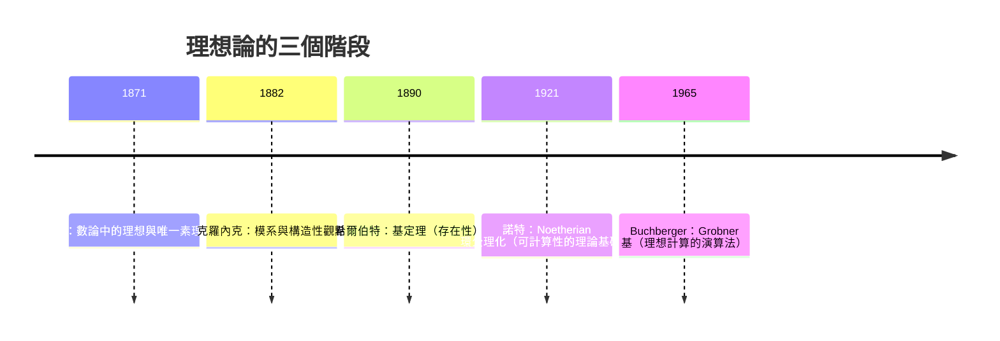

## 3.2 理想與商環：諾特（1921）的理想理論

### 學習目標

- 掌握理想、主理想、商環的定義與基本計算。
- 理解戴德金（1871）→ 克羅內克 → 諾特（1921）三個階段：從「數的分解」到「理想的分解」再到「一般交換環的 Noetherian 條件」。
- 認識素理想、極大理想與 $`R/p`$ 、 $`R/m`$ 的關係。
- 能用 SymPy 的 `Poly`、`sp.groebner`（預覽第 7 章）與多項式除法操作商環 $`\mathbb{Q}[x]/(f)`$ 。

### 歷史背景

- **1871**：戴德金在《數論講義》第二版定義「理想」——這個名字取自庫默爾的「理想質數」。戴德金證明：在代數整數環中，每個非零理想可**唯一**分解為素理想之積。數的唯一分解失敗了，但理想的唯一分解成功，費馬大定理的研究由此回到正軌。
- **1880s**：克羅內克以「模系」重新表述同樣的對象，強調構造性：給定生成元 $`\{f_1, \dots, f_k\}`$ ，所有線性組合

$$
(f_1, \dots, f_k) = \left\{ \sum_i g_i f_i \;:\; g_i \in R \right\}
$$

就是一個理想。這種「由生成元給出」的觀點是可計算的，直接通往 Grobner 基（第 7 章）。
- **1888/1890**：希爾伯特證明基定理： $`\mathbb{C}[x_1,\dots,x_n]`$ 的每個理想都是有限生成的（第 7.1 節詳述）。
- **1921**：艾米·諾特（Emmy Noether）發表《Idealtheorie in Ringbereichen》，把上述一切公理化：她提出 **Noetherian 環**（每個理想皆有限生成，等價於遞增鏈條件 ACC），證明在此條件下有限生成交換環上的分解理論成立。抽象代數作為一門獨立學科，通常以這篇論文為誕生日。
- **動機與技術的互動：** 戴德金做的是數論計算；諾特做的是公理化；而 1965 年 Buchberger 發明 Grobner 基後，諾特的「有限生成」變成電腦可以實際執行的終止性保證——今天 SymPy 的 `groebner` 能夠終止，正是 Noetherian 條件在起作用。



---

### 3.2.1 理想的定義

**定義。** 設 $`R`$ 為交換環， $`I \subseteq R`$ 非空子集稱為一個**理想**，若：

1. $`I`$ 對加法與取負封閉（ $`I`$ 是 $`(R,+)`$ 的子群）；
2. 對任意 $`r \in R`$ 、 $`a \in I`$ ，有 $`ra \in I`$ （吸收性）。

**例子。**

- $`n\mathbb{Z} = \{ \dots, -2n, -n, 0, n, 2n, \dots \}`$ 是 $`\mathbb{Z}`$ 的理想。
- 在 $`\mathbb{Q}[x]`$ 中， $`(f) = \{fg : g \in \mathbb{Q}[x]\}`$ 是**主理想**。
- 兩個生成元的理想 $`(x, y) \subseteq \mathbb{Q}[x, y]`$ 不是主理想（見習題 5）。

**定理（戴德金，1871；本書以 $`\mathbb{Z}`$ 的形式呈現）。** $`\mathbb{Z}`$ 的每個理想都是主理想，且形如 $`n\mathbb{Z}`$ 。

**證明。** 設 $`I \neq \{0\}`$ 為 $`\mathbb{Z}`$ 的理想，取 $`n = \min(I \cap \mathbb{Z}_{>0})`$ （良序原理）。對 $`a \in I`$ ，帶餘除法 $`a = qn + r`$ ， $`0 \le r < n`$ 。因 $`a, qn \in I`$ ，故 $`r = a - qn \in I`$ ；由 $`n`$ 的最小性 $`r = 0`$ ，即 $`a \in n\mathbb{Z}`$ 。所以 $`I = n\mathbb{Z}`$ 。 $`\blacksquare`$

**商環。** 設 $`I`$ 為 $`R`$ 的理想，在陪集集合

$$
R/I = \{ a + I : a \in R \}
$$

上定義 $`(a + I) + (b + I) = (a + b) + I`$ 、 $`(a + I)(b + I) = ab + I`$ 。由吸收性可證這些運算**良定義**（與代表元選取無關）， $`R/I`$ 成為一個環，稱為**商環**。

### 3.2.2 素理想與極大理想

**定義。** 交換環 $`R`$ 的真理想 $`I`$ 稱為

- **素理想**：若 $`ab \in I \Rightarrow a \in I`$ 或 $`b \in I`$ ；
- **極大理想**：若沒有真理想真包含 $`I`$ （ $`I \ne R`$ ）。

**定理。** $`I`$ 是極大理想 $`\iff`$ $`R/I`$ 是體； $`I`$ 是素理想 $`\iff`$ $`R/I`$ 是整環（見 3.3 節）。

**證明思路。** 商環 $`R/I`$ 的理想與 $`R`$ 中「包含 $`I`$ 的理想」一一對應（對應 $`J \mapsto J/I`$ ）。所以 $`I`$ 極大 $`\iff`$ $`R/I`$ 沒有非平凡理想 $`\iff`$ $`R/I`$ 是體（見 3.3 節：交換環是體 $`\iff`$ 只有不平凡理想）。素性條件 $`ab \in I \Rightarrow a \in I`$ 或 $`b \in I`$ 翻譯到 $`R/I`$ 正是「無零因子」。 $`\blacksquare`$

**推論（體的特徵化）。** 在 $`\mathbb{Z}`$ 中， $`(p)`$ 是極大理想 $`\iff`$ $`p`$ 是質數，且 $`\mathbb{Z}/p\mathbb{Z}`$ 是體——這就是有限體 $`\mathbb{F}_p`$ （3.3、3.7 節的主角）。

**SymPy 驗證： $`\mathbb{Z}_6`$ 不是體、 $`\mathbb{Z}_5`$ 是體。**

```python
import sympy as sp

# Z_6 有零因子：2 * 3 = 0 (mod 6)，故 (6) 不是素理想
print((sp.Integer(2) * sp.Integer(3)) % 6)   # 0

# Z_5 中每個非零元有逆元 => 體
for a in range(1, 5):
    inv = sp.mod_inverse(a, 5)
    print(a, '->', inv, 'check:', (a * inv) % 5)
```

輸出說明：第一行印 `0`（零因子 $`2\cdot 3 \equiv 0 \pmod 6`$ ），故 $`\mathbb{Z}_6`$ 不是整環， $`(6)`$ 不是素理想；後面的表顯示 $`\mathbb{Z}_5`$ 中每個非零元都有乘法逆元，證實 $`\mathbb{Z}_5`$ 是體。

### 3.2.3 多項式的商環： $`\mathbb{Q}[x]/(f)`$

設 $`f \in \mathbb{Q}[x]`$ 次數 $`n`$ ，則商環 $`\mathbb{Q}[x]/(f)`$ 的每個元素有唯一代表元

$$
r(x) = b_0 + b_1 x + \cdots + b_{n-1}x^{n-1},
$$

由帶餘除法（除以 $`f`$ ）得到。這就是 3.1 節克羅內克「加入根 $`\alpha`$ 」的商環表述：若 $`f`$ 不可約（3.6 節），則 $`\mathbb{Q}[x]/(f)`$ 是一個**體**，且 $`\bar{x}`$ 就是 $`f`$ 的根。

**SymPy：實作一個小商環計算器。**

```python
import sympy as sp

x = sp.Symbol('x')
f = sp.Poly(x**3 - 2, x, domain=sp.QQ)   # 加入 2 的立方根

def reduce_mod(g):
    """把 g(x) 模 f(x) 約化為次數 < 3 的代表元"""
    q, r = sp.div(sp.Poly(g, x, domain=sp.QQ), f)
    return r.as_expr()

a = x                    # 商環中的「alpha」
g1 = x**4 + x            # alpha^4 + alpha
g2 = x**2 - 1

print(reduce_mod(g1))          # 2*x + x  -> 3x（因 x^3=2, x^4=2x）
print(reduce_mod(g1 * g2))     # 乘法在商環中的結果
```

輸出說明：

- `reduce_mod(x**4 + x)` 印出 `3*x`：因為在商環中 $`x^3 = 2`$ ，所以 $`x^4 + x = 2x + x = 3x`$ 。
- 乘積 $`g_1 g_2 = (x^4+x)(x^2-1) = x^6 + x^3 - x^4 - x`$ ，用 $`x^3=2`$ 降次後得 $`-2x + 4`$ 之類的代表元——程式會自動算出。

這個 `reduce_mod` 就是 SymPy `Poly.div` 的一層包裝；實務上也可以直接用

```python
print(sp.rem(sp.Poly(x**4 + x, x), f))   # 餘式 = 商環代表元
```

### 3.2.4 諾特的兩條等價定義與 Noetherian 環

**定理（Noether, 1921）。** 對交換環 $`R`$ ，下列等價：

1. **有限生成條件**：每個理想皆由有限多個元素生成；
2. **遞增鏈條件（ACC）**：任何理想鏈 $`I_1 \subseteq I_2 \subseteq I_3 \subseteq \cdots`$ 最終穩定（存在 $`N`$ 使 $`I_N = I_{N+1} = \cdots`$ ）；
3. **極大元條件**：每個非空理想集合對包含關係有極大元。

滿足這些條件的環稱為 **Noetherian 環**。

**證明思路（1 $`\Rightarrow`$ 2）。** 反設 $`I_1 \subsetneq I_2 \subsetneq \cdots`$ ，令 $`J = \bigcup_k I_k`$ （ $`J`$ 是理想）。若 $`J`$ 由 $`a_1, \dots, a_m`$ 生成，每個 $`a_i`$ 落在某 $`I_{k_i}`$ 中，取 $`K = \max k_i`$ ，則 $`J \subseteq I_K`$ ，與 $`I_{K+1} \supsetneq I_K`$ 矛盾。 $`\blacksquare`$

**主要定理（Noether, 1921）。** Noetherian 環的商環與有限生成環都還是 Noetherian；且在 Noetherian 環中，每個理想有（準質）分解，一般分解理論在此成立。特例： $`\mathbb{Z}[x_1, \dots, x_n]`$ 與 $`\mathbb{Q}[x_1, \dots, x_n]`$ 都是 Noetherian（希爾伯特基定理，1890）。

**戴德金域。** 3.1 節的代數整數環 $`\mathcal{O}_K`$ 滿足：每個非零真理想可**唯一**分解為素理想之積

$$
\mathfrak{a} = \mathfrak{p}_1^{e_1} \mathfrak{p}_2^{e_2} \cdots \mathfrak{p}_r^{e_r}.
$$

把 3.1 節 $`6 = 2 \cdot 3 = (1+\sqrt{-5})(1-\sqrt{-5})`$ 的失敗重述在理想層次：

$$
(2) = \mathfrak{p}_2^2, \quad (3) = \mathfrak{p}_3 \mathfrak{q}_3, \quad (1+\sqrt{-5}) = \mathfrak{p}_2 \mathfrak{p}_3, \quad (1-\sqrt{-5}) = \mathfrak{p}_2 \mathfrak{q}_3,
$$

於是 $`(6) = \mathfrak{p}_2^2 \mathfrak{p}_3 \mathfrak{q}_3`$ 有**唯一**的素理想分解，兩個表面上不同的數分解其實給出同一個理想分解。**戴德金用「升一級的對象」恢復了唯一性**——這個策略在數學中反覆出現（例如從點到簇、從函數到層）。

### 3.2.5 理想論與計算：通往 Grobner 基

克羅內克–諾特「由生成元給出理想」的觀點，在電腦上落地為：**給定生成元，如何回答 $`f \in I`$ ？** 這個理想成員判定問題，在單變數時用 GCD 就夠了：

**定理。** $`\mathbb{F}[x]`$ 是主理想域，且 $`(f_1, \dots, f_k) = (\gcd(f_1, \dots, f_k))`$ 。

多變數時就困難得多，需要 Grobner 基（第 7 章）。SymPy 已內建：

```python
import sympy as sp

x, y = sp.symbols('x y')
I = sp.groebner([x**2 - y, x - y**2], x, y, order='lex')
print(I)
# GroebnerBasis([x**2 - y, x - y**2, ...], x, y, domain=QQ, order='lex')
```

輸出說明：`groebner` 傳回這組生成元所生成理想的 Grobner 基，可用於成員判定、消元與解聯立方程——詳見第 7.4 節。這裡只是預覽：**諾特 1921 年的抽象理論，在 1965 年變成了演算法，在 2007 年進入了 SymPy。**

### 3.2.6 綜合範例： $`\mathbb{Z}[i]`$ （高斯整數環）

高斯 1832 年為了證明雙平方定理研究 $`\mathbb{Z}[i]`$ ；戴德金視之為理想論的第一個範例。它是一個歐幾里得整環，因此是主理想域，唯一分解成立。

```python
import sympy as sp

from sympy import I as Im

# 高斯整數的帶餘除法
def gauss_div(u, v):
    q = (u * sp.conjugate(v)) // (v * sp.conjugate(v))
    # 四捨五入到最近的高斯整數
    q = sp.Integer(round(sp.re(q))) + Im * sp.Integer(round(sp.im(q)))
    r = u - q * v
    return q, r

def gauss_norm(z):
    return sp.re(z)**2 + sp.im(z)**2

print(gauss_norm(3 + 4*Im))          # 25
print(gauss_div(11 + 7*Im, 2 + Im))  # (7+3i, 0-2i) 之類的商與餘
```

輸出說明：範數 $`N(3+4i) = 25`$ ；帶餘除法給出 $`11 + 7i = q(2+i) + r`$ 且 $`N(r) < N(2+i) = 5`$ ，這正是歐幾里得整環的定義性質，保證輾轉相除法終止、每個理想都是主理想、唯一分解成立。

---

### SymPy 要點回顧

| 函式 / 物件 | 用途 |
|---|---|
| `sp.Poly(g, x, domain=...)` | 建立指定係數域上的多項式 |
| `sp.div`、`sp.rem` | 帶餘除法，產生商環代表元 |
| `sp.groebner(...)` | 理想的 Grobner 基（預覽第 7 章） |
| `sp.conjugate`、`sp.re`、`sp.im` | 高斯整數運算 |
| `sp.mod_inverse(a, n)` | 模逆元，檢驗 $`\mathbb{Z}_n`$ 是否為體 |

### 習題

1. 證明商環運算的良定義性：若 $`a \equiv a' \pmod I`$ 、 $`b \equiv b' \pmod I`$ ，則 $`ab \equiv a'b' \pmod I`$ 。
2. 列出 $`\mathbb{Z}_{12}`$ 的所有理想，並指出哪些是素理想、哪些是極大理想。
3. 用程式窮舉 $`\mathbb{Z}_n`$ （ $`n = 2, \dots, 15`$ ）的單位個數 $`\varphi(n)`$ ，並與歐拉函數公式 $`\varphi(n) = n\prod_{p \mid n}(1 - 1/p)`$ 對照。
4. 在 $`\mathbb{Q}[x]/(x^2+1)`$ 中求 $`(2+3x)(1-4x)`$ 的代表元，並與複數 $`(2+3i)(1-4i) = 14 - 5i`$ 對照。
5. 證明 $`(x, y) \subseteq \mathbb{Q}[x,y]`$ 不是主理想。（提示：若 $`(x,y) = (h)`$ ，則 $`h \mid x`$ 與 $`h \mid y`$ 迫使 $`h`$ 為常數。）
6. 3.1 節中 $`\mathbb{Z}[\sqrt{-5}]`$ 的兩個數分解對應的理想分解為 $`(6) = \mathfrak{p}_2^2 \mathfrak{p}_3 \mathfrak{q}_3`$ 。查閱 Dedekind 域的資料，說明 $`\mathfrak{p}_2 = (2, 1+\sqrt{-5})`$ 為什麼是一個理想（生成元的兩個元素分別是 $`2`$ 與 $`1+\sqrt{-5}`$ ）。
7. **歷史題**：諾特 1921 年論文的 §1 用 ACC 重述希爾伯特基定理。說明為什麼「每個理想有限生成」對電腦代數系統是**終止性的保證**（提示：Grobner 基演算法的每一步都嚴格增大某個理想鏈）。
8. 用 `sp.rem` 在 $`\mathbb{Q}[x]/(x^3 - 2)`$ 中求 $`x^{10}`$ 的代表元，並驗證它等於 $`(x^3)^3 \cdot x = 8x`$ 模 $`x^3-2`$ 的形式。

**前後節連結：** 上一節 [3.1-環論的誕生](03.1-環論的誕生：戴德金與克羅內克（1870s–1880s）.md)；下一節 [3.3-整環、體與體的特徵](03.3-整環、體與體的特徵.md)
