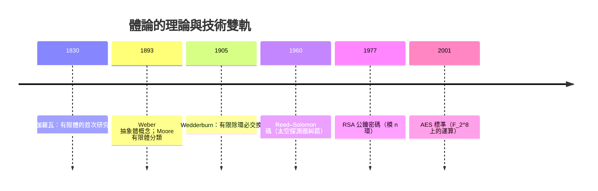
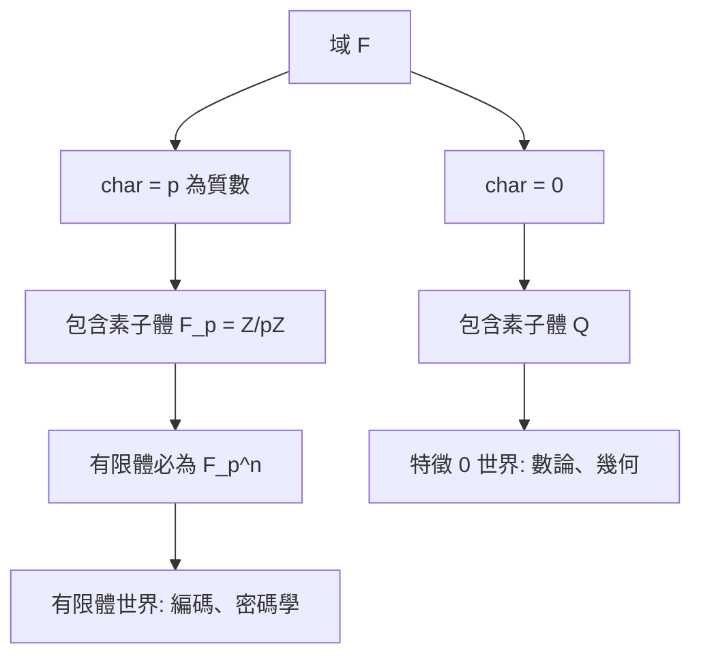

# 第 3 章 環、體與多項式（續）

## 3.3 整環、體與體的特徵

### 學習目標

- 給出整環、域的嚴格定義，理解「零因子」在其中的角色。
- 掌握**體的特徵**概念，證明特徵只能是 $`0`$ 或質數 $`p`$ 。
- 認識有限體 $`\mathbb{F}_{p^n}`$ 的存在唯一性（建構留待 3.5、3.7 節）。
- 理解有限體為何成為現代編碼理論（Reed–Solomon、AES）與密碼學的數學基礎。

### 歷史背景

- **1830**：伽羅瓦（Galois）在決鬥前夜寫下《論有限體上方程的可解性》（*Sur la théorie des nombres*），首次系統研究 $`p`$ 個元素的體 $`\mathbb{F}_p`$ 及其擴張 $`\mathbb{F}_{p^n}`$ ，這些體後來被稱為 **Galois 體**。他的動機來自方程可解性與數論（分圓與本原根）。
- **1847–1893**：戴德金、韋伯（Heinrich Weber）逐步把「體」抽象化；1893 年韋伯發表《體概念的普遍基礎》，正式給出體的抽象公理。
- **1893–1905**：摩爾（E. H. Moore，1893）證明有限體的分類：每個有限體的元素個數是質數冪，且每個質數冪大小的有限體在同構意義下唯一。1905 年韋德伯恩（Wedderburn）證明著名的「小 Wedderburn 定理」：**有限除環必為交換體**。
- **1960 年代**：Reed–Solomon 碼（1960）、BCH 碼把 $`\mathbb{F}_{2^n}`$ 變成工程常數；**1977 年 RSA** 使用 $`\mathbb{Z}_n`$ 的環結構；**2001 年 AES 標準**的核心運算直接定義在 $`\mathbb{F}_{2^8}`$ 上。
- 這是「技術需求驅動理論」的反向案例：有限體理論先於應用一百多年被伽羅瓦研究，然後被衛星通訊、二維碼、USB 傳輸（Reed–Solomon）與加密（AES）大規模使用。



---

### 3.3.1 零因子、整環與域

**定義（零因子）。** 環 $`R`$ 中，非零元素 $`a`$ 稱為**左零因子**，若存在非零 $`b`$ 使 $`ab = 0`$ 。

**定義（整環，integral domain）。** 含單位元的交換環 $`R \neq \{0\}`$ 若**沒有零因子**，稱為整環。

**定義（域，field）。** 含單位元的交換環 $`R \neq \{0\}`$ 中，若每個非零元素都有乘法逆元，稱為**域**（或**體**）。

**定理。** 每個域都是整環。

**證明。** 設 $`ab = 0`$ 且 $`a \neq 0`$ ，則 $`b = (a^{-1}a)b = a^{-1}(ab) = a^{-1} \cdot 0 = 0`$ 。 $`\blacksquare`$

反方向不成立： $`\mathbb{Z}`$ 是整環但不是域。但 $`\mathbb{Z}`$ 可以「最經濟地」嵌入一個域：

**定理（分式體，分數域的構造）。** 整環 $`R`$ 可嵌入其**分式體** $`\mathrm{Frac}(R) = \{(a,b) : a, b \in R, b \neq 0\}/\sim`$ ，其中 $`(a,b) \sim (c,d) \iff ad = bc`$ （就是分數的構造）。特別地 $`\mathrm{Frac}(\mathbb{Z}) = \mathbb{Q}`$ 、 $`\mathrm{Frac}(\mathbb{Z}[x]) = \mathbb{Q}(x)`$ （有理函數體）。

**消去律。** 整環的另一種刻劃：

**定理。** $`R`$ 是整環 $`\iff`$ 對任意非零 $`a`$ ， $`ab = ac \Rightarrow b = c`$ （消去律成立）。

**證明。** 若 $`ab = ac`$ 則 $`a(b - c) = 0`$ ；整環無零因子且 $`a \neq 0`$ ，故 $`b = c`$ 。反之若 $`ab = 0`$ 且 $`b \neq 0`$ ，由消去律 $`a \cdot 0 = a \cdot b`$ 推得 $`a = 0`$ ，即無零因子。 $`\blacksquare`$

**SymPy 窮舉：找出 $`\mathbb{Z}_n`$ 的零因子。**

```python
import sympy as sp

def zero_divisors(n):
    """回傳 Z_n 的零因子清單"""
    zd = []
    for a in range(1, n):
        for b in range(1, n):
            if (a * b) % n == 0:
                zd.append(a)
                break
    return sorted(set(zd))

for n in [4, 6, 8, 9, 10, 12]:
    print(n, zero_divisors(n))
# 4  [2]
# 6  [2, 3, 4]
# 8  [2, 4, 6]
# 9  [3, 6]
# 10 [2, 4, 5, 6, 8]
# 12 [2, 3, 4, 6, 8, 9, 10]
```

輸出說明： $`\mathbb{Z}_n`$ 的零因子恰為與 $`n`$ 不互素的非零剩餘。用 `sp.gcd(a, n) > 1` 可以更快判斷：

```python
print([a for a in range(1, 12) if sp.gcd(a, 12) > 1])
# [2, 3, 4, 6, 8, 9, 10]  與上面一致
```

### 3.3.2 理想與整環/域的刻劃

**定理。** 交換環 $`R \neq 0`$ 是域 $`\iff`$ $`R`$ 只有不平凡的理想 $`\{0\}`$ 與 $`R`$ 。

**證明。**（ $`\Rightarrow`$ ）設 $`I \neq 0`$ 為域 $`R`$ 的理想，取 $`a \in I \setminus \{0\}`$ ，則 $`1 = a^{-1}a \in I`$ ，故 $`I = R`$ 。（ $`\Leftarrow`$ ）設 $`a \neq 0`$ ，理想 $`aR`$ 非零，故 $`aR = R`$ ，於是有 $`b`$ 使 $`ab = 1`$ 。 $`\blacksquare`$

結合 3.2 節的定理得到漂亮的對應：

$$
\text{素理想 } \mathfrak{p} \;\longleftrightarrow\; R/\mathfrak{p} \text{ 是整環}, \qquad
\text{極大理想 } \mathfrak{m} \;\longleftrightarrow\; R/\mathfrak{m} \text{ 是域}.
$$

在主理想域 $`\mathbb{F}[x]`$ 中， $`(f)`$ 是極大理想 $`\iff`$ $`f`$ 不可約（3.6 節將系統研究）。

### 3.3.3 體的特徵

**定義（特徵）。** 域 $`F`$ 中，使

$$
\underbrace{1 + 1 + \cdots + 1}_{n \text{ 個}} = 0
$$

的最小正整數 $`n`$ 稱為 $`F`$ 的**特徵**，記作 $`\mathrm{char}(F)`$ ；若這樣的 $`n`$ 不存在，定義 $`\mathrm{char}(F) = 0`$ 。

**定理。** 域的特徵只能是 $`0`$ 或質數 $`p`$ 。

**證明。** 設 $`\mathrm{char}(F) = n > 0`$ 且 $`n = ab`$ 為合數（ $`1 < a, b < n`$ ）。則

$$
0 = n \cdot 1 = (a \cdot 1)(b \cdot 1).
$$

域無零因子，故 $`a \cdot 1 = 0`$ 或 $`b \cdot 1 = 0`$ ，都與 $`n`$ 的最小性矛盾。 $`\blacksquare`$

**推論。** $`\mathrm{char}(F) = p`$ 時， $`F`$ 包含 $`\mathbb{F}_p = \mathbb{Z}/p\mathbb{Z}`$ 作為最小子域（素子體）； $`\mathrm{char}(F) = 0`$ 時， $`F`$ 包含 $`\mathbb{Q}`$ 作為素子體。這給出兩個完全平行的世界：



**Frobenius 自同構。** 在特徵 $`p`$ 的域中，映射 $`\varphi(x) = x^p`$ 是域自同構：

$$
(x + y)^p = x^p + y^p \quad (\text{二項式係數 } \binom{p}{k} \equiv 0 \pmod p,\ 0 < k < p).
$$

**例子：在 $`\mathbb{F}_3`$ 中檢驗。**

```python
import sympy as sp

p = 3
ok = all(((a + b)**p - a**p - b**p) % p == 0
         for a in range(p) for b in range(p))
print(ok)   # True：Frobenius 恆等式 (x+y)^3 = x^3 + y^3 在 F_3 中成立
```

輸出說明：印出 `True`。在 $`\mathbb{F}_3`$ 中 $`(a+b)^3 = a^3 + b^3`$ 對所有 $`a, b`$ 成立，因為中間項係數 $`3`$ 恆為 $`0`$ 。這就是「Freshman's dream」在有限體中為真的現象，也是 AES 中求逆與有限體冪運算的基礎。

### 3.3.4 有限體：Galois 體 $`\mathbb{F}_{p^n}`$

**定理（Galois 1830；Moore 1893 分類）。**

1. 有限體的元素個數必為質數冪 $`q = p^n`$ ；
2. 對每個質數冪 $`p^n`$ ，恰存在一個 $`p^n`$ 元體（在同構意義下），記為 $`\mathbb{F}_{p^n}`$ 或 $`\mathrm{GF}(p^n)`$ ；
3. $`\mathbb{F}_{p^n}^{\times} = \mathbb{F}_{p^n} \setminus \{0\}`$ 是 $`p^n - 1`$ 階**循環群**（存在本原根 $`\alpha`$ 使 $`\mathbb{F}_{p^n} = \mathbb{Z}[\alpha]`$ 的有限版本）。

**證明要點。**

1. 特徵為質數 $`p`$ ，故 $`F`$ 是 $`\mathbb{F}_p`$ 上的向量空間；若維度為 $`n`$ ，則 $`|F| = p^n`$ 。
2. 建構：取 $`f`$ 為 $`\mathbb{F}_p`$ 上 $`n`$ 次不可約多項式（存在，見 3.6 節），則 $`\mathbb{F}_p[x]/(f)`$ 是 $`p^n`$ 元體；唯一性由「 $`p^n`$ 元體的元素都是 $`x^{p^n} - x`$ 的根，且 $`x^{p^n}-x`$ 無重根」得到。
3. 有限群的乘法子群： $`F^{\times}`$ 是有限交換群，其每個元素的階整除 $`q-1`$ ；用 Lagrange 定理與多項式 $`x^{q-1}-1`$ 至多 $`q-1`$ 個根的事實證明 $`F^{\times}`$ 循環（完整證明見 2.5 節的有限交換群結構與 3.6 節習題）。 $`\blacksquare`$

**構造示範： $`\mathbb{F}_4 = \mathbb{F}_2[x]/(x^2+x+1)`$ 。** 取 $`f(x) = x^2 + x + 1`$ （在 $`\mathbb{F}_2`$ 上不可約： $`f(0) = f(1) = 1 \neq 0`$ ）。設 $`\alpha = \bar{x}`$ ，則 $`\alpha^2 = \alpha + 1`$ （因 $`\alpha^2 + \alpha + 1 = 0`$ ，而在 $`\mathbb{F}_2`$ 中負號等於正號），於是

$$
\mathbb{F}_4 = \{0, 1, \alpha, \alpha+1\}, \qquad \alpha^3 = 1,
$$

即 $`\alpha`$ 是 $`\mathbb{F}_4^{\times}`$ 的生成元（本原根），驗證了定理 3。

**SymPy：手動實作 $`\mathbb{F}_4`$ 的完整乘法表。**

```python
import sympy as sp

x = sp.Symbol('x')
f = sp.Poly(x**2 + x + 1, x, domain=sp.GF(2))

def rep(g):   # 約化到次數 < 2
    return sp.rem(sp.Poly(g, x, domain=sp.GF(2)), f).as_expr()

elems = [0, 1, x, x + 1]
print('乘法表 (F_4):')
for a in elems:
    row = []
    for b in elems:
        row.append(rep(a * b) if (a != 0 and b != 0) else 0)
    print(a, '->', row)
```

輸出說明：程式印出 $`\mathbb{F}_4`$ 的乘法表；會看到 $`x \cdot (x+1) = x^2 + x \equiv 1 \pmod{x^2+x+1}`$ ，即 $`x+1 = x^{-1}`$ ，且 $`x^3 = 1`$ ，證實 $`\alpha`$ 的階為 3。

### 3.3.5 小 Wedderburn 定理與循環性的計算驗證

**定理（Wedderburn, 1905）。** 每個有限除環（每個非零元素有逆元，但乘法不必交換）必為交換體。

證明依賴於群論的環中心計數論證，超出本節範圍，但它是「有限世界比無限世界更有秩序」的代表定理。下面的程式驗證定理 3（循環性）在幾個小體中的成立：

```python
import sympy as sp

# F_7^x 應為 6 階循環群：找本原根
p = 7
for g in range(2, p):
    orders = {pow(g, k, p) for k in range(1, p)}
    if len(orders) == p - 1:
        print(f'{g} 是 F_{p} 的本原根, 階 = {p-1}')
        break

# 3 是 F_7 的本原根, 階 = 6
# F_2[x]/(x^4+x+1) = F_16 的本原多項式檢查
f16 = sp.Poly(x**4 + x + 1, x, domain=sp.GF(2))
print(sp.factor(f16.as_expr(), modulus=2))
# x**4 + x + 1  （在 F_2 上不可約，故生成 F_16）
```

輸出說明：

- 第二段印出「3 是 F_7 的本原根」： $`3^1, \dots, 3^6 \pmod 7`$ 取遍 $`1,\dots,6`$ ，證實 $`\mathbb{F}_7^{\times}`$ 循環。
- `factor` 在模 2 下無法分解 $`x^4+x+1`$ ，它就是 $`\mathbb{F}_{16}`$ 的標準本原多項式（3.6 節的不可約性判準在此派上用場）。

### 3.3.6 應用視角：為什麼工程師需要 $`\mathbb{F}_{2^8}`$ ？

AES（Rijndael, 2001 標準）的 SubBytes 層需要 $`x \mapsto x^{-1}`$ （ $`\mathbb{F}_{2^8}^{\times}`$ 上的反演），其元素直接用多項式 $`\bmod\ (x^8 + x^4 + x^3 + x + 1)`$ 表示，一個位元組就是一個多項式。Reed–Solomon 碼則用 $`\mathbb{F}_{2^m}`$ 的加法群構造糾錯碼。沒有 Galois 1830 年的抽象體論，這些標準無從表述；反過來，工程界的大量硬體（AES-NI 指令集）正是「理論支持技術」的迴響。詳細程式實作見 3.7 節與 4.7 節。

---

### SymPy 要點回顧

| 函式 / 工具 | 用途 |
|---|---|
| `sp.gcd(a, n)` | 判斷零因子與單位（與 $`n`$ 互素者為單位） |
| `sp.mod_inverse(a, n)` | 求模逆元，驗證域性質 |
| `sp.Poly(..., domain=sp.GF(p))` | 有限體上的多項式 |
| `sp.rem`、`sp.div` | 商環代表元計算（構造 $`\mathbb{F}_{p^n}`$ ） |
| `sp.factor(expr, modulus=p)` | 有限體上的因式分解（3.4、3.6 節） |
| `pow(g, k, p)`（Python 內建） | 模冪，找本原根、Frobenius 驗證 |

### 習題

1. 證明：整環的有限子集若對乘法封閉且含非零元，則它含 $`1`$ （結合 2.3 節 Lagrange 定理的思路）。
2. 求出 $`\mathbb{Z}_{20}`$ 的所有單位，驗證單位個數為 $`\varphi(20) = 8`$ 。
3. 證明： $`\mathrm{char}(\mathbb{F}_{p^n}) = p`$ ，且 $`\mathbb{F}_{p^n}`$ 的質子體是 $`\mathbb{F}_p`$ 。
4. 用程式窮舉驗證：在 $`\mathbb{F}_5`$ 中 $`(a+b)^5 = a^5 + b^5`$ 對所有 $`a, b`$ 成立。
5. 構造 $`\mathbb{F}_9 = \mathbb{F}_3[x]/(x^2+1)`$ ：寫出它的 9 個元素、乘法表，並找一個本原根。（提示：在 $`\mathbb{F}_3`$ 中 $`x^2+1`$ 不可約，因為 $`0^2+1=1`$ 、 $`1^2+1=2`$ 、 $`2^2+1=5\equiv 2`$ 。）
6. 證明：若 $`F`$ 是域，則 $`F[x]`$ 是歐幾里得整環，因此是主理想域（呼應 3.2 節定理）。
7. **歷史與應用題**：AES 用 $`\mathbb{F}_{2^8} = \mathbb{F}_2[x]/(x^8+x^4+x^3+x+1)`$ 。用 SymPy 驗證這個多項式在 $`\mathbb{F}_2`$ 上不可約，並計算 $`x^{-1}`$ （即求 $`g`$ 使 $`xg \equiv 1`$ ）。
8. Wedderburn 定理說有限除環必交換。找出一個**無限**的非交換除環的例子（哈密頓四元數 $`\mathbb{H}`$ ），並用 SymPy 定義兩個四元數的乘法，驗證 $`ij = k \neq -k = ji`$ 。

**前後節連結：** 上一節 [3.2-理想與商環](03.2-理想與商環：諾特（1921）的理想理論.md)；下一節 [3.4-多項式環、整除性與因式分解](03.4-多項式環、整除性與因式分解.md)
