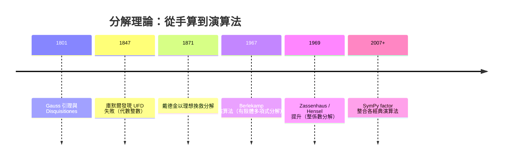

# 第 3 章 環、體與多項式（續）

## 3.4 多項式環、整除性與因式分解

### 學習目標

- 掌握多項式環 $`R[x]`$ 的代數性質：次數運算、帶餘除法。
- 證明 $`F[x]`$ （ $`F`$ 為域）是歐幾里得整環，進而是主理想域與唯一分解域（UFD）。
- 理解 GCD、輾轉相除法與 Bezout 恆等式在多項式上的版本。
- 認識 Gauss 引理與「UFD 上本原多項式的分解」理論，說明 $`\mathbb{Z}[x]`$ 也是 UFD。
- 能用 SymPy 的 `Poly`、`div`、`gcd`、`factor` 完成所有對應計算。

### 歷史背景

- **1801**：高斯《算術研究》（*Disquisitiones Arithmeticae*）系統建立了整數與多項式分解的平行理論，**Gauss 引理**（本原多項式之積仍本原）即出於此書。
- **1840s–1850s**：庫默爾與戴德金把分解理論推廣到代數整數時遭遇失敗（見 3.1 節），才發現「UFD」是一種**可失去的性質**——多項式環恰好保有它，這不是巧合而是結構（Gauss 引理）。
- **1930s**：van der Waageden 與諾特學派把 UFD、PID、ED（歐幾里得域）的蘊含鏈整理成教科書標準內容。
- **1965–1970s**：計算機代數的爆炸期。Berlekamp（1967）的有限體分解演算法、Zassenhaus（1969）的 Hensel 提升法，使「因式分解」從數學技巧變成**演算法學科**。SymPy 的 `factor` 內部正是這些經典演算法的 Python 實作。
- 現代應用：RSA 的安全根基之一是「多項式分解在 $`\mathbb{F}_q[x]`$ 上有多項式時間演算法、而整數分解未知」這種不對稱性；編碼理論解碼（Reed–Solomon）歸結為 $`\mathbb{F}_q[x]`$ 的 GCD 計算。



---

### 3.4.1 多項式環的基本性質

設 $`R`$ 為含單位元的交換環。 $`R[x]`$ 的元素為

$$
f(x) = a_n x^n + a_{n-1}x^{n-1} + \cdots + a_0, \qquad a_i \in R,
$$

若 $`a_n \neq 0`$ ，定義**次數** $`\deg f = n`$ ， $`a_n`$ 稱為**首項係數**。次數的基本規則：

$$
\deg(fg) = \deg f + \deg g \quad \text{（若 } R \text{ 是整環）}, \qquad \deg(f \pm g) \le \max(\deg f, \deg g).
$$

**證明（次數乘法公式）。** 設 $`f = a_m x^m + \cdots`$ 、 $`g = b_n x^n + \cdots`$ ， $`a_m, b_n \neq 0`$ 。則 $`fg`$ 的 $`m+n`$ 次項係數為 $`a_m b_n`$ ；因 $`R`$ 無零因子， $`a_m b_n \neq 0`$ ，故 $`\deg(fg) = m+n`$ 。（若 $`R`$ 有零因子，公式可能失敗，例如在 $`(\mathbb{Z}/4)[x]`$ 中 $`(2x+1)(2x+1)`$ 的二次項 $`4x^2 = 0`$ 。） $`\blacksquare`$

**推論。** 若 $`R`$ 是整環，則 $`R[x]`$ 也是整環。反覆應用得： $`\mathbb{Z}[x]`$ 、 $`F[x, y]`$ 、 $`F[x_1,\dots,x_n]`$ 都是整環。

**帶餘除法。** 當除式首項係數 $`b_n`$ 是**單位**（例如 $`F[x]`$ 中任何非零多項式）時：

**定理。** $`F`$ 為域， $`f, g \in F[x]`$ ， $`g \neq 0`$ ，則存在唯一 $`q, r \in F[x]`$ 使

$$
f = qg + r, \qquad r = 0 \ \text{或}\ \deg r < \deg g.
$$

**證明（存在性，歸納法）。** 對 $`\deg f`$ 歸納。若 $`\deg f < \deg g`$ ，取 $`q = 0, r = f`$ 。否則設 $`f`$ 首項 $`a_m x^m`$ 、 $`g`$ 首項 $`b_n x^n`$ （ $`m \ge n`$ ），令 $`f_1 = f - (a_m/b_n)x^{m-n}g`$ ，則 $`\deg f_1 < \deg f`$ ，由歸納假設 $`f_1 = q_1 g + r`$ ，故 $`f = [(a_m/b_n)x^{m-n} + q_1]g + r`$ 。唯一性：若 $`f = qg + r = q'g + r'`$ ，則 $`(q - q')g = r' - r`$ ；左邊若非零次數 $`\ge \deg g`$ ，右邊次數 $`< \deg g`$ ，故兩邊皆零。 $`\blacksquare`$

**SymPy：帶餘除法與餘式定理。**

```python
import sympy as sp

x = sp.Symbol('x')
f = sp.Poly(2*x**4 + 3*x**3 - x + 5, x, domain=sp.QQ)
g = sp.Poly(x**2 - 1, x, domain=sp.QQ)

q, r = sp.div(f, g)
print(q)   # Poly(2*x**2 + 3*x + 2, x, domain=QQ)
print(r)   # Poly(3*x + 7, x, domain=QQ)
# 驗證 f = q*g + r
print(sp.expand(q.as_expr()*g.as_expr() + r.as_expr() - f.as_expr()) == 0)  # True
```

輸出說明：`div` 傳回商與餘式；最後一行驗證 $`f = qg + r`$ 恆等成立。這就是長除法的機械化——它同時是 3.2 節商環代表元的計算核心。

### 3.4.2 $`F[x]`$ 是歐幾里得整環 → PID → UFD

**定義（歐幾里得整環，ED）。** 整環 $`R`$ 稱為 ED，若存在函式 $`d: R\setminus\{0\} \to \mathbb{Z}_{\ge 0}`$ （**範函**）使得帶餘除法成立：對 $`f, g \neq 0`$ ，存在 $`q, r`$ 使 $`f = qg + r`$ 且 $`r = 0`$ 或 $`d(r) < d(g)`$ 。

 $`F[x]`$ 以 $`d(f) = \deg f`$ 為範函即是 ED（ $`\mathbb{Z}`$ 以絕對值為範函也是，3.2 節 $`\mathbb{Z}[i]`$ 以範數為範函也是）。性質鏈：

$$
\text{ED} \;\Rightarrow\; \text{PID} \;\Rightarrow\; \text{UFD} \;\Rightarrow\; \text{整環}.
$$

**定理（ $`F[x]`$ 是 PID）。** $`F[x]`$ 的每個理想 $`I`$ 都是主理想，且 $`I = (d)`$ ，其中 $`d = \gcd`$ （次數最小者的代表）。

**證明。** 取 $`I`$ 中次數最小的非零元 $`d`$ 。對任意 $`f \in I`$ ，帶餘除法 $`f = qd + r`$ 給 $`r = f - qd \in I`$ ，由 $`d`$ 的最小性 $`r = 0`$ 。故 $`I = (d)`$ 。 $`\blacksquare`$

**定理（Bezout 恆等式，多項式版）。** $`f, g \in F[x]`$ 不全為零，則 $`\gcd(f, g)`$ 存在，且存在 $`s, t \in F[x]`$ 使

$$
sf + tg = \gcd(f, g).
$$

**證明。** 由上， $`(f, g) = (d)`$ ， $`d`$ 為次數最小的組合。則 $`d \mid f`$ 且 $`d \mid g`$ （否則 $`f`$ 除以 $`d`$ 有非零餘式落在理想中，矛盾），故 $`d \mid \gcd`$ ；反之 $`\gcd`$ 整除 $`f, g`$ 即整除 $`d`$ 。所以 $`d = \gcd`$ ，且 $`d = sf + tg`$ 。 $`\blacksquare`$

**擴充歐幾里得演算法**計算 $`s, t`$ ，SymPy 內建：

```python
import sympy as sp

x = sp.Symbol('x')
f = x**4 - 1
g = x**3 + x**2 + x + 1

d = sp.gcd(f, g)
print(d)   # x**2 + 1

s, t, h = sp.gcdex(g, f)   # h = s*g + t*f
print(sp.expand(h))        # x**2 + 1
print(sp.expand(s*g + t*f - d) == 0)   # True：Bezout 恆等式成立
```

輸出說明： $`\gcd(x^4 - 1,\; x^3+x^2+x+1) = x^2+1`$ ；`gcdex` 給出 Bezout 係數 $`s, t`$ 使 $`s g + t f = \gcd`$ ，最後一行驗證為 `True`。這個演算法在編碼理論中就是 Reed–Solomon 解碼的關鍵步驟（關鍵方程求解）。

### 3.4.3 不可約多項式與唯一分解

**定義（不可約）。** $`F[x]`$ 中，次數 $`\ge 1`$ 的 $`p(x)`$ 稱為**不可約**，若它不能寫成兩個次數皆較低的多項式之積。次數 0 或 $`0`$ 多項式既不約也不可約。

**定理（唯一分解，UFD）。** $`F[x]`$ 的每個次數 $`\ge 1`$ 的多項式可寫成

$$
f = c\, p_1^{e_1} p_2^{e_2} \cdots p_k^{e_k},
$$

其中 $`c \in F^{\times}`$ 為常數、 $`p_i`$ 是互不相同的首一不可約多項式。此分解在不計次序與單位倍數下唯一。

**證明思路。** 存在性由歸納：若 $`f`$ 可約， $`f = gh`$ 且 $`\deg g, \deg h < \deg f`$ ，對 $`g, h`$ 歸納分解。唯一性：關鍵是 **Euclid 引理**——

**引理（Euclid）。** $`p`$ 不可約且 $`p \mid ab`$ ，則 $`p \mid a`$ 或 $`p \mid b`$ 。

證明：若 $`p \nmid a`$ ，則 $`\gcd(p, a) = 1`$ （因 $`p`$ 的因式只有 1 與 $`p`$ ），由 Bezout 存在 $`s, t`$ 使 $`sp + ta = 1`$ ，兩邊乘 $`b`$ ： $`spb + tab = b`$ ； $`p`$ 整除左邊兩項，故 $`p \mid b`$ 。 $`\blacksquare`$

由 Euclid 引理對分解式的質因數逐一匹配即得唯一性。 $`\blacksquare`$

**SymPy：分解示範（有理數體上）。**

```python
import sympy as sp

x = sp.Symbol('x')
print(sp.factor(x**4 - 5*x**2 + 4))
# (x - 2)(x - 1)(x + 1)(x + 2)

print(sp.factor(x**5 + x + 1))
# x**5 + x + 1   （在有理數上不可約，見 3.6 節 Eisenstein 的推廣判準）

print(sp.factor_list(x**4 - 5*x**2 + 4))
# ((1, [(Poly(x - 2), 1), (Poly(x - 1), 1), (Poly(x + 1), 1), (Poly(x + 2), 1)]), ...)
```

輸出說明：`factor` 傳回人類易讀的分解式；`factor_list` 傳回機器友善的「常數 × (不可約因式, 重數)」清單，對應 UFD 定理中的 $`c\, p_1^{e_1}\cdots p_k^{e_k}`$ 。 $`x^5+x+1`$ 無法在有理數上分解——我們將在 3.6 節用正式判準證明它。

### 3.4.4 Gauss 引理與 $`\mathbb{Z}[x]`$ 的分解

 $`\mathbb{Z}`$ 是 UFD 但不是域， $`\mathbb{Z}[x]`$ 還是 UFD 嗎？**是**，靠 Gauss 引理。

**定義（本原多項式）。** $`\mathbb{Z}[x]`$ 中的多項式稱為**本原**，若其係數的最大公因數為 1。

**引理（Gauss, 1801）。** 兩個本原多項式之積仍為本原。

**證明思路。** 反設 $`fg`$ 的係數都被質數 $`p`$ 整除。則 $`\mathbb{F}_p[x]`$ 中 $`\bar{f}\bar{g} = 0`$ ；但 $`\mathbb{F}_p[x]`$ 是整環，故 $`\bar{f} = 0`$ 或 $`\bar{g} = 0`$ ，即 $`p`$ 整除 $`f`$ 或 $`g`$ 的所有係數，與本原性矛盾。（這個證明是「模 $`p`$ 約化」技巧的第一次亮相——3.6 節 Eisenstein 判別法將再次使用它。） $`\blacksquare`$

**定理（Gauss）。** $`\mathbb{Z}`$ 是 UFD $`\Rightarrow`$ $`\mathbb{Z}[x]`$ 是 UFD。更一般地， $`R`$ 是 UFD $`\Rightarrow`$ $`R[x]`$ 是 UFD（歸納可得 $`R[x_1,\dots,x_n]`$ 都是 UFD）。

**證明思路。** 把 $`f \in \mathbb{Z}[x]`$ 拆成「係數 GCD $`c`$ 」乘「本原部分 $`\tilde f`$ 」； $`c`$ 在 $`\mathbb{Z}`$ 中分解， $`\tilde f`$ 在 $`\mathbb{Q}[x]`$ 中分解（Gauss 引理保證本原多項式在 $`\mathbb{Q}[x]`$ 與 $`\mathbb{Z}[x]`$ 中同時不可約），兩段分解合併。 $`\blacksquare`$

**注意 UFD 不一定是 PID**： $`\mathbb{Q}[x, y]`$ 是 UFD 但 $`(x, y)`$ 不是主理想（3.2 節習題 5）。這條鏈的「反例地圖」：

| 性質 | 例子 | 非例 |
|---|---|---|
| ED | $`\mathbb{Z}`$ 、 $`F[x]`$ 、 $`\mathbb{Z}[i]`$ | — |
| PID 而非 ED | $`\mathbb{Z}[\frac{1+\sqrt{-19}}{2}]`$ | — |
| UFD 而非 PID | $`\mathbb{Q}[x,y]`$ | — |
| 非 UFD | $`\mathbb{Z}[\sqrt{-5}]`$ （3.1 節反例） | — |

### 3.4.5 有限體上的分解與 Berlekamp 思想一瞥

在 $`\mathbb{F}_q[x]`$ 上分解多項式有完全不同的技巧。關鍵觀察： $`f \in \mathbb{F}_q[x]`$ 無重根時，

$$
f = \prod_{c \in \mathbb{F}_q} \gcd\big(f(x),\, x - c\big) \cdot \gcd\big(f(x),\, x^q - x\big) \text{ 的推廣},
$$

更實用的是 $`x^{q^m} \equiv x \pmod f`$ 的冪映射： $`\gcd(f, x^{q^m} - x)`$ 給出次數整除 $`m`$ 的不可約因式之積。Berlekamp 演算法把這變成線性代數（在 $`\mathbb{F}_q^{\deg f}`$ 上求算子的不動點空間）。

**SymPy 直接呼叫：**

```python
import sympy as sp

x = sp.Symbol('x')
# 在 F_2 上分解
print(sp.factor(x**8 + x**4 + x**3 + x + 1, modulus=2))
# x**8 + x**4 + x**3 + x + 1  （不可約 = AES 的體多項式）

print(sp.factor(x**15 - 1, modulus=2))
# (x + 1)(x**2 + x + 1)(x**4 + x + 1)(x**4 + x**3 + 1)(x**4 + x**3 + x**2 + x + 1)

# x^15 - 1 在 F_2 上的因式全部不可約且次數整除 4（F_16 中全體非零元的階 | 15）
```

輸出說明： $`x^{15}-1`$ 在 $`\mathbb{F}_2`$ 上分裂成五個不可約多項式，次數為 $`1, 2, 4, 4, 4`$ ，總和 $`15`$ ——每個不可約因式的次數 $`d`$ 對應 $`\mathbb{F}_{2^d}`$ 中的 15 階元素（見 3.3 節定理 3）。這正是「分解理論 ↔ 有限體結構」的雙向對話。

### 3.4.6 歷史註腳：分解與 RSA

整數分解（RSA 的安全性假設）與多項式分解的命運截然不同：後者有多項式時間演算法（Berlekamp–Cantor–Zassenhaus, 1981），前者至今沒有。這個不對稱性本身就是「代數結構決定計算難度」的範例： $`\mathbb{F}_q[x]`$ 有豐富的加法結構（向量空間）可被 Berlekamp 線性代數利用，而 $`\mathbb{Z}`$ 的加法結構太弱。第 9.4 節將看到 Shor 演算法如何用量子計算繞過這個障礙。

---

### SymPy 要點回顧

| 函式 | 用途 |
|---|---|
| `sp.Poly(f, x, domain=...)` | 建立多項式物件（可指定係數域） |
| `sp.div(f, g)` | 帶餘除法，傳回 `(商, 餘式)` |
| `sp.gcd(f, g)`、`sp.gcdex(g, f)` | GCD 與擴充歐幾里得（Bezout 係數） |
| `sp.factor(f)`、`sp.factor_list(f)` | 有理數域上的唯一分解 |
| `sp.factor(f, modulus=p)` | 有限體 $`\mathbb{F}_p`$ 上的分解 |
| `sp.degree`、`sp.LC`、`sp.Monomial` | 次數、首項係數等查詢 |

### 習題

1. 在 $`(\mathbb{Z}/6)[x]`$ 中找兩個次數 1 的多項式，其乘積次數小於 2，說明為什麼這裡的次數乘法公式失效。
2. 用 `sp.div` 計算 $`x^5 - 3x^3 + 2x - 1`$ 除以 $`x^2 + x + 1`$ 的商與餘式，並驗證 $`f = qg + r`$ 。
3. 用 `sp.gcdex` 求出 $`\gcd(x^3 - 1, x^2 - 1)`$ 與 Bezout 係數 $`s, t`$ 。
4. 證明： $`f \in F[x]`$ 滿足 $`f(2) = 0 \iff (x - 2) \mid f`$ （餘式定理），並用 `sp.rem` 驗證 $`x^{10} - 1`$ 除以 $`x - 2`$ 的餘式等於 $`2^{10} - 1`$ 。
5. 證明 $`x^3 + x + 1`$ 在 $`\mathbb{F}_2`$ 上不可約（檢查無根即可，因為三次多項式可約必有一次因式），並用它構造 $`\mathbb{F}_8`$ 。
6. 用 `sp.factor_list` 分解 $`x^{12} - 1`$ （在 $`\mathbb{Q}`$ 上），指出哪些因式對應 12 次單位根的分圓多項式（預告 4.7 節）。
7. **Gauss 引理練習**：驗證 $`f = 2x + 3`$ 、 $`g = 3x + 4`$ 都本原，其積 $`6x^2 + 17x + 12`$ 也本原；再舉一對非本原多項式使乘積非本原。
8. **演算法題**：實作簡化版 Berlekamp 的第一步——給定無重根的 $`f \in \mathbb{F}_2[x]`$ ，計算 $`x^{2^k} \bmod f`$ （用 `sp.rem` 與反覆平方），並計算 $`\gcd(f, x^{2^k} - x)`$ ，觀察何時出現非平凡因式。

**前後節連結：** 上一節 [3.3-整環、體與體的特徵](03.3-整環、體與體的特徵.md)；下一節 [3.5-體擴張與克羅內克定理](03.5-體擴張與克羅內克定理：代數閉包.md)
