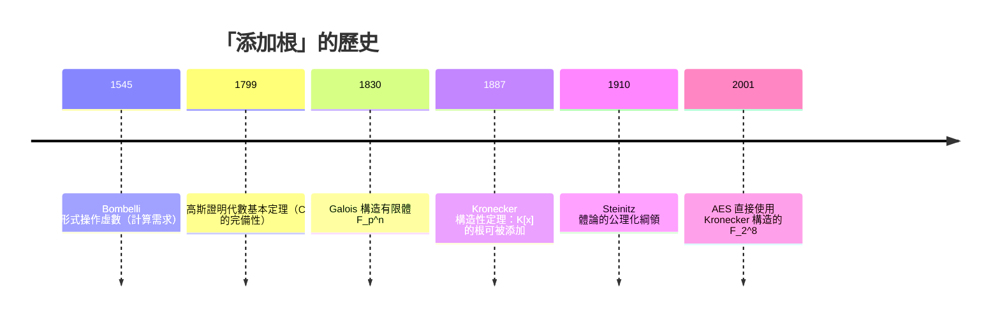

# 第 3 章 環、體與多項式（續）

## 3.5 體擴張與克羅內克定理：代數閉包

### 學習目標

- 定義體擴張、代數元素、擴張次數 $`[L : K]`$ 與塔式定理。
- 證明**克羅內克定理**（1887）：在 $`K[x]`$ 中不可約多項式必有根所在的擴張體——「永遠可以添加根」。
- 認識代數閉包與代數基本定理（FTA），以及 FTA 的歷史（高斯 1799）。
- 能用 SymPy 的 `minimal_polynomial`、`AlgebraicNumber`、`roots` 研究具體擴張。

### 歷史背景

- **16 世紀**：卡爾達諾公式（1545，見 1.3 節）迫使人們「形式上」使用 $`\sqrt{-121}`$ ——邦貝利（Bombelli, 1572）發現必須操作「虛數」才能求出實根。複數在**毫無理論**的情況下被計算需求創造出來。
- **1799**：22 歲的高斯博士論文《單變數整有理函數分解為一次實因式的新證明》給出代數基本定理的第一個（近乎完整的）證明；他一生又給了三個不同證明。FTA 說 $`\mathbb{C}`$ 是代數閉的——不夠用的數體總能在 $`\mathbb{C}`$ 內找到根。
- **1887**：克羅內克發表《關於代數方程的一般理論基礎》，證明一個純構造性的定理：給定係數在 $`K`$ 的不可約多項式 $`f`$ ，**可以具體地構造**一個擴張體 $`K(\alpha)`$ 使 $`f`$ 有根。這不需要假設 $`\mathbb{C}`$ 存在——任何體都能「自己長出」自己需要的根。
- 這是構造主義哲學的勝利：克羅內克的名言「神創整數，其餘皆為人造」。這條思路直接導致今日計算機代數系統的設計：SymPy 中的 `AlgebraicNumber` 正是把根表示為「商環 $`\mathbb{Q}[x]/(f)`$ 的元素」，完全避免引用 $`\mathbb{C}`$ 的存在性。
- **技術驅動：** 有限體 $`\mathbb{F}_{p^n}`$ 的構造（3.3、3.7 節）就是克羅內克定理的最小案例；AES、橢圓曲線密碼學都要求「給我 $`\mathbb{F}_{2^8}`$ 」這樣的構造服務。



---

### 3.5.1 體擴張與代數元素

**定義（擴張）。** 若 $`K \subseteq L`$ 且兩者都是域（運算相容），稱 $`L/K`$ 是一個**體擴張**， $`K`$ 為基體。

**定義（代數 / 超越）。** $`\alpha \in L`$ 稱為在 $`K`$ 上**代數**，若存在非零 $`f \in K[x]`$ 使 $`f(\alpha) = 0`$ ；否則稱為**超越**。

**定義（極小多項式）。** 代數元素 $`\alpha`$ 在 $`K`$ 上唯一的次數最小、**首一**、不可約的 $`m_\alpha(x) \in K[x]`$ （以 $`\alpha`$ 為根）稱為**極小多項式**。次數 $`\deg m_\alpha`$ 稱為 $`\alpha`$ 在 $`K`$ 上的**次數**。

**定理。** $`m_\alpha`$ 存在且不可約，且 $`f(\alpha) = 0 \iff m_\alpha \mid f`$ 。

**證明。** 考慮賦值同態 $`\varphi: K[x] \to L`$ ， $`g \mapsto g(\alpha)`$ ；核 $`\ker \varphi = \{g : g(\alpha) = 0\}`$ 是 $`K[x]`$ 的理想，非零（ $`\alpha`$ 代數）。因 $`K[x]`$ 是 PID（3.4 節）， $`\ker\varphi = (m)`$ ，取 $`m`$ 首一。若 $`m = gh`$ 非平凡分解，則 $`g(\alpha)h(\alpha) = 0`$ ，域中 $`g(\alpha), h(\alpha)`$ 有一為零，與 $`m`$ 的最小次數矛盾，故 $`m`$ 不可約。 $`f(\alpha) = 0 \iff f \in \ker\varphi \iff m \mid f`$ 。 $`\blacksquare`$

**定義（單擴張與擴張次數）。** 對 $`\alpha \in L`$ ，定義

$$
K(\alpha) = \left\{ \frac{g(\alpha)}{h(\alpha)} : g, h \in K[\alpha],\ h(\alpha) \ne 0 \right\} \subseteq L,
$$

是包含 $`K`$ 與 $`\alpha`$ 的最小子域。當 $`\alpha`$ 代數時， $`K(\alpha)`$ 是一個**向量空間**（ $`K`$ 上的），其維度稱為**擴張次數** $`[K(\alpha) : K]`$ 。

**定理。** $`\alpha`$ 在 $`K`$ 上代數、 $`\deg m_\alpha = n`$ ，則

$$
K(\alpha) = \{c_0 + c_1\alpha + \cdots + c_{n-1}\alpha^{n-1}\}, \qquad [K(\alpha):K] = n.
$$

**證明思路。** 克羅內克構造（3.1 節）＋商環：映射

$$
\Phi: K[x]/(m_\alpha) \to K(\alpha), \quad \bar g \mapsto g(\alpha)
$$

是同構（核恰為 $`(m_\alpha)`$ ，滿性由 $`\alpha`$ 可逆： $`h(\alpha) \neq 0 \Rightarrow \gcd(h, m_\alpha) = 1 \Rightarrow 1 = sh + tm_\alpha \Rightarrow h(\alpha)^{-1} = s(\alpha)`$ ）。而 $`\{1, \alpha, \dots, \alpha^{n-1}\}`$ 是商環的 $`K`$ -基。 $`\blacksquare`$

**例子。** $`\alpha = \sqrt{2}`$ ： $`m_\alpha = x^2 - 2`$ ， $`\mathbb{Q}(\sqrt{2}) = \{a + b\sqrt{2}\}`$ ， $`[\mathbb{Q}(\sqrt2):\mathbb{Q}] = 2`$ 。

**SymPy 驗證：**

```python
import sympy as sp

x = sp.Symbol('x')
alpha = sp.sqrt(2) + sp.sqrt(3)
m = sp.minimal_polynomial(alpha, x)
print(m)          # x**4 - 10*x**2 + 1
print(sp.degree(m))   # 4
```

輸出說明： $`\sqrt2+\sqrt3`$ 的極小多項式為 $`x^4 - 10x^2 + 1`$ ，次數 4，即 $`[\mathbb{Q}(\sqrt2, \sqrt3):\mathbb{Q}] = 4`$ 。可以驗證 $`m(\sqrt2+\sqrt3) = 0`$ ：

```python
print(sp.simplify(m.subs(x, sp.sqrt(2) + sp.sqrt(3))))   # 0
```

### 3.5.2 塔式定理（預告第 4.2 節）

**定理（塔式定理）。** 若 $`K \subseteq L \subseteq M`$ 都是域且 $`[L:K] < \infty`$ ，則

$$
[M : K] = [M : L] \cdot [L : K],
$$

在有限次數下恆成立（右邊任一因子無限時取 $`\infty`$ ）。

**證明思路。** 設 $`\{e_1, \dots, e_m\}`$ 是 $`L/K`$ 的基、 $`\{d_1, \dots, d_n\}`$ 是 $`M/L`$ 的基。證明 $`\{d_i e_j\}`$ （共 $`mn`$ 個）是 $`M/K`$ 的基：張成性由兩次展開得到；線性無關性由「先把 $`K`$ 係數按 $`e_j`$ 分組（ $`e_j`$ 對 $`L`$ 無關，故每組 $`L`$ 係數為零），再用 $`d_i`$ 對 $`L`$ 的無關性」。 $`\blacksquare`$

**推論。** 若 $`[L : K] = p`$ 為質數，則 $`K \subseteq L`$ 之間沒有中間體。（第 4 章 Galois 對應的基礎。）

**例子。** $`[\mathbb{Q}(\sqrt[4]{2}) : \mathbb{Q}] = 4`$ ，因為 $`x^4 - 2`$ 不可約（Eisenstein 於 $`p=2`$ ，見 3.6 節），且

$$
\mathbb{Q} \subset \mathbb{Q}(\sqrt 2) \subset \mathbb{Q}(\sqrt[4]{2}), \qquad
[\mathbb{Q}(\sqrt[4]2):\mathbb{Q}(\sqrt2)] = [\mathbb{Q}(\sqrt[4]2):\mathbb{Q}] / [\mathbb{Q}(\sqrt2):\mathbb{Q}] = 4/2 = 2.
$$

### 3.5.3 克羅內克定理（1887）

**定理（Kronecker）。** 設 $`K`$ 是域、 $`f \in K[x]`$ 次數 $`\ge 1`$ 。則存在擴張 $`L/K`$ 使 $`f`$ 在 $`L`$ 中有根。若 $`f`$ 不可約且 $`\deg f = n`$ ，可取 $`L = K[x]/(f)`$ ，此時 $`[L:K] = n`$ 。

**證明。** 取 $`f`$ 的一個不可約因式 $`p`$ （3.4 節 UFD），對不可約 $`p`$ 構造商環

$$
L = K[x]/(p).
$$

$`L`$ 是域：因 $`p`$ 不可約， $`(p)`$ 是極大理想（3.4 節 PID 中不可約 $`\iff`$ 極大），故商環為域。令 $`\alpha = \bar{x} \in L`$ ，則 $`p(\alpha) = \overline{p(x)} = 0`$ ，且 $`K \hookrightarrow L`$ 是自然嵌入（常數多項式）。 $`[L:K] = \deg p`$ ，因為 $`\{1, \alpha, \dots, \alpha^{n-1}\}`$ 是 $`L`$ 的 $`K`$ -基。 $`\blacksquare`$

**意義。** 這個證明是純構造的：**根 $`\alpha`$ 就是「符號 $`x`$ 加上關係 $`p(x)=0`$ 」的正式化身**。不需要 $`\mathbb{C}`$ ，不需要選擇公理，只需要商環。克羅內克定理反覆套用即得：

**推論。** 任何 $`f \in K[x]`$ 都在某個擴張 $`E/K`$ 中完全分裂（存在 $`E`$ 使 $`f`$ 分解為一次因式之積）。

反覆構造：添加一個根、把 $`f`$ 除掉 $`(x - \alpha)`$ 、再對剩下的多項式繼續；每次次數至少降 1，最多 $`\deg f`$ 步完成。

**SymPy：親手構造 $`\mathbb{Q}(\sqrt[3]{2})`$ 。**

```python
import sympy as sp

x = sp.Symbol('x')
f = sp.Poly(x**3 - 2, x, domain=sp.QQ)

# Kronecker 構造：商環 Q[x]/(x^3 - 2)
# SymPy 中用 AlgebraicNumber 直接表示根
beta = sp.real_root(2, 3)                    # 2 的實立方根
print(sp.minimal_polynomial(beta, x))        # x**3 - 2

# 在 Q(2^(1/3)) 中做運算：每個元素 = a + b*alpha + c*alpha^2
a, b, c, d, e, g = sp.symbols('a b c d e g')
u = a + b*beta
v = d + e*beta + g*beta**2
print(sp.expand(u * v))
# 展開後 SymPy 自動用 beta^3 = 2 化約高次項
```

輸出說明：`minimal_polynomial(real_root(2, 3))` 印出 $`x^3 - 2`$ ，確認 $`\beta`$ 的次數是 3（ $`x^3-2`$ 在 $`\mathbb{Q}`$ 上不可約，3.6 節將用 Eisenstein 證明）。`expand` 乘開 $`(a + b\beta)(d + e\beta + g\beta^2)`$ 時， $`b\beta \cdot g\beta^2 = bg\beta^3 = 2bg`$ 自動併入常數項——**這正是商環 $`\mathbb{Q}[x]/(x^3-2)`$ 中乘法的降次規則**。

### 3.5.4 代數閉包與代數基本定理

**定義（代數閉）。** 域 $`K`$ 稱為**代數閉**，若每個次數 $`\ge 1`$ 的 $`f \in K[x]`$ 在 $`K`$ 中有根。等價地： $`K[x]`$ 的不可約多項式恰有一次式。

**定義（代數閉包）。** 擴張 $`\bar K/K`$ 若 $`\bar K`$ 代數閉且 $`\bar K/K`$ 是代數擴張，稱 $`\bar K`$ 為 $`K`$ 的**代數閉包**。

**定理（代數基本定理，Gauss 1799）。** $`\mathbb{C}`$ 是代數閉的。因此 $`\overline{\mathbb{Q}} = \{z \in \mathbb{C} : z \text{ 代數}\}`$ 是 $`\mathbb{Q}`$ 的代數閉包。

**證明（複變版本概要）。** 設 $`f \in \mathbb{C}[z]`$ 無根。則 $`1/f(z)`$ 是有界整函數（ $`f \to \infty`$ 當 $`|z| \to \infty`$ ），由 Liouville 定理 $`1/f`$ 是常數，矛盾。 $`\blacksquare`$ （高斯的原證明是拓撲／實分析的，不依賴複分析；完整證明見任何複變教材。）

**存在性定理（Steinitz, 1910）。** 每個域都有代數閉包，且在同構意義下唯一（固定基體的同構）。證明用 Zorn 引理對「代數擴張鏈」取極大元——這裡**離開了克羅內克的構造世界**，是選擇公理的典型應用；構造主義者對此始終不滿。

**次數鏈的例子。**

$$
\mathbb{Q} \subset \mathbb{Q}(\sqrt2) \subset \mathbb{Q}(\sqrt2, \sqrt3) \subset \mathbb{Q}(\sqrt2, \sqrt3, \zeta_5) \subset \cdots \subset \overline{\mathbb{Q}},
$$

次數分別為 $`1, 2, 4, 20, \dots`$ ，最後逼近無限次代數擴張 $`\overline{\mathbb{Q}}/\mathbb{Q}`$ （可數無限）。

**SymPy：探索 $`\overline{\mathbb{Q}}`$ 中的元素。**

```python
import sympy as sp

x = sp.Symbol('x')
# 各種代數數的極小多項式與次數
samples = [sp.sqrt(2), sp.sqrt(2) + sp.sqrt(3),
           sp.cos(sp.pi/7) * 2,                      # 2cos(2pi/14) 是代數整數
           sp.Rational(3, 7),                        # 有理數：次數 1
           (1 + sp.sqrt(5)) / 2]                     # 黃金比例

for v in samples:
    m = sp.minimal_polynomial(v, x)
    print(v, ':', m, '| 次數 =', sp.degree(m))
```

輸出說明（理論值）：

| $`\alpha`$ | $`m_\alpha(x)`$ | $`[\mathbb{Q}(\alpha):\mathbb{Q}]`$ |
|---|---|---|
| $`\sqrt2`$ | $`x^2 - 2`$ | 2 |
| $`\sqrt2+\sqrt3`$ | $`x^4 - 10x^2 + 1`$ | 4 |
| $`2\cos(\pi/7)`$ | $`x^3 - x^2 - 2x + 1`$ | 3 |
| $`3/7`$ | $`7x - 3`$ | 1 |
| $`(1+\sqrt5)/2`$ | $`x^2 - x - 1`$ | 2 |

注意 $`3/7`$ 的極小多項式 $`7x - 3`$ 非首一——它不是代數整數（3.1 節判準）；而 $`2\cos(\pi/7)`$ 與黃金比例是代數整數（首一極小多項式）。

### 3.5.5 技術迴響：CAS 與有限體的克羅內克構造

克羅內克定理說「不可約多項式 $`p`$ 的商環是體」。在 $`\mathbb{F}_2`$ 上取 $`p = x^8+x^4+x^3+x+1`$ ，就構造出 $`\mathbb{F}_{256}`$ ——AES 的心臟。SymPy 的 `GF` 類可以表達一般 $`\mathbb{F}_{p^n}`$ ：

```python
import sympy as sp
from sympy.polys.domains import GF

x = sp.Symbol('x')
# SymPy 支援質數域 GF(p) 上的 Poly；F_256 需要藉由模多項式約化（見 3.7 節完整實作）
f = sp.Poly(x**8 + x**4 + x**3 + x + 1, x, domain=sp.GF(2))
print(sp.factor(f.as_expr(), modulus=2))
# x**8 + x**4 + x**3 + x + 1（不可約 => 商環是 F_256）
```

輸出說明：`factor(..., modulus=2)` 無法分解此多項式，依 3.4 節 UFD 理論它不可約，故 $`\mathbb{F}_2[x]/(f)`$ 是 256 元域。**1887 年的構造定理，在 2001 年成為加密標準的定義檔。** 完整的 $`\mathbb{F}_{2^8}`$ 算術實作見 3.7 節。

---

### SymPy 要點回顧

| 函式 / 物件 | 用途 |
|---|---|
| `sp.minimal_polynomial(expr, x)` | 求代數數的極小多項式與次數 |
| `sp.AlgebraicNumber(expr)` | 建立代數數（克羅內克構造的實作） |
| `sp.expand` | 在數體中自動降次（商環運算） |
| `sp.real_root(n, k)` | 表示實 $`k`$ 次根，可求極小多項式 |
| `sp.degree(m)` | 擴張次數 $`[\mathbb{Q}(\alpha):\mathbb{Q}]`$ |
| `sp.factor(..., modulus=p)` | 有限體上檢驗不可約性 |

### 習題

1. 證明：若 $`[L:K] = 2`$ ，則 $`L = K(\alpha)`$ 對任何 $`\alpha \in L \setminus K`$ 成立（先證 $`\alpha`$ 在 $`K`$ 上代數且次數為 2）。
2. 用塔式定理證明 $`\sqrt[3]{2} \notin \mathbb{Q}(\sqrt2)`$ 。（提示：若在，則 $`2`$ 會整除一個不可能的次數。）
3. 用 `sp.minimal_polynomial` 求 $`\sqrt[4]{2}`$ 的極小多項式；再用塔式定理把 $`[\mathbb{Q}(\sqrt[4]2):\mathbb{Q}] = 4`$ 拆成兩個二次擴張的積。
4. 證明 $`\cos(2\pi/5) = \frac{\sqrt5 - 1}{4}`$ （可用 SymPy 的 `sp.N` 與 `sp.simplify` 輔助猜測），並據此求 $`2\cos(2\pi/5)`$ 的極小多項式。
5. 親手執行克羅內克構造：對 $`f = x^2 + x + 1 \in \mathbb{F}_2[x]`$ ，用 `sp.rem` 寫出 $`\mathbb{F}_2[x]/(f)`$ 的完整加法與乘法表，確認它與 3.3 節的 $`\mathbb{F}_4`$ 同構。
6. 證明： $`\alpha`$ 代數 $`\Rightarrow`$ $`\alpha + 1`$ 代數，並求 $`m_{\alpha+1}(x)`$ 與 $`m_\alpha(x)`$ 的關係（用 $`x \mapsto x - 1`$ 代換）。
7. **歷史題**：邦貝利 1572 年解 $`x^3 = 15x + 4`$ 時得到 $`\sqrt[3]{2 + 11i} + \sqrt[3]{2 - 11i} = 5`$ 。用 SymPy 驗證 $`(2+11i)^{1/3}`$ 的實部為 2、虛部為 1（即 $`2 + 11i = (2+i)^3`$ ），重建這個「虛數第一次被迫登場」的計算。
8. 說明為什麼 Steinitz 的代數閉包存在性證明需要 Zorn 引理，而克羅內克的「添加一個根」不需要。這對「可計算性」有何影響？

**前後節連結：** 上一節 [3.4-多項式環、整除性與因式分解](03.4-多項式環、整除性與因式分解.md)；下一節 [3.6-不可約多項式與Eisenstein判別法](03.6-不可約多項式與Eisenstein判別法.md)
