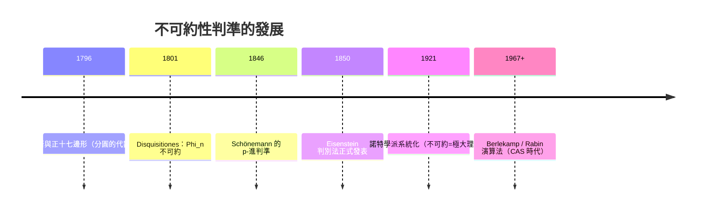

# 第 3 章 環、體與多項式（續）

## 3.6 不可約多項式與 Eisenstein 判別法

### 學習目標

- 給出不可約性的基本判準：次數 2、3 時的「無根判準」、模 $`p`$ 約化判準。
- 完整證明 **Eisenstein 判別法**（Gauss–Schönemann–Eisenstein，1840s–1850）。
- 學會移位變換技巧： $`f(x) \mapsto f(x + a)`$ 與分圓多項式的應用。
- 認識有限體上不可約多項式的計數公式（Gauss 公式）與生成演算法。
- 用 SymPy 的 `factor`、`Poly`、`GF` 系統化判斷不可約性。

### 歷史背景

- **1801**：高斯在《算術研究》第 341 條證明 $`x^n - 1`$ 的「本原因式」（後稱分圓多項式 $`\Phi_n`$ ）在 $`\mathbb{Z}[x]`$ 中不可約——這是他構造正 17 邊形（1796）與正 257 邊形的代數基礎。
- **1846**：Gauss 的學生舍恩曼（Gotthold Eisenstein 的前輩 Schönemann）在 $`\mathbb{Z}[x]`$ 上發表了現代 Eisenstein 判別法的一個版本（以 $`p`$ -進形式）。
- **1850**：艾森斯坦（Gotthold Eisenstein）發表以他命名的判別法的完整形式。高斯稱讚他為「本世紀三個偉大的數學家之一」；可惜他 29 歲死於肺結核（1852）。
- **動機**：判斷 $`f \in \mathbb{Z}[x]`$ 不可約，等價於求 $`[\mathbb{Q}(\alpha):\mathbb{Q}]`$ ，是數體論的第一步。沒有系統判準，戴德金與克羅內克的數體理論（3.1 節）寸步難行。
- **技術驅動：** 有限體中「 $`p^n`$ 元體存在」的證明需要「每個質數冪次都有不可約多項式」（本節 Gauss 公式），而**密碼學反向需要「快速生成不可約多項式」**：AES 要一個 8 次不可約多項式、橢圓曲線密碼學（如 NIST 曲線）要求特定 $`2^{255} - 19`$ 體的選擇。今天 SymPy 的 `factor(..., modulus=p)` 每秒能分解上千個多項式，全是這些判準的演算法化。



---

### 3.6.1 不可約性的基本事實與無根判準

回顧 3.4 節定義： $`f \in F[x]`$ （次數 $`\ge 1`$ ）**不可約**，若不能分解為兩個更低次多項式之積。

**定理（次數 $`\le 3`$ 的判準）。** 次數 2 或 3 的 $`f \in F[x]`$ 不可約 $`\iff`$ $`f`$ 在 $`F`$ 中沒有根。

**證明。**（ $`\Rightarrow`$ ）可約則 $`f = gh`$ 、 $`\deg g = 1`$ ，於是 $`g = ax + b`$ 有根 $`-b/a \in F`$ ，此根也是 $`f`$ 的根。（ $`\Leftarrow`$ ）有根 $`\alpha`$ 時由餘式定理 $`(x-\alpha) \mid f`$ ， $`f`$ 可約。 $`\blacksquare`$

次數 $`\ge 4`$ 時判準失效： $`x^4 + 2x^2 + 1 = (x^2+1)^2`$ 無實根但在 $`\mathbb{R}[x]`$ 中可約。

**SymPy：無根判準的窮舉。**

```python
import sympy as sp

x = sp.Symbol('x')
# 在 F_3 上列出所有 3 次不可約多項式（共 8 個）
irred = []
for coeffs in [(a, b, c, d) for a in (1,) for b in range(3)
               for c in range(3) for d in range(3)]:
    f = sum(coeffs[i] * x**i for i in range(4))
    if sp.degree(f) == 3 and sp.factor(f, modulus=3) == f:
        irred.append(sp.Poly(f, x, domain=sp.GF(3)))
print(len(irred))
# 8
for f in irred[:4]:
    print(f.as_expr())
```

輸出說明： $`\mathbb{F}_3`$ 上 3 次首一多項式共 $`3^3 = 27`$ 個，其中 $`8`$ 個不可約——這與下面的 Gauss 計數公式 $`N_3 = \frac{3^3 - 3}{3} = 8`$ 完全吻合（3.6.4 節）。也可以用無根判準檢查：3 次多項式不可約 $`\iff`$ 在 $`\mathbb{F}_3`$ 的 3 個元素處都非零。

### 3.6.2 Eisenstein 判別法

**定理（Eisenstein, 1850）。** 設

$$
f(x) = a_n x^n + a_{n-1}x^{n-1} + \cdots + a_1 x + a_0 \in \mathbb{Z}[x].
$$

若存在質數 $`p`$ 滿足：

1. $`p \nmid a_n`$ （首項係數不被 $`p`$ 整除）；
2. $`p \mid a_i`$ 對所有 $`i < n`$ ；
3. $`p^2 \nmid a_0`$ （常數項恰被 $`p`$ 整除一次）；

則 $`f`$ 在 $`\mathbb{Q}[x]`$ 中不可約。

**證明（模 $`p`$ 約化法）。** 反設 $`f = gh`$ 非平凡， $`g, h \in \mathbb{Z}[x]`$ 本原、次數 $`\ge 1`$ （可取本原，因 $`f`$ 的係數 GCD 為 $`\gcd(\dots, a_0, \dots) = 1`$ 由條件 1、3）。在 $`\mathbb{F}_p`$ 中約化：條件 2、3 給出

$$
\bar{f}(x) = \overline{a_n}\, x^n.
$$

而 $`\bar f = \bar g \bar h`$ ， $`\mathbb{F}_p[x]`$ 是 UFD（3.4 節）， $`x^n`$ 的唯一分解是 $`x \cdot x \cdots x`$ ，故

$$
\bar g = \bar b x^s, \qquad \bar h = \bar c x^t, \qquad s + t = n,\ s, t \ge 1.
$$

即 $`p`$ 整除 $`g`$ 的常數項與 $`h`$ 的常數項，故 $`p^2 \mid g(0)h(0) = f(0) = a_0`$ ，與條件 3 矛盾。 $`\blacksquare`$

**證明的靈魂**是「模 $`p`$ 約化」：把困難的整係數問題送到更簡單的 $`\mathbb{F}_p[x]`$ （那裡唯一分解由 $`x`$ 主導）。這是「換一個更強的結構來證明」的典範，也再次展現 3.2 節商環思想的威力： $`\mathbb{Z}[x] \to \mathbb{F}_p[x]`$ 恰是商掉理想 $`(p)`$ 。

**例子。**

- $`x^4 - 2`$ ：Eisenstein 於 $`p = 2`$ （ $`a_0 = -2`$ 、其餘中間項為 0），故 $`[\mathbb{Q}(\sqrt[4]2):\mathbb{Q}] = 4`$ （3.5 節已用）。
- $`x^{17} - 2`$ 、 $`x^5 + 10x^3 - 15x + 25`$ （ $`p = 5`$ ；但其 $`a_0 = 25 = 5^2`$ 被 $`p^2`$ 整除，故此式並不適用 Eisenstein 判別法）等。
- 反例： $`x^2 + x + 1`$ 不滿足條件（ $`p \nmid 1`$ ），但其實不可約——Eisenstein 不適用不代表可約。

**移位技巧。** $`f(x)`$ 直接不適用時，考慮 $`f(x + a)`$ （不可約性在平移下不變，因為若 $`f(x+a) = g(x)h(x)`$ 則 $`f(x) = g(x-a)h(x-a)`$ ）。

**經典例子： $`f(x) = x^p + x + 1`$ （ $`p`$ 質數）不可約？** 考慮 $`f(x-1) = (x-1)^p + (x-1) + 1`$ 。用 Freshman's dream（3.3 節 Frobenius 的整係數版本）：

$$
(x-1)^p = \sum_k \binom{p}{k}x^k(-1)^{p-k} \equiv x^p - 1 \pmod p,
$$

故 $`f(x-1) \equiv x^p - 1 + x - 1 + 1 = x^p + x - 1 \pmod p`$ ；再取 $`f(x+1)`$ 的另一方向：對 $`g(x) = (x+1)^p + x + 1`$ ，中間二項式係數 $`\binom{p}{k}`$ （ $`0<k<p`$ ）都被 $`p`$ 整除、常數項 $`(x+1)^p\big|_{x=0} + 1 = 2`$ 對 $`p \ge 3`$ 只被 $`p`$ 整除一次嗎？ $`2`$ 不被 $`p`$ 整除——用 $`f(x-1)`$ 形式：常數項 $`f(-1) = (-1)^p - 1 + 1 = -1`$ ？直接檢查： $`f(x) = x^p + x + 1`$ ， $`f(x - 1)`$ 的常數項為 $`(-1)^p + (-1) + 1 = -1`$ （ $`p`$ 奇數時），首項係數 1，中間項 $`\binom pk`$ 皆被 $`p`$ 整除——**這不滿足條件 2**（要求中間項被 $`p`$ 整除，這裡中間項是 $`\binom pk`$ 沒錯，被 $`p`$ 整除 ✓；但 $`a_0 = -1`$ 不被 $`p`$ 整除 ✗）。正確的經典例子是 $`f(x) = \frac{x^p - 1}{x - 1} = x^{p-1} + \cdots + x + 1`$ （ $`p`$ 次以上情況），取 $`f(x+1)`$ ：

$$
\frac{(x+1)^p - 1}{x} = \sum_{k=1}^{p} \binom{p}{k} x^{k-1},
$$

首項係數 $`\binom{p}{p} = 1`$ 、中間項 $`\binom pk`$ （ $`0 < k < p`$ ）被 $`p`$ 整除、常數項 $`\binom p1 = p`$ 恰被 $`p`$ 整除一次。**Eisenstein 成立，所以 $`x^{p-1} + \cdots + 1`$ 不可約**——這是高斯 1801 年分圓多項式 $`\Phi_p`$ 不可約定理的兩行重證！

**SymPy：Eisenstein 的機器檢驗與移位。**

```python
import sympy as sp

x = sp.Symbol('x')

def is_eisenstein(f, p):
    """檢驗整係數多項式 f 是否對質數 p 滿足 Eisenstein 條件"""
    c = sp.Poly(f, x).all_coeffs()          # 由高次到低次
    if c[0] % p == 0:
        return False
    if c[-1] % p != 0 or c[-1] % p**2 == 0:  # 條件 3：p | a_0 且 p**2 ∤ a_0
        return False
    return all(ci % p == 0 for ci in c[1:-1])

f = x**5 + 10*x**3 - 15*x + 25
print(is_eisenstein(f, 5), sp.factor(f))
# False：a_0 = 25 = 5**2 被 p**2 整除，條件 3 不成立（但 factor 亦無法分解）

g = sp.div(x**7 - 1, x - 1)[0]     # Phi_7 = x^6 + ... + x + 1
g_shift = sp.expand(g.subs(x, x + 1))
print(is_eisenstein(g_shift, 7))
# True：g(x+1) 滿足 Eisenstein => Phi_7 不可約（高斯 1801）
```

輸出說明：

```
False x**5 + 10*x**3 - 15*x + 25
True
```

- $`x^5 + 10x^3 - 15x + 25`$ 對 $`p=5`$ 只差在條件 3 ：常數項 $`a_0 = 25 = 5^2`$ 恰被 $`p^2`$ 整除，故 `is_eisenstein` 回傳 `False`——判別法不適用不代表可約（`factor` 同樣無法分解）。
- $`\Phi_7(x) = x^6 + x^5 + \cdots + x + 1`$ 本身不滿足 Eisenstein，但平移後 $`\Phi_7(x+1)`$ 對 $`p = 7`$ 滿足，於是 $`\Phi_7`$ 不可約。**移位 + Eisenstein = 分圓多項式的通用證明**（對所有質數 $`p`$ ）。

### 3.6.3 模 $`p`$ 約化判準

**定理（模 $`p`$ 判準）。** $`f \in \mathbb{Z}[x]`$ 本原、 $`\deg f = n`$ 。若存在質數 $`p \nmid`$ （ $`f`$ 的首項係數），使 $`\bar f \in \mathbb{F}_p[x]`$ 不可約，則 $`f`$ 在 $`\mathbb{Q}[x]`$ 中不可約。

**證明。** 若 $`f = gh`$ 非平凡分解（本原因子），約化得 $`\bar f = \bar g \bar h`$ ； $`\bar f`$ 不可約且 $`\deg \bar f = n = \deg g + \deg h`$ ，故 $`\deg \bar g = n`$ 或 $`\deg \bar h = n`$ （次數不降，因 $`p \nmid`$ 首項係數）。若 $`\deg \bar g = n`$ 則 $`\deg g = n`$ ， $`h`$ 為常數，矛盾。 $`\blacksquare`$

**注意**：反向不成立—— $`x^2 + 1`$ 在 $`\mathbb{Q}`$ 上不可約，但 $`\bmod 2`$ 得 $`(x+1)^2`$ 可約。實務上：**多試幾個質數，只要有一個 $`p`$ 使 $`\bar f`$ 不可約即可判不可約**；反過來若 $`f`$ 可約，模 $`p`$ 約化（ $`p \nmid`$ 首項係數）也保持可約，所以「掃描質數」是雙向安全的（只是有限體上不可約證明需要每次確認）。

**SymPy 綜合應用：判斷 $`x^5 + x + 1`$ （3.4 節留下的謎）。**

```python
import sympy as sp

x = sp.Symbol('x')
f = x**5 + x + 1
print(sp.factor(f))            # x**5 + x + 1（Q 上不可約）

# 用模 p 約化找證據
for p in [2, 3, 5, 7]:
    fp = sp.factor(f, modulus=p)
    print(p, fp)
# 2  x**5 + x + 1
# 3  x**5 + x + 1
# 5  (x**2 + 2*x + 3)*(x**3 + 3*x**2 + 4*x + 2)
# 7  x**5 + x + 1
```

輸出說明：在 $`p = 2, 3, 7`$ 上 $`\bar f`$ 都不可約（`factor` 無法分解），任取其一（如 $`p=2`$ ）即可由模 $`p`$ 判準斷言 $`f`$ 在 $`\mathbb{Q}`$ 上不可約。有趣的是 $`p = 5`$ 時它**可約**——這說明不同質數給出不同資訊，也說明模 $`p`$ 判準只需「一個好的質數」。

### 3.6.4 有限體上的不可約多項式：Gauss 計數公式

**定理（Gauss, 1801；計數公式）。** $`\mathbb{F}_q`$ 上首一 $`n`$ 次不可約多項式的個數為

$$
N_n = \frac{1}{n} \sum_{d \mid n} \mu(d)\, q^{n/d},
$$

其中 $`\mu`$ 為 Möbius 函數。特別地 $`N_n > 0`$ 對所有 $`n \ge 1`$ 。

**證明思路。** 關鍵恆等式： $`x^{q^n} - x`$ 恰為所有次數整除 $`n`$ 的首一不可約多項式之積（每個 $`\mathbb{F}_{q^d}`$ （ $`d \mid n`$ ）的元素都是 $`x^{q^n}-x`$ 的根，而 $`n`$ 次不可約多項式的根都在 $`\mathbb{F}_{q^n}`$ 中且共軛類大小為其次數）。取次數並用 Möbius 反演：

$$
q^n = \sum_{d \mid n} d\, N_d \quad \Longrightarrow \quad n N_n = \sum_{d \mid n} \mu(n/d)\, q^{d} = \sum_{d\mid n} \mu(d) q^{n/d}. \qquad \blacksquare
$$

這個定理直接保證了 3.3 節「 $`\mathbb{F}_{p^n}`$ 存在」所需的原料：**任何質數冪大小的有限體都造得出來**。用它驗證小案例：

```python
import sympy as sp
from sympy import mobius, divisors

def count_irred(q, n):
    return (1 / n) * sum(mobius(d) * q**(n // d) for d in divisors(n))

# F_2 上 1..8 次不可約多項式個數
print([count_irred(2, n) for n in range(1, 9)])
# [2, 1, 2, 3, 6, 9, 18, 30]

# 用窮舉驗證 n = 4：應有 3 個
x = sp.Symbol('x')
c = 0
for b in range(2):
    for cc in range(2):
        for d in range(2):
            f = x**4 + b*x**3 + cc*x**2 + d*x + 1
            if sp.factor(f, modulus=2) == f:
                c += 1
print(c)   # 3  與公式一致
```

輸出說明：公式給 $`\mathbb{F}_2`$ 上 1 到 8 次不可約多項式個數 $`2, 1, 2, 3, 6, 9, 18, 30`$ ，與窮舉（ $`n=4`$ 時 3 個： $`x^4+x+1`$ 、 $`x^4+x^3+1`$ 、 $`x^4+x^3+x^2+x+1`$ ）一致。**「 $`F_{256}`$ 存在」就是「 $`N_8 = 30`$ 個選擇」**——AES 選了 $`x^8+x^4+x^3+x+1`$ 。

### 3.6.5 應用與迴響

- **分圓與尺規作圖**：高斯 17 歲時證明正 17 邊形可作圖，核心是 $`\Phi_{17}`$ 的次數 $`16 = 2^4`$ 可被一連串二次擴張拆解（第 4.1、4.2 節）。 $`\Phi_n`$ 不可約（Eisenstein 移位 + $`p`$ 的情形；一般 $`n`$ 需要更多工作，見 4.7 節）是整個故事的代數入口。
- **密碼學的「選擇自由」**： $`\mathbb{F}_{2^8}`$ 有 30 個候選多項式，AES 選 $`x^8+x^4+x^3+x+1`$ （NIST FIPS-197 規格書第一頁）；選哪一個不影響安全性，但影響硬體效率——理論（計數公式）給出選項，技術（電路）做出選擇。
- **分解演算法**：3.4 節的 Cantor–Zassenhaus 演算法需要「隨機取次數整除 $`m`$ 的不可約多項式」，其正確性依賴 Gauss 公式保證數量夠多。

---

### SymPy 要點回顧

| 函式 / 工具 | 用途 |
|---|---|
| `sp.factor(f, modulus=p)` | 模 $`p`$ 約化判準的直接工具 |
| `sp.Poly(f, x).all_coeffs()` | 取係數以實作 Eisenstein 檢驗 |
| `sp.expand(g.subs(x, x + 1))` | 移位變換 $`x \mapsto x + a`$ |
| `sympy.mobius`、`sp.divisors` | Gauss 計數公式的原料 |
| `sp.Poly(..., domain=sp.GF(p))` | 有限體上的多項式物件 |

### 習題

1. 用無根判準證明 $`x^2 + 1`$ 在 $`\mathbb{F}_3`$ 上不可約、在 $`\mathbb{F}_5`$ 上可約，並用 `sp.factor(..., modulus=p)` 驗證。
2. 證明： $`x^4 + 2x^2 + 2`$ 不可約（對 $`p=2`$ 用 Eisenstein；注意先確認條件）。
3. 對 $`f = x^6 + x^3 + 1`$ ，分別檢驗它在 $`\mathbb{F}_2`$ 上是否不可約；若可約，分解它並解釋與 Gauss 公式 $`N_6 = 9`$ 的關係。
4. 用移位 + Eisenstein 證明 $`\Phi_{11}(x) = x^{10} + \cdots + 1`$ 不可約，並用 `sp.factor` 驗證。
5. 證明：若 $`f \in \mathbb{Z}[x]`$ 對 $`p`$ 滿足 Eisenstein，則 $`f`$ 是本原多項式。
6. 寫一個函式 `random_irred(q, n)`：隨機生成 $`\mathbb{F}_q`$ 上首一 $`n`$ 次多項式，用 `sp.factor(..., modulus=q)` 檢驗不可約，回傳第一個找到的。統計平均嘗試次數並與 $`1/N_n`$ 比較（Gauss 公式）。
7. **歷史題**：查閱 AES 規格 FIPS-197，找出它使用的不可約多項式；用本節方法驗證其不可約性，並討論為什麼規格書要「指定」一個多項式而不是任選。
8. 證明： $`\mathbb{F}_q`$ 上 $`n`$ 次不可約多項式的根 $`\alpha`$ 在 $`\mathbb{F}_{q^n}`$ 中，且 $`m_\alpha`$ 的所有根為 $`\alpha, \alpha^q, \alpha^{q^2}, \dots, \alpha^{q^{n-1}}`$ （Frobenius 共軛，3.3 節）。

**前後節連結：** 上一節 [3.5-體擴張與克羅內克定理](03.5-體擴張與克羅內克定理：代數閉包.md)；下一節 [3.7-SymPy的GF、factor與minimal_polynomial](03.7-SymPy的GF、factor與minimal_polynomial.md)
