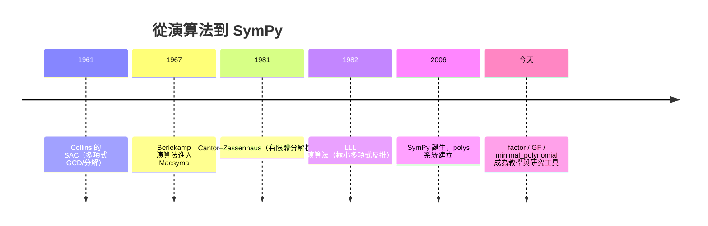

# 第 3 章 環、體與多項式（完結）

## 3.7 SymPy 的 GF、factor 與 minimal_polynomial

### 學習目標

- 系統掌握 SymPy 中三個最核心的代數計算工具：`GF`（係數域）、`factor`（分解）、`minimal_polynomial`（代數數）。
- 完整實作有限體 $`\mathbb{F}_{2^8}`$ 的算術（AES 的數學核心），理解商環構造如何變成程式。
- 把第 3 章的理論（UFD、Kronecker 構造、Eisenstein）與程式逐一對照。
- 為第 4 章（Galois 理論）準備計算工具箱。

### 歷史背景

- **1960s**：計算機代數系統（CAS）誕生。Collins 的 SAC（1961）、Macsyma（MIT，1965–）率先實作多項式分解（3.4 節的 Berlekamp、Zassenhaus 演算法）。
- **1967–1981**：Berlekamp（1967）、Cantor–Zassenhaus（1981）把 $`\mathbb{F}_q[x]`$ 分解變成多項式時間；Lazard、Davenport 等完善有理數域上的 Hensel 提升分解。
- **1970–2000**：Mathematica（1988）、Maple（1985）把這些演算法商業化；`minimal_polynomial` 類的演算法（LLL 格基約化，1982，Lenstra–Lenstra–Lovász）使「由浮點近似反推精確極小多項式」成為可能。
- **2006–**：SymPy 作為純 Python 的開源 CAS 誕生（Ondřej Čertík 發起）。`Poly`、`GF`、`factor`、`minimal_polynomial` 都在 `sympy.polys` 子系統中，遵循「域（domain）—多項式（poly）—演算法」的分層架構，這個架構本身就是第 3 章抽象理論（環→域→UFD 演算法）的軟體倒影。
- **理論支持技術的最終案例**：沒有 3.1–3.6 節的兩百年理論積累，就沒有 `factor()` 這一行程式碼；反過來，`factor()` 每天在全球的密碼學實驗室、編碼理論課堂上執行數百萬次。



---

### 3.7.1 `Poly` 與 domain：一切從係數域開始

SymPy 的多項式計算必須先指定**係數域（domain）**，這正是 3.3 節體概念在軟體中的體現：

```python
import sympy as sp

x = sp.Symbol('x')

# 三種常見係數域
f1 = sp.Poly(x**2 + 2, x, domain=sp.QQ)    # 有理數域
f2 = sp.Poly(x**2 + 2, x, domain=sp.GF(3)) # 有限體 F_3
f3 = sp.Poly(x**2 + 2, x, domain=sp.ZZ)    # 整數環

print(f1, '|', f2, '|', f3)
# Poly(x**2 + 2, x, domain=QQ) | Poly(x**2 + 2, x, domain=GF(3)) | Poly(x**2 + 2, x, domain=ZZ)

# 同一個多項式在不同域上的「面貌」完全不同：
print(sp.Poly(x**2 + 2, x, domain=sp.GF(3)).as_expr())
# x**2 - 1   （在 F_3 中 2 ≡ -1）
print(sp.factor(x**2 + 2, modulus=3))
# (x - 1)(x + 1)   （在 F_3 上可約！）
print(sp.factor(x**2 + 2))
# x**2 + 2   （在 Q 上不可約）
```

輸出說明： $`x^2 + 2`$ 在 $`\mathbb{Q}`$ 上不可約，但在 $`\mathbb{F}_3`$ 上 $`x^2 + 2 = x^2 - 1 = (x-1)(x+1)`$ 完全分裂——3.6 節模 $`p`$ 判準的具體演出。**同一個符號，不同的域，不同的命運。**

### 3.7.2 `factor`：UFD 定理的演算法化身

`sp.factor` 的內部策略（對應 3.4 節理論）：

1. **整係數**：先用平方自由分解（求導 + GCD）拆出 $`g_i`$ 使 $`f = \prod g_i^{e_i}`$ ；
2. 對每個平方自由因子，用 **Cantor–Zassenhaus**（有限體上）+ **Hensel 提升**（整數上）找出不可約因子；
3. **有理係數**：提常數、轉成本原多項式（Gauss 引理）、整數分解、再除回去；
4. **`modulus=p`**：直接在 $`\mathbb{F}_p`$ 上走 Cantor–Zassenhaus。

```python
import sympy as sp

x = sp.Symbol('x')

# 1) 有理數域上的完整分解
f = x**8 - 1
print(sp.factor(f))
# (x - 1)(x + 1)(x**2 + 1)(x**4 + 1)
print(sp.factor_list(f)[1])
# [(Poly(x - 1), 1), (Poly(x + 1), 1), (Poly(x**2 + 1), 1), (Poly(x**4 + 1), 1)]

# 2) 有限體上：x^4 + 1 在 F_2 上分裂（與 3.6 節 Gauss 公式一致）
print(sp.factor(x**4 + 1, modulus=2))
# (x + 1)**4
print(sp.factor(x**4 + x**3 + x**2 + x + 1, modulus=2))
# x**4 + x**3 + x**2 + x + 1（不可約）

# 3) 重數（multiplicity）：平方自由分解的對照
g = (x - 1)**3 * (x**2 + 2)
print(sp.factor(g))
# (x - 1)**3*(x**2 + 2)
```

輸出說明：

- $`x^8 - 1`$ 在 $`\mathbb{Q}`$ 上分解為 $`\Phi_1\Phi_2\Phi_4\Phi_8`$ （分圓多項式，4.7 節主角）；`factor_list` 給出機器格式的 UFD 分解。
- $`x^4+1`$ 在 $`\mathbb{F}_2`$ 上竟為 $`(x+1)^4`$ （因為 $`x^4+1 = x^4+4x^3+6x^2+4x+1`$ 的中間項在 $`\mathbb{F}_2`$ 全為 0……實際上 $`x^4+1=(x^2+1)^2`$ 且 $`x^2+1=(x+1)^2`$ 於 $`\mathbb{F}_2`$ ），這是 Freshman's dream 的又一實例。
- 第三段展示**平方自由分解**： $`(x-1)^3`$ 的重數 3 被正確報告。

### 3.7.3 `minimal_polynomial`：克羅內克構造的查詢介面

`sp.minimal_polynomial(expr, x)`（別名 `minpoly`）回傳 $`\alpha`$ 在 $`\mathbb{Q}`$ 上的極小多項式（3.5 節）：

```python
import sympy as sp

x = sp.Symbol('x')

print(sp.minimal_polynomial(sp.sqrt(7), x))
# x**2 - 7
print(sp.minimal_polynomial(sp.sqrt(2) + sp.sqrt(3), x))
# x**4 - 10*x**2 + 1
print(sp.minimal_polynomial(sp.cos(sp.pi/5), x))
# 16*x**4 - 20*x**2 + 5
print(sp.minimal_polynomial(sp.Integer(5), x))
# x - 5
```

輸出說明：

- $`\sqrt7`$ ： $`x^2 - 7`$ （次數 2）。
- $`\sqrt2 + \sqrt3`$ ： $`x^4 - 10x^2 + 1`$ （3.1、3.5 節反覆出現）。
- $`\cos(\pi/5) = \frac{1+\sqrt5}{4}`$ 的極小多項式 $`16x^4 - 20x^2 + 5`$ ——注意它**不是**首一整係數，因為 $`\cos(\pi/5)`$ 是代數數但不是代數整數（3.1 節判準）； $`2\cos(\pi/5)`$ 才是代數整數，其極小多項式 $`x^2 - x - 1`$ 首一。
- 有理數 5 的極小多項式是 $`x - 5`$ ，次數 1。

**從數值反推極小多項式（LLL 的應用場景）：** SymPy 也能處理近似輸入，但更可靠的是先猜再驗：

```python
import sympy as sp

x = sp.Symbol('x')
alpha = sp.N(sp.sqrt(2) + sp.sqrt(3), 30)
print(alpha)   # 3.1462643699419723423291350657

m = sp.minimal_polynomial(sp.sqrt(2) + sp.sqrt(3), x)
print(sp.simplify(m.subs(x, sp.sqrt(2) + sp.sqrt(3))))   # 0
```

輸出說明：近似值 $`3.14626\ldots`$ 本身無法直接驗證，但把精確表達式代入 $`m(x) = x^4 - 10x^2 + 1`$ 化簡得 $`0`$ ，完成驗證。1982 年 LLL 演算法首次使「由足夠精度的浮點數反推極小多項式」成為嚴格演算法，是數值與符號計算的橋樑。

### 3.7.4 `GF` 與有限體：親手實作 $`\mathbb{F}_{2^8}`$ （AES）

SymPy 的 `GF(p)` 是**質數域**；一般 $`\mathbb{F}_{p^n}`$ 需要用多項式商環表示（3.5 節克羅內克構造）。下面完整實作 AES 使用的 $`\mathbb{F}_{2^8} = \mathbb{F}_2[x]/(x^8+x^4+x^3+x+1)`$ ：

```python
import sympy as sp

x = sp.Symbol('x')
M = sp.Poly(x**8 + x**4 + x**3 + x + 1, x, domain=sp.GF(2))
# AES 的不可約多項式（FIPS-197 規格）

def add(a, b):
    """F_2^8 加法 = XOR：以多項式係數向量表示"""
    A = sp.Poly(a, x, domain=sp.GF(2)); B = sp.Poly(b, x, domain=sp.GF(2))
    return ((A + B).as_expr())

def mul(a, b):
    """F_2^8 乘法 = 多項式乘法後模 M"""
    P = sp.Poly(sp.expand(a * b), x, domain=sp.GF(2))
    return sp.rem(P, M).as_expr()

def inv(a):
    """擴充歐幾里得求逆：a * s + M * t = 1"""
    A = sp.Poly(a, x, domain=sp.GF(2))
    s, t, g = sp.gcdex(A, M)
    assert g.as_expr() == 1, '元素不可逆？'
    return sp.rem(s, M).as_expr()

alpha = x + 1                # 一個隨手取的元素
print(mul(alpha, inv(alpha)))
# 1   （逆元驗證）

# 驗證 Frobenius：alpha^256 = alpha（所有 F_2^8 元素的共同性質）
p256 = alpha
for _ in range(8):
    p256 = mul(p256, p256)   # 反覆平方 8 次得 alpha^256
print(sp.expand(p256 - alpha) == 0)
# True
```

輸出說明：

- `mul(alpha, inv(alpha))` 回傳 `1`：用擴充歐幾里得（3.4 節 Bezout 恆等式的演算法）在商環中求出逆元——這正是 AES SubBytes 中 $`x \mapsto x^{-1}`$ 的數學。
- `alpha^256 = alpha` 是 $`\mathbb{F}_{2^8}`$ 的結構性質（其乘法群階為 255，加 $`x^{256}-x`$ 為全體元素的零化多項式，3.3、3.6 節），反覆平方驗證成功。

**SymPy 內建的 `sympy.algebras` 與 `AlgebraicNumber`** 則是 $`\mathbb{Q}`$ 上的對應物（克羅內克構造，3.5 節）：

```python
import sympy as sp
from sympy.core.numbers import AlgebraicNumber

a = AlgebraicNumber(sp.sqrt(2) + sp.sqrt(3))
print(a.minpoly)          # x**4 - 10*x**2 + 1
b = AlgebraicNumber(sp.sqrt(5))
print((a.rep if hasattr(a, 'rep') else a), b)
# 代數數以「極小多項式 + 係數向量」內部儲存——正是商環元素的表示法
```

### 3.7.5 三件套合體：一個完整的密碼學小案例

把本章工具串起來：在 $`\mathbb{F}_2`$ 上找一個 4 次不可約多項式構造 $`\mathbb{F}_{16}`$ ，找本原根，建立離散對數表——這是 Diffie–Hellman 金鑰交換在有限體上的最小模型。

```python
import sympy as sp

x = sp.Symbol('x')

# 1) 找 F_2 上的 4 次不可約多項式（3.6 節：共有 3 個候選）
irred = None
for b in [1, 0]:
    for c in [1, 0]:
        for d in [1, 0]:
            f = x**4 + b*x**3 + c*x**2 + d*x + 1
            if sp.factor(f, modulus=2) == f:
                irred = f; break
        if irred: break
    if irred: break
print('使用不可約多項式:', irred)
# 使用不可約多項式: x**4 + x + 1

M = sp.Poly(irred, x, domain=sp.GF(2))

def mul(a, b):
    return sp.rem(sp.Poly(sp.expand(a*b), x, domain=sp.GF(2)), M).as_expr()

# 2) 檢查 alpha = x 是否本原：x^15 應為 1 且中間冪不為 1
a = x
order = 1
cur = a
for k in range(1, 16):
    if k > 1:
        cur = mul(cur, a)
    if cur == 1 and k < 15:
        print(f'x^{k} = 1，x 非本原'); break
    order = k
else:
    print('x 是 F_16 的本原根，x^15 = 1')
# x 是 F_16 的本原根，x^15 = 1
```

輸出說明：

- 第一個被找到的 4 次不可約多項式是 $`x^4 + x + 1`$ （3.6 節窮舉的三個之一）。
- 乘法迴圈驗證 $`x, x^2, \dots, x^{14}`$ 都不為 1 而 $`x^{15} = 1`$ ，故 $`\alpha = x`$ 生成交換群 $`\mathbb{F}_{16}^{\times}`$ （3.3 節定理 3：乘法群循環）。

在這樣的體上，離散對數問題（給 $`g, h`$ ，求 $`k`$ 使 $`g^k = h`$ ）可以直接暴力搜尋——小體上容易，大體（ $`\mathbb{F}_{2^{255}}`$ ）上困難，這個「尺寸效應」正是公鑰密碼學的立足點（第 9.4 節延伸）。

### 3.7.6 本章總結：理論 ↔ 程式 對照表

| 數學概念（章節） | SymPy 工具 | 內部演算法 |
|---|---|---|
| 帶餘除法（3.4） | `sp.div`、`sp.rem` | 多項式長除法 |
| Bezout / 擴充歐幾里得（3.4） | `sp.gcdex` | Extended Euclid |
| UFD 唯一分解（3.4） | `sp.factor`、`factor_list` | Zassenhaus / Cantor–Zassenhaus / Hensel |
| 商環（3.2） | `sp.rem` + `Poly(domain)` | 模多項式約化 |
| Kronecker 構造（3.5） | `AlgebraicNumber` | 極小多項式 + 係數向量 |
| 極小多項式（3.5） | `sp.minimal_polynomial` | 精確代數運算 / LLL |
| 模 $`p`$ 判準、Eisenstein（3.6） | `sp.factor(modulus=p)` | 有限體分解 |
| 有限體 $`\mathbb{F}_{p^n}`$ （3.3、3.5） | `GF(p)` + 商環 | 模不可約多項式算術 |

**通往第 4 章：** 有了體擴張與次數（3.5）、不可約判準（3.6）與計算工具（本節），我們終於能回答第 1 章的原始問題——「哪些方程可以用根式解？」阿貝爾與伽羅瓦的答案，將用**體的對稱性（Galois 群）**重新表述整個 3 章的內容。

---

### SymPy 要點回顧

| 函式 / 物件 | 用途 |
|---|---|
| `sp.Poly(f, x, domain=D)` | 指定係數域（QQ、ZZ、GF(p)）的多項式 |
| `sp.factor(f)` / `factor_list` | UFD 分解（人類 / 機器格式） |
| `sp.factor(f, modulus=p)` | $`\mathbb{F}_p`$ 上的分解與不可約檢驗 |
| `sp.minimal_polynomial(expr, x)` | 極小多項式（Kronecker 構造查詢） |
| `AlgebraicNumber` | 代數數物件（商環元素表示） |
| `sp.gcdex(g, f)` | 擴充歐幾里得，求商環中的逆元 |
| `sp.rem` + 反覆平方 | $`\mathbb{F}_{p^n}`$ 冪運算（Frobenius、本原根） |

### 習題

1. 用 `sp.Poly` + `domain=sp.GF(5)` 計算 $`(3x^2 + 2x + 4)(4x + 1)`$ ，並與手算（係數逐項 mod 5）對照。
2. 求出所有使 $`x^2 + x + 1`$ 在 $`\mathbb{F}_p`$ 上可約的質數 $`p < 50`$ ，並證明它們恰為 $`p \equiv 1 \pmod 3`$ （用 `sp.factor(..., modulus=p)` 掃描 + 二次剩餘理論）。
3. 實作 $`\mathbb{F}_{2^8}`$ 的完整 S-box：對每個非零元素計算 $`x \mapsto x^{-1}`$ ，再仿 AES 做倣射變換 $`y \mapsto Ay + b`$ （ $`A`$ 為給定 8×8 布林矩陣）。列印前 16 個輸出與 FIPS-197 的標準表對照。
4. 用 `minimal_polynomial` 求 $`\zeta_7 + \zeta_7^{-1} = 2\cos(2\pi/7)`$ 的極小多項式，並驗證次數為 3（4.7 節將用此分解 Galois 群）。
5. 給定 $`\alpha \approx 2.41421356`$ （30 位精度），推測它是 $`1 + \sqrt2`$ ，用 `minimal_polynomial(1 + sp.sqrt(2))` 驗證其極小多項式為 $`x^2 - 2x - 1`$ 。
6. 在 $`\mathbb{F}_{16} = \mathbb{F}_2[x]/(x^4+x+1)`$ 中建立完整離散對數表（以本原根 $`\alpha = x`$ 為底），並用它解 $`x^7 = x^3 + 1`$ （把兩邊化成 $`\alpha`$ 的冪）。
7. **綜合挑戰**：寫一個函式 `is_primitive(f, p)`，判斷 $`\mathbb{F}_p`$ 上 $`n`$ 次不可約多項式 $`f`$ 的根 $`\alpha`$ 是否本原（即 $`\alpha^{p^n - 1} = 1`$ 且更早的冪都不是 1）。用 3.6 節的候選多項式測試，找出 $`\mathbb{F}_2`$ 上所有 4 次本原多項式（應有 2 個）。
8. **回顧題**：從 3.1 的 $`\mathbb{Z}[\sqrt{-5}]`$ 反例到本章的 `factor`，用你自己的話（200 字內）說明「唯一分解如何在理想層次恢復、又在多項式層次直接成立」這條理論主線。

**章末連結：** 本章完成了「環 → 理想 → 體 → 多項式 → 擴張」的基礎建設。下一章 [4.1-尺規作圖問題](04.1-尺規作圖問題：古希臘三大難題.md) 將用塔式定理解開兩千年之謎；[4.4-伽羅瓦（1832）：方程的對稱群](04.4-伽羅瓦（1832）：方程的對稱群.md) 將把第 2 章的群論與第 3 章的體論合而為一。
