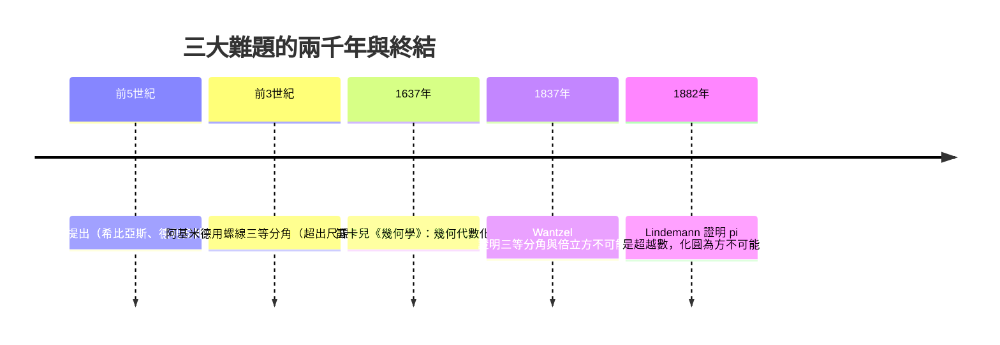
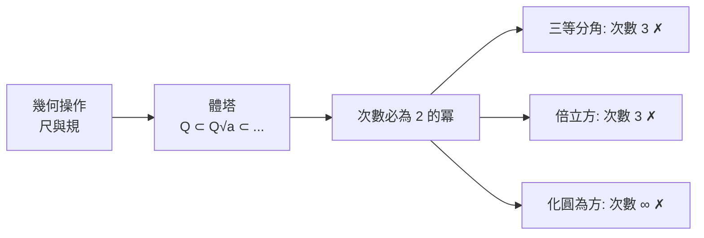

# 4.1 尺規作圖問題：古希臘三大難題

## 學習目標

1. 認識古希臘三大幾何難題：化圓為方、三等分角、倍立方。
2. 理解「尺規可作圖數」的嚴格代數定義：由有理數經過開平方逐步擴張而得。
3. 學會「可作圖 ⇒ 次數為 $`2`$ 的冪」這一必要條件，並用它證明三大難題不可能。
4. 用 SymPy 計算 $`\cos 20^\circ`$ 的最小多項式，驗證其次數為 $`3`$ ，從而判定三等分 $`60^\circ`$ 角不可作。

## 歷史背景

公元前 5 世紀前後，古希臘幾何學家提出三個看似簡單的作圖問題，只允許使用**無刻度直尺**與**圓規**，在有限步驟內完成：

| 問題 | 提出年代（約） | 傳說與人物 |
|---|---|---|
| 化圓為方 | 前 5 世紀 | 阿那克薩哥拉（Anaxagoras）在獄中研究 |
| 倍立方 | 前 5 世紀 | 德利安神諭：祭壇體積加倍 |
| 三等分任意角 | 前 5 世紀 | 希比亞斯（Hippias）的割圓曲線嘗試 |

兩千年間，無數數學家（阿基米德、尼科米德斯、韋達、笛卡兒……）都曾嘗試，全部失敗。失敗的原因不是不夠聰明，而是**問題本身無解**——但要證明「無解」，需要一套當時尚不存在的語言：**體擴張（field extension）理論**。這正是「技術與理論互相驅動」的經典案例：幾何難題驅動了 19 世紀體論的誕生，而體論（經 Wantzel 1837 年、Lindemann 1882 年的工作）反過來徹底解決了兩千年的懸案。



## 定義：可作圖數

**定義 4.1.1（尺規作圖的代數模型）** 從數線上的 $`\{0, 1\}`$ 出發（即給定單位長），一個實數 $`\alpha`$ 稱為**可作圖的**，若存在一列體

$$
\mathbb{Q} = F_0 \subset F_1 \subset \cdots \subset F_n, \qquad \alpha \in F_n,
$$

其中每一步 $`F_{i+1} = F_i(\sqrt{a_i})`$ ，且 $`a_i \in F_i`$ 、 $`a_i \ge 0`$ 。也就是說：可作圖數 = 反覆「加、減、乘、除、開平方」能造出的數。

幾何操作對應代數操作的理由：

- 直尺：過兩已知點畫線 ⇒ 解兩個線性方程，係數在已知體內 ⇒ 交點座標仍在該體內。
- 圓規：以已知點為心、已知長為半徑畫圓 ⇒ 座標方程出現平方項 ⇒ 交點落在 $`F(\sqrt{d})`$ 中。

**定理 4.1.2（次數必要條件）** 若 $`\alpha`$ 可作圖，則 $`[\mathbb{Q}(\alpha) : \mathbb{Q}]`$ 是 $`2`$ 的冪。

*證明思路*：由塔式定理（見 [4.2 節](04.2-體擴張的次數與塔式定理.md)），

$$
[\mathbb{Q}(\alpha):\mathbb{Q}] \;\text{整除}\; [F_n:\mathbb{Q}] = [F_n:F_{n-1}]\cdots[F_1:F_0] = 2^n .
$$

因為 $`\sqrt{a_i}`$ 的次數至多是 $`2`$ （二次多項式的根），每一層次數為 $`1`$ 或 $`2`$ 。若 $`\alpha`$ 是 $`n`$ 次不可約多項式的根且 $`n`$ 不是 $`2`$ 的冪，則 $`\alpha`$ 必不可作圖。 $`\blacksquare`$

注意：這只是**必要條件**。次數是 $`2`$ 的冪並不保證可作圖（反例可見 4.2 節習題）。

## 三大難題的終結

### 1. 三等分角（Wantzel，1837）

取 $`60^\circ`$ 角。能三等分 $`60^\circ`$ 等價於能作出 $`\cos 20^\circ`$ 。由三倍角公式：

$$
\cos 60^\circ = \frac{1}{2} = 4\cos^3 20^\circ - 3\cos 20^\circ .
$$

令 $`t = \cos 20^\circ`$ ，得 $`8t^3 - 6t - 1 = 0`$ 。此多項式在 $`\mathbb{Q}`$ 上不可約（見下方 SymPy 驗證），故 $`[\mathbb{Q}(t):\mathbb{Q}] = 3`$ ，不是 $`2`$ 的冪 ⇒ 不可作圖。

### 2. 倍立方（Wantzel，1837）

倍立方要求作出 $`2^{1/3}`$ 。其最小多項式 $`x^3 - 2`$ 由 Eisenstein 判別法（見 [3.6 節](03.6-不可約多項式與Eisenstein判別法.md)）知不可約，次數 $`3`$ ⇒ 不可作圖。

### 3. 化圓為方（Lindemann，1882）

化半徑 $`1`$ 的圓為方形，需作出 $`\sqrt{\pi}`$ 。Lindemann 證明 $`\pi`$ 是**超越數**（不是任何有理係數多項式的根），故 $`[\mathbb{Q}(\sqrt{\pi}):\mathbb{Q}] = \infty`$ ，違反有限次數條件 ⇒ 不可作圖。



## SymPy 實作

### 範例 1：三等分 $`60^\circ`$ 角的不可能性

```python
import sympy as sp

x = sp.Symbol('x')
t = sp.Symbol('t', real=True)

# 三倍角公式：cos 3θ = 4cos³θ − 3cosθ
expr = 4*sp.cos(t)**3 - 3*sp.cos(t) - sp.Rational(1, 2)
# 代入 θ = 20°，用 cos(60°) = 1/2 化簡出多項式
poly = sp.Poly(sp.expand(8*x**3 - 6*x - 1), x)

print("多項式：", poly.as_expr())
print("在 Q 上不可約？", poly.is_irreducible)
print("次數：", poly.degree())
print("判斷：次數 3 不是 2 的冪 ⇒ cos(20°) 不可作圖")
```

輸出說明：

```
多項式： 8*x**3 - 6*x - 1
在 Q 上不可約？ True
次數： 3
判斷：次數 3 不是 2 的冪 ⇒ cos(20°) 不可作圖
```

`is_irreducible` 為 `True` 表示 $`8x^3-6x-1`$ 在 $`\mathbb{Q}[x]`$ 中沒有非平凡因式，因此 $`\cos 20^\circ`$ 的體次數恰為 $`3`$ 。

### 範例 2：倍立方與最小多項式

```python
import sympy as sp

x = sp.Symbol('x')
# 2^(1/3) 的最小多項式
mp = sp.minimal_polynomial(2**(sp.Rational(1, 3)), x)
print("minimal_polynomial(2^(1/3)) =", mp)
print("不可約分解：", sp.factor(mp))
print("次數 =", sp.Poly(mp, x).degree())

# 對照：可作圖數 2^(1/2) 的最小多項式次數為 2
print("minimal_polynomial(√2) =", sp.minimal_polynomial(sp.sqrt(2), x))
```

輸出說明：

```
minimal_polynomial(2^(1/3)) = x**3 - 2
不可約分解： x**3 - 2
次數 = 3
minimal_polynomial(√2) = x**2 - 2
```

 $`x^3 - 2`$ 的次數 $`3`$ 違反「 $`2`$ 的冪」條件，倍立方無解；而 $`\sqrt{2}`$ 次數 $`2`$ ，確實可以用尺規作出（半圓上的比例中項作圖）。

### 範例 3：作圖數的世界——開平方的體塔

```python
import sympy as sp

x = sp.Symbol('x')

# 逐步建構可作圖數：√2, 1+√2, √(1+√2) ...
a1 = sp.sqrt(2)                    # 第一層
a2 = sp.sqrt(1 + a1)               # 第二層
mp = sp.minimal_polynomial(a2, x)
print("√(1+√2) 的最小多項式：", mp)
print("次數：", sp.Poly(mp, x).degree())   # 應為 4 = 2²
print("在有理數上分解：", sp.factor(mp))
```

輸出說明：

```
√(1+√2) 的最小多項式： x**4 - 2*x**2 - 1
次數： 4
在有理數上分解： x**4 - 2*x**2 - 1
```

次數 $`4 = 2^2`$ 符合定理 4.1.2：每開一次平方，次數至多乘上 $`2`$ 。

## 可作圖的正多邊形：Gauss 的預言

1796 年，19 歲的 Gauss 證明正十七邊形可用尺規作出，這是兩千年來第一次對三大難題之外的作圖問題的重大突破。他的一般結果（Gauss–Wantzel 定理，1837 年 Wantzel 補完證明）：

**定理 4.1.3（Gauss–Wantzel）** 正 $`n`$ 邊形可尺規作圖 $`\iff`$ $`\varphi(n)`$ 是 $`2`$ 的冪，即 $`n = 2^k p_1 p_2 \cdots p_r`$ ，其中 $`p_i`$ 是不同的**費馬質數**（形如 $`2^{2^m}+1`$ ）。

目前已知費馬質數只有 $`3, 5, 17, 257, 65537`$ 。這個定理把「幾何作圖」完全化約為「分圓體的次數」（見 [4.7 節](04.7-分圓體與有限體：高斯週期與密碼學應用.md)），是 Galois 理論的先聲。

```python
import sympy as sp

# Gauss–Wantzel：正 n 邊形可作圖 ⟺ φ(n) 是 2 的冪（質因數只有 2）
for n in range(3, 101):
    phi = sp.totient(n)
    if all(p == 2 for p in sp.factorint(phi)):
        print(f"正 {n} 邊形可作圖，φ(n) = {phi}")
```

輸出：

```
正 3 邊形可作圖，φ(n) = 2
正 4 邊形可作圖，φ(n) = 2
正 5 邊形可作圖，φ(n) = 4
正 6 邊形可作圖，φ(n) = 2
正 8 邊形可作圖，φ(n) = 4
正 10 邊形可作圖，φ(n) = 4
正 12 邊形可作圖，φ(n) = 4
正 15 邊形可作圖，φ(n) = 8
正 16 邊形可作圖，φ(n) = 8
正 17 邊形可作圖，φ(n) = 16
正 20 邊形可作圖，φ(n) = 8
正 24 邊形可作圖，φ(n) = 8
正 30 邊形可作圖，φ(n) = 8
正 32 邊形可作圖，φ(n) = 16
正 34 邊形可作圖，φ(n) = 16
正 40 邊形可作圖，φ(n) = 16
正 48 邊形可作圖，φ(n) = 16
正 51 邊形可作圖，φ(n) = 32
正 60 邊形可作圖，φ(n) = 16
正 64 邊形可作圖，φ(n) = 32
正 68 邊形可作圖，φ(n) = 32
正 80 邊形可作圖，φ(n) = 32
正 85 邊形可作圖，φ(n) = 64
正 96 邊形可作圖，φ(n) = 32
```

正 $`7`$ 、正 $`9`$ 、正 $`11`$ 邊形都不在名單中——例如 $`\varphi(7) = 6`$ 不是 $`2`$ 的冪。

## 理論驅動技術的迴響

三大難題的「失敗」並非浪費：為了處理它們，數學家被迫發展出體、向量空間次數、最小多項式等概念，最終催生 Galois 理論。今日這些工具支撐著密碼學（有限體，見 4.7 節）、編碼理論與符號計算（SymPy 的 `factor`、`minimal_polynomial` 都是體論的產物）。一個兩千年無解的幾何問題，孕育了整個現代代數。

## 習題

1. 證明 $`\sqrt{2} + \sqrt{3}`$ 可作圖，並求 $`[\mathbb{Q}(\sqrt{2}+\sqrt{3}):\mathbb{Q}]`$ 。（提示：用 SymPy 的 `minimal_polynomial` 驗證答案。）
2. 用 SymPy 驗證 $`\cos 36^\circ = \frac{1+\sqrt5}{4}`$ ，說明正五邊形可作圖。
3. 證明：若 $`p`$ 是質數且正 $`p`$ 邊形可作圖，則 $`p`$ 是費馬質數。（提示： $`\varphi(p) = p-1`$ 需為 $`2`$ 的冪。）
4. 判斷 $`\sqrt[4]{2}`$ 是否可作圖（用 SymPy 求其最小多項式次數）。那 $`\sqrt[6]{2}`$ 呢？
5. （挑戰）證明次數為 $`2`$ 的冪不足以保證可作圖：考慮 $`x^4 - 4x + 2`$ 的實根 $`\alpha`$ ，驗證 $`[\mathbb{Q}(\alpha):\mathbb{Q}] = 4`$ ，但 $`x^4-4x+2`$ 恰有兩個實根，而可作圖數所在體 $`F_n`$ 是 $`\mathbb{R}`$ 的子體、其元素皆實，故 $`\alpha`$ 不可作圖。

## SymPy 要點回顧

- `sp.Poly(f, x).is_irreducible`：判斷多項式在有理數域上的不可約性。
- `sp.Poly(f, x).degree()`：多項式次數，對應體擴張次數（不可約時）。
- `sp.minimal_polynomial(alpha, x)`：求代數數的最小多項式，次數 = 體擴張次數。
- `sp.totient(n)`、`sp.factorint(n)`：處理 Gauss–Wantzel 定理的費馬質數條件。
- 下一節：[4.2 體擴張的次數與塔式定理](04.2-體擴張的次數與塔式定理.md)——把本節的「 $`2`$ 的冪」論證嚴格化。
