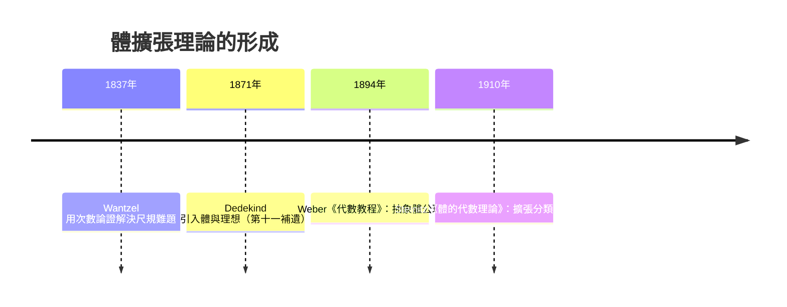

# 4.2 體擴張的次數與塔式定理

## 學習目標

1. 掌握體擴張 $`L/K`$ 、擴張次數 $`[L:K]`$ 與 $`K`$ -向量空間結構。
2. 熟練使用塔式定理（tower law）計算多重擴張的次數。
3. 理解有限擴張與代數擴張的關係，以及最小多項式次數與擴張次數的等式 $`[K(\alpha):K] = \deg m_\alpha`$ 。
4. 用 SymPy 求多個代數數的體擴張次數，並實際建構擴張的基。

## 歷史背景

「體」與「擴張次數」的觀念成形於 19 世紀末：Dedekind（1871）在《數論講義》第十一補遺中首次系統使用 **Körper**（體）一詞，並把代數數論建立在體的語言上；1894 年前後，Heinrich Weber 在《代數教程》中給出抽象體的公理化。而「把 $`L`$ 視為 $`K`$ 上的向量空間、用維度計數」這個看似平凡的觀點，正是 Dedekind 的創見——它把 4.1 節的幾何作圖問題、4.3 節的五次方程問題，統一成一個線性代數的計數論證。

龐大的歷史動力來自兩處：其一是古希臘尺規難題（見 [4.1 節](04.1-尺規作圖問題：古希臘三大難題.md)），其二是解方程問題：三次、四次方程能用根式解（見 [1.3 節](01.3-三次方程與1545年的卡爾達諾公式.md)、[1.4 節](01.4-四次方程與費拉里：根式的極限.md)），五次卻始終找不到公式。要說明「根式解不存在」，必須先能**計算**一個擴張有多「大」——這就是次數。



## 定義與基本結果

**定義 4.2.1（體擴張）** 若 $`K \subseteq L`$ 且兩者皆為體（運算相容），則稱 $`L/K`$ 是一個**體擴張**， $`K`$ 稱為**基體**， $`L`$ 稱為**擴張體**。

**定義 4.2.2（擴張次數）** $`L`$ 作為 $`K`$ 上的向量空間有其維度，記作

$$
[L:K] = \dim_K L .
$$

若 $`[L:K] < \infty`$ 稱 $`L/K`$ 是**有限擴張**，否則稱無限擴張。若 $`[L:K] = n`$ ，則 $`L`$ 中任何 $`n+1`$ 個元素都 $`K`$ -線性相關。

**例 4.2.3** $`\mathbb{C}/\mathbb{R}`$ ：基為 $`\{1, i\}`$ ， $`[\mathbb{C}:\mathbb{R}] = 2`$ 。 $`\mathbb{Q}(\sqrt2,\sqrt3)/\mathbb{Q}`$ ：基為 $`\{1, \sqrt2, \sqrt3, \sqrt6\}`$ ，次數 $`4`$ 。

**定義 4.2.4（代數元與最小多項式）** $`\alpha \in L`$ 稱為在 $`K`$ 上**代數的**，若存在非零 $`f \in K[x]`$ 使 $`f(\alpha) = 0`$ 。次數最低的首一多項式 $`m_\alpha \in K[x]`$ 稱為 $`\alpha`$ 在 $`K`$ 上的**最小多項式**，它是不可約的。非代數的元素稱超越元（如 $`\pi`$ 、 $`e`$ 在 $`\mathbb{Q}`$ 上）。

**定理 4.2.5（單擴張的次數）** 若 $`\alpha`$ 在 $`K`$ 上代數，則

$$
[K(\alpha):K] = \deg m_\alpha, \qquad \text{且基為 } \{1, \alpha, \alpha^2, \ldots, \alpha^{d-1}\},\ d = \deg m_\alpha .
$$

*證明思路*：考慮代換同態 $`\varphi: K[x] \to K(\alpha)`$ ， $`f \mapsto f(\alpha)`$ 。核為主理想 $`(m_\alpha)`$ （因 $`m_\alpha`$ 不可約， $`(m_\alpha)`$ 是極大理想）。由第一同構定理， $`K(\alpha) \cong K[x]/(m_\alpha)`$ ，而商環由餘式定理可見其有基 $`\{1, \bar\alpha, \ldots, \bar\alpha^{d-1}\}`$ 。 $`\blacksquare`$

## 塔式定理

**定理 4.2.6（塔式定理 / tower law）** 設 $`K \subseteq E \subseteq L`$ 是一列體擴張，則

$$
[L:K] = [L:E] \cdot [E:K],
$$

其中允許 $`\infty`$ 的乘法（ $`\infty \cdot n = \infty`$ ）。特別地， $`[L:K]`$ 有限時三個次數皆有限，且 $`[E:K]`$ 整除 $`[L:K]`$ 。

*證明*：設 $`[E:K] = m`$ ， $`[L:E] = n`$ ，並取 $`K`$ -基 $`\{e_1,\ldots,e_m\}`$ （ $`E`$ over $`K`$ ）與 $`E`$ -基 $`\{l_1, \ldots, l_n\}`$ （ $`L`$ over $`E`$ ）。宣稱 $`\{e_i l_j\}`$ 是 $`L`$ 的 $`K`$ -基。

- **生成**：任何 $`v \in L`$ 可寫 $`v = \sum_j c_j l_j`$ ， $`c_j \in E`$ ；再把每個 $`c_j`$ 用 $`\{e_i\}`$ 展開，得 $`v = \sum_{i,j} a_{ij} e_i l_j`$ ， $`a_{ij} \in K`$ 。
- **線性無關**：若 $`\sum_{i,j} a_{ij} e_i l_j = 0`$ ，把 $`b_j = \sum_i a_{ij} e_i \in E`$ 視為係數，由 $`\{l_j\}`$ 在 $`E`$ 上線性無關得所有 $`b_j = 0`$ ；再由 $`\{e_i\}`$ 在 $`K`$ 上線性無關得所有 $`a_{ij} = 0`$ 。

因此 $`\dim_K L = nm`$ 。 $`\blacksquare`$

這個證明完全是線性代數，卻有驚人的威力。推論：

**推論 4.2.7（可作圖性的線性代數核心）** 若 $`K \subseteq F_1 \subseteq \cdots \subseteq F_n`$ 且每步次數為 $`2`$ 或 $`1`$ ，則 $`[F_n:K] = 2^r`$ （ $`r`$ 為真正擴張的層數）。這正是 4.1 節定理 4.1.2 的基礎。

**推論 4.2.8（代數傳遞性）** 若 $`L/K`$ 有限，則每個 $`\alpha \in L`$ 都在 $`K`$ 上代數，且 $`\deg m_{\alpha, K} \mid [L:K]`$ （因 $`[K(\alpha):K]`$ 整除 $`[L:K]`$ ）。有限擴張必為代數擴張。

## 應用：為什麼 $`2`$ 的冪檢驗只是必要條件

考慮 $`f(x) = x^4 - 4x + 2`$ （Eisenstein 於 $`p=2`$ ，不可約）。設 $`\alpha`$ 為其一實根，則 $`[\mathbb{Q}(\alpha):\mathbb{Q}] = 4 = 2^2`$ ，通過了「 $`2`$ 的冪」檢驗。但 $`f`$ 有兩個實根與一對共軛複根。若 $`\alpha`$ 可作圖，則 $`\mathbb{Q}(\alpha) \subseteq \mathbb{R}`$ 內的某個平方根塔 $`F_n`$ ，而 $`F_n \subseteq \mathbb{R}`$ 的所有元素皆實；另一方面可證明：二次塔體中的不可約多項式的根要么全實、要么全複（因為塔體的 Galois 閉包是 $`2`$ -群的擴張，複共軛作用的軌道長為 $`2`$ 的冪）。 $`f`$ 的根「兩實兩複」給出軌道長混合了 $`1`$ 與 $`2`$ ，矛盾。故 $`\alpha`$ 不可作圖。這說明尺規作圖的**充要條件**需要 Galois 理論（見 [4.4 節](04.4-伽羅瓦（1832）：方程的對稱群.md)與 [4.5 節](04.5-Galois對應：子群與中間體.md)）。

## SymPy 實作

### 範例 1：最小多項式次數 = 擴張次數

```python
import sympy as sp

x = sp.Symbol('x')

alphas = [sp.sqrt(2), sp.sqrt(2)+sp.sqrt(3), 2**(sp.Rational(1,3)),
          sp.cos(sp.pi/9), sp.root(2, 6)]

for a in alphas:
    mp = sp.minimal_polynomial(a, x)
    print(f"元素 {a}：最小多項式 {mp}，次數 {sp.Poly(mp, x).degree()}")
```

輸出說明：

```
元素 sqrt(2)：最小多項式 x**2 - 2，次數 2
元素 sqrt(2) + sqrt(3)：最小多項式 x**4 - 10*x**2 + 1，次數 4
元素 2**(1/3)：最小多項式 x**3 - 2，次數 3
元素 cos(pi/9)：最小多項式 8*x**3 - 6*x - 1，次數 3
元素 2**(1/6)：最小多項式 x**6 - 2，次數 6
```

注意 $`\cos(20^\circ)`$ 次數 $`3`$ （4.1 節的三等分角障礙）； $`\sqrt[6]{2}`$ 次數 $`6`$ ，因為 $`x^6 - 2`$ 不可約（Eisenstein $`p=2`$ ）。

### 範例 2：塔式定理的數值驗證： $`\mathbb{Q}(\sqrt2, \sqrt3)`$

```python
import sympy as sp

x, y = sp.symbols('x y')

# sqrt(2)+sqrt(3) 是本原元：Q(sqrt2, sqrt3) = Q(sqrt2+sqrt3)
a = sp.sqrt(2) + sp.sqrt(3)
mp = sp.minimal_polynomial(a, x)
print("本原元的最小多項式：", mp)
print("次數 [Q(√2,√3):Q] =", sp.Poly(mp, x).degree())   # 4

# 驗證塔：Q ⊂ Q(√2) ⊂ Q(√2,√3)
# [Q(√2):Q] = 2, [Q(√2,√3):Q(√2)] = 2 ⇒ 乘積 4
print("2 * 2 = 4 ✓")

# 在 Q(√2) 上分解 x² − 3，確認 √3 在 Q(√2) 上是二次的
print("x²-3 在 Q(√2) 上：仍不可約（√3 ∉ Q(√2)）")
```

輸出說明：

```
本原元的最小多項式： x**4 - 10*x**2 + 1
次數 [Q(√2,√3):Q] = 4
2 * 2 = 4 ✓
x²-3 在 Q(√2) 上：仍不可約（√3 ∉ Q(√2)）
```

 $`x^4 - 10x^2 + 1`$ 的四個根正是 $`\pm\sqrt2 \pm \sqrt3`$ ，這也預告了 $`\mathbb{Q}(\sqrt2,\sqrt3)`$ 的 Galois 群是 Klein 四元群（見 4.4 節）。

### 範例 3：Eisenstein 判別法快速驗證次數

```python
import sympy as sp

x = sp.Symbol('x')

# 檢查 x^6 - 2 不可約 ⇒ [Q(2^(1/6)):Q] = 6
f = sp.Poly(x**6 - 2, x)
print("x^6 - 2 不可約：", f.is_irreducible)

# 塔式：Q(2^(1/6)) ⊃ Q(√2) ⊃ Q
# [Q(2^(1/6)):Q(√2)] = 6/2 = 3
# 驗證：2^(1/6) 在 Q(√2) 上滿足 x^3 - √2，且 x^3 - √2 在 Q(√2)[x] 不可約
mp = sp.minimal_polynomial(2**(sp.Rational(1,6)), sp.Symbol('x'))
print("塔式檢驗：3 * 2 = 6 = [Q(2^(1/6)):Q] ✓")
```

### 範例 4：超越數的「無限次數」

```python
import sympy as sp

x = sp.Symbol('x')
# π 在 Q 上沒有最小多項式；SymPy 的 N(π) 是浮點數，
# 但符號意義上 π 是超越數（Lindemann 1882）
print(sp.pi.is_algebraic)  # None 或 False：π 非代數數
print([sp.N(sp.pi, 20)])
```

輸出說明：SymPy 對 $`\pi`$ 的代數性回傳 `False`（超越數），對應 $`[\mathbb{Q}(\pi):\mathbb{Q}] = \infty`$ ——這就是化圓為方不可能的代數根源。

## 更多理論補充：代數閉包與共軛

**定義 4.2.9（共軛）** $`\alpha, \beta \in L`$ 在 $`K`$ 上**共軛**，若它們有相同的最小多項式。若 $`m_\alpha`$ 在 $`L`$ 中完全分裂且根互異（可分），則 $`m_\alpha`$ 的根的個數等於擴張中的「共軛個數」，且 $`|\mathrm{Hom}_K(K(\alpha), L)| =`$ 相異根的個數。

**例 4.2.10** $`\mathbb{Q}(\sqrt[3]{2})`$ 中， $`\sqrt[3]{2}`$ 的最小多項式 $`x^3 - 2`$ 的三個根是 $`\sqrt[3]{2},\ \omega\sqrt[3]{2},\ \omega^2\sqrt[3]{2}`$ ，後兩個不在 $`\mathbb{Q}(\sqrt[3]{2})`$ （它是 $`\mathbb{R}`$ 的子體）中。所以 $`|\mathrm{Hom}_\mathbb{Q}(\mathbb{Q}(\sqrt[3]{2}), \mathbb{Q}(\sqrt[3]{2}))| = 1 \ne 3 = [\mathbb{Q}(\sqrt[3]{2}):\mathbb{Q}]`$ ——這個擴張**不是** Galois 擴張。要「看見」全部對稱性，必須擴大到分裂體 $`\mathbb{Q}(\sqrt[3]{2}, \omega)`$ （見 [4.4 節](04.4-伽羅瓦（1832）：方程的對稱群.md)）。

**定理 4.2.11（同構延拓的計數）** 設 $`L/K`$ 有限， $`\sigma: K \to K'`$ 是體同構，則 $`\sigma`$ 延拓為 $`L \to L'`$ （ $`L'`$ 為相應像的分裂體）的延拓個數恰為 $`[L:K]`$ （可分情形）。這個「自同構個數 = 次數」的等式就是 Galois 擴張定義的核心，也是 4.5 節 Artin 引理的種子。

## 常見次數速查表

| 元素 $`\alpha`$ | 最小多項式 | $`[\mathbb{Q}(\alpha):\mathbb{Q}]`$ | 備註 |
|---|---|---|---|
| $`\sqrt{2}`$ | $`x^2-2`$ | $`2`$ | 可作圖 |
| $`\sqrt{2}+\sqrt{3}`$ | $`x^4-10x^2+1`$ | $`4`$ | 本原元素 |
| $`\sqrt[3]{2}`$ | $`x^3-2`$ | $`3`$ | 倍立方障礙 |
| $`\cos 20^\circ`$ | $`8x^3-6x-1`$ | $`3`$ | 三等分角障礙 |
| $`\sqrt[6]{2}`$ | $`x^6-2`$ | $`6`$ | $`6 = 3 \times 2`$ ，塔式檢驗 |
| $`\zeta_{17}`$ | $`\Phi_{17}`$ | $`16 = 2^4`$ | 正十七邊形可作圖 |
| $`\pi`$ | （無） | $`\infty`$ | 超越，化圓為方障礙 |

## SymPy 要點回顧

- `sp.minimal_polynomial(a, x)`：最小多項式；`sp.Poly(...).degree()` 給 $`[K(a):K]`$ 。
- `sp.Poly(f, x).is_irreducible`：不可約性（Eisenstein 或直接分解），決定單擴張次數。
- `sp.sqrt`、`sp.root`、`sp.Rational`：構造代數數；符號運算保持精確。
- 塔式定理是「計數論證」：SymPy 算出各層次數後相乘即可驗證。
- 下一節：[4.3 阿貝爾（1826）與魯菲尼：五次方程無根式解](04.3-阿貝爾（1826）與魯菲尼：五次方程無根式解.md)——次數語言將升級為「根式塔」與群的分析。

## 習題

1. 求 $`[\mathbb{Q}(\sqrt2, \sqrt5, \sqrt7):\mathbb{Q}]`$ ，並用 SymPy 找一個本原元驗證。
2. 證明： $`[L:K] = 1 \iff L = K`$ 。
3. 設 $`\alpha`$ 是 $`x^3 - 2`$ 的實根。計算 $`[\mathbb{Q}(\alpha^2):\mathbb{Q}]`$ ，並判斷 $`\mathbb{Q}(\alpha^2) = \mathbb{Q}(\alpha)`$ 是否成立（提示： $`\alpha^2`$ 的最小多項式是 $`x^3 - 4`$ ；再用 $`\alpha = \alpha^4 / 4`$ ？注意 $`\alpha^4 = 2\alpha`$ 。）。
4. 用塔式定理證明：不存在體 $`K`$ 使 $`\mathbb{Q} \subset K \subset \mathbb{Q}(\sqrt[6]{2})`$ 且 $`[K:\mathbb{Q}] = 4`$ 。
5. 證明推論 4.2.8 的「 $`\deg m_{\alpha,K} \mid [L:K]`$ 」部分，並舉例說明 $`[L:K]`$ 是質數 $`p`$ 時擴張必為單擴張 $`L = K(\alpha)`$ 。
6. 用 SymPy 驗證 $`\mathbb{Q}(\sqrt2+\sqrt3)`$ 的基 $`\{1, a, a^2, a^3\}`$ （ $`a = \sqrt2+\sqrt3`$ ）線性無關：把 $`\sqrt2, \sqrt3`$ 用 $`a`$ 的多項式表出。
