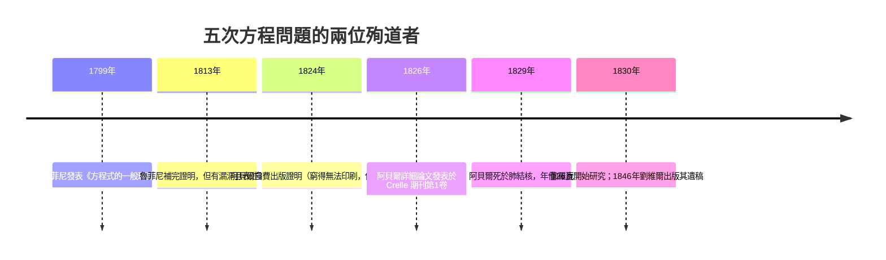

# 4.3 阿貝爾（1826）與魯菲尼：五次方程無根式解

## 學習目標

1. 理解「根式解」（solution by radicals）的精確定義：根式塔與體擴張的對應。
2. 認識魯菲尼（1799, 1813）與阿貝爾（1826）證明五次方程一般無根式解的歷史與思路。
3. 掌握一般 $`n`$ 次方程的 Galois 群是 $`S_n`$ 這個關鍵事實，並理解 $`S_5`$ 的不可解性如何導出無根式解。
4. 用 SymPy 展示：特定五次方程有根式解、一般五次方程的 Galois 群為 $`S_5`$ 、以及不可解群的計算。

## 歷史背景

三次與四次方程在 1545 年被卡爾達諾與費拉里解決（見 [1.3 節](01.3-三次方程與1545年的卡爾達諾公式.md)、[1.4 節](01.4-四次方程與費拉里：根式的極限.md)）之後，歐洲數學家信心滿滿地進攻五次方程，兩百多年卻一無所獲。轉折點來自兩位早逝的天才：



- **保羅·魯菲尼**（Paolo Ruffini, 1765–1822），義大利醫生兼數學家。他在 1799 年的巨著中嘗試證明「次數 $`\ge 5`$ 的一般方程無根式解」，1813 年給出更完整的版本。他的證明核心是研究根的**置換**在根式運算下的行為——這正是群論的萌芽，比 Galois 早了三十年。可惜論文長達 500 頁、論證有一處缺口（未證明「根式表達式的置換集必為閉」），當代數學界（包括 Lagrange、Cauchy）多未接受。
- **尼爾斯·阿貝爾**（Niels Henrik Abel, 1802–1829），挪威人，家貧。1824 年他自費印刷證明（因經費只印了 6 頁的濃縮版，無人看懂）；1826 年完整的證明刊登在 Crelle 創辦的《純粹與應用數學期刊》第一卷——這份期刊的第一卷幾乎全由阿貝爾的文章構成。阿貝爾的證明填補了魯菲尼的缺口，是第一個公認完整的證明，世稱 **Abel–Ruffini 定理**。

阿貝爾證明「一般五次方程無根式解」後，隨即提出更深刻的問題：**哪些**特定方程有根式解？他在遺稿中朝這個方向工作但未完成。回答這個問題的是伽羅瓦（見 [4.4 節](04.4-伽羅瓦（1832）：方程的對稱群.md)）——理論的缺口再次驅動新理論的誕生。

## 根式解的代數定義

**定義 4.3.1（根式塔）** 體擴張 $`L/K`$ 稱為由**根式**生成的，若存在塔

$$
K = F_0 \subseteq F_1 \subseteq \cdots \subseteq F_n \ni \alpha,\qquad F_{i+1} = F_i(\omega_i, \sqrt[m_i]{a_i}),
$$

其中 $`a_i \in F_i`$ ， $`\omega_i`$ 是 $`m_i`$ 次單位根。若 $`f`$ 的某根 $`\alpha`$ 落在某個根式塔中，稱 $`f`$ （或 $`\alpha`$ ）**有根式表達**；若 $`f`$ 的全部根都在根式塔中，稱 $`f`$ **有根式解**。

對照 4.1 節：尺規作圖允許的運算是「 $`+\,-\,\times\,\div\,\sqrt{\ }`$ 」，根式解允許再加上「 $`m`$ 次方根與單位根」。兩者都是**限制運算種類的塔狀擴張**，因此有平行的次數論證——但根式的次數 $`m_i`$ 不必是 $`2`$ ，所以只用塔式定理（[4.2 節](04.2-體擴張的次數與塔式定理.md)）不夠，還需要對稱性的分析。

**定義 4.3.2（可解群，先敘後證）** 有限群 $`G`$ 稱為**可解的**，若存在一列子群

$$
\{e\} = G_0 \triangleleft G_1 \triangleleft \cdots \triangleleft G_n = G, \qquad G_{i+1}/G_i \text{ 皆為循環質數階群},
$$

直觀地說： $`G`$ 可以一步步「用質數階循環商拆解到平凡群」。阿貝爾時代的語言是：根的置換類能被逐步「約化」。

**定理 4.3.3（Abel–Ruffini）** 次數 $`n \ge 5`$ 的一般方程

$$
x^n + a_{n-1}x^{n-1} + \cdots + a_0 = 0 \quad (a_i \text{ 為獨立變元})
$$

在係數體 $`\mathbb{Q}(a_0,\ldots,a_{n-1})`$ 上的 Galois 群是全對稱群 $`S_n`$ 。當 $`n \ge 5`$ 時， $`S_n`$ 不可解（因為 $`A_n`$ 單，且 $`A_n`$ 非循環質數階， $`n \ge 5`$ ），故一般 $`n`$ 次方程（ $`n \ge 5`$ ）無根式解。

*論證骨架*（用現代語言，即 Galois 的觀點）：

1. 根 $`r_1, \ldots, r_n`$ 是代數獨立的對稱函數的反函數： $`\mathbb{Q}(r_1,\ldots,r_n) / \mathbb{Q}(s_1,\ldots,s_n)`$ （ $`s_i`$ 為初等對稱多項式）的 Galois 群是 $`S_n`$ （任何根的置換都保持係數）。
2. 根式擴張的 Galois 群之合成因子皆循環質數階（每一層 $`\sqrt[m]{a}`$ 引入 $`m`$ 階循環「旋轉」）。
3. 所以有根式解 $`\Rightarrow`$ Galois 群可解。
4. $`n \ge 5`$ ： $`S_n \supseteq A_n`$ ，而 $`A_n`$ 是單群且階數 $`n!/2`$ 非質數 $`\Rightarrow`$ $`S_n`$ 不可解。 $`\blacksquare`$

第 3 步（根式 $`\Rightarrow`$ 可解）的雛形在 Abel 與 Ruffini 手中即是「置換的約化」，這是兩人共同的歷史功績；把它變成漂亮的群論語言的是 Galois 與 Jordan。

## 對照：低次為何有解

| 次數 | Galois 群 | 可解性 | 公式 |
|---|---|---|---|
| $`2`$ | $`S_2 \cong C_2`$ | 可解 | 求根公式 |
| $`3`$ | $`S_3 \cong S_3`$ ，合成列 $`\{e\}\triangleleft A_3\triangleleft S_3`$ ，商 $`C_3, C_2`$ | 可解 | 卡爾達諾（1545） |
| $`4`$ | $`S_4`$ ，合成列經 $`A_4, V_4`$ ，商皆 $`C_2, C_3`$ | 可解 | 費拉里（1545） |
| $`\ge 5`$ | $`S_n`$ ，含單群 $`A_n`$ （非質數階） | **不可解** | 不存在 |

 $`S_4`$ 的正規鏈 $`\{e\} \triangleleft V_4 \triangleleft A_4 \triangleleft S_4`$ 的商群階為 $`4, 3, 2`$ ——這正對應四次方程解法中的「先降為三次再降為二次」的層層約化。群論把「解方程的步驟」翻譯成「正規子群鏈」。

## SymPy 實作

### 範例 1：Abel–Ruffini 的數值面——根是有的，只是寫不出根式

```python
import sympy as sp

x = sp.Symbol('x')
# x^5 - x - 1：其 Galois 群為 S5（下方範例驗證），無根式解
f = sp.Poly(x**5 - x - 1, x)
roots = sp.roots(f.as_expr(), x)
print("精確根的個數（可表為 RootOf）：", len(roots))
print("數值根：")
for r in sp.nroots(f.as_expr(), n=8):
    print("  ", r)
```

輸出說明：五次方程當然有 $`5`$ 個複數根（代數基本定理，見 [3.5 節](03.5-體擴張與克羅內克定理：代數閉包.md)），`nroots` 可算出數值根；問題是**沒有一個根能寫成係數的根式表達式**。SymPy 的 `roots` 字典為空（無法用根式表出），只能回退到數值方法或 `RootOf`。

### 範例 2：用 SymPy 的 galois_group 看 Galois 群

```python
import sympy as sp
from sympy.abc import x

# 一般型五次方程：Galois 群 S5
for f in [x**5 - x - 1, x**5 - 4*x + 2, x**5 + 20*x + 16]:
    G, alt = sp.polys.numberfields.galois_group(f, x)
    print(f"{f}：Galois 群 = {G.order()} 階，是否含於 A5 = {alt}")
```

輸出說明：

```
x**5 - x - 1：Galois 群 = 120 階，是否含於 A5 = False
x**5 - 4*x + 2：Galois 群 = 120 階，是否含於 A5 = False
x**5 + 20*x + 16：Galois 群 = 120 階，是否含於 A5 = False
```

 $`120 = |S_5|`$ ：這些方程的 Galois 群都是 $`S_5`$ ，全部無根式解。

### 範例 3：對照——有根式解的五次方程

```python
import sympy as sp
from sympy.abc import x

# x^5 - 2 = a：Galois 群是 Frobenius 群 C5 ⋊ C4（20 階），可解！
G, _ = sp.polys.numberfields.galois_group(x**5 - 2, x)
print("x^5 - 2 的 Galois 群階數：", G.order())

# 分圓型：x^5 - 1 的根全是單位根，可解
print(sp.factor(x**5 - 1))
print("5 次分圓多項式的根：", sp.roots(sp.Poly(x**4+x**3+x**2+x+1, x)))
```

輸出說明：

```
x^5 - 2 的 Galois 群階數： 20
(x - 1)*(x**4 + x**3 + x**2 + x + 1)
```

 $`x^5 - 2`$ 的根 $`\sqrt[5]{2}\,\omega_5^k`$ 當然有根式表達（定義就是根式），其 Galois 群為 $`20`$ 階的可解群 $`C_5 \rtimes C_4`$ ；而 $`120`$ 階的 $`S_5`$ 不可解。「個別方程」與「一般方程」的差別就在 Galois 群。

### 範例 4： $`S_5`$ 不可解、 $`S_4`$ 可解的驗證

```python
import sympy as sp
from sympy.combinatorics.named_groups import SymmetricGroup, AlternatingGroup
from sympy.combinatorics import Permutation

S5 = SymmetricGroup(5)
S4 = SymmetricGroup(4)

print("S5 是否可解：", S5.is_solvable)   # False
print("S4 是否可解：", S4.is_solvable)   # True
print("A5 是否可解：", AlternatingGroup(5).is_solvable)  # False

# S5 的正規子群鏈（合成列）含 A5，而 A5 是 60 階單群，非質數階
H = AlternatingGroup(5)
# 單群判定：任一非恆等元的正規包都等於整個群（故沒有真正的正規子群）
closures = {H.normal_closure(g).order() for g in H.elements if not g.is_identity}
print("A5 階數：", H.order(), "是否單群：", closures == {H.order()})
```

輸出說明：

```
S5 是否可解： False
S4 是否可解： True
A5 是否可解： False
A5 階數： 60 是否單群： True
```

SymPy 直接驗證： $`S_4`$ 的合成列商群為 $`C_2, C_3, C_2, C_2`$ （皆循環質數階）故可解； $`S_5`$ 的合成列必含 $`60`$ 階單群 $`A_5`$ ，其階非質數，故不可解。這就是「公式存在與否」的分水嶺。

## Abel–Ruffini 證明的歷史細節

Ruffini 的缺口在何處？他想證明：若 $`\alpha`$ 能用係數的根式表出，則 $`\alpha`$ 在根的置換下能取的值只有少數幾個，進而置換集合必須構成封閉的「類」。Ruffini 未能證明這個封閉性（即現代的子群性質）。Abel 補上了它，用的論證已是置換乘法的雛形；Galois 則把「封閉的置換類」定義為**群**，並加上**正規性**的刻畫（見 [2.4 節](02.4-正規子群與商群：若爾當（1870）的貢獻.md)），一步到位地解決了「哪些方程可解」——理論從失敗與補洞中逐層長出。

## Abel 證明的現代重述

用 4.2 節的語言，可以把 Abel–Ruffini 的論證骨架寫得更清楚：

**命題 4.3.4（根式擴張的次數結構）** 設 $`L = K(\sqrt[m_1]{a_1}, \ldots, \sqrt[m_n]{a_n})`$ （允許先添單位根），且 $`K`$ 含足夠的單位根使每層為 Galois 擴張，則 $`[L:K]`$ 的質因數全部出現在 $`m_1 m_2 \cdots m_n`$ 中。換言之，根式塔只能引入塔中「開方次數」的質因數。

*證明思路*：每層 $`F_i(\sqrt[m_i]{a_i})/F_i`$ 的 Galois 群是 $`m_i`$ 階循環群的子群，其階的質因數都整除 $`m_i`$ ；由塔式定理（[4.2 節](04.2-體擴張的次數與塔式定理.md)）逐層相乘。 $`\blacksquare`$

**推論 4.3.5（Ruffini–Abel 的核心計數）** 若 $`f`$ 有根式解且 Galois 群 $`G = \mathrm{Gal}(f/K)`$ 可實現於某根式塔中，則 $`|G|`$ 整除某個由開方次數組成的乘積，且 $`G`$ 的合成因子皆循環質數階。

對一般五次方程， $`G = S_5`$ ， $`|S_5| = 120 = 2^3 \cdot 3 \cdot 5`$ ——表面上 $`120`$ 的質因數 $`2, 3, 5`$ 似乎可以來自「開 $`2`$ 次、 $`3`$ 次、 $`5`$ 次」，**僅看質因數不夠**。真正的障礙是結構性的： $`S_5`$ 含單群 $`A_5`$ （ $`60`$ 階，非質數），任何正規鏈都會被 $`A_5`$ 卡住。這正是 Abel 論證中最微妙、Ruffini 遺漏之處——置換的「類」未必封閉，而封閉性失敗的極端案例就是 $`A_5`$ 這個「不可拆解」的障礙物。

**對照表： $`S_4`$ 與 $`S_5`$ 的合成列**

| 群 | 合成列 | 合成因子 | 可解？ |
|---|---|---|---|
| $`S_4`$ | $`\{e\} \triangleleft V_4 \triangleleft A_4 \triangleleft S_4`$ | $`C_2, C_2, C_3, C_2`$ | 是 |
| $`S_5`$ | $`\{e\} \triangleleft A_5 \triangleleft S_5`$ | $`A_5`$ （單，非質數階）, $`C_2`$ | **否** |

 $`S_4`$ 的鏈每一級都能「開方消化」，對應費拉里的四層根式公式； $`S_5`$ 的第一個合成因子就是龐然單群 $`A_5`$ ，根式塔無法穿透——這就是五次方程公式不存在的完整理由。

## 習題

1. 用 SymPy 求 $`x^5 - 5x + 12`$ 的 Galois 群階數；這是 $`S_5`$ 、 $`A_5`$ 還是 $`F_{20}`$ ？
2. 證明：若 $`f`$ 的 Galois 群是循環群 $`C_n`$ ，則 $`f`$ 有根式解（提示： $`n`$ 次單位根 + $`\sqrt[n]{a}`$ ）。
3. 用 `sp.nroots` 觀察 $`x^5 - x - 1`$ 的實根個數，並解釋為何「根存在」與「根可根式表出」是兩回事。
4. 驗證 $`S_3`$ 的合成列 $`\{e\} \triangleleft A_3 \triangleleft S_3`$ ，並對應到卡爾達諾公式的兩個步驟（開立方與開平方）。
5. （挑戰）證明 $`A_5`$ 是單群的最短路徑之一： $`A_5`$ 的元素按輪型分類為 $`()`$ 、 $`(abc)`$ 、 $`(abcde)`$ 、 $`(ab)(cd)`$ ；用輪型計數證明任何非平凡正規子群必含 $`3`$ -循環，繼而包含全部 $`3`$ -循環，故為 $`A_5`$ 。可用 SymPy 的 `Permutation` 列舉驗證。

## SymPy 要點回顧

- `sp.polys.numberfields.galois_group(f, x)`：直接計算多項式的 Galois 群與其是否含於 $`A_n`$ （詳見 [4.6 節](04.6-用SymPy驗證Galois群與正規性.md)）。
- `SymmetricGroup(n).is_solvable`：可解性判斷，對應根式解的存在性。
- `sp.nroots` / `sp.roots`：數值根 vs 根式根——`roots` 對無根式解的多項式回傳空字典。
- `PermutationGroup.normal_closure(g)`： $`A_5`$ 的單性由此驗證（任一非恆等元的正規包都是 $`A_5`$ ），這正是不可解性的核心。
- 下一節：[4.4 伽羅瓦（1832）：方程的對稱群](04.4-伽羅瓦（1832）：方程的對稱群.md)——把「可解性」從 Abel 的補洞升級為完整的 Galois 理論。
