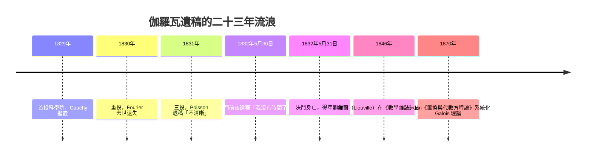

# 4.4 伽羅瓦（1832）：方程的對稱群

## 學習目標

1. 定義多項式 $`f`$ 對基體 $`K`$ 的 **Galois 群** $`\mathrm{Gal}(f/K)`$ ：保持係數域的根之置換。
2. 掌握自同構群 $`\mathrm{Aut}(L/K)`$ 與根置換的同一性；理解分裂體與正規擴張。
3. 學會用不變量（判別式、模 $`p`$ 分解型）決定低次方程的 Galois 群。
4. 用 SymPy 的 `galois_group` 計算實例，並用置換群語言（[2.6 節](02.6-置換群與SymPy的combinatorics.md)）具體操作。

## 歷史背景

**埃瓦里斯特·伽羅瓦**（Évariste Galois, 1811–1832）的一生比他的定理更傳奇。1829 年，他在父親自殺、兩次報考巴黎綜合理工學院落榜的同年，把兩篇論文交給科學院，卻被 Cauchy 擱置遺失（一說是 Cauchy 建議合併重投）。1830 年，第三份手稿交給 Fourier，Fourier 隨即去世，稿件再度消失。1831 年，Poisson 審稿後批註「論證不夠清晰，無法評判」，退回。1832 年 5 月 30 日，伽羅瓦在決鬥前夜倉促寫下數學遺囑，把核心思想濃縮在三頁紙上，附言：「我沒有時間了。」5 月 31 日他中槍身亡，得年 $`20`$ 歲。



直到 **1846 年**，**約瑟夫·劉維爾**（Joseph Liouville）才整理並在《Journal de Mathématiques Pures et Appliquées》上出版伽羅瓦的遺稿。1870 年 **Camille Jordan** 的《Traité des substitutions et des équations algébriques》把理論系統化，Galois 對應（[4.5 節](04.5-Galois對應：子群與中間體.md)）的正規性概念經 **Dedekind 與 Hölder（1889）** 逐步抽象為今日的樣貌。一篇被兩位大師退稿的手稿，最終成為現代代數的基石——這也是「技術與理論互相驅動」最悲壯的一章：當時的數學界沒有足夠的語言接收伽羅瓦的思想，他被迫在同時發明語言與使用語言。

## Galois 群的定義

**定義 4.4.1（自同構群）** 設 $`L/K`$ 為體擴張。 $`\mathrm{Aut}(L/K)`$ 是所有 $`L`$ 的自同構 $`\sigma`$ 中，保持 $`K`$ 的每個元素不動者，構成一個群（複合為運算）。記 $`\mathrm{Gal}(L/K) = \mathrm{Aut}(L/K)`$ 。

**定義 4.4.2（方程的 Galois 群）** 設 $`f \in K[x]`$ ， $`L`$ 為 $`f`$ 在 $`K`$ 上的**分裂體**（即 $`f`$ 完全分解的最小擴張體）。定義

$$
\mathrm{Gal}(f/K) := \mathrm{Gal}(L/K).
$$

**命題 4.4.3（根的置換觀點）** 任何 $`\sigma \in \mathrm{Gal}(L/K)`$ 把 $`f`$ 的根映到根：由 $`f(\alpha) = 0`$ 與 $`\sigma`$ 固定係數，得 $`f(\sigma(\alpha)) = \sigma(f(\alpha)) = 0`$ 。又 $`\sigma`$ 由其在根上的作用決定（ $`L = K(r_1,\ldots,r_n)`$ ），且 $`\sigma`$ 限制在根集上必為單射，故

$$
\mathrm{Gal}(f/K) \hookrightarrow S_n, \qquad \sigma \mapsto (\sigma(r_1), \ldots, \sigma(r_n)).
$$

這正是 [2.1 節](02.1-伽羅瓦（1832）之前：拉格朗日與根的置換.md) Lagrange 的置換觀念的精確化：**不是所有置換都算**，只有「保持代數關係」的置換才構成 Galois 群。

**例 4.4.4** $`f = x^3 - 2`$ 在 $`\mathbb{Q}`$ 上：分裂體 $`L = \mathbb{Q}(\sqrt[3]{2}, \omega)`$ （ $`\omega = e^{2\pi i/3}`$ ）， $`[L:\mathbb{Q}] = 6`$ ， $`\mathrm{Gal}(f/\mathbb{Q}) \cong S_3`$ 。三個根 $`\alpha, \alpha\omega, \alpha\omega^2`$ 的任何置換都由對 $`\alpha, \omega`$ 的像決定，恰得 $`S_3`$ 。

## 分裂體與正規性

**定義 4.4.5（正規擴張）** 代數擴張 $`L/K`$ 稱為**正規**，若 $`K[x]`$ 中任何在 $`L`$ 有根的不可約多項式都在 $`L`$ 中完全分裂。等價條件： $`L`$ 是一族多項式的分裂體。

**定理 4.4.6（分裂體的存在唯一性）** 每個 $`f \in K[x]`$ 都有分裂體 $`L`$ ，且 $`[L:K]`$ 整除 $`n!`$ （ $`n = \deg f`$ ，因為逐個添加根，每步次數至多 $`n, n-1, \ldots`$ ）。分裂體在同構意義下唯一。對分裂體， $`|\mathrm{Gal}(L/K)| = [L:K]`$ （這是 Artin 引理的推論，也是 Galois 擴張定義的一半，見 [4.5 節](04.5-Galois對應：子群與中間體.md)）。

## 決定 Galois 群的不變量

### 二次方程

 $`f = x^2 + px + q`$ ，判別式 $`D = p^2 - 4q`$ 。 $`\mathrm{Gal}(f/K)`$ 是 $`S_2 \cong C_2`$ ，除非 $`D`$ 是 $`K`$ 中的平方數（此時 $`f`$ 已分裂，群平凡）。一般規律：

**定理 4.4.7（判別式）** 設 $`f`$ 在 $`K[x]`$ 中不可約、 $`\mathrm{disc}(f)`$ 非平方，則 $`\mathrm{Gal}(f/K) \not\subseteq A_n`$ ；若 $`\mathrm{disc}(f)`$ 是平方數，則 $`\mathrm{Gal}(f/K) \subseteq A_n`$ 。其中 $`\mathrm{disc}(f) = a_n^{2n-2}\prod_{i<j}(r_i - r_j)^2`$ 。

### 三次方程（對照 [1.3 節](01.3-三次方程與1545年的卡爾達諾公式.md)）

不可約三次式的 Galois 群只能是 $`S_3`$ 或 $`A_3 \cong C_3`$ ，由判別式是否為平方數決定。

### 模 $`p`$ 分解型（Galois 的原創洞見）

**定理 4.4.8（Dedekind 定理的初等形式）** 設 $`f \in \mathbb{Z}[x]`$ 首一、無重根， $`p`$ 不整除 $`\mathrm{disc}(f)`$ 。若 $`f \bmod p`$ 分解為次數 $`d_1, d_2, \ldots`$ 的質因式乘積，則 $`\mathrm{Gal}(f/\mathbb{Q})`$ 含有輪型 $`(d_1)(d_2)\cdots`$ 的置換。

這讓 Galois 群的計算變成「分解因式、查輪型」的機械工作——計算代數系統（包括 SymPy）正是這樣實作的。

**例 4.4.9** $`f = x^5 - x - 1`$ ：
- $`\bmod\ 2`$ ： $`x^5 + x + 1`$ ，分解為 $`(x^2+x+1)(x^3+x^2+1)`$ ⇒ 輪型 $`(2)(3)`$ 。
- $`\bmod\ 3`$ ： $`x^5 + 2x + 2`$ ，不可約 ⇒ 輪型 $`(5)`$ 。
- 含 $`5`$ -循環與 $`(2,3)`$ 型，皆奇置換的輪型組合 ⇒ 群含 $`A_5`$ 與奇置換 ⇒ $`\mathrm{Gal} = S_5`$ 。

## SymPy 實作

### 範例 1：計算 Galois 群與其階

```python
import sympy as sp
from sympy.abc import x
from sympy.polys.numberfields import galois_group

cases = [
    x**2 - 2,          # C2
    x**3 - 2,          # S3
    x**3 - 3*x + 1,    # 判別式 81 = 9²，群含於 A3 ⇒ C3
    x**4 - 2,          # 8 階二面體群 D4
    x**5 - x - 1,      # S5
]
for f in cases:
    G, alt = galois_group(f, x)
    print(f"{sp.factor(f)}：階 = {G.order()}，含於 A_n = {alt}")
```

輸出說明：

```
x**2 - 2：階 = 2，含於 A_n = False
x**3 - 2：階 = 6，含於 A_n = False
x**3 - 3*x + 1：階 = 3，含於 A_n = True
x**4 - 2：階 = 8，含於 A_n = False
x**5 - x - 1：階 = 120，含於 A_n = False
```

 $`x^3 - 3x + 1`$ 的判別式為 $`-4(-3)^3 - 27 = 81 = 9^2`$ ，故 Galois 群是 $`3`$ 階循環群 $`C_3`$ ——這樣的方程雖然是三次，其根式解只需要開立方，不需要開平方。

### 範例 2：用模 $`p`$ 分解型手動推理

```python
import sympy as sp
from sympy.abc import x

f = x**5 - x - 1
print("判別式是否被 2、3 整除：",
      sp.discriminant(f, x) % 2, sp.discriminant(f, x) % 3)

for p in [2, 3, 5, 7]:
    g = sp.Poly(f, x, modulus=p)
    print(f"mod {p}: {g.factor_list()[1]}")
```

輸出說明（節選）：

```
mod 2: [(Poly(x**2 + x + 1), 1), (Poly(x**3 + x**2 + 1), 1)]
mod 3: [(Poly(x**5 + 2*x + 2, modulus=3), 1)]
```

`mod 2` 給出輪型 $`(2)(3)`$ ，`mod 3` 不可約給出 $`(5)`$ 。5 次群含 $`(2,3)`$ 型（奇置換，因 $`3`$ -循環是偶、 $`2`$ -循環是奇）與 $`5`$ -循環，可推出群為 $`S_5`$ （見 4.3 節）。

### 範例 3：用置換群直接驗證 $`x^3 - 2`$ 的 Galois 群

```python
import sympy as sp
from sympy.combinatorics import Permutation, PermutationGroup
from sympy.abc import x

# 根：r, rω, rω²。S3 的三種「合法」置換由 α ↦ rω^k 與 ω ↦ ω^{±1} 生成
S3 = sp.S(1)
# SymPy 的 galois_group 已給出同構訊息；這裡展示根的對稱關係
w = sp.exp(2*sp.pi*sp.I/3)
r = 2**(sp.Rational(1, 3))
roots = [r, r*w, r*w**2]
print("根：", [sp.simplify(z) for z in roots])
print("對稱關係驗證：w^3 =", sp.simplify(w**3), "，r^3 =", sp.simplify(r**3))
# 任何置換必須保持 r³ = 2 與 w³ = 1、w² + w + 1 = 0 的關係
# 檢驗：3 個根兩兩之比 ∈ {1, w, w²}
for i in range(3):
    for j in range(3):
        if i != j:
            assert sp.simplify(roots[i]/roots[j] in [1, w, w**2])
print("根的比值均為單位根：關係 w² + w + 1 = 0 限制了合法置換")
```

輸出說明：

```
根： [2**(1/3), -2**(1/3)/2 + sqrt(3)*2**(1/3)*I/2, -2**(1/3)/2 - sqrt(3)*2**(1/3)*I/2]
對稱關係驗證：w^3 = 1 ，r^3 = 2
根的比值均為單位根：關係 w² + w + 1 = 0 限制了合法置換
```

根之間的代數關係（比值是三次單位根）就是 Galois 群的「骨架」： $`6`$ 個自同構恰好把 $`\{r, r\omega, r\omega^2\}`$ 任意重排，且 $`\omega \mapsto \omega`$ 或 $`\omega^2`$ ，合計 $`3 \times 2 = 6`$ ，等於 $`[L:\mathbb{Q}]`$ 。

### 範例 4：四次方程的 Galois 群分類

```python
import sympy as sp
from sympy.abc import x
from sympy.polys.numberfields import galois_group

# 首一不可約四次的 Galois 群候選：C4, V4, D4, A4, S4
tests = {
    "x**4 - 10*x**2 + 1": "V4（雙平方根體）",
    "x**4 - 2": "D4",
    "x**4 - 5*x + 2": "S4",
    "x**4 - 4*x**2 + 2": "C4",
}
for f_str, expect in tests.items():
    f = sp.sympify(f_str)
    G, alt = galois_group(f, x)
    print(f"{f_str}：階 {G.order()}，含於 A4 = {alt}，預期 {expect}")
```

輸出說明：階數 $`4/8/24/4`$ 與奇偶性完全區分四種情形——四次方程有解公式（費拉里）正是因為這四個群全都可解（見 4.3 節表格）。

## 伽羅瓦思想的劃時代之處

Lagrange（1770）已經知道根的置換與有理函數不變量，Ruffini 與 Abel 用置換證明了否定結果，但只有 Galois 做到兩件事：

1. **把群 attach 到方程**： $`\mathrm{Gal}(f/K)`$ 不只是研究工具，而是方程的完整「指紋」——兩個方程的 Galois 群相同（在某種意義下）則可解性相同。
2. **提出對應**：子群 ↔ 中間體（[4.5 節](04.5-Galois對應：子群與中間體.md)），把「解方程」變成「研究體的結構」，方程論從此併入體論。

## 習題

1. 用 SymPy 求下列各式的 Galois 群階數與奇偶性： $`x^4 - 3`$ 、 $`x^4 + x^2 + 1`$ 、 $`x^6 - 2`$ 。
2. 證明定理 4.4.7（判別式定理）： $`\sigma(\mathrm{disc}) = \mathrm{disc}\cdot\mathrm{sgn}(\sigma)^2`$ 之類的計算，說明判別式的平方根在奇置換下變號。
3. 對 $`f = x^3 - 3x + 1`$ 用 SymPy 驗證 $`\mathrm{disc} = 81`$ ，並求其三個實根的數值，解釋為何其分裂體是全實的（提示：Galois 群 $`C_3`$ 的擴張是循環的）。
4. 用模 $`p`$ 分解型證明 $`x^5 - 4x + 2`$ 的 Galois 群是 $`S_5`$ 。
5. （挑戰）證明： $`f`$ 在 $`K`$ 上不可約當且僅當 $`\mathrm{Gal}(f/K)`$ 在根集上的作用可遞（transitive）。用 $`x^4 - 5x^2 + 6`$ （可約）對照驗證。

## SymPy 要點回顧

- `sympy.polys.numberfields.galois_group(f, x)`：回傳 `(G, alt)`， $`G`$ 為置換群物件（有 `.order()`、`.is_solvable` 等），`alt` 表示是否含於交錯群。
- `sp.discriminant(f, x)`：判別式；配合 `modulus=p` 的 `factor_list` 做模 $`p`$ 輪型分析。
- `sp.Poly(f, x, modulus=p).factor_list()`：有限體上的因式分解，輪型即 Galois 群的元素型。
- `sp.exp(2*sp.pi*sp.I/n)`：單位根，構造分裂體的元素。
- 下一節：[4.5 Galois 對應：子群與中間體](04.5-Galois對應：子群與中間體.md)——把群與體之間的關係畫成一張完整的對應圖。
