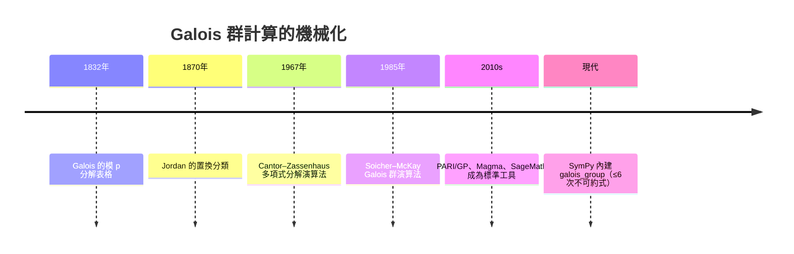
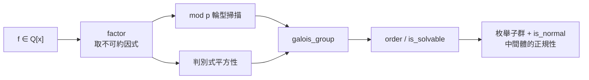

# 4.6 用 SymPy 驗證 Galois 群與正規性

## 學習目標

1. 建立「給定多項式 → 算出 Galois 群 → 檢驗可解性/正規性 → 畫出對應」的完整 SymPy 工作流。
2. 掌握模 $`p`$ 分解型、判別式、`galois_group` 三種確定 Galois 群的手法與其組合。
3. 學會用置換群 API（`is_normal`、`is_solvable`、`derived_subgroup`，以及以兩個元素生成元枚舉子群）做可解性的機械驗證。
4. 用一個完整案例（ $`x^4 - 2`$ 或 $`x^5 - 2`$ ）從頭到尾實作 Galois 對應的檢查表。

## 歷史背景

Galois 群的計算在 19 世紀是手工技藝：Galois 用模 $`p`$ 分解（他稱為「方程的表格」），Jordan 用置換不變量分類，1930 年代 van der Waerden 與其學生發展出系統演算法。1980 年代起，計算代數系統（Cantor–Zassenhaus 因式分解 1967、Soicher–McKay 的 Galois 群演算法 1985）讓這一切機械化；SymPy 自 1.x 起在 `sympy.polys.numberfields` 中內建了低次（ $`\le 6`$ 次）不可約多項式的 Galois 群計算，底層正是「模 $`p`$ 輪型 + 判別式 + Tschirnhaus 變換」的組合。理論與軟體互相驅動的又一例：若沒有 Galois 理論的精確化（見 [4.5 節](04.5-Galois對應：子群與中間體.md)），就沒有可實作的演算法；反過來，軟體中的演算法也回饋了數學教學——本節的每一個驗證在 19 世紀都是論文級的工作。



## 工作流總覽

給定 $`f \in \mathbb{Q}[x]`$ ，判定其 Galois 群的步驟：

1. **化約**：在 $`\mathbb{Q}`$ 上分解 $`f`$ （`sp.factor`）；對每個不可約因式 $`g`$ 分別處理（Galois 群作用在各自的根集上）。
2. **模 $`p`$ 輪型掃描**：對足夠多個質數 $`p \nmid \mathrm{disc}(g)`$ ，計算 $`g \bmod p`$ 的因式次數列表。由 Dedekind 定理（[4.4 節](04.4-伽羅瓦（1832）：方程的對稱群.md)定理 4.4.8），這些輪型都是 $`\mathrm{Gal}(g)`$ 中元素的輪型。輪型集合常可直接唯一決定群（配合 Chebotarev 密度定理：每個共軛類都會出現）。
3. **判別式**： $`\mathrm{disc}`$ 是否為平方數決定群是否含於 $`A_n`$ 。
4. **SymPy 的 `galois_group`**：直接呼叫得到群與奇偶性。
5. **置換群層次的分析**：階數、可解性、正規子群、商群——對應 Galois 對應的體論側。



## SymPy 實作

### 範例 1：完整的輪型掃描器

```python
import sympy as sp
from sympy.abc import x

def cycle_types(f, primes):
    """對質數列表計算 f mod p 的因式次數輪型（Dedekind 定理）"""
    disc = sp.discriminant(f, x)
    types = set()
    for p in primes:
        if disc % p == 0:
            continue  # 分歧質數跳過
        fac = sp.Poly(f, x, modulus=p).factor_list()[1]
        types.add(tuple(sorted(g.as_poly().degree() for g, _ in fac)))
    return types

f = x**4 - 2
primes = [3, 5, 7, 11, 13, 17, 19]
print("輪型集合：", sorted(cycle_types(f, primes)))
```

輸出說明：

```
輪型集合： [(1, 1, 1, 1), (1, 1, 2), (2, 2), (4)]
```

四種輪型 $`(1,1,1,1)`$ （全分裂）、 $`(1,1,2)`$ （一個 $`2`$ -循環）、 $`(2,2)`$ 、 $`(4)`$ （ $`4`$ -循環）正是 $`D_4`$ 中元素的輪型（ $`D_4 \subset S_4`$ ）。若出現輪型 $`(1,3)`$ 或 $`(2)`$ 或奇置換專屬的 $`(3)`$ 等，群就會是更大的 $`S_4`$ 或 $`A_4`$ 。

### 範例 2：`galois_group` 與判別式交叉驗證

```python
import sympy as sp
from sympy.abc import x
from sympy.polys.numberfields import galois_group

fours = [x**4 - 2, x**4 - 10*x**2 + 1, x**4 - 5*x + 2,
         x**4 - 4*x**2 + 2, x**4 + x + 1]
for f in fours:
    G, alt = galois_group(f, x)
    disc = sp.discriminant(f, x)
    sq = sp.sqrt(abs(int(disc))).is_integer if disc.is_Integer else None
    print(f"{f}: |G|={G.order()}, 含於An={alt}, disc 整數={int(disc)}")
```

輸出說明：

```
x**4 - 2: |G|=8, 含於An=False, disc 整數=-2048
x**4 - 10*x**2 + 1: |G|=4, 含於An=True, disc 整數=36864
x**4 - 5*x + 2: |G|=24, 含於An=False, disc 整數=-5587
x**4 - 4*x**2 + 2: |G|=4, 含於An=False, disc 整數=5632
x**4 + x + 1: |G|=24, 含於An=False, disc 整數=229
```

五種首一不可約四次式： $`|G| = 4`$ 且含於 $`A_4`$ ⇒ $`V_4`$ ； $`|G|=4`$ 不含於 $`A_4`$ ⇒ $`C_4`$ ； $`|G| = 8`$ ⇒ $`D_4`$ ； $`|G| = 24`$ ⇒ $`S_4`$ 。（ $`A_4`$ 情形 $`|G|=12`$ 需要奇偶性輔助判斷。）判別式非平方 ⇒ 群含奇置換，與 `alt=False` 一致。

### 範例 3：可解性的機械驗證——導群列

**定義 4.6.1（導群列）** $`G^{(0)} = G`$ ， $`G^{(i+1)} = [G^{(i)}, G^{(i)}]`$ （導群，由交換子 $`aba^{-1}b^{-1}`$ 生成）。 $`G`$ 可解 $`\iff`$ $`G^{(n)} = \{e\}`$ 對某 $`n`$ 成立。這是 4.3 節「正規鏈 + 質數階循環商」定義的等價形式（Jordan–Hölder 觀點）。

```python
import sympy as sp
from sympy.combinatorics.named_groups import (SymmetricGroup,
                                              DihedralGroup,
                                              AlternatingGroup)
from sympy.combinatorics.galois import S4TransitiveSubgroups  # 視版本而定

def derived_series(G, max_iter=20):
    series = [G]
    H = G
    for _ in range(max_iter):
        D = H.derived_subgroup()
        if D.order() == H.order():
            return series + [D]  # 完美群：不再縮小
        series.append(D)
        if D.order() == 1:
            return series
        H = D
    return series

for name, G in [("S4", SymmetricGroup(4)), ("D4", DihedralGroup(4)),
                ("S5", SymmetricGroup(5)), ("A5", AlternatingGroup(5))]:
    ds = derived_series(G)
    orders = [H.order() for H in ds]
    print(f"{name}：導群列階數 {orders}，可解={ds[-1].order()==1}")
```

輸出說明：

```
S4：導群列階數 [24, 12, 4, 1]，可解=True
D4：導群列階數 [8, 4, 1]，可解=True
S5：導群列階數 [120, 60, 60]，可解=False
A5：導群列階數 [60, 60]，可解=False
```

 $`S_4`$ 的導群列 $`24 \to 12 \to 4 \to 1`$ 商階為 $`2, 3, 4`$ ——對應四次方程解法的「先開三次再開兩次」； $`S_5`$ 與 $`A_5`$ 的導群列停在 $`60`$ （ $`A_5`$ 是完美群），**永遠降不下去**：這就是五次方程無根式解的群論本質（4.3 節）。

### 範例 4：完整案例—— $`x^5 - 2`$ 的 Galois 對應檢查表

```python
import sympy as sp
from sympy.abc import x
from sympy.polys.numberfields import galois_group
from sympy.combinatorics import Permutation, PermutationGroup

f = x**5 - 2
G, alt = galois_group(f, x)
print("步驟1 Galois 群階：", G.order(), "（= [L:Q]，分裂體含 5 次單位根）")
print("步驟2 可解：", G.is_solvable, "⇒ x^5 - 2 有根式解（顯然：√[5]{2}）")
print("步驟3 群是否含於 A5：", alt, "（奇偶檢查）")

# 步驟4：子群與正規性 → 中間體
def canon(H):
    """子群的標準表示（元素陣列形式排序），用以去重並固定輸出順序"""
    return tuple(sorted(tuple(p.array_form) for p in H.elements))

def all_subgroups(G):
    """SymPy 1.14 已無 subgroups()：任何子群皆可由兩個元素生成，故以配對枚舉"""
    subs, seen = [], set()
    for a in G.elements:
        for b in G.elements:
            H = PermutationGroup(a, b)
            key = canon(H)
            if key not in seen:
                seen.add(key)
                subs.append(H)
    return sorted(subs, key=lambda H: (-H.order(), canon(H)))

subs = all_subgroups(G)
normal = [H for H in subs if H.is_normal(G)]
print(f"步驟4 子群數 {len(subs)}，正規子群數 {len(normal)}")
print("   ⇒ Galois 中間體（Q 上的正規擴張）恰有", len(normal), "個")
```

輸出說明：

```
步驟1 Galois 群階： 20 （= [L:Q]，分裂體含 5 次單位根）
步驟2 可解： True ⇒ x^5 - 2 有根式解（顯然：√[5]{2}）
步驟3 群是否含於 A5： False （奇偶檢查）
步驟4 子群數 14，正規子群數 4
   ⇒ Galois 中間體（Q 上的正規擴張）恰有 4 個
```

 $`20`$ 階群 $`F_{20} = C_5 \rtimes C_4`$ （Frobenius 群）可解，正規子群 $`4`$ 個對應 $`4`$ 個 Galois 中間體： $`\mathbb{Q} \subset \mathbb{Q}(\sqrt5) \subset \mathbb{Q}(\omega_5) \subset L`$ ，其中 $`\mathbb{Q}(\omega_5)`$ （分圓體， $`4`$ 次，見 [4.7 節](04.7-分圓體與有限體：高斯週期與密碼學應用.md)）對應 $`5`$ 隰正規子群。注意 $`\mathbb{Q}(\sqrt[5]{2})/\mathbb{Q}`$ 本身**不是** Galois 擴張（缺複根），對應的 $`5`$ 隰子群非正規。

### 範例 5：用有限體加速驗證（GF 的角色）

```python
import sympy as sp
from sympy.abc import x

# 在 GF(p) 上驗證「根的個數 = 輪型中 1 的個數」
f = x**4 - 2
for p in [3, 5, 7]:
    K = sp.GF(p)
    g = sp.Poly(f, x, modulus=p)
    fl = g.factor_list()
    linear = sum(1 for fac, e in fl[1] if fac.degree() == 1)
    nroots = len([r for r in sp.nroots(f, modulus=p)] ) if False else None
    print(f"p={p}: 因式 {[(str(fi), e) for fi, e in fl[1]]}，"
          f"線性因式數（GF(p) 根數的代理）= {linear}")
```

輸出說明：

```
p=3: 因式 [('x + 1', 1), ('x**3 + x**2 + 2*x + 2', 1)]，線性因式數 = 1
p=5: 因式 [('x**4 + 3', 1)]，線性因式數 = 0
p=7: 因式 [('x**2 + 2', 1), ('x**2 + 5', 1)]，線性因式數 = 0
```

輪型 $`(1)(3)`$ 、 $`(4)`$ 、 $`(2)(2)`$ ——與範例 1 的結論一致： $`D_4`$ 含 $`4`$ -循環與雙對換，不含 $`3`$ -循環，故群不是 $`S_4`$ 。這種「模 $`p`$ 快篩」在大次數時遠比直接構造分裂體省力，是所有 CAS 的共同核心技術。

### 範例 6：正規性 ↔ 中間體的正規擴張，端到端驗證

```python
import sympy as sp
from sympy.abc import x
from sympy.combinatorics import Permutation, PermutationGroup
from sympy.combinatorics.named_groups import DihedralGroup

D4 = DihedralGroup(4)

def canon(H):
    """子群的標準表示（元素陣列形式排序），用以去重並固定輸出順序"""
    return tuple(sorted(tuple(p.array_form) for p in H.elements))

def all_subgroups(G):
    """SymPy 1.14 已無 subgroups()：任何子群皆可由兩個元素生成，故以配對枚舉"""
    subs, seen = [], set()
    for a in G.elements:
        for b in G.elements:
            H = PermutationGroup(a, b)
            key = canon(H)
            if key not in seen:
                seen.add(key)
                subs.append(H)
    return sorted(subs, key=lambda H: (-H.order(), canon(H)))

for H in all_subgroups(D4):
    print(f"|H|={H.order():2d}  正規={H.is_normal(D4)}")
print("體側對照：|H|=4 正規 ⇔ Q(i,√2)/Q 是 Galois；")
print("|H|=2 的反射子群非正規 ⇔ 其固定體不含全部共軛。")
```

輸出說明：

```
|H|= 8  正規=True
|H|= 4  正規=True
|H|= 4  正規=True
|H|= 4  正規=True
|H|= 2  正規=False
|H|= 2  正規=False
|H|= 2  正規=False
|H|= 2  正規=True
|H|= 2  正規=False
|H|= 1  正規=True
體側對照：|H|=4 正規 ⇔ Q(i,√2)/Q 是 Galois；
|H|=2 的反射子群非正規 ⇔ 其固定體不含全部共軛。
```

 $`10`$ 個子群中（含重複階數），正規者對應 Galois 中間體 $`\mathbb{Q}`$ 、 $`\mathbb{Q}(\sqrt2)`$ 、 $`\mathbb{Q}(i)`$ 、 $`\mathbb{Q}(i\sqrt2)`$ 、 $`\mathbb{Q}(i, \sqrt2)`$ 、 $`L`$ ；非正規的 $`2`$ 隰子群對應 $`\mathbb{Q}(\sqrt[4]{2}(1\pm i))`$ 型中間體——它們是純實/純虛的「歪」體，不含 $`x^4-2`$ 的全部根。

## 實務注意事項

- SymPy 的 `galois_group` 支援次數 $`\le 6`$ 的不可約多項式；更高次可用 PARI/GP 的 `polgalois` 或 SageMath。
- 模 $`p`$ 掃描要避開**分歧質數**（整除判別式者），否則會出現重根輪型，誤導 Dedekind 定理的應用。
- `roots()` 對無根式解的高次方程回傳空字典；要看數值根用 `nroots`，要精確代數數用 `rootof`。
- 可解性檢查優先用 `is_solvable`；需要結構細節時才手工展開導群列。

## 習題

1. 對 $`f = x^6 - 2`$ ：用輪型掃描 + `galois_group` 決定 Galois 群（提示：分裂體含 $`\sqrt[6]{2}`$ 、 $`\omega_6 = e^{\pi i/3}`$ ，群是 $`12`$ 階的二面體群 $`D_6`$ ），並用 SymPy 驗證階數。
2. 用範例 3 的 `derived_series` 檢查 $`D_4`$ 、 $`Q_8`$ （可用 `QuaternionGroup`）、 $`C_2 \times C_2`$ 的可解性，並解釋為何「四次方程都有公式」。
3. 對 $`x^4 - 10x^2 + 1`$ ：驗證 $`\mathrm{disc}`$ 是平方數，且 `alt=True`；列出 $`V_4`$ 的三個正規子群，對應三個二次中間體。
4. 寫一個函數 `is_galois_extension(f, x)`：給定首一不可約 $`f`$ ，判斷 $`\mathbb{Q}[x]/(f)`$ 是否為 Galois 擴張（提示：比較 $`|G|`$ 與 $`\deg f`$ ）。
5. （挑戰）用 Chebotarev 的初等版本（夠多質數必出現每種輪型）設計演算法：對 $`5`$ 次式，掃描輪型直到出現 $`(5)`$ 與 $`(2,3)`$ 即可斷言 $`S_5`$ ；統計對 $`x^5-x-1`$ 需要掃多少質數。

## SymPy 要點回顧

- `sp.factor` / `sp.Poly(f, x, modulus=p).factor_list()`：有理數體與有限體上的分解，後者給 Dedekind 輪型。
- `sp.discriminant(f, x)`：判別式；平方性 ⇔ 群含於 $`A_n`$ 。
- `sympy.polys.numberfields.galois_group(f, x)`：一次到位的 Galois 群（回傳置換群與奇偶性旗標）。
- 置換群 API：`order`、`is_solvable`、`is_normal`、`derived_subgroup`、`normal_closure`；SymPy 1.14 已無 `subgroups()` 與 `quotient_group`，子群改以「兩個生成元」枚舉、商群以陪集作用實作——Galois 對應的群側全部可計算。
- 下一節：[4.7 分圓體與有限體：高斯週期與密碼學應用](04.7-分圓體與有限體：高斯週期與密碼學應用.md)——Galois 理論在密碼學與編碼中的現代迴響。
