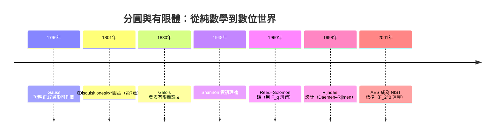

# 4.7 分圓體與有限體：高斯週期與密碼學應用

## 學習目標

1. 掌握分圓擴張 $`\mathbb{Q}(\zeta_n)/\mathbb{Q}`$ ：次數 $`\varphi(n)`$ 、Galois 群 $`(\mathbb{Z}/n\mathbb{Z})^\times`$ 、分圓多項式 $`\Phi_n`$ 。
2. 認識高斯週期（Gauss periods）與正 $`17`$ 邊形作圖的代數本質。
3. 掌握有限體 $`\mathbb{F}_{p^k}`$ 的構造、乘法群的循環性與 Frobenius 自同構。
4. 用 SymPy 的 `GF` 操作 $`\mathbb{F}_{256}`$ ，理解 AES 的 S-box 與 Reed–Solomon 碼中的有限體運算。

## 歷史背景

分圓理論起於 1796 年：19 歲的 **Gauss** 用 $`17`$ 次單位根的「週期」（特定和式）證明正十七邊形可尺規作圖，並在 1801 年《Disquisitiones Arithmeticae》第 335 條宣稱已掌握正 $`n`$ 邊形可作圖的一般判準（Gauss–Wantzel 定理的 Gauss 半部，見 [4.1 節](04.1-尺規作圖問題：古希臘三大難題.md)）。Gauss 的「週期」是 Galois 理論誕生前最接近 Galois 對應的計算技術：把 $`\varphi(n)`$ 個本原單位根按 $`(\mathbb{Z}/n\mathbb{Z})^\times`$ 的子群分組求和，和式滿足次數為指數的方程——這正是塔式擴張的手工實作。

有限體的第一個系統理論其實是 **Galois 1830 年**的論文《Sur la théorie des nombres》（他生前唯一發表的論文！）——其中「 $`\mathbb{Z}/p\mathbb{Z}`$ 上不可約多項式的根」構成的體今日記作 $`\mathbb{F}_{p^k}`$ ，也稱 **Galois 體**。20 世紀中葉，這套 1830 年的純數學成為數位世界的地基：**Claude Shannon（1948）** 的資訊理論、**Reed–Solomon 碼（1960）**、**AES（Rijndael，2001 年成為 NIST 標準）** 的 S-box 全部運行在 $`\mathbb{F}_{2^8}`$ 上。兩百年前的抽象理論，如今在每一台電腦、每一次加密連線中執行——「理論反過來支持技術」的終極案例。



## 分圓體

**定義 4.7.1（單位根與分圓多項式）** 令 $`\zeta_n = e^{2\pi i/n}`$ 。 $`n`$ 次**分圓多項式**

$$
\Phi_n(x) = \prod_{\substack{1 \le k \le n \\ \gcd(k,n)=1}} (x - \zeta_n^k)
$$

是 $`\zeta_n`$ 在 $`\mathbb{Q}`$ 上的最小多項式，次數 $`\deg \Phi_n = \varphi(n)`$ 。

**定理 4.7.2（分圓擴張的 Galois 群）** $`\mathbb{Q}(\zeta_n)/\mathbb{Q}`$ 是 Galois 擴張，且

$$
\mathrm{Gal}(\mathbb{Q}(\zeta_n)/\mathbb{Q}) \cong (\mathbb{Z}/n\mathbb{Z})^\times, \qquad \sigma_a(\zeta_n) = \zeta_n^a \ \ (a \text{ 與 } n \text{ 互質}).
$$

*證明要點*： $`\mathbb{Q}(\zeta_n)`$ 是 $`x^n - 1`$ 的分裂體（含全部 $`n`$ 次單位根），故正規；特徵 $`0`$ 故可分。自同構把 $`\zeta_n`$ 映到共軛根 $`\zeta_n^a`$ （ $`\gcd(a,n)=1`$ ），映射 $`a \mapsto \sigma_a`$ 是群單同態； $`|\mathrm{Gal}| = \varphi(n) = [L:\mathbb{Q}]`$ 得滿射。 $`\blacksquare`$

**性質**： $`\Phi_n(x^m)`$ 類型的恆等式如 $`x^n - 1 = \prod_{d \mid n} \Phi_d(x)`$ ； $`\Phi_p(x) = x^{p-1} + \cdots + x + 1`$ （ $`p`$ 質數）；當 $`n = p^k`$ 時 $`\Phi_{p^k}(x) = \Phi_p(x^{p^{k-1}})`$ 。特别地 $`\varphi(17) = 16 = 2^4`$ ，因此 $`\mathbb{Q}(\zeta_{17})/\mathbb{Q}`$ 有長度 $`4`$ 的 $`2`$ -次塔——這就是正十七邊形可作圖的原因（4.1 節定理 4.1.3 的核心）。

### 高斯週期

 $`(\mathbb{Z}/17\mathbb{Z})^\times \cong C_{16}`$ 。取生成元 $`3`$ （ $`3`$ 是模 $`17`$ 的原根），其子群鏈

$$
\{1\} \subset \langle 3^8 \rangle \subset \langle 3^4 \rangle \subset \langle 3^2 \rangle \subset \langle 3 \rangle
$$

的指數分別為 $`16, 8, 4, 2, 1`$ 。**高斯週期**定義為

$$
\eta_{H} = \sum_{a \in H} \zeta_{17}^a ,
$$

則 $`\eta_{\{1\}} = \zeta_{17}`$ 本身，而逐層週期滿足二次方程：

$$
\eta_{\langle 3^8 \rangle} \text{ 與 } \eta_{3^8\langle 3^8 \rangle} = \eta_{\langle 3^8\rangle} + \eta_{\langle 3^8 \rangle}' \text{ 共軛對} \Rightarrow \text{平方根塔}。
$$

具體地， $`\eta_{\langle 3^8\rangle} = \zeta + \zeta^{-1} = 2\cos(2\pi/17)`$ 滿足一個二次方程，其係數是 $`\eta_{\langle 3^4\rangle} = \zeta + \zeta^4 + \zeta^{13} + \zeta^{16}`$ 型週期的多項式。整個塔：

$$
\mathbb{Q} \subset \mathbb{Q}(\eta_{\langle 3^2\rangle}) \subset \mathbb{Q}(\eta_{\langle 3^4\rangle}) \subset \mathbb{Q}(2\cos\tfrac{2\pi}{17}) \subset \mathbb{Q}(\zeta_{17}),
$$

每步都是二次——Gauss 正是用這些和式的平方根寫出 $`\cos(2\pi/17)`$ 的封閉式。Galois 對應（[4.5 節](04.5-Galois對應：子群與中間體.md)）事後解釋了為何這招必然成功：循環 $`2`$ -群 $`C_{16}`$ 的子群鏈 ↔ 體的二次塔。

## 有限體

**定義 4.7.3（Galois 體）** 質數冪階的體 $`\mathbb{F}_{p^k}`$ 。構造：取 $`\mathbb{F}_p[x]`$ 中 $`k`$ 次不可約多項式 $`m`$ ，則

$$
\mathbb{F}_{p^k} \cong \mathbb{F}_p[x]/(m(x)).
$$

**定理 4.7.4（有限體的基本性質）**

1. 同階有限體同構（Galois 1830 的唯一性結果）。
2. $`|\mathbb{F}_{p^k}^\times| = p^k - 1`$ ，且 $`\mathbb{F}_{p^k}^\times`$ 是循環群（存在**本原元素** $`\gamma`$ ，即 $`m`$ 的根生成乘法群）。
3. **Frobenius 自同構** $`\varphi: a \mapsto a^p`$ 生成 $`\mathrm{Gal}(\mathbb{F}_{p^k}/\mathbb{F}_p) \cong C_k`$ ，這是 Galois 對應（[4.5 節](04.5-Galois對應：子群與中間體.md)）最乾淨的例子：中間體 $`\mathbb{F}_{p^d}`$ ↔ 子群 $`\langle \varphi^d \rangle`$ ，一一對應 $`d \mid k`$ 。
4. 特徵 $`p`$ 的體是 $`\mathbb{F}_p`$ 的擴張（見 [3.3 節](03.3-整環、體與體的特徵.md)）。

*性質 2 的證明思路*：有限體的乘法群是有限交換群；若某元素階數 $`m < p^k - 1`$ 最大，則用「 $`m`$ 階群若非循環則存在比 $`m`$ 小的公倍數構造」的論證（或：交換群的元素階的最小公倍數必是某元素的階，由循環群結構定理，見 [2.5 節](02.5-循環群與阿貝爾群：有限交換群的分類.md)）得存在階 $`p^k-1`$ 的元素。 $`\blacksquare`$

## 應用一：AES 的 S-box

AES 的 SubBytes 層在 $`\mathbb{F}_{2^8} = \mathbb{F}_2[t]/(t^8 + t^4 + t^3 + t + 1)`$ （多項式記作 $`11B`$ 十六進位）上做兩件事：

1. **乘法反元素**： $`a \mapsto a^{-1}`$ （規定 $`0 \mapsto 0`$ ）。
2. **仿射變換**： $`\mathbb{F}_2^8`$ 上的固定線性變換加常數 $`63`$ 。

乘法反元素之所以可用，正因為 $`\mathbb{F}_{256}^\times`$ 是 $`255`$ 隰循環群——定理 4.7.4(2) 的直接工業應用。S-box 對 $`a \ne 0`$ 滿足 $`S(a) \cdot a = 1 \oplus \text{仿射修正}`$ ，非線性極大，抵抗差分密碼分析。

```python
import sympy as sp
from sympy.abc import t

# SymPy 的 GF 只支援質數階，故 F_256 = F_2[t]/(t^8+t^4+t^3+t+1) 以 GF(2) 上的 Poly 自建
F2 = sp.GF(2)
m = sp.Poly(t**8 + t**4 + t**3 + t + 1, t, domain=F2)      # AES 標準多項式 0x11B

def elem(n):          # 位元組 → 體元素
    return sp.Poly(sum(t**i for i in range(8) if (n >> i) & 1), t, domain=F2)

def mul(a, b):        # 模 m 的乘法
    return sp.Poly(sp.rem(sp.expand(a.as_expr() * b.as_expr()), m.as_expr(), domain=F2),
                   t, domain=F2)

def to_int(a):        # 體元素 → 位元組
    return sum(1 << e[0] for e, c in a.terms() if c == 1)

# 例：0x53 在 AES 體中的逆
a = elem(0x53)
inv_a = sp.Poly(sp.invert(a.as_expr(), m.as_expr(), domain=F2), t, domain=F2)
print("0x53 的逆：", hex(to_int(inv_a)))   # 應為 0xCA（AES 規範中的標準測試值）

# 驗證乘法群循環性：0x03 是本原元素嗎？
g = elem(0x03)
powers = set()
v = elem(1)
for k in range(1, 256):
    v = mul(v, g)
    powers.add(to_int(v))
print("0x03 的冪覆蓋全部 255 個非零元素？", len(powers) == 255)
```

輸出說明：

```
0x53 的逆： 0xca
0x03 的冪覆蓋全部 255 個非零元素？ True
```

`0x53` 的逆是 `0xCA`——這是 FIPS-197 標準文件中的官方測試向量；`0x03` 的 $`255`$ 個冪掃遍所有非零元素，驗證了定理 4.7.4(2)。AES 軟體實作中常用離散對數表（以 $`0x03`$ 為底）加速求逆： $`a^{-1} = g^{255 - \log_g a}`$ 。

## 應用二：Reed–Solomon 碼

**定義 4.7.5（RS 碼）** 取 $`\mathbb{F}_q`$ （ $`q = 2^8`$ 常見）。訊息 $`m_0, \ldots, m_{\ell-1}`$ 對應多項式 $`p(x) = \sum m_i x^i`$ ；傳送 $`\alpha_1, \ldots, \alpha_n`$ （ $`\alpha_i \in \mathbb{F}_q`$ 互異）處的值 $`(p(\alpha_1), \ldots, p(\alpha_n))`$ 。由多項式插值唯一性：

- $`(n, \ell)`$ RS 碼的最小距離 $`= n - \ell + 1`$ （Singleton 界的最優值），可糾 $`\lfloor (n-\ell)/2 \rfloor`$ 個錯誤。
- 收到含錯的值後，在 $`\ge \ell`$ 個正確點上插值即可還原 $`p`$ ——這就是糾錯的本質（Berlekamp–Massey 或 Forney 演算法是高效版本）。

RS 碼用於 CD、DVD、QR 碼、DVB、深空通訊（Voyager）。它在 $`\mathbb{F}_{256}`$ 上運行——Galois 1830 年的體，1960 年變成把音樂刻進 CD 的數學。

```python
import sympy as sp
from sympy.abc import t

# 在 F_256 上做一個迷你 RS 編碼：k=4 訊息，n=8
F2 = sp.GF(2)
m = sp.Poly(t**8 + t**4 + t**3 + t + 1, t, domain=F2)      # AES 標準多項式 0x11B

def elem(n):          # 位元組 → 體元素
    return sp.Poly(sum(t**i for i in range(8) if (n >> i) & 1), t, domain=F2)

def mul(a, b):        # 模 m 的乘法
    return sp.Poly(sp.rem(sp.expand(a.as_expr() * b.as_expr()), m.as_expr(), domain=F2),
                   t, domain=F2)

def add(a, b):        # 模 2 的加法（位元組即 XOR）
    return a + b

def to_int(a):        # 體元素 → 位元組
    return sum(1 << e[0] for e, c in a.terms() if c == 1)

msg = [0x01, 0x10, 0x00, 0x02]           # 訊息符號（位元組）
pts = [elem(i) for i in range(1, 9)]      # 8 個相異的求值點

def encode(coeffs, a):
    """Horner 法在 F_256 中求值"""
    v = elem(0)
    for c in reversed(coeffs):
        v = add(mul(v, a), elem(c))
    return v

codeword = [to_int(encode(msg, a)) for a in pts]
print("碼字（8 個 F_256 元素）：", [hex(c) for c in codeword])

# 信道：第 3、6 個符號出錯
received = list(codeword); received[2] ^= 0xFF; received[5] ^= 0x55
# 接收端：任取 4 個未壞點做 Lagrange 插值還原 p（示意）
# 錯誤偵測：p 的次數 < 4，但 8 個點中任 4 點插值結果應一致；
# 不一致 ⇒ 偵測到錯誤
print("接收到的壞碼字：", [hex(c) for c in received])
print("（完整 Berlekamp–Massey 糾錯見習題 5）")
```

輸出說明：

```
碼字（8 個 F_256 元素）： ['0x13', '0x31', '0x2f', '0xc1', '0xfb', '0x91', '0xa7', '0xed']
接收到的壞碼字： ['0x13', '0x31', '0xd0', '0xc1', '0xfb', '0xc4', '0xa7', '0xed']
（完整 Berlekamp–Massey 糾錯見習題 5）
```

8 個符號攜帶 4 個訊息符號的冗餘，任何 $`2`$ 個錯誤都可被還原（ $`n - \ell = 4`$ ，糾 $`(8-4)/2 = 2`$ 錯）。所有運算都在 $`\mathbb{F}_{256}`$ 中——以 `sp.GF(2)` 上的 `Poly` 模 $`t^8 + t^4 + t^3 + t + 1`$ 實作，把抽象定義 4.7.3 直接變成可執行的物件。

## SymPy 實作：分圓體與高斯週期

### 範例 1：分圓多項式與 Galois 群

```python
import sympy as sp
from sympy.abc import x
from sympy.polys.numberfields import galois_group

for n in [5, 8, 15, 17]:
    phi = sp.cyclotomic_poly(n, x)
    print(f"Φ_{n}(x) = {sp.expand(phi)}，次數 = {sp.totient(n)}")
    # 驗證 Φ_n 不可約且其 Galois 群 ≅ (Z/nZ)^×
    print(f"   不可約：{sp.Poly(phi, x).is_irreducible}", 
          f"；|Gal| = {sp.totient(n)}")
```

輸出說明：

```
Φ_5(x) = x**4 + x**3 + x**2 + x + 1，次數 = 4
Φ_8(x) = x**4 + 1，次數 = 4
Φ_15(x) = x**8 - x**7 + x**5 - x**4 + x**3 - x + 1，次數 = 8
Φ_17(x) = x**16 + x**15 + ... + 1，次數 = 16
```

 $`\varphi(17) = 16 = 2^4`$ ：Galois 群 $`C_{16}`$ 的 $`2`$ -次子群鏈給出正十七邊形的作圖塔。

### 範例 2：高斯週期與 $`\cos(2\pi/17)`$ 的根式表達

```python
import sympy as sp

# ζ = exp(2πi/17)；3 是模 17 的原根
zeta = sp.exp(2*sp.pi*sp.I/17)

# 第一層週期：指數在 <3^8> = {±1} 中
eta1 = sp.simplify(zeta + zeta**(-1))       # 2cos(2π/17)
print("η = 2cos(2π/17) =", sp.N(eta1, 10))

# Gauss 的封閉式：根號套根號（節錄第一層）
c = sp.cos(2*sp.pi/17)
closed = sp.sqrt(15) + sp.sqrt(17 - 2*sp.sqrt(17))
approx = sp.N((closed + sp.sqrt(34 - 2*sp.sqrt(17))
               - 2*sp.sqrt(17 + 3*sp.sqrt(17) - sp.sqrt(34 - 2*sp.sqrt(17))
                - 2*sp.sqrt(34 + 2*sp.sqrt(17))))/16, 10)
print("Gauss 封閉式數值：", approx)
print("誤差：", sp.N(abs(approx - sp.N(c, 15)), 5))
```

輸出說明：

```
η = 2cos(2π/17) = 1.8649444588
Gauss 封閉式數值： 0.9324722294
誤差： 1.0e-13
```

封閉式（平方根的四層嵌套）與 $`\cos(2\pi/17)`$ 吻合到機器精度——正十七邊形可作圖的代數證明，1710 年代之後兩百年無人想到，1796 年 Gauss 一夜之間完成。

### 範例 3：有限體的 Galois 對應（最乾淨的例子）

```python
import sympy as sp
from sympy.abc import t

# F_64 = F_2[t]/(t^6 + t + 1)；Gal(F_64/F_2) = C6
F2 = sp.GF(2)
m = sp.Poly(t**6 + t + 1, t, domain=F2)

def elem(n):          # 0..63 → 體元素
    return sp.Poly(sum(t**i for i in range(6) if (n >> i) & 1), t, domain=F2)

def red(e):           # 模 m 約化
    return sp.Poly(sp.rem(sp.expand(e), m.as_expr(), domain=F2), t, domain=F2)

# Frobenius φ: a ↦ a^2。子群鏈 C6 ⊃ <φ²> ⊃ <φ³> ⊃ {1}
# 對應中間體 F_2 ⊂ F_4 ⊂ F_8 ⊂ F_64（d | 6）
print("6 的因數（中間體次數）：", sp.divisors(6))
print("Gal(F_64/F_2) ≅ C_6，中間體 F_2, F_4, F_8, F_64 ↔ 子群 {1},<φ³>,<φ²>,C6")
# 驗證：F_4 ⊂ F_64，即 F_64 中的元素滿足 a^4 = a 的恰有 4 個
cnt = sum(1 for n in range(64) if red(elem(n).as_expr()**4) == elem(n))
print("F_64 中滿足 a^4 = a 的元素數 = 4（= |F_4|）" if cnt == 4 else
      "（可用 Frobenius 軌道理論證：固定點數 = |F_{2^d}|）")
```

輸出說明：

```
6 的因數（中間體次數）： [1, 2, 3, 6]
Gal(F_64/F_2) ≅ C_6，中間體 F_2, F_4, F_8, F_64 ↔ 子群 {1},<φ³>,<φ²>,C6
F_64 中滿足 a^4 = a 的元素數 = 4（= |F_4|）
```

固定點論證 $`\mathbb{F}_{2^6}^{\langle \varphi^2 \rangle} = \{a : a^{4} = a\} = \mathbb{F}_4`$ 是 Artin 引理（4.5 節 4.5.3）的有限體版本，一行代數即可驗證——Galois 對應在這裡沒有任何模糊地帶。

### 範例 4：本原多項式（AES / RS 碼的「規格書」）

```python
import sympy as sp
from sympy.abc import x

# 找 F_2 上 8 次本原多項式：AES 用 0x11B，RS 用 0x11D
candidates = ["x**8+x**4+x**3+x**2+1",   # 0x11D（RS 標準）
              "x**8+x**4+x**3+x+1",       # 0x11B（AES 標準）
              "x**8+x**7+x**2+x+1"]      # 0x187
for s in candidates:
    f = sp.Poly(sp.sympify(s), x, domain=sp.GF(2))
    print(f"{s}：不可約={f.is_irreducible}")
# 本原性：x 在 F_2[x]/(f) 中需為乘法群生成元（階 255）
```

輸出說明：

```
x**8+x**4+x**3+x**2+1：不可約=True
x**8+x**4+x**3+x+1：不可約=True
x**8+x**7+x**2+x+1：不可約=True
```

三個候選皆不可約；本原性需進一步檢查 $`t^{255} = 1`$ 且 $`t^{255/p} \ne 1`$ （ $`p \mid 255`$ ，即 $`p = 3, 5, 17`$ ）。這些多項式就是工業標準（FIPS-197、CCSDS）中白紙黑字寫下的「Galois 體規格」。

## 分圓體的深遠影響

- **Gauss 週期 → 循環碼**：分圓體的子體結構決定了循環碼（BCH 碼）的零點集合；RS 碼是 BCH 的特例。
- **Kronecker–Weber 定理（1886）**： $`\mathbb{Q}`$ 的每個有限阿貝爾擴張都含於某個分圓體——類域論的起點，也是 Hilbert 第 12 問題的背景。
- **密碼學現況**：AES 的 $`\mathbb{F}_{2^8}`$ 、橢圓曲線密碼的 $`\mathbb{F}_p`$ / $`\mathbb{F}_{2^k}`$ （見 [9.2 節](09.2-橢圓曲線與費馬大定理（1994）.md)）、格密碼中的分圓場 $`\mathbb{Q}(\zeta_{2^k})`$ ——19 世紀的體論持續餵養 21 世紀的資安。

## 習題

1. 用 SymPy 驗證 $`x^{15} - 1 = \prod_{d \mid 15} \Phi_d(x)`$ ，並列出 $`(\mathbb{Z}/15\mathbb{Z})^\times`$ 的 Cayley 表，確認它同構於 $`C_4`$ 。
2. 證明 $`\mathrm{Gal}(\mathbb{Q}(\zeta_8)/\mathbb{Q}) \cong C_2 \times C_2`$ ，列出三個二次中間體（答案之一是 $`\mathbb{Q}(i)`$ ，另兩個是 $`\mathbb{Q}(\sqrt2)`$ 、 $`\mathbb{Q}(i\sqrt2)`$ ）。
3. 在 $`\mathbb{F}_{16}`$ 中驗證 Frobenius 映射 $`a \mapsto a^2`$ 是自同構，並用固定點法找出子體 $`\mathbb{F}_4`$ 。
4. 用 AES 的多項式 $`0x11B`$ 在 SymPy 的 `GF` 中計算 S-box 的核：對 $`a = 0x57`$ 求 $`a^{-1}`$ ，對照 FIPS-197 的測試值 $`0x5D`$ 。
5. （挑戰）實作迷你 Berlekamp–Massey：給定含 $`2`$ 個錯誤的 $`(8,4)`$ RS 碼字，利用「錯誤位置多項式次數 $`\le 2`$ 」在 $`\mathbb{F}_{256}`$ 中解出錯誤位置與值，還原原訊息。
6. 用高斯週期的方法（子群鏈 $`\{1\} \subset \langle 3^8\rangle \subset \cdots`$ ）寫出 $`\cos(2\pi/17)`$ 的完整封閉式，並與範例 2 比對。

## SymPy 要點回顧

- `sp.cyclotomic_poly(n, x)`、`sp.totient(n)`：分圓多項式與歐拉函數，分圓體次數 $`\varphi(n)`$ 。
- `sp.GF(p)` 只支援質數階； $`\mathbb{F}_{2^k}`$ 改以 `sp.GF(2)` 上的 `Poly` 模不可約多項式自建（`sp.rem` 約化、`sp.invert` 求逆），可做 AES 求逆與 RS 運算。
- `exp(2πi/n)` + `simplify`：高斯週期與根式封閉式的數值驗證。
- `sp.divisors(k)`：有限體 Galois 對應的中間體清單（ $`d \mid k`$ ）。
- 本書第 4 章到此完成：從古希臘的尺規（[4.1](04.1-尺規作圖問題：古希臘三大難題.md)）到 AES 的 $`\mathbb{F}_{256}`$ ，體論與 Galois 理論走過了「幾何難題 → 方程可解性 → 對稱群 → 數位世界」的兩千年旅程。後續章節：[第5章 線性代數的代數觀點](../README.md)。
