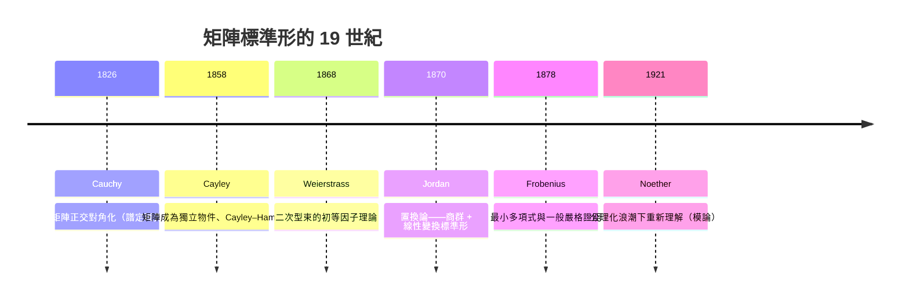
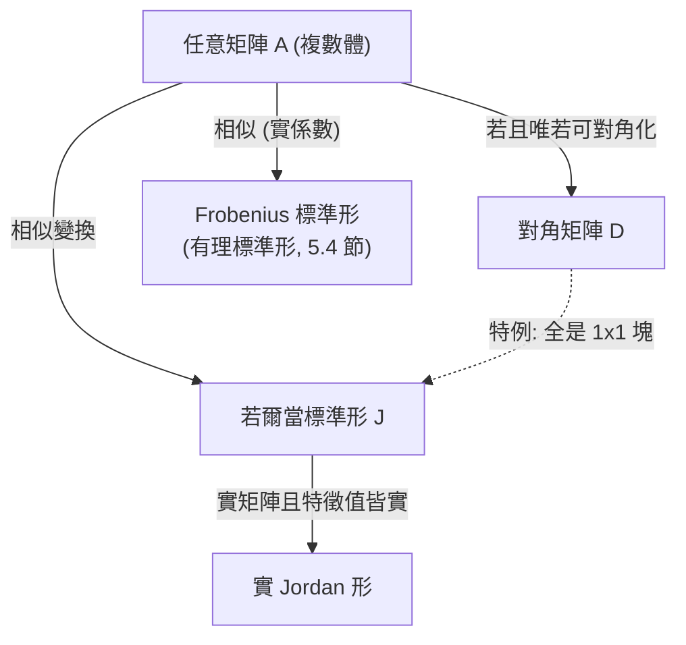

# 5.3 若爾當標準形與若爾當（1870）的工作

## 學習目標

- 理解為什麼不是所有矩陣都可對角化，以及「退而求其次」的最佳標準形是什麼。
- 定義若爾當塊與若爾當標準形，敘述存在唯一性定理。
- 了解 Camille Jordan 1870 年《Traité des substitutions et des équations algébriques》的歷史脈絡：這本書同時孕育了 [2.4 節](02.4-正規子群與商群：若爾當（1870）的貢獻.md)的商群概念與線性代數的標準形理論。
- 能用 SymPy 的 `jordan_cells` 計算若爾當標準形。

## 歷史背景

### 5.3.1 從對角化的失敗說起

[5.2 節](05.2-特徵值、特徵多項式與Cayley–Hamilton定理.md)末尾展示了 $`A = \begin{pmatrix} 1 & 1 \\ 0 & 1\end{pmatrix}`$ 不可對角化。這不是病態例子——**微分方程組 $`\mathbf{x}' = A\mathbf{x}`$ 、差分方程、Markov 鏈**中出現的矩陣經常有重根而不可對角化。19 世紀的數學家需要一個能處理**所有**線性變換的標準形。

### 5.3.2 Camille Jordan 與 1870 年的《置換論》

**Marie Ennemond Camille Jordan**（若爾當，1838–1922）是巴黎綜合理工學院的工程師與數學家（與 [5.1 節](05.1-矩陣論的起源：凱萊（1858）與線性方程組.md)的凱萊不是同一人；注意還有德國的 Pascual Jordan 是 20 世紀物理學家）。1870 年他出版了巨著《Traité des substitutions et des équations algébriques》（《置換論與代數方程》），這本書：

1. 系統化了 **Galois 理論**——把伽羅瓦 1832 年的手稿整理成可傳播的理論，提出**正規子群**與**商群**的概念（見 [2.4 節](02.4-正規子群與商群：若爾當（1870）的貢獻.md)）；
2. 證明了**有限交換群分類**的早期版本（見 [2.5 節](02.5-循環群與阿貝爾群：有限交換群的分類.md)與 [5.6 節](05.6-主理想環上的模：有限交換群的結構定理.md)）；
3. 包含了**線性變換化為標準形**的理論——今日所稱的**若爾當標準形**（Jordan normal form）。

要注意歷史細節：若爾當 1870 年的原始形式是處理「典範基底下的二次型/線性變換」，現在的矩陣形式經過 **Frobenius（1878）**與 **Weierstrass（1868）**（後者處理「束」pencil 的理論）的加工。這是理論在學派之間流動、被抽象化的典型過程。動機又是技術性的：**天體力學中的線性化微分方程組**需要知道矩陣冪 $`A^k`$ 與指數 $`e^{At}`$ 的行為，而只有把 $`A`$ 化成標準形才看得出來。



## 數學理論

### 5.3.3 不變子空間與廣義特徵向量

> **定義 5.3.1**。設 $`A \in M_n(F)`$ ， $`\lambda`$ 為特徵值。 $`k`$ 階**廣義特徵空間**定義為
> 

$$
G_\lambda = \ker\left((A - \lambda I)^n\right).
$$

$`\{0\} \subset \ker(A-\lambda I) \subseteq \ker(A-\lambda I)^2 \subseteq \cdots`$ 這條鏈最遲在 $`n`$ 步穩定，穩定點就是 $`G_\lambda`$ ，維度等於 $`\lambda`$ 的代數重數。特徵向量是 $`k=1`$ 的廣義特徵向量；**若爾當理論的核心思想是：僅用特徵向量不夠，要用「鏈狀」的廣義特徵向量**。

### 5.3.4 若爾當塊與標準形

> **定義 5.3.2**。對應特徵值 $`\lambda`$ 的 $`k`$ 階**若爾當塊**是
> 

$$
J_k(\lambda) = \begin{pmatrix} \lambda & 1 & & \\ & \lambda & \ddots & \\ & & \ddots & 1 \\ & & & \lambda \end{pmatrix} = \lambda I_k + N_k, \qquad N_k = \begin{pmatrix} 0 & 1 & & \\ & 0 & \ddots & \\ & & \ddots & 1 \\ & & & 0\end{pmatrix}.
$$

$`N_k`$ 是**移位算子**，滿足 $`N_k^k = O`$ （而 $`N_k^{k-1} \neq O`$ ）。因此

$$
J_k(\lambda)^m = (\lambda I + N)^m = \sum_{j=0}^{\min(m,k-1)} \binom{m}{j}\lambda^{m-j}N^j,
$$

這就是**為什麼微分方程需要若爾當形**： $`e^{Jt}`$ 的每個塊都是 $`\lambda^t e`$ 乘上多項式——重根情形的解是「 $`e^{\lambda t}`$ 乘多項式」，這正是常微分方程課本裡重根情形的公式來源。

> **定義 5.3.3**。**若爾當標準形**是分塊對角矩陣 $`J = \operatorname{diag}\big(J_{k_1}(\lambda_1), \dots, J_{k_r}(\lambda_r)\big)`$ ，各塊尺寸總和為 $`n`$ 。

> **定理 5.3.4（若爾當標準形存在性， $`F`$ 代數閉）**。對任意 $`A \in M_n(F)`$ （ $`F`$ 代數閉，如 $`\mathbb{C}`$ ），存在可逆 $`P`$ 使 $`P^{-1}AP = J`$ 為若爾當標準形。

**證明思路**（對 $`n`$ 歸納）：

1. $`\chi_A(t) = \prod_i (t - \lambda_i)^{m_i}`$ ，可證 $`F^n = \bigoplus_i G_{\lambda_i}`$ （廣義特徵空間直和，各維 $`m_i`$ ）——用 Bezout：存在多項式 $`p_i(t)`$ 使 $`\sum p_i(t)\frac{\chi_A(t)}{(t-\lambda_i)^{m_i}} = 1`$ ，把 $`1`$ 拆開就得到直和分解的投影。這一步已經預示了 [5.4 節](05.4-最小多項式與Frobenius（1878）的矩陣理論.md)與 [5.6 節](05.6-主理想環上的模：有限交換群的結構定理.md)的 PID 分解思想。
2. 在每個 $`G_{\lambda_i}`$ 上， $`B = A - \lambda_i I`$ 是冪零的（ $`B^n = O`$ ）。歸納地把冪零矩陣化為移位塊的直和：取 $`B^{j}`$ 的核鏈構造「若爾當鏈」 $`\mathbf{v}, B\mathbf{v}, B^2\mathbf{v}, \dots`$ 。
3. 每條鏈給出一個若爾當塊。 $`\blacksquare`$

> **定理 5.3.5（唯一性）**。若爾當標準形在「塊的排列」意義下唯一：對每個特徵值 $`\lambda`$ ，尺寸為 $`k`$ 的塊 $`J_k(\lambda)`$ 的個數由 $`A`$ 決定，等於
> 

$$
r_k(\lambda) = \operatorname{rank}(A-\lambda I)^{k-1} - 2\operatorname{rank}(A-\lambda I)^{k} + \operatorname{rank}(A-\lambda I)^{k+1}.
$$

**可對角化判準**： $`A`$ 可對角化 $`\iff`$ 所有若爾當塊都是 $`1\times1`$ $`\iff`$ 每個特徵值的幾何重數 $`=`$ 代數重數（回顧 [5.2 節](05.2-特徵值、特徵多項式與Cayley–Hamilton定理.md)定理 5.2.7）。

### 5.3.5 幾種標準形的關係



若爾當形的缺點：需要代數閉體，且 $`P`$ 的元素可能無理/複數。**Frobenius 有理標準形**（見 [5.4 節](05.4-最小多項式與Frobenius（1878）的矩陣理論.md)）在任何體上都存在且係數保持在原體中。

### 5.3.6 應用：矩陣函數與微分方程

設 $`J = \operatorname{diag}(J_1, \dots, J_r)`$ 是 $`A`$ 的若爾當形， $`f`$ 是足夠光滑的函數，定義 $`f(A) = P f(J) P^{-1}`$ ，其中

$$
f\big(J_k(\lambda)\big) = \begin{pmatrix} f(\lambda) & \frac{f'(\lambda)}{1!} & \cdots & \frac{f^{(k-1)}(\lambda)}{(k-1)!} \\ & f(\lambda) & \ddots & \vdots \\ & & \ddots & \frac{f'(\lambda)}{1!} \\ & & & f(\lambda) \end{pmatrix}.
$$

特別地 $`A^m`$ 與 $`e^{At}`$ 都能顯式寫出。微分方程組 $`\mathbf{x}' = A\mathbf{x}`$ 的解是 $`\mathbf{x}(t) = e^{At}\mathbf{x}_0`$ ——**若爾當形把線性 ODE 系統的解完全代數化**，這正是它誕生的技術動機。

## SymPy 實作

### 範例 1：jordan_cells 的基本用法

```python
import sympy as sp

A = sp.Matrix([[1, 1], [0, 1]])
P, J = A.jordan_cells()
print("P =", P)
print("J =", J)
print("驗證 A = P J P^{-1}:", P * J * P.inv() == A)
```

輸出：

```
P = Matrix([[1, 0], [0, 1]])
J = [Matrix([[1, 1], [0, 1]])]
驗證 A = P J P^{-1}: True
```

這個 $`A`$ **本身就是**一個若爾當塊 $`J_2(1)`$ 。注意 `jordan_cells` 回傳的 `J` 是「塊的串列」；單一塊時直接是該矩陣。

### 範例 2：混合特徵值的矩陣

```python
import sympy as sp

A = sp.Matrix([[4, 1, 0], [0, 4, 0], [0, 0, 2]])
P, J = A.jordan_cells()
print("J =", J)
# [[4, 1, 0], [0, 4, 0], [0, 0, 2]]  =>  塊 J_2(4) 與 J_1(2)
```

輸出：

```
J = [Matrix([
[2, 0, 0],
[0, 4, 1],
[0, 0, 4]])]
```

（塊的順序可能與輸入特徵值順序不同，SymPy 自行排列。）驗證唯一性：塊 $`J_2(4)`$ 一個、 $`J_1(2)`$ 一個，與定理 5.3.5 的 rank 公式一致。

### 範例 3：用 rank 公式驗證塊結構

```python
import sympy as sp

def r_k(A, lam, k):
    """定理 5.3.5: 尺寸為 k 的 J_k(lam) 個數"""
    M1 = (A - lam*sp.eye(A.rows))**(k-1)
    M2 = (A - lam*sp.eye(A.rows))**k
    M3 = (A - lam*sp.eye(A.rows))**(k+1)
    return M1.rank() - 2*M2.rank() + M3.rank()

A = sp.Matrix([[5, 1, 0, 0],
               [0, 5, 0, 0],
               [0, 0, 5, 1],
               [0, 0, 0, 5]])
lam = 5
for k in (1, 2):
    print(f"J_{k}({lam}) 個數 =", r_k(A, lam, k))
```

輸出：

```
J_1(5) 個數 = 0
J_2(5) 個數 = 2
```

兩個 $`2\times2`$ 塊： $`\operatorname{diag}(J_2(5), J_2(5))`$ 。rank 序列 $`4, 2, 0`$ 的二階差分給出塊計數。

### 範例 4：矩陣函數 $`e^{At}`$ 與微分方程

```python
import sympy as sp

t = sp.Symbol('t', positive=True)
A = sp.Matrix([[0, 1], [-1, 0]])          # 旋轉生成元
print("exp(At) =", sp.exp(A*t))           # SymPy 自動用 Jordan/Putzer 方法
# 結果: [[cos(t), sin(t)], [-sin(t), cos(t)]] —— 諧振子解！
```

輸出：

```
exp(At) = Matrix([[cos(t), sin(t)], [-sin(t), cos(t)]])
```

諧振子方程 $`x'' + x = 0`$ 化為一階系統 $`\mathbf{x}' = A\mathbf{x}`$ ，其基本矩陣 $`e^{At}`$ 就是旋轉矩陣——線性代數（矩陣指數）與微分方程的交會點。

## 習題

1. 手算 $`J_3(0)^2`$ 與 $`J_3(0)^3`$ ，驗證 $`N_3^3 = O`$ 。
2. 求矩陣 $`A = \begin{pmatrix} 2 & 1 & 1 \\ 0 & 2 & 1 \\ 0 & 0 & 2 \end{pmatrix}`$ 的若爾當形（它是幾個塊？）。
3. 用 SymPy 找出 $`A = \begin{pmatrix} 3 & 1 & 0 \\ -4 & -1 & 0 \\ 4 & -8 & -2\end{pmatrix}`$ 的若爾當形與轉換矩陣 $`P`$ 。
4. 證明：若爾當塊 $`J_k(\lambda)`$ 的最小多項式是 $`(t-\lambda)^k`$ （為 [5.4 節](05.4-最小多項式與Frobenius（1878）的矩陣理論.md)鋪路）。
5. 證明：矩陣 $`A`$ 可對角化 $`\iff`$ $`A`$ 的最小多項式無重根（提示：用定理 5.3.4 與習題 4）。
6. 用 $`e^{Jt}`$ 的公式寫出 $`\mathbf{x}' = A\mathbf{x}`$ 、 $`A = \begin{pmatrix}1 & 1\\ 0 & 1\end{pmatrix}`$ 的通解，並說明「重根 ⇒ 解多項式乘 $`e^t`$ 」的現象。
7. 用 `r_k` 函數計算習題 2 的塊結構，與手算對照。
8. （挑戰）證明定理 5.3.5 中 $`r_k(\lambda)`$ 公式（提示：先對單一塊計算 $`\operatorname{rank} J_k(\lambda)^j`$ ）。

## SymPy 要點回顧

| 語法 | 意義 |
|------|------|
| `A.jordan_cells()` | 回傳 `(P, J)`， $`P^{-1}AP = J`$ ；`J` 是塊的串列 |
| `A**k`、`sp.exp(A*t)` | 矩陣冪、矩陣指數（SymPy 內部用若爾當/Putzer 方法） |
| `A.rank()` | 秩（塊結構公式所需） |
| `A.eigenvals()` | 特徵值與代數重數（塊的 λ 與總維度） |

**注意**：`jordan_cells` 對符號參數矩陣可能很慢，建議先用 `eigenvals` 確認特徵值結構，或對數值/小矩陣使用。

**下一節**：若爾當理論背後更深的代數——最小多項式與 Frobenius 的矩陣理論，見 [5.4 節](05.4-最小多項式與Frobenius（1878）的矩陣理論.md)。
