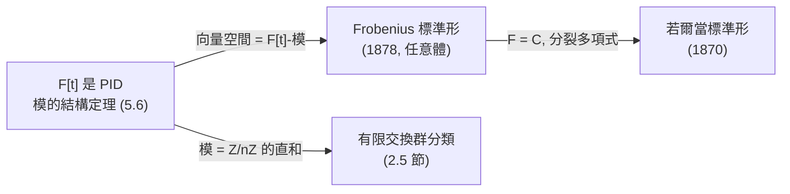

# 5.4 最小多項式與 Frobenius（1878）的矩陣理論

## 學習目標

- 定義最小多項式，證明其存在性、唯一性與基本性質（整除特徵多項式）。
- 理解 Frobenius 1878 年論文《Ueber lineare Substitutionen und bilineare Formen》的內容：最小多項式、相似不變量、有理標準形的思想。
- 認識矩陣理論與**群表示論**（見 [第6章](06.1-群特徵標的誕生：弗比尼烏斯（1896）.md)）之間「技術需求驅動理論」的關係。
- 能用 SymPy 計算最小多項式與 Frobenius 標準形。

## 歷史背景

### 5.4.1 Frobenius：從行列式到矩陣到表示論

**Ferdinand Georg Frobenius**（弗比尼烏斯，1849–1917）是 19 世紀後半最重要的代數學家之一，柏林大學教授。他的生涯本身就是「技術驅動理論」的教科書案例：

| 年代 | 工作 | 驅動力 |
|------|------|--------|
| 1878 | 《論線性替換與雙線性形式》：最小多項式、矩陣相似理論的系統化 | 整理 Cayley/Jordan 的散亂結果；為雙線性形式的分類服務 |
| 1879–1883 | 初等因子理論（承 Weierstrass 1868） | 二次型與束（pencil）的分類 |
| 1896–1903 | **群特徵標與表示論**的創立 | 對稱群與有限群的結構研究（Dedekind 的群行列式問題） |

1896 年 **Dedekind** 問 Frobenius 一個具體計算問題：如何分解「群行列式」 $`\det\big(\sum_{g\in G} x_g \rho(g)\big)`$ ？Frobenius 為解決它發明了**群特徵標**——這是 [6.1 節](06.1-群特徵標的誕生：弗比尼烏斯（1896）.md)的主題。而要在群表示的語言裡工作，就需要 1878 年那套**矩陣理論**：相似分類、最小多項式、標準形。換言之，**1878 年的矩陣理論是 1896 年表示論的基礎設施**，正如 [5.1 節](05.1-矩陣論的起源：凱萊（1858）與線性方程組.md)的矩陣代數是 [5.2 節](05.2-特徵值、特徵多項式與Cayley–Hamilton定理.md)特徵值理論的基礎設施。

### 5.4.2 為什麼需要「最小」多項式

Cayley–Hamilton（[5.2 節](05.2-特徵值、特徵多項式與Cayley–Hamilton定理.md)）說 $`A`$ 滿足自己的 $`n`$ 次特徵方程。但 $`A`$ 可能滿足**更低次**的方程： $`A = \lambda I`$ 只需 $`t - \lambda`$ 。刻劃「 $`A`$ 到底滿足哪個最低次的多項式」就是最小多項式——它是矩陣的「代數指紋」，決定了若爾當塊的最大尺寸（從而與 [5.3 節](05.3-若爾當標準形與若爾當（1870）的工作.md)的塊結構直接相連）。

## 數學理論

### 5.4.3 最小多項式

> **定義 5.4.1**。設 $`A \in M_n(F)`$ 。稱多項式 $`f(t) \in F[t]`$ **零化** $`A`$ ，若 $`f(A) = O`$ 。次數最低的首一零化多項式稱為 $`A`$ 的**最小多項式**，記作 $`\mu_A(t)`$ 。

> **定理 5.4.2（存在唯一性）**。最小多項式存在且唯一，並且整除**所有**零化 $`A`$ 的多項式。

**證明**。零化多項式構成 $`F[t]`$ 的子集 $`I = \{f : f(A) = O\}`$ ，而 $`F[t]`$ 是主理想環（PID，見 [3.4 節](03.4-多項式環、整除性與因式分解.md)），非零理想由次數最低的元素生成： $`I = (\mu_A)`$ 。因此 $`f(A)=O \Rightarrow f \in (\mu_A) \Rightarrow \mu_A \mid f`$ 。若 $`\mu_1, \mu_2`$ 都是最小多項式，則互相整除且皆首一，故相等。 $`\blacksquare`$

**這個證明值得停下來看**：它沒有任何矩陣技巧，只用了「 $`F[t]`$ 是 PID」+「線性映射 $`f \mapsto f(A)`$ 的核是理想」。這種「代數物件由其滿足的關係決定」的思想，正是 [5.5 節](05.5-模與向量空間：諾特與阿廷的公理化.md)模論（ $`F[t]`$ -模結構）與 [5.6 節](05.6-主理想環上的模：有限交換群的結構定理.md)結構定理的胚芽。

由 Cayley–Hamilton 立即得到：

> **定理 5.4.3（Cayley–Hamilton 的精煉版）**。 $`\mu_A \mid \chi_A`$ 。特別地 $`\deg \mu_A \le n`$ 。

> **定理 5.4.4（基本性質）**。
> 1. $`\mu_A`$ 與 $`\chi_A`$ 有相同的根集（不計重數）： $`A`$ 的特徵值恰是 $`\mu_A`$ 的根；
> 2. 若 $`A \sim B`$ （相似），則 $`\mu_A = \mu_B`$ ——最小多項式是相似不變量；
> 3. 對若爾當塊， $`\mu_{J_k(\lambda)}(t) = (t-\lambda)^k`$ ；
> 4. 若 $`A = \operatorname{diag}(A_1, \dots, A_r)`$ （分塊對角），則 $`\mu_A = \operatorname{lcm}(\mu_{A_1}, \dots, \mu_{A_r})`$ 。

**證明思路**。(1)： $`\lambda`$ 是 $`\chi_A`$ 的根， $`\chi_A = \mu_A q`$ ，故 $`\chi_A(\lambda) = 0 = \mu_A(\lambda)q(\lambda)`$ ，而 $`q(\lambda) \neq 0`$ （否則 $`\lambda`$ 是 $`q`$ 的根，與 $`\chi_A = \mu_A q`$ 的根集比對矛盾——更嚴格地：若 $`\mu_A(\lambda) \ne 0`$ 則 $`(t-\lambda)^{-1}`$ 層次展開顯示矛盾；標準證法用 $`(A-\lambda I)\mathbf{v} \ne 0`$ 的廣義特徵向量鏈）。(2)： $`\mu_A(PBP^{-1}) = P\mu_A(B)P^{-1}`$ 。(3)： $`N_k^k = O \ne N_k^{k-1}`$ 。(4)： $`\mu_A(A_i) = O`$ 對所有 $`i`$ ，故 $`\mu_{A_i} \mid \mu_A`$ ，反之 $`\operatorname{lcm}`$ 零化所有塊。 $`\blacksquare`$

### 5.4.5 最小多項式與可對角化

> **定理 5.4.6（Frobenius / 可對角化判準）**。 $`A`$ 可對角化 $`\iff`$ $`\mu_A`$ 無重根（在代數閉包中）。

**證明思路**。 $`(\Leftarrow)`$ 若 $`\mu_A = \prod_i (t-\lambda_i)`$ 無重根，則由 $`\mu_A(A)=O`$ 與 Bezout 恆等式 $`\sum p_i(t)\frac{\mu_A(t)}{t-\lambda_i} = 1`$ （這裡用到 $`\lambda_i`$ 互異），得到 $`F^n = \bigoplus_i \ker(A - \lambda_i I)`$ ——全是特徵空間，故可對角化。 $`(\Rightarrow)`$ 若 $`A`$ 可對角化， $`A \sim \operatorname{diag}(\lambda_i)`$ ，由性質 4 最小多項式是 $`\prod_i (t - \lambda_i)`$ （互異根），無重根。 $`\blacksquare`$

回顧 [5.3 節](05.3-若爾當標準形與若爾當（1870）的工作.md)： $`J_k(\lambda)`$ 的最小多項式是 $`(t-\lambda)^k`$ ，故

> **定理 5.4.7（最小多項式決定最大塊）**。設 $`A`$ 的若爾當形中，特徵值 $`\lambda`$ 的最大塊尺寸為 $`s(\lambda)`$ ，則
> 

$$
\mu_A(t) = \prod_{\lambda \text{ 特徵值}} (t - \lambda)^{s(\lambda)}, \qquad \chi_A(t) = \prod_{\lambda}(t-\lambda)^{m(\lambda)}.
$$

**最小多項式給出塊的「最大尺寸」，特徵多項式給出塊的「總尺寸」**。知道這兩個多項式往往足以（在維度小時）唯一決定若爾當形。

### 5.4.6 Frobenius 標準形（有理標準形）

Frobenius 1878 年的另一貢獻是把 [5.3 節](05.3-若爾當標準形與若爾當（1870）的工作.md)的標準形**推廣到任意體**（不必代數閉、不必分裂特徵多項式）：

> **定義 5.4.8**。對首一多項式 $`p(t) = t^k + a_{k-1}t^{k-1} + \cdots + a_0`$ ，其**伴隨矩陣**（友矩陣，companion matrix）為
> 

$$
C(p) = \begin{pmatrix} 0 & 0 & \cdots & 0 & -a_0 \\ 1 & 0 & \cdots & 0 & -a_1 \\ & \ddots & & \vdots \\ 0 & & 1 & 0 & -a_{k-2} \\ 0 & & 0 & 1 & -a_{k-1} \end{pmatrix}.
$$

> **定理 5.4.9（Frobenius，1878）**。對任意 $`A \in M_n(F)`$ ，存在可逆 $`P`$ 使
> 

$$
P^{-1}AP = \operatorname{diag}\big(C(p_1), C(p_2), \dots, C(p_r)\big),
$$

> 其中 $`p_1 \mid p_2 \mid \cdots \mid p_r`$ （**不變因子**）， $`p_r = \mu_A`$ ， $`p_1 p_2 \cdots p_r = \chi_A`$ 。此標準形在唯一性意義下不變。

 $`C(p)`$ 的特徵多項式與最小多項式都是 $`p`$ 。當 $`F = \mathbb{C}`$ 進一步把 $`p_i`$ 分裂成線性因子，就得到若爾當形——**Frobenius 標準形是若爾當形的「算術前身」**，它的證明（透過 $`F[t]`$ -模的 PID 結構定理）正是 [5.6 節](05.6-主理想環上的模：有限交換群的結構定理.md)的主題。事實上，同一套定理還給出**有限交換群的分類**（見 [2.5 節](02.5-循環群與阿貝爾群：有限交換群的分類.md)）——這是數學統一性的絕佳範例。



## SymPy 實作

### 範例 1：計算最小多項式

```python
import sympy as sp
from itertools import product

t = sp.Symbol('t')

def poly_eval_matrix(f, A):
    """把多項式 f 代入矩陣：f(A)"""
    result = sp.zeros(A.rows)
    for c in sp.Poly(f, t).all_coeffs():
        result = result * A + c * sp.eye(A.rows)
    return result

def minimal_poly(A):
    """最小多項式：枚舉特徵多項式的首一因式，找最低次的零化多項式"""
    coeff, factors = sp.factor_list(A.charpoly(t).as_expr(), t)
    best = None
    for combo in product(*[range(e + 1) for _, e in factors]):
        f = sp.Poly(coeff, t)
        for (g, _), k in zip(factors, combo):
            f *= sp.Poly(g, t) ** k
        if poly_eval_matrix(f.as_expr(), A) == sp.zeros(A.rows):
            if best is None or f.degree() < best.degree():
                best = f
    return sp.factor(best.as_expr())

A = sp.Matrix([[1, 1], [0, 1]])
print("chi_A =", sp.factor(A.charpoly(t).as_expr()))   # (t - 1)**2
print("mu_A  =", minimal_poly(A))                       # (t - 1)**2

B = sp.eye(2)
print("mu_I =", minimal_poly(B))                        # t - 1（一次！）
```

輸出：

```
chi_A = (t - 1)**2
mu_A  = (t - 1)**2
mu_I = t - 1
```

**程式說明**：SymPy 的 `Matrix` 類別沒有內建最小多項式方法（`sp.minimal_polynomial` 是給代數數用的），所以我們自訂 `minimal_poly`：由 Cayley–Hamilton 知 $`\mu_A \mid \chi_A`$ ，故只需枚舉 $`\chi_A`$ 的首一因式（`factor_list` 給出素因式與重數，`product` 枚舉各指數 $`0..e`$ ），取最低次的零化者。`poly_eval_matrix` 用 Horner 法計算 $`f(A)`$ 。

 $`I`$ 的最小多項式只有一次：雖然 $`\chi_I = (t-1)^2`$ ，但 $`I - I = O`$ 早就成立了。這正是「最小多項式比特徵多項式更精細」的例子。

### 範例 2：最小多項式與可對角化判準

```python
import sympy as sp

tests = [
    ("J2(1)", sp.Matrix([[1, 1], [0, 1]])),
    ("diag(1,2,3)", sp.diag(1, 2, 3)),
    ("diag(J2(2), 2)", sp.Matrix([[2, 1, 0], [0, 2, 0], [0, 0, 2]])),
]
t = sp.Symbol('t')
for name, M in tests:
    mu = minimal_poly(M)
    print(f"{name}: mu = {mu}, 無重根? {sp.Poly(mu, t).is_squarefree}, 可對角化? {M.is_diagonalizable()}")
```

輸出：

```
J2(1): mu = (t - 1)**2, 無重根? False, 可對角化? False
diag(1,2,3): mu = (t - 1)*(t - 2)*(t - 3), 無重根? True, 可對角化? True
diag(J2(2), 2): mu = (t - 2)**2, 無重根? False, 可對角化? False
```

定理 5.4.6 完全驗證：「 $`\mu_A`$ 無重根 $`\iff`$ 可對角化」。第三個例子中特徵值 $`2`$ 的代數重數是 $`3`$ ，但最大塊是 $`J_2`$ ，故 $`\mu = (t-2)^2`$ 。

### 範例 3：從塊結構預測最小多項式

```python
import sympy as sp

t = sp.Symbol('t')
# 若爾當形 diag(J_2(3), J_2(3), J_1(3))
A = sp.Matrix([[3, 1, 0, 0, 0],
               [0, 3, 0, 0, 0],
               [0, 0, 3, 1, 0],
               [0, 0, 0, 3, 0],
               [0, 0, 0, 0, 3]])
print("chi_A =", sp.expand(A.charpoly(t).as_expr()))   # (t-3)^5
print("mu_A  =", A.minimal_polynomial())                # (t-3)**2：最大塊是 2 階
print("lcm 檢查:", sp.lcm(sp.lcm((t-3)**2, (t-3)**2), t-3))
```

輸出：

```
chi_A = (t - 3)**5
mu_A  = (t - 3)**2
lcm 檢查: (t - 3)**2
```

塊是 $`J_2, J_2, J_1`$ ；最小多項式 $`= \operatorname{lcm}\big((t-3)^2, (t-3)^2, (t-3)\big) = (t-3)^2`$ ——性質 4 的驗證。

### 範例 4：Frobenius 標準形（伴隨矩陣）

```python
import sympy as sp

def companion(p):
    """首一多項式 p 的伴隨矩陣 C(p)"""
    coeffs = sp.Poly(p, t).all_coeffs()[::-1]   # [a0, a1, ..., a_{k-1}, 1]
    k = len(coeffs) - 1
    C = sp.zeros(k)
    for i in range(k - 1):
        C[i + 1, i] = 1
    for i, a in enumerate(coeffs[:-1]):
        C[i, k - 1] = -a
    return C

t = sp.Symbol('t')
p = t**3 - 2*t + 5
C = companion(p)
print("C =", C)
print("chi_C =", C.charpoly(t).as_expr())    # t**3 - 2*t + 5
print("mu_C  =", C.minimal_polynomial())     # 同一個 p
```

輸出：

```
C = Matrix([[0, 0, -5], [1, 0, 2], [0, 1, 0]])
chi_C = t**3 - 2*t + 5
mu_C  = t**3 - 2*t + 5
```

伴隨矩陣把「多項式 ↔ 矩陣」對應起來：任何首一 $`n`$ 次多項式都可實現為某矩陣的特徵多項式。這是 Frobenius 標準形的積木，也是 [3.5 節](03.5-體擴張與克羅內克定理：代數閉包.md)中「把 $`F(\alpha)`$ 實現為矩陣」的關鍵。

## 習題

1. 求 $`A = \begin{pmatrix} 0 & 0 & 1 \\ 0 & 1 & 0 \\ 1 & 0 & 0 \end{pmatrix}`$ 的最小多項式（提示： $`A^2 = I`$ ），並判斷可對角化性。
2. 證明： $`\deg \mu_A = n \iff \chi_A = \mu_A`$ 。
3. 舉例說明：兩個矩陣有相同的特徵多項式但不同的最小多項式；又有相同的 $`\chi, \mu`$ 但不相似（ $`n \ge 4`$ 時才可能）。
4. 證明定理 5.4.4 的性質 (4)，並用 SymPy 驗證 [範例 3](#範例-3從塊結構預測最小多項式)。
5. 證明： $`A`$ 冪零（ $`A^k = O`$ ） $`\iff`$ $`\mu_A = t^m`$ 。此時 $`m`$ 與若爾當塊有什麼關係？
6. 用 SymPy 對所有 $`2\times2`$ 首一多項式 $`p`$ （係數 $`-2,-1,0,1,2`$ ）建立伴隨矩陣，驗證 $`\chi_{C(p)} = p`$ 。
7. 證明： $`\mu_A`$ 的根必是 $`A`$ 的特徵值（完成定理 5.4.4 (1) 的嚴格證明，可用 $`\mu_A(A)\mathbf{v} = (\lambda-\lambda_0)^m`$ 式的展開）。
8. （挑戰）查閱 Frobenius 1878 年論文的結構（或任何教科書），寫出「最小多項式是相似不變量，且 $`\chi_A = \mu_A`$ 時若爾當形唯一確定」的證明。

## SymPy 要點回顧

| 語法 | 意義 |
|------|------|
| `A.minimal_polynomial()` | 最小多項式（可傳入變數符號） |
| `A.charpoly(t)` | 特徵多項式 |
| `sp.Poly(f, t).is_squarefree` | 判斷無重根（可對角化判準） |
| `sp.lcm(f, g)`、`sp.gcd(f, g)` | 多項式最小公倍式／最大公因式 |
| `A.is_diagonalizable()` | 可對角化判斷 |
| `A.rank()` | 秩 |

**下一節**：把矩陣理論放進更大的框架——模與向量空間的公理化，見 [5.5 節](05.5-模與向量空間：諾特與阿廷的公理化.md)。
