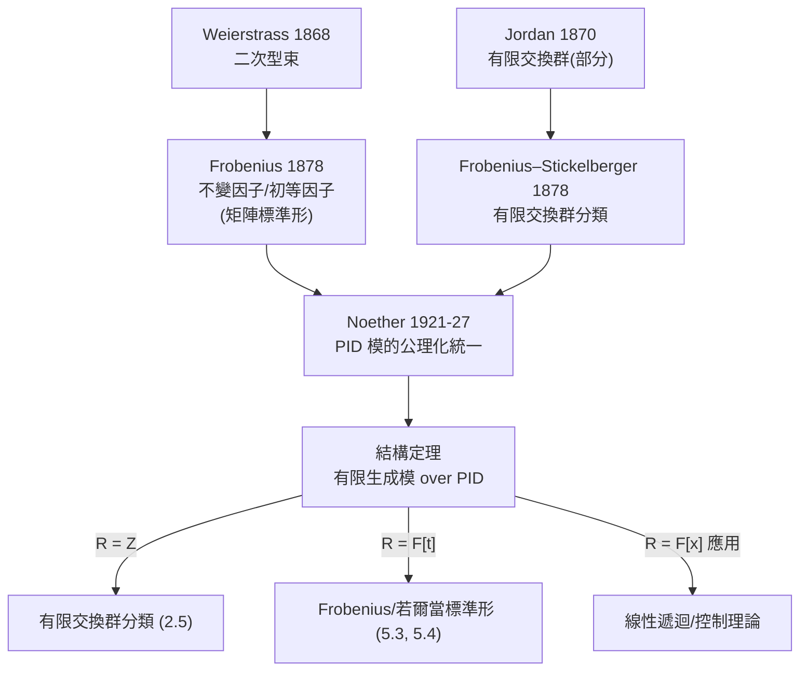

# 5.6 主理想環上的模：有限交換群的結構定理

## 學習目標

- 敘述並理解 PID 上有限生成模的結構定理，及其兩大化身：有限交換群分類與矩陣的 Frobenius／若爾當標準形。
- 掌握不變因子與初等因子兩種分解及其互換。
- 理解這條定理如何把 [2.5 節](02.5-循環群與阿貝爾群：有限交換群的分類.md)、[5.3 節](05.3-若爾當標準形與若爾當（1870）的工作.md)、[5.4 節](05.4-最小多項式與Frobenius（1878）的矩陣理論.md)統一起來。
- 能用 SymPy 計算交換群的結構分解與矩陣的不變因子。

## 歷史背景

### 5.6.1 一條定理的兩次獨立發現

結構定理的歷史呈現「同一條定理在不同語境被發現兩次」的罕見景象：

- **有限交換群的分類**：**Jordan**（1870，《置換論》第 I 章部分結果）→ **Frobenius 與 Stickelberger**（1878/1879，完整證明）：有限交換群是循環群 $`p`$ -部分的直積。當時的語言是「置換群」——見 [2.5 節](02.5-循環群與阿貝爾群：有限交換群的分類.md)。
- **矩陣的標準形**：**Weierstrass**（1868，二次型束）→ **Frobenius**（1878–1883，初等因子與不變因子理論）：矩陣在不變因子下分類。
- **模論統一**：到了 1920 年代諾特的公理化（[5.5 節](05.5-模與向量空間：諾特與阿廷的公理化.md)），人們才看清**這兩個定理是同一個定理**：取 $`R = \mathbb{Z}`$ 得交換群分類；取 $`R = F[t]`$ 得矩陣標準形。

技術驅動面：交換群分類來自**數論**（高斯的 $`\mathbb{Z}_n^\times`$ 結構、分圓域的類群）與**方程論**；不變因子理論來自**線性方程組與雙線性形式**。兩者共同的底層需求是「分類」——把無窮多個同構類壓縮成有限參數表，這是 19 世紀數學「分類學」浪潮（二次型、群、代數數域）的一部分。



## 數學理論

### 5.6.2 結構定理

> **定理 5.6.1（PID 上有限生成模的結構定理，不變因子形式）**。設 $`R`$ 是主理想環， $`M`$ 是有限生成 $`R`$ -模。則存在 $`r \ge 0`$ 與非零、非單位元素 $`d_1, \dots, d_s \in R`$ 使
> 

$$
M \cong R^r \oplus R/(d_1) \oplus \cdots \oplus R/(d_s), \qquad d_1 \mid d_2 \mid \cdots \mid d_s.
$$

> 其中 $`r`$ （自由秩）與理想鏈 $`(d_i)`$ 由 $`M`$ 唯一決定。

> **定理 5.6.2（初等因子形式）**。同樣的 $`M`$ 可寫成
> 

$$
M \cong R^r \oplus \bigoplus_{i,j} R/(p_i^{e_{ij}}),
$$

> 其中 $`p_i`$ 是互不相伴的素元， $`e_{ij} \ge 1`$ ；素元冪對 $`(p_i^{e_{ij}})`$ （連同 $`r`$ ）由 $`M`$ 唯一決定。

兩種形式的互換：把不變因子分解，每個 $`d_j`$ 分解為素元冪 $`d_j = \prod_i p_i^{e_{ij}}`$ （因為 $`d_j \mid d_{j+1}`$ ，指標隨 $`j`$ 單調），用中國剩餘定理 $`\mathbb{Z}/6 \cong \mathbb{Z}/2 \times \mathbb{Z}/3`$ 拆開即得初等因子；反向用 $`\operatorname{lcm}`$ 逐層合併。

**證明思路**（三步，各步都有獨立的數學價值）：

1. **表現（presentation）**： $`M`$ 有限生成，取滿同態 $`\varphi: R^n \to M`$ （把生成元送到 $`M`$ ），核 $`\ker\varphi \subseteq R^n`$ 。因 $`R`$ 是 PID 而 $`R^n`$ 是 Noether 模， $`\ker\varphi`$ 有限生成，設秩 $`\le n`$ 。於是 $`M \cong R^n / \operatorname{im}\psi`$ ，其中 $`\psi: R^m \to R^n`$ 由一個 $`n \times m`$ **關係矩陣** $`A`$ 給出。**分類 $`M`$ = 對關係矩陣做對角化**。
2. **Smith 標準形**：對 PID 上的矩陣 $`A`$ ，可用初等行／列變換（在 $`R`$ 內合法：交換、乘單位、加倍數）化為對角形

$$
\operatorname{diag}(s_1, s_2, \dots, s_k, 0, \dots, 0), \qquad s_1 \mid s_2 \mid \cdots \mid s_k,
$$

其中 $`s_j`$ 是**不變因子**： $`s_1 = \gcd`$ of all $`1\times1`$ minors， $`s_1 s_2 = \gcd`$ of $`2\times2`$ minors，等等（ $`s_j = \Delta_j / \Delta_{j-1}`$ ， $`\Delta_j`$ 是 $`j`$ 階行列式因子）。
3. **組裝**：由 $`R^n/\operatorname{im}A \cong \bigoplus_j R/(s_j) \oplus R^{n-k}`$ 得定理；唯一性由「商模的各階 Fitting 理想」不變性得出。 $`\blacksquare`$

**步驟 2 的核心引理**：對 $`a, b \in R`$ ，取 $`d = \gcd(a,b)`$ 與 $`x, y`$ 使 $`ax + by = d`$ （Bezout，PID 的定義性質），則可構造 $`2\times2`$ 行變換把 $`(a, b)`$ 化為 $`(d, 0)`$ ：矩陣 $`\begin{pmatrix} x & y \\ -b/d & a/d \end{pmatrix}`$ 的行列式為 $`1`$ ，可逆。**這是「輾轉相除」的矩陣化**。

### 5.6.3 化身一：有限交換群的分類

> **定理 5.6.3（有限交換群分類）**。有限交換群 $`G`$ 同構於
> 

$$
G \cong \mathbb{Z}/d_1 \times \cdots \times \mathbb{Z}/d_s, \quad d_1 \mid d_2 \mid \cdots \mid d_s, \ d_1 > 1
$$

> （不變因子），或
> 

$$
G \cong \bigoplus_p \bigoplus_j \mathbb{Z}/p^{e_{pj}}
$$

> （初等因子： $`p`$ -群部分）。且分解唯一。

**證明**。交換群 = $`\mathbb{Z}`$ -模（[5.5 節](05.5-模與向量空間：諾特與阿廷的公理化.md)例 5.5.2 的推廣）；有限 $`\Rightarrow`$ 有限生成且無自由部分（ $`r = 0`$ ，否則階無窮）。套用定理 5.6.1， $`\mathbb{Z}/(d_i)`$ 就是循環群。唯一性來自定理 5.6.1。 $`\blacksquare`$

> **例 5.6.4**。階 $`8`$ 的交換群恰有三個同構類：
> 

$$
\mathbb{Z}/8, \qquad \mathbb{Z}/4 \times \mathbb{Z}/2, \qquad \mathbb{Z}/2 \times \mathbb{Z}/2 \times \mathbb{Z}/2.
$$

> 階 $`72 = 2^3 \cdot 3^2`$ 的交換群： $`2`$ -部分有 $`\{[2,2,2],[2,4],[8]\}`$ 三種， $`3`$ -部分有 $`\{[3,3],[9]\}`$ 兩種，共 $`3 \times 2 = 6`$ 個同構類。

**記號**： $`[d_1, d_2, \dots]`$ （ $`d_1 \mid d_2 \mid \cdots`$ ）表示 $`\mathbb{Z}/d_1 \times \mathbb{Z}/d_2 \times \cdots`$ 。

### 5.6.4 化身二：矩陣的 Frobenius 標準形

設 $`A \in M_n(F)`$ 。由 [5.5 節](05.5-模與向量空間：諾特與阿廷的公理化.md)例 5.5.3， $`V = F^n`$ 是 $`F[t]`$ -模（ $`t`$ 作用 = $`A`$ ），有限生成。套用定理 5.6.1：

$$
V \cong F[t]/(a_1) \oplus \cdots \oplus F[t]/(a_s), \qquad a_1 \mid a_2 \mid \cdots \mid a_s,
$$

其中**循環模 $`F[t]/(a)`$ 對應伴隨矩陣 $`C(a)`$ **（[5.4 節](05.4-最小多項式與Frobenius（1878）的矩陣理論.md)定理 5.4.9 的積木）。因此

> **定理 5.6.5（Frobenius 標準形）**。 $`P^{-1}AP = \operatorname{diag}\big(C(a_1), \dots, C(a_s)\big)`$ ， $`a_1 \mid \cdots \mid a_s`$ 是**不變因子**， $`a_s = \mu_A`$ ， $`\prod a_i = \chi_A`$ 。

再取 $`F = \mathbb{C}`$ 把 $`a_i`$ 分裂為線性因子並用中國剩餘定理拆塊，得**若爾當標準形**（[5.3 節](05.3-若爾當標準形與若爾當（1870）的工作.md)）：

$$
F[t]/(t-\lambda)^e \text{ 對應 } J_e(\lambda).
$$

**初等因子** $`p^e = (t-\lambda)^e`$ 的指數 $`e`$ 就是若爾當塊的尺寸——兩套名詞完全對上。

> **例 5.6.6**。 $`A = \operatorname{diag}\big(J_2(3), J_2(3), J_1(3)\big)`$ （ $`n=5`$ ）：
> - 初等因子： $`(t-3)^2, (t-3)^2, (t-3)`$ ；
> - 不變因子： $`a_1 = (t-3)`$ ， $`a_2 = (t-3)^2`$ ， $`a_3 = (t-3)^2`$ ；
> - $`\mu_A = a_3 = (t-3)^2`$ （與 [5.4 節](05.4-最小多項式與Frobenius（1878）的矩陣理論.md)範例 3 一致）， $`\chi_A = (t-3)^5`$ 。

### 5.6.5 Smith 標準形：計算核心

> **定理 5.6.7（Smith 標準形）**。設 $`A \in M_{m\times n}(R)`$ ， $`R`$ 是 PID。存在可逆 $`P \in M_m(R)`$ 、 $`Q \in M_n(R)`$ 使 $`PAQ = D`$ 是對角矩陣，對角元 $`s_1 \mid s_2 \mid \cdots`$ ，其中 $`s_j = \Delta_j/\Delta_{j-1}`$ 。

**行列式因子** $`\Delta_j = \gcd(\text{所有 } j \times j \text{ 子式})`$ 是相似／等價不變量——這組不變量在整數矩陣（群表現計算）與多項式矩陣（線性系統）中都可直接計算。

## SymPy 實作

### 範例 1：Smith 標準形與不變因子（整數矩陣）

```python
import sympy as sp

A = sp.Matrix([[2, 4, 4],
               [-6, 6, 12],
               [10, 4, 16]])
print(A.smith_normal_form())   # 或用 normal_form：版本不同名稱可能不同
```

輸出（對角元 $`1, 2, 12`$ ，注意 $`1 \mid 2 \mid 12`$ ）：

```
Matrix([[1, 0, 0], [0, 2, 0], [0, 0, 12]])
```

這個矩陣作為 $`\mathbb{Z}^3`$ 的關係矩陣，給出商模 $`\mathbb{Z}^3/\operatorname{im}A \cong \mathbb{Z}/2 \times \mathbb{Z}/12`$ ——一個階 $`24`$ 的交換群，即 $`[2, 12]`$ 型（不變因子），等價於初等因子 $`\mathbb{Z}/2 \times \mathbb{Z}/4 \times \mathbb{Z}/6 \cong \mathbb{Z}/2 \times \mathbb{Z}/4 \times \mathbb{Z}/2 \times \mathbb{Z}/3`$ 。

### 範例 2：有限交換群的分類枚舉

```python
import sympy as sp
from itertools import product

def abelian_groups_of_order(n):
    """回傳階 n 的交換群的不變因子分解（所有同構類）"""
    parts = sp.factorint(n)
    # 每個素數 p^e：枚舉 e 的分割 => p-部分的初等因子
    def partitions(k, min_part=1):
        if k == 0:
            yield []
            return
        for first in range(min_part, k + 1):
            for rest in partitions(k - first, first):
                yield [first] + rest
    by_prime = {p: list(partitions(e)) for p, e in parts.items()}
    result = []
    for combo in product(*by_prime.values()):
        elementary = []   # 初等因子列表
        for (p, e), cuts in zip(by_prime.items(), combo):
            elementary.extend([p**c for c in cuts])
        # 由初等因子組裝不變因子
        max_len = max(len(sp.factorint(f)) for f in elementary) if elementary else 0
        invariant = {}
        for f in elementary:
            for i, (p, e) in enumerate(sorted(sp.factorint(f).items())):
                invariant.setdefault(i, 1)
                invariant[i] *= p**e
        result.append(sorted(invariant.values()))
    return sorted(set(map(tuple, result)))

print("階 8:", abelian_groups_of_order(8))
print("階 72:", abelian_groups_of_order(72))
print("階 72 的個數:", len(abelian_groups_of_order(72)))
```

輸出：

```
階 8: [(2, 2, 2), (2, 4), (8,)]
階 72: [(2, 2, 2, 3, 3), (2, 2, 2, 9), (2, 4, 3, 3), (2, 4, 9), (8, 3, 3), (8, 9)]
階 72 的個數: 6
```

與理論一致： $`[2,2,2,3,3]`$ 等六類。這正是 [2.5 節](02.5-循環群與阿貝爾群：有限交換群的分類.md)分類定理的計算化。

### 範例 3： $`F[t]`$ -模的初等因子與若爾當塊

```python
import sympy as sp

t = sp.Symbol('t')
# A 的特徵/最小多項式 => 反推塊結構（n = 6）
# 設初等因子: (t-1)^2, (t-1), (t-2)^3
blocks = [sp.jordan_cell(t - 1, 2), sp.jordan_cell(t - 1, 1), sp.jordan_cell(t - 2, 3)]
A = sp.diag(*blocks)
print("n =", A.rows)                             # 6
print("chi_A =", sp.factor(A.charpoly(t).as_expr()))  # (t-1)**3*(t-2)**3
print("mu_A  =", A.minimal_polynomial())              # (t-1)**2*(t-2)**3
print("不變因子: a1 = (t-1)*(t-2)**3, a2 = (t-1)**2*(t-2)**3")
```

輸出：

```
n = 6
chi_A = (t - 1)**3*(t - 2)**3
mu_A  = (t - 1)**2*(t - 2)**3
不變因子: a1 = (t-1)*(t-2)**3, a2 = (t-1)**2*(t-2)**3
```

由 $`\chi = (t-1)^3(t-2)^3`$ 、 $`\mu = (t-1)^2(t-2)^3`$ 可反推： $`t-2`$ 只有一塊（尺寸 $`3`$ ）， $`t-1`$ 有兩塊（最大 $`2`$ ，另一塊 $`1`$ ）——**兩個多項式足以重建整個若爾當形**（本例）。

### 範例 4：多項式矩陣的不變因子（模擬 Frobenius 計算）

```python
import sympy as sp

t = sp.Symbol('t')
# A = J_2(1) ⊕ J_1(1) 的 tI - A 矩陣
M = sp.Matrix([[t-1, -1, 0],
               [0, t-1, 0],
               [0, 0, t-1]])

# 行列式因子 Delta_j
D1 = sp.gcd_list([M[i, j] for i in range(3) for j in range(3)])
minors2 = []
for i in range(3):
    for j in range(3):
        Mi = M.minor_submatrix(i, j)
        minors2.append(Mi.det())
D2 = sp.gcd_list(minors2)
D3 = M.det()
print("Δ1 =", sp.expand(D1))                    # 1
print("Δ2 =", sp.expand(D2))                    # (t-1)
print("Δ3 =", sp.expand(D3))                    # (t-1)**3
print("不變因子 s1 = Δ1 =", D1)
print("不變因子 s2 = Δ2/Δ1 =", sp.expand(D2/D1))
print("不變因子 s3 = Δ3/Δ2 =", sp.expand(D3/D2))
```

輸出：

```
Δ1 = 1
Δ2 = t - 1
Δ3 = (t - 1)**3
不變因子 s1 = Δ1 = 1
不變因子 s2 = Δ2/Δ1 = t - 1
不變因子 s3 = Δ3/Δ2 = (t - 1)**2
```

不變因子 $`1,\ (t-1),\ (t-1)^2`$ 對應循環塊 $`C(t-1) = [1]`$ 與 $`C((t-1)^2) = J_2(1)`$ ——精確重現 $`A = J_2(1) \oplus J_1(1)`$ 的初等因子 $`(t-1)^2, (t-1)`$ 。**同一套 gcd 計算， $`R = \mathbb{Z}`$ 時給群分類、 $`R = F[t]`$ 時給矩陣標準形**。

## 習題

1. 列出階 $`16`$ 的所有交換群（不變因子形式），並用 [範例 2](#範例-2有限交換群的分類枚舉) 的程式驗證（應有 5 個）。
2. 證明： $`\mathbb{Z}/m \times \mathbb{Z}/n \cong \mathbb{Z}/(mn)`$ 當且僅當 $`\gcd(m,n)=1`$ （中國剩餘定理的群論形式）。
3. 求 $`\mathbb{Z}^2 / \langle (2, 0), (0, 3), (1, 1) \rangle`$ 的結構（用關係矩陣的 Smith 標準形）。
4. 證明 Smith 標準形中 $`s_j = \Delta_j / \Delta_{j-1}`$ 的公式（提示： $`PAQ`$ 的初等變換如何影響子式的 gcd）。
5. 給定 $`\chi_A = (t-2)^4`$ 、 $`\mu_A = (t-2)^2`$ ，列出所有可能的若爾當形（有幾種？）。
6. 用 [5.3 節](05.3-若爾當標準形與若爾當（1870）的工作.md)的 `jordan_cells` 驗證 [範例 3](#範例-3ft-模的初等因子與若爾當塊) 的塊結構。
7. 證明：有限交換群 $`G`$ 中， $`x^m = e`$ 的解的個數是 $`\prod_i \gcd(m, d_i)`$ ，並用此給出「不變因子唯一性」的一個證明思路。
8. （挑戰）寫一個完整的整數矩陣 Smith 標準形演算法（用 `sp.gcdex` 實現 Bezout 行變換），並測試 [範例 1](#範例-1smith-標準形與不變因子整數矩陣) 的矩陣。

## SymPy 要點回顧

| 語法 | 意義 |
|------|------|
| `A.smith_normal_form()` | 整數（或多項式）矩陣的 Smith 標準形 |
| `sp.jordan_cell(λ_expr, size)` | 構造若爾當塊 $`J_k(\lambda)`$ |
| `sp.factorint(n)` | 整數的素因子分解 $`\{p: e\}`$ |
| `sp.factor(...)`、`sp.expand(...)` | 多項式因式分解／展開 |
| `sp.gcd_list([...])`、`sp.gcdex(a, b)` | 多項式／整數 gcd 與 Bezout 係數 |
| `A.charpoly(t)`、`A.minimal_polynomial()` | 特徵／最小多項式（重建塊結構） |

**下一節**：把本章所有工具（Matrix、eigenvals、jordan_cells、minimal_polynomial）整合成完整的計算工作流，見 [5.7 節](05.7-SymPy的Matrix與Jordan形計算.md)。
