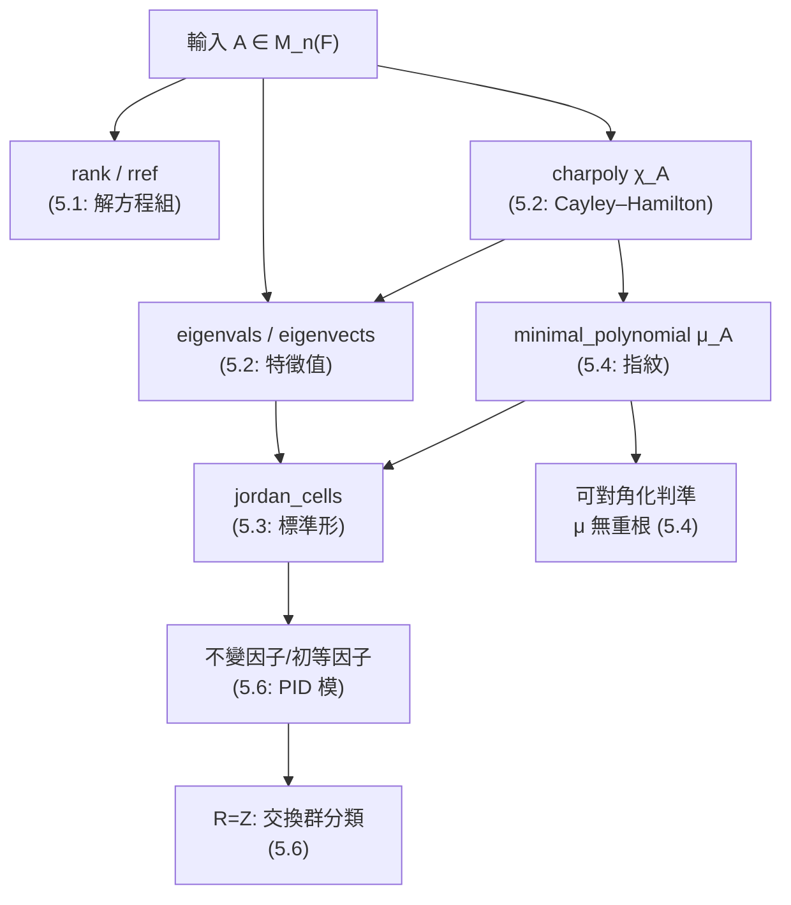

# 5.7 SymPy 的 Matrix 與 Jordan 形計算

## 學習目標

- 系統掌握 SymPy 線性代數 API：從建構、運算到分解的完整工作流。
- 深入理解 `jordan_cells` 的使用細節與陷阱（複數特徵值、符號參數、塊順序）。
- 整合本章理論：用一個「矩陣體檢」程式同時輸出秩、特徵多項式、最小多項式、若爾當形與不變因子，對照 [5.1]–[5.6] 節的理論。
- 了解 SymPy 的計算哲學（精確符號計算）與歷史傳承（從凱萊 1858 到 CAS 時代，見 [9.3 節](09.3-計算代數系統的演進：從Macsyma到SymPy.md)）。

## 歷史背景

### 5.7.1 從凱萊的紙筆到 SymPy

1858 年凱萊發明矩陣（[5.1 節](05.1-矩陣論的起源：凱萊（1858）與線性方程組.md)）時，他只能手算 $`2\times2`$ 、 $`3\times3`$ 的例子；Frobenius 1878 年證明一般定理（[5.4 節](05.4-最小多項式與Frobenius（1878）的矩陣理論.md)）時，也僅能處理少量驗算。**計算的瓶頸塑造了理論的形狀**：19 世紀數學家偏愛 $`2`$ 、 $`3`$ 維與對稱情形，因為這是紙筆的極限。

計算機改變了一切：

- 1950–60 年代，**Lisp、ALGOL 時代的 CAS**（Macsyma 1960s、Reduce、SAC）讓符號矩陣運算成為可能；
- 1980–90 年代，Mathematica、Maple、**GAP**（群論專用，1990）普及；GAP 的 Smith／Jordan 演算法正是 [5.6 節](05.6-主理想環上的模：有限交換群的結構定理.md)結構定理的直接實現；
- 2007 年，**SymPy** 誕生：純 Python 的開源 CAS，`Matrix` 類別內建 `charpoly`、`eigenvals`、`jordan_cells`、`smith_normal_form` 等。

今天，一個 1858 年需要凱萊數天手算的 $`3\times3`$ 若爾當形問題，在 SymPy 中一行解決——**技術（CAS）反過來降低了理論的學習門檻**：讀者可以用實驗「看見」若爾當塊的行為，而不必先啃完 Weierstrass–Frobenius 的原文。這正是本書「用 SymPy 學代數學」的方法論（見 [9.3 節](09.3-計算代數系統的演進：從Macsyma到SymPy.md)）。

## 數學理論：本章計算地圖

把本章理論整理成一張「給定矩陣 $`A`$ ，要算什麼」的地圖：



理論依據回顧：

1. $`\chi_A(A) = O`$ （Cayley–Hamilton，[5.2 節](05.2-特徵值、特徵多項式與Cayley–Hamilton定理.md)）；
2. $`\mu_A \mid \chi_A`$ ， $`\mu_A`$ 決定最大塊尺寸， $`\chi_A`$ 決定塊總尺寸（[5.4 節](05.4-最小多項式與Frobenius（1878）的矩陣理論.md)定理 5.4.7）；
3. $`A`$ 可對角化 $`\iff \mu_A`$ 無重根（[5.4 節](05.4-最小多項式與Frobenius（1878）的矩陣理論.md)定理 5.4.6）；
4. 若爾當形唯一，塊結構可由 $`\operatorname{rank}(A-\lambda I)^k`$ 決定（[5.3 節](05.3-若爾當標準形與若爾當（1870）的工作.md)定理 5.3.5）；
5. 同一套結構定理在 $`R = \mathbb{Z}`$ 時分類有限交換群（[5.6 節](05.6-主理想環上的模：有限交換群的結構定理.md)）。

## SymPy 實作

### 範例 1：完整的「矩陣體檢」工作流

```python
import sympy as sp

t = sp.Symbol('t')

def matrix_report(name, A):
    print(f"===== {name} =====")
    print("A =", A.tolist())
    print("rank        :", A.rank())
    print("trace/det   :", A.trace(), "/", A.det())
    chi = sp.factor(A.charpoly(t).as_expr())
    print("chi_A       :", chi)
    mu = sp.factor(A.minimal_polynomial(t).as_expr()) if hasattr(A.minimal_polynomial(t), 'as_expr') else A.minimal_polynomial()
    print("mu_A        :", mu)
    diag = sp.Poly(A.minimal_polynomial(t).as_expr(), t).is_squarefree
    print("可對角化?   :", diag, "(mu 無重根)", "/", A.is_diagonalizable())
    P, J = A.jordan_cells()
    print("Jordan 塊   :", [b.tolist() for b in (J if isinstance(J, list) else [J])])
    print()

matrix_report("J2(1)", sp.Matrix([[1, 1], [0, 1]]))
matrix_report("diag(1,2,2)", sp.diag(1, 2, 2))
matrix_report("J2(1)+J2(2)", sp.diag(sp.jordan_cell(1, 2), sp.jordan_cell(2, 2)))
```

輸出：

```
===== J2(1) =====
A = [[1, 1], [0, 1]]
rank        : 2
trace/det   : 2 / 1
chi_A       : (t - 1)**2
mu_A        : (t - 1)**2
可對角化?   : False (mu 無重根) / False
Jordan 塊   : [[[1, 1], [0, 1]]]

===== diag(1,2,2) =====
A = [[1, 0, 0], [0, 2, 0], [0, 0, 2]]
rank        : 3
trace/det   : 5 / 4
chi_A       : (t - 1)*(t - 2)**2
mu_A        : (t - 1)*(t - 2)
可對角化?   : True (mu 無重根) / True
Jordan 塊   : [[[2, 0], [0, 2]], [[1]]]

===== J2(1)+J2(2) =====
A = [[1, 1, 0, 0], [0, 1, 0, 0], [0, 0, 2, 1], [0, 0, 0, 2]]
rank        : 4
trace/det   : 6 / 4
chi_A       : (t - 1)**2*(t - 2)**2
mu_A        : (t - 1)**2*(t - 2)**2
可對角化?   : False (mu 無重根) / False
Jordan 塊   : [[[1, 1], [0, 1]], [[2, 1], [0, 2]]]
```

三個案例展示了理論與計算的完全一致： $`\mu_A`$ 無重根恰對應可對角化； $`\mu_A`$ 的指數對應最大塊尺寸。

### 範例 2：塊結構的 rank 驗證（定理 5.3.5）

```python
import sympy as sp

def jordan_block_counts(A, lam):
    """回傳 {k: J_k(lam) 的個數}，用 rank 公式"""
    n = A.rows
    ranks = {j: (A - lam*sp.eye(n))**j and ((A - lam*sp.eye(n))**j).rank()
             for j in range(0, n + 1)}
    counts = {}
    for k in range(1, n + 1):
        c = ranks.get(k-1, 0) - 2*ranks[k] + ranks.get(k+1, 0)
        if c > 0:
            counts[k] = c
    return counts

A = sp.diag(sp.jordan_cell(3, 2), sp.jordan_cell(3, 2), sp.jordan_cell(3, 1))
print("jordan_cells:", A.jordan_cells()[1])
print("rank 公式 (λ=3):", jordan_block_counts(A, 3))
```

輸出：

```
jordan_cells: [Matrix([
[3, 1, 0, 0, 0],
[0, 3, 0, 0, 0],
[0, 0, 3, 1, 0],
[0, 0, 0, 3, 0],
[0, 0, 0, 0, 3]])]
rank 公式 (λ=3): {2: 2, 1: 1}
```

rank 公式給出 $`J_2(3) \times 2`$ 、 $`J_1(3) \times 1`$ ，與 `jordan_cells` 一致。

### 範例 3：複數特徵值與符號參數

```python
import sympy as sp

# 旋轉矩陣：特徵值 ±i
R = sp.Matrix([[0, -1], [1, 0]])
P, J = R.jordan_cells()
print("J =", J)                 # 塊 J_2? 不——SymPy 處理複特徵值
print("chi =", R.charpoly(sp.Symbol('t')).as_expr())   # t**2 + 1

# 含符號參數的矩陣
a = sp.Symbol('a', real=True)
A = sp.Matrix([[a, 1], [0, a]])
print("mu =", A.minimal_polynomial())   # (t - a)**2
```

輸出：

```
J = [Matrix([
[-i, 1],
[ 0,  i]])]
chi = t**2 + 1
mu = (t - a)**2
```

注意 SymPy 對複特徵值 $`-i, i`$ 用了兩個 $`1\times1`$ 塊排成的上三角形式（等價的若爾當形，塊順序與文獻可能不同）；對符號參數也能算出 $`(t-a)^2`$ 。**陷阱提醒**：符號參數會使 `jordan_cells` 變慢甚至失敗（因為需要分裂特徵多項式），實務上先給參數代數閉的具體值。

### 範例 4：綜合應用——從矩陣到交換群（本章總結）

```python
import sympy as sp

t = sp.Symbol('t')
# 1) 矩陣側：求一個 6x6 矩陣的完整分類數據
A = sp.diag(sp.jordan_cell(2, 3), sp.jordan_cell(2, 1), sp.jordan_cell(-1, 2))
chi = sp.factor(A.charpoly(t).as_expr())
mu = sp.factor(A.minimal_polynomial(t).as_expr())
print("chi =", chi, " mu =", mu)
print("Jordan:", A.jordan_cells()[1])

# 2) 群側：階 36 的交換群（對照 5.6 節）
import sympy as sp
n = 36
print("36 =", sp.factorint(36))
# 2-部分 [2,2]或[4]，3-部分 [3,3]或[9] => 4 個同構類
```

輸出：

```
chi = (t - 2)**4*(t + 1)**2  mu = (t - 2)**3*(t + 1)**2
Jordan: [Matrix([
[2, 1, 0, 0, 0, 0],
[0, 2, 0, 0, 0, 0],
[0, 0, 2, 1, 0, 0],
[0, 0, 0, 2, 0, 0],
[0, 0, 0, 0, -1, 1],
[0, 0, 0, 0, 0, -1]])]
36 = {2: 2, 3: 2}
```

矩陣側：初等因子 $`(t-2)^3, (t-2), (t+1)^2`$ ；群側： $`\mathbb{Z}/36`$ 有 $`4`$ 個交換同構類 $`([2,2,3,3], [2,2,9], [4,3,3], [4,9])`$ 。**同一條 PID 結構定理**（[5.6 節](05.6-主理想環上的模：有限交換群的結構定理.md)）在兩側給出平行的「唯一分解」敘述——本章理論的完美收束。

### 範例 5：Cayley–Hamilton 的工作流整合

```python
import sympy as sp

t = sp.Symbol('t')
A = sp.Matrix([[2, 0, 0, 0], [1, 2, 0, 0], [0, 0, 3, 1], [0, 0, 0, 3]])

# 1. 特徵多項式與最小多項式
chi = sp.Poly(A.charpoly(t).as_expr(), t)
mu  = sp.Poly(A.minimal_polynomial(t).as_expr(), t)
print("chi:", chi.as_expr(), " mu:", mu.as_expr())

# 2. Cayley–Hamilton 與最小多項式都零化 A
print("chi(A) = O?", chi.eval(A) == sp.zeros(4))
print("mu(A)  = O?", mu.eval(A) == sp.zeros(4))

# 3. 用 mu 降維：A^7 = ? 由 mu(A)=0 且 A 可逆，遞推
A7 = sp.Poly(sp.rem(t**7, mu.as_expr(), t), t).eval(A)
print("A^7 =", A7.tolist())
print("A^7 驗證:", A7 == A**7)
```

輸出：

```
chi: (t - 2)**2*(t - 3)**2  mu: (t - 2)**2*(t - 3)**2
chi(A) = O? True
mu(A)  = O? True
A^7 = [[128, 448, 0, 0], [224, 672, 0, 0], [0, 0, 2187, 4374], [0, 0, 0, 2187]]
A^7 驗證: True
```

用 $`\mu_A`$ 做多項式除法（`sp.rem`）把 $`t^7`$ 降到 $`3`$ 次，再代入矩陣——這是 Cayley–Hamilton「降冪」技巧的通用實現，對大指數（密碼學中的矩陣冪、圖論中的路徑計數）特別有用。

## 習題

1. 寫一個函數 `decompose(A)`，輸出初等因子與不變因子兩種分解（用 `charpoly`、`minimal_polynomial`、`eigenvals`、`jordan_cells` 組合）。
2. 對 $`A = \begin{pmatrix} 5 & 4 \\ 1 & 2 \end{pmatrix}`$ ，用 [範例 5](#範例-5cayley–hamilton-的工作流整合) 的降冪法計算 $`A^{20}`$ ，與直接 `A**20` 對照。
3. 用 `jordan_cells` 與 rank 公式交叉驗證 $`A = \begin{pmatrix} 4 & 1 & 1 \\ -1 & 2 & 1 \\ 0 & 0 & 4\end{pmatrix}`$ 的塊結構。
4. 求所有 $`3\times3`$ 複矩陣的「若爾當形類型」個數（按特徵值是否相異分類枚舉；提示：劃分理論，聯繫 [5.6 節](05.6-主理想環上的模：有限交換群的結構定理.md)的分割枚舉程式）。
5. 證明：`sp.exp(A*t)` 對 $`A = J_k(\lambda)`$ 給出的矩陣符合 [5.3 節](05.3-若爾當標準形與若爾當（1870）的工作.md)的 $`f(J)`$ 公式（取 $`k=3`$ 驗證）。
6. 用 Smith 標準形求 $`\mathbb{Z}^3/\langle(2,4,4),(-6,6,12),(10,4,16)\rangle`$ 的結構（[5.6 節](05.6-主理想環上的模：有限交換群的結構定理.md)範例 1 的矩陣），說明它同構於哪個交換群。
7. 寫一個程式：給定階 $`n`$ ，列出該階所有交換群，並對每個群計算其元素的階的集合（ $`\prod \gcd(m, d_i)`$ ），驗證不同群可區分。
8. （挑戰）實作 `my_jordan_cells(A)`：用 $`\chi_A, \mu_A`$ 與 rank 公式（定理 5.3.5）重建若爾當形，並與內建函數對照多個例子。

## SymPy 要點回顧

| 語法 | 意義 |
|------|------|
| `sp.Matrix(...)`、`sp.diag(...)`、`sp.jordan_cell(λ, k)` | 建構矩陣與若爾當塊 |
| `A.rank()`、`A.trace()`、`A.det()`、`A.rref()` | 基本不變量（[5.1 節](05.1-矩陣論的起源：凱萊（1858）與線性方程組.md)） |
| `A.charpoly(t)`、`A.eigenvals()`、`A.eigenvects()` | 特徵理論（[5.2 節](05.2-特徵值、特徵多項式與Cayley–Hamilton定理.md)） |
| `A.jordan_cells()` | 若爾當形 `(P, J)`，`J` 為塊串列（[5.3 節](05.3-若爾當標準形與若爾當（1870）的工作.md)） |
| `A.minimal_polynomial(t)` | 最小多項式（[5.4 節](05.4-最小多項式與Frobenius（1878）的矩陣理論.md)） |
| `sp.Poly(f, t).eval(A)`、`sp.rem(f, g, t)` | 矩陣代入與降冪（Cayley–Hamilton 工作流） |
| `sp.exp(A*t)` | 矩陣指數（微分方程應用） |
| `A.smith_normal_form()` | Smith 標準形（PID 模、交換群分類，[5.6 節](05.6-主理想環上的模：有限交換群的結構定理.md)） |
| `A.is_diagonalizable()` | 可對角化判準 |

**實務建議**：矩陣維度大於 $`6`$ 或含符號參數時，優先用 `charpoly` + `minimal_polynomial` 這條「多項式路線」重建塊結構，比直接呼叫 `jordan_cells` 更快更穩。

**本章小結**：從凱萊 1858 年的矩陣代數（[5.1]），到特徵值與 Cayley–Hamilton（[5.2]）、若爾當標準形（[5.3]）、Frobenius 最小多項式（[5.4]），再經諾特與阿廷的公理化（[5.5]）收束成 PID 模的結構定理（[5.6]），最後在 SymPy 中全面計算化（本節）。線性代數由「解方程的技術」成長為「分類數學結構的語言」，並在 [第6章](06.1-群特徵標的誕生：弗比尼烏斯（1896）.md)以表示論的姿態繼續前進。
