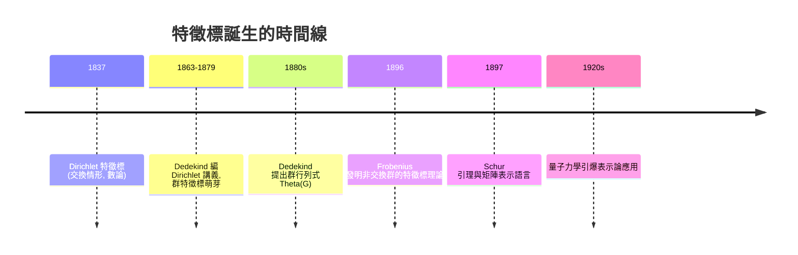

# 06.1 群特徵標的誕生：弗比尼烏斯（1896）

## 學習目標

1. 了解弗比尼烏斯如何從「群行列式」的分解問題發明群特徵標。
2. 掌握群表示與特徵標的定義，以及特徵標的基本性質（類函數、特徵標的核）。
3. 會驗證特徵標的第一正交關係（在本節先敘述，於 [6.3](06.3-有限群的不可約表示與特徵標表.md) 完整證明）。
4. 能用 SymPy 的 `PermutationGroup` 建構群表示，並用純 Python 算出特徵標。

## 歷史背景

表示論的誕生有一段非常具體的「技術驅動」故事。

- **1896 年以前**：數學家已熟知「有限交換群可用特徵標（characters）分解」——這是 Dirichlet（1837）在解析數論中研究算術級數素數分佈時使用的Dirichlet 特徵標，以及 Dedekind 在編輯 Dirichlet《數論講義》（1863–1879 各版）時發展的群特徵標概念。但對**非交換群**，特徵標應該長什麼樣，完全沒有頭緒。
- **1880s**：Dedekind 研究所謂的**群行列式**（group determinant）：給定有限群 $`G = \{g_1,\dots,g_n\}`$ ，取 $`n^2`$ 個獨立變數 $`x_{g}`$ ，考慮

$$
\Theta(G) = \det\big( x_{g_i g_j^{-1}} \big)_{i,j=1}^n .
$$

對交換群，Dedekind 觀察到 $`\Theta(G)`$ 可以**完全分解成線性因式**，每個因式對應一個特徵標。但對非交換群（例如 $`S_3`$ ），他發現因式不是線性的，而且某些因式會「重複出現」。他百思不得其解，於是把這個問題寫信告訴他的學生輩友人 **弗比尼烏斯（Ferdinand Georg Frobenius, 1849–1917）**。
- **1896 年**：Frobenius 在一連串論文（*Über Gruppencharaktere* 等）中解開了這個謎：非交換群的群行列式可以分解為若干**不可約因式**的冪次乘積，

$$
\Theta(G) = \prod_{\chi} \left( \sum_{g \in G} \chi(g^{-1})\, x_g \right)^{\deg \chi},
$$

其中 $`\chi`$ 跑遍**不可約特徵標**。為了證明這件事，他被迫發明了一整套新工具——今天我們稱之為**表示論**。特徵標理論不是被「抽象地」想出來的，而是被一個具體的多項式分解問題逼出來的。
- **1897–1898**：Frobenius 的學生 **Schur（伊薩伊・舒爾，Issai Schur, 1875–1941）** 把這套理論重塑為「矩陣表示」的語言（見 [6.2](06.2-舒爾引理與半單性.md)），證明瞭著名的 Schur 引理。
- **1920s**：量子力學誕生後，物理學家（Weyl、Wigner、van der Waerden）發現原子光譜的選擇律正好是群表示論的定理，表示論從純數學瞬間變成物理學的必需工具（見 [6.6](06.6-應用：從物理學到分子對稱.md)）。

這是本書反覆出現的主題的另一個最佳例證：**一個來自計算的問題（分解群行列式）催生了全新的理論（表示論），而理論成熟後又反過來服務於物理、化學與計算。**



## 群行列式：一切的起點

設 $`G = \{g_1, \dots, g_n\}`$ 是有限群，定義 $`n \times n`$ 矩陣

$$
M_G = \big( x_{g_i g_j^{-1}} \big)_{i,j},
$$

其中 $`\{x_h : h \in G\}`$ 是 $`n`$ 個獨立變數。群行列式為 $`\Theta(G) = \det M_G`$ 。

**交換群的情形（Dedekind 的發現）。** 若 $`G`$ 交換，則用特徵標 $`\chi: G \to \mathbb{C}^\times`$ （即 $`\chi(gh) = \chi(g)\chi(h)`$ ）做變數替換，可以證明

$$
\Theta(G) = \prod_{\chi \in \widehat{G}} \left( \sum_{g \in G} \chi(g)^{-1} x_g \right),
$$

即 $`n`$ 個線性因式的乘積，其中 $`\widehat{G}`$ 是 $`G`$ 的全部 $`n`$ 個特徵標（見 [2.5 節](02.5-循環群與阿貝爾群：有限交換群的分類.md)中有限交換群的結構定理， $`\widehat{G} \cong G`$ ）。

**非交換群的情形（Frobenius 的突破）。** 若 $`G`$ 非交換， $`\Theta(G)`$ 仍可分解，但因式不再是線性的：

$$
\Theta(G) = \prod_{i=1}^{r} \left( \sum_{g \in G} \chi_i(g^{-1})\, x_g \right)^{d_i},
$$

其中 $`\chi_1, \dots, \chi_r`$ 是 $`G`$ 的**不可約特徵標**（ $`r`$ = 共軛類個數）， $`d_i = \chi_i(1)`$ 是它們的次數，且 $`\sum_i d_i^2 = n`$ 。某些因式會重複（冪次 $`d_i > 1`$ ），這正是 Dedekind 在 $`S_3`$ 上觀察到的現象。

## 表示與特徵標的定義

**定義（群表示）。** 群 $`G`$ 在複向量空間 $`V`$ 上的一個**表示**是一個群同態

$$
\rho : G \to GL(V).
$$

若 $`\dim V = d`$ ，稱 $`\rho`$ 的**次數**為 $`d`$ 。兩個表示 $`\rho_1, \rho_2`$ **同構**若存在可逆線性映射 $`T`$ 使 $`T \rho_1(g) T^{-1} = \rho_2(g)`$ 對所有 $`g`$ 成立。

**定義（特徵標）。** 表示 $`\rho`$ 的**特徵標**是函數

$$
\chi_\rho(g) = \operatorname{tr}(\rho(g)).
$$

若 $`\rho`$ 不可約（ $`V`$ 沒有非平凡的 $`G`$ -不變子空間），則稱 $`\chi_\rho`$ 為**不可約特徵標**。

**基本性質。**

1. $`\chi(1) = \dim V`$ （次數）。
2. $`\chi(g^{-1}) = \overline{\chi(g)}`$ ：因為有限群的元素階數有限， $`\rho(g)^m = I`$ ，故 $`\rho(g)`$ 的特徵值都是單位根， $`\rho(g)`$ 可（在適當基下）對角化且 $`\chi(g^{-1}) = 1/\lambda_i`$ 逐特徵值取即得共軛。
3. $`\chi`$ 是**類函數**： $`\chi(hgh^{-1}) = \operatorname{tr}(\rho(h)\rho(g)\rho(h)^{-1}) = \chi(g)`$ 。所以 $`G`$ 的特徵標個數不超過共軛類個數——事實上恰好相等（[6.3 節](06.3-有限群的不可約表示與特徵標表.md)定理 6.3.5）。
4. $`\chi_{\rho_1 \oplus \rho_2} = \chi_{\rho_1} + \chi_{\rho_2}`$ ：特徵標把直和變成逐點相加。

**重要觀察（Frobenius 的觀點）。** 雖然表示本身依賴於基選擇（是矩陣的等價類），特徵標卻是同構不變量。因此特徵標是「把整個表示壓縮成一個函數」的完美工具：判斷兩個表示是否同構，只需比較特徵標（這是正交關係的推論）。

## 特徵標的第一正交關係（敘述）

對有限群 $`G`$ ，其不可約特徵標 $`\chi_1, \dots, \chi_r`$ 滿足

$$
\frac{1}{|G|} \sum_{g \in G} \chi_i(g)\, \overline{\chi_j(g)} = \begin{cases} 1 & i = j, \\ 0 & i \neq j. \end{cases}
$$

換句話說，不可約特徵標在類函數空間中構成一組（關於內積 $`\langle \alpha, \beta \rangle = \frac{1}{|G|}\sum_g \alpha(g)\overline{\beta(g)}`$ 的）**正交單位向量**。因為類函數空間的維數等於共軛類個數 $`r`$ ，這立刻給出：

> **定理 6.1.1（不可約特徵標個數）。** 有限群 $`G`$ 的不可約特徵標個數等於 $`G`$ 的共軛類個數。

完整證明需要 Schur 引理與半單性（Maschke 定理），將在 [6.2](06.2-舒爾引理與半單性.md) 與 [6.3](06.3-有限群的不可約表示與特徵標表.md) 節展開。

## 例子： $`S_3`$ 的特徵標

 $`S_3`$ 有三個共軛類： $`\{e\}`$ 、三個對換、兩個三循環。因此恰有三個不可約特徵標：

| 類大小 $`\to`$ | 1 | 3 | 2 |
|---|---|---|---|
| 代表元 $`\to`$ | $`e`$ | $`(12)`$ | $`(123)`$ |
| $`\chi_1`$ （平凡） | 1 | 1 | 1 |
| $`\chi_2`$ （符號） | 1 | $`-1`$ | 1 |
| $`\chi_3`$ （二維） | 2 | 0 | $`-1`$ |

第三列就是著名的 $`S_3`$ 標準表示： $`S_3`$ 作用在 $`\mathbb{C}^3`$ 中「座標和為零」的平面上（等價於三角形的旋轉反射幾何）。驗證正交性：

$$
\langle \chi_3, \chi_3 \rangle = \frac{1}{6}\left( 2^2 + 3 \cdot 0^2 + 2 \cdot (-1)^2 \right) = \frac{6}{6} = 1,
$$

$$
\langle \chi_2, \chi_3 \rangle = \frac{1}{6}\left( 2 \cdot 1 + 3 \cdot (-1)(0) + 2 \cdot 1 \cdot (-1) \right) = 0.
$$

同時 $`\sum d_i^2 = 1 + 1 + 4 = 6 = |S_3|`$ ，與群行列式理論一致： $`\Theta(S_3)`$ 分解為兩個線性因式各一次、一個二次因式一次……事實上二次因式的冪次為 $`d_3 = 2`$ ，總次數 $`1\cdot 1 + 1 \cdot 1 + 2 \cdot 2 = 6`$ 。

## SymPy 實作

### 範例 1：用 SymPy 的置換群找 $`S_3`$ 的共軛類

```python
import sympy as sp
from sympy.combinatorics import Permutation, PermutationGroup
from sympy.combinatorics.named_groups import SymmetricGroup

G = SymmetricGroup(3)   # S_3
print("元素個數:", G.order())

# 共軛類：SymPy 的 PermutationGroup.conjugacy_classes()
classes = G.conjugacy_classes()

for cls in classes:
    print(f"共軛類 (大小 {len(cls)}): {sorted([p.array_form for p in cls])}")
```

```text
元素個數: 6
共軛類 (大小 1): [[0, 1, 2]]
共軛類 (大小 2): [[1, 2, 0], [2, 0, 1]]
共軛類 (大小 3): [[0, 2, 1], [1, 0, 2], [2, 1, 0]]
```

輸出說明：程式會列出三個共軛類（大小 1、2、3）——單位元、兩個三循環、三個對換，與上表一致。`G.conjugacy_classes()` 直接計算每個 $`hgh^{-1}`$ 的軌道，正是「共軛 = 重新標籤」的代數化身。

### 範例 2：手算 $`S_3`$ 的三個不可約特徵標並驗證正交關係

```python
import sympy as sp
from sympy.combinatorics.named_groups import SymmetricGroup

G = SymmetricGroup(3)
elems = list(G.elements)

def chi_trivial(g):  return 1
def chi_sign(g):     return 1 if g.is_even else -1

# 二維標準表示：S_3 作用於 {x1+x2+x3=0}，矩陣 = 3x3 置換矩陣限制到商空間
def chi_std(g):
    M = sp.zeros(3)
    for i in range(3):
        j = g(i)          # 置換作用: g 送 i -> g(i)
        M[j, i] = 1
    # 限制到 sum=0 的二維空間：跡 = 3x3 置換矩陣的跡 - 1
    return sp.trace(M) - 1

chars = [chi_trivial, chi_sign, chi_std]

def inner(f, h):
    return sp.Rational(1, G.order()) * sum(f(g) * sp.conjugate(h(g)) for g in elems)

for i in range(3):
    for j in range(3):
        val = inner(chars[i], chars[j])
        if i <= j:
            print(f"<chi_{i+1}, chi_{j+1}> = {val}")

print("特徵標值表:")
for name, c in zip(["triv", "sign", "std "], chars):
    print(name, [c(g) for g in elems])
print("sum d_i^2 =", sum(chars[i](sp.identity if False else list(elems)[0])**2 for i in range(3)))
```

```text
<chi_1, chi_1> = 1
<chi_1, chi_2> = 0
<chi_1, chi_3> = 0
<chi_2, chi_2> = 1
<chi_2, chi_3> = 0
<chi_3, chi_3> = 1
特徵標值表:
triv [1, 1, 1, 1, 1, 1]
sign [1, 1, 1, -1, -1, -1]
std  [2, -1, -1, 0, 0, 0]
sum d_i^2 = 6
```

輸出說明：內積矩陣是單位矩陣（正交關係成立）；特徵標值表與前述表格一致；最後一行利用 $`\chi(1) = d`$ 驗證 $`\sum_i d_i^2 = 6`$ 。注意 `chi_std` 中「 $`3 \times 3`$ 置換矩陣的跡 = 不動點個數」這一技巧：標準表示 = 置換表示 $`\ominus`$ 平凡表示，故 $`\chi_{\text{std}}(g) = \#\text{Fix}(g) - 1`$ 。

### 範例 3：驗證「跡 = 不動點個數」的置換表示公式

置換表示 $`\rho(g)`$ 的特徵標恰為 $`g`$ 的不動點個數。我們對 $`S_4`$ 抽查：

```python
from sympy.combinatorics import Permutation
import sympy as sp

def perm_matrix_trace(g, n):
    M = sp.zeros(n)
    for i in range(n):
        M[g(i), i] = 1
    return sp.trace(M)

p = Permutation(0, 1, 2, size=4)   # S_4 中的 3-循環 (0 1 2), 固定指標 3
print("trace =", perm_matrix_trace(p, 4))
print("fixed points =", sum(1 for i in range(4) if p(i) == i))
```

```text
trace = 1
fixed points = 1
```

輸出：兩者皆為 `1`。這個簡單的公式在 [6.4 節](06.4-對稱群的表示：楊圖與楊表.md) 計算對稱群的特徵標時會反覆用到。

## SymPy 要點回顧

* `sympy.combinatorics.named_groups.SymmetricGroup(n)` 快速建構對稱群；`G.elements`、`G.order()` 是基本操作。
* `PermutationGroup.conjugacy_classes()` 計算共軛類；特徵標是類函數，因此共軛類分類是特徵標表的第一步。
* 置換表示的特徵標 = 不動點個數：`sum(1 for i in range(n) if p(i) == i)`。
* `sp.Rational(1, |G|)` 保持精確的有理數算術，避免浮點誤差破壞正交性檢查。

## 習題

1. 對循環群 $`C_4 = \{1, i, -1, -i\}`$ ，寫出它的四個（交換群）特徵標，並直接驗證群行列式 $`\Theta(C_4)`$ 分解為四個線性因式。
2. 計算 Klein 四元群 $`V_4`$ 的特徵標，並說明 $`\widehat{V_4} \cong V_4`$ 。
3. 用本節的 `chi_std` 思路，寫出 $`S_4`$ 的「標準表示」特徵標（次數 3），並對每個共軛類求值。
4. 證明性質 3：特徵標是類函數。
5. （挑戰）對 $`S_3`$ 用 SymPy 符號變數 $`x_e, x_{12}, \dots`$ 明確寫出 $`6 \times 6`$ 群行列式矩陣，用 `sp.det` 展開，並對照 Frobenius 分解公式核對因式的冪次。

**下一節**：特徵標正交關係的證明需要兩大支柱——Schur 引理與 Maschke 定理，請見 [6.2-舒爾引理與半單性](06.2-舒爾引理與半單性.md)。
