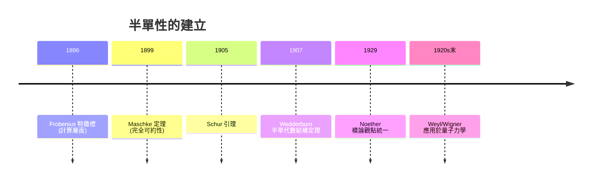

# 06.2 舒爾引理與半單性

## 學習目標

1. 敘述並證明 Maschke 定理（1899）：有限群的複表示完全可約。
2. 敘述並證明 Schur 引理（1905），及其兩個關鍵推論。
3. 理解群代數 $`\mathbb{C}[G]`$ 、正則表示與半單代數的 Wedderburn 分解。
4. 用 SymPy 驗證：將一個表示分解為不可約子表示，並檢查與不可約表示交織的矩陣必為純量。

## 歷史背景

Frobenius 在 1896 年發明特徵標時，使用的是高度技巧性的行列式與內積計算，整個理論的「為什麼成立」仍隱藏在計算之中。把這座大廈的地基挖出來的，是兩位數學家：

- **海因里希・馬施克（Heinrich Maschke, 1853–1908）**：他在 1899 年證明，特徵不整除 $`|G|`$ 的體上（特別是 $`\mathbb{C}`$ ），有限群的每個表示都可以**完全可約**——任何不變子空間都有補空間。這個看似技術性的結果，實際上宣告了表示論是一門「柔性」的理論：沒有若爾當塊、沒有不可約之外的神祕結構，一切表示都由不可約表示拼裝而成（參考 [5.3 節](05.3-若爾當標準形與若爾當（1870）的工作.md)中若爾當塊的麻煩，此處它們被消滅了）。
- **伊薩伊・舒爾（Issai Schur, 1875–1941）**：Frobenius 的學生，1905 年前後將表示論改寫成矩陣語言並證明以他命名的引理。Schur 引理是整個表示論中使用頻率最高的一句話：「與不可約表示交織的映射，要嘛是零、要嘛是同構（在 $`\mathbb{C}`$ 上還必是純量）」。
- **Emmy Noether（1882–1935）**：1929 年她提出決定性的一步——把表示看成**模**（module over the group algebra $`\mathbb{C}[G]`$ ）。表示的子表示就是子模，完全可約就是半單模。這個觀點把 Maschke 定理與 Wedderburn（1907）的半單代數結構定理串成一體，也直接連向 [8 章](08.1-拓撲的驅動：龐加萊（1895）與同調的誕生.md)的同調代數（半單性 = 所有 Ext 消失）。
- **理論與技術的互相驅動**：1920 年代量子力學需要處理「對稱性如何約束態向量空間」——這正是完全可約性的問題：一個帶對稱性的大空間如何分解成不可約子空間的直和。沒有 Maschke 定理，光譜的「殼層結構」在數學上就無從保證（見 [6.6 節](06.6-應用：從物理學到分子對稱.md)）。



## Maschke 定理

**定理 6.2.1（Maschke, 1899）。** 設 $`G`$ 是有限群， $`K`$ 是體， $`\operatorname{char} K \nmid |G|`$ 。若 $`\rho: G \to GL(V)`$ 是表示且 $`W \subseteq V`$ 是 $`G`$ -不變子空間，則存在 $`G`$ -不變的補空間 $`W'`$ 使 $`V = W \oplus W'`$ 。

**證明思路（平均化技巧）。** 這是本書最重要的證明技巧之一，值得完整寫下。

1. 先在向量空間層面（拋開 $`G`$ ）取任意線性補映射 $`\pi_0 : V \to W`$ （投影到 $`W`$ ，即 $`\pi_0|_W = \operatorname{id}_W`$ ）。
2. 對 $`G`$ **平均**這個投影：

$$
\pi = \frac{1}{|G|} \sum_{g \in G} \rho(g)\, \pi_0\, \rho(g)^{-1}.
$$

3. 檢查 $`\pi`$ 仍是 $`W`$ 上的投影：若 $`w \in W`$ ， $`\rho(g)^{-1}w \in W`$ （不變性）， $`\pi_0`$ 保持它，再被 $`\rho(g)`$ 送回 $`w`$ ，故 $`\pi(w) = w`$ 。
4. 檢查 $`\pi`$ 與 $`G`$ 交換：對 $`h \in G`$ ，

$$
\pi \rho(h) = \frac{1}{|G|}\sum_g \rho(g)\pi_0\rho(g^{-1}h) = \frac{1}{|G|}\sum_{u}\rho(hu)\pi_0\rho(u) = \rho(h)\pi,
$$

（令 $`u = g^{-1}h`$ ，用 $`\{g^{-1}h\} = \{g\}`$ 這個重標籤——群論在證明中扮演的角色正是「允許平均」）。
5. 令 $`W' = \ker \pi`$ 。因 $`\pi`$ 與 $`G`$ 交換， $`W'`$ 是 $`G`$ -不變的，且 $`V = W \oplus W'`$ 。 $`\blacksquare`$

**關鍵點： $`\frac{1}{|G|}`$ 必須存在**，這就是條件 $`\operatorname{char} K \nmid |G|`$ 的來源。特徵 $`p`$ 整除 $`|G|`$ 時（模表示論，Brauier 1930s 起）完全可約性失效，理論面貌徹底改變——這也再次說明「條件的來源 = 證明中工具的需求」。

## Schur 引理

**引理 6.2.2（Schur, 1905）。** 設 $`\rho_1 : G \to GL(V_1)`$ 、 $`\rho_2 : G \to GL(V_2)`$ 是不可約複表示， $`T : V_1 \to V_2`$ 滿足 $`T\rho_1(g) = \rho_2(g) T`$ 對所有 $`g`$ （這樣的 $`T`$ 稱為**交織算子**，intertwiner）。則：

1. 若 $`\rho_1 \not\cong \rho_2`$ ，則 $`T = 0`$ 。
2. 若 $`\rho_1 = \rho_2`$ （同一表示），則 $`T = \lambda I`$ 是純量矩陣。

**證明。**

(1) $`\ker T`$ 是 $`V_1`$ 的 $`G`$ -不變子空間： $`T\rho_1(g)v = \rho_2(g)Tv = 0 \Rightarrow \rho_1(g)v \in \ker T`$ 。不可約性給 $`\ker T = 0`$ 或 $`V_1`$ 。同理 $`\operatorname{im} T`$ 是 $`V_2`$ 的不變子空間，為 $`0`$ 或 $`V_2`$ 。若 $`T \neq 0`$ 則 $`\ker T = 0, \operatorname{im} T = V_2`$ ， $`T`$ 是同構， $`\rho_1 \cong \rho_2`$ ，矛盾（或得結論 $`T`$ 同構）。

(2) 取 $`T`$ 在 $`\mathbb{C}`$ 上的特徵值 $`\lambda`$ （ $`\mathbb{C}`$ 代數封閉保證存在），則 $`T - \lambda I`$ 仍是交織算子，且奇異。由 (1) 的論證，奇異交織算子必為零，故 $`T = \lambda I`$ 。 $`\blacksquare`$

**注意**：(2) 在 $`\mathbb{R}`$ 上不成立—— $`\mathbb{C}`$ 對 $`\mathbb{R} \setminus \{0\}`$ 旋轉群的表示（ $`2 \times 2`$ 旋轉矩陣）不可約，但 $`\mathbb{C} \cong \mathbb{R}^2`$ 中所有與旋轉交換的矩陣構成 $`\mathbb{C}`$ 自身，是 2 維實代數而非純量。這說明代數封閉性的角色，也埋下了實表示分類（Frobenius–Schur 指標）的伏線（[6.6 節](06.6-應用：從物理學到分子對稱.md)中化學的複表示與實表示差異正源於此）。

**推論 6.2.3。** 不可約表示 $`\rho : G \to GL_d(\mathbb{C})`$ 的像落在「所有與 $`\rho(G)`$ 交換的矩陣」的中心化子 = 純量矩陣中。反過來，這給出不可約性判據： $`\rho`$ 不可約 $`\iff`$ 與所有 $`\rho(g)`$ 交換的矩陣只有純量矩陣。

**推論 6.2.4（正交關係的引擎）。** Schur 引理是 [6.1 節](06.1-群特徵標的誕生：弗比尼烏斯（1896）.md)正交關係的證明核心：對 $`\chi_i \neq \chi_j`$ ，矩陣 $`\sum_g \rho_i(g^{-1}) A \rho_j(g)`$ 交織 $`\rho_j`$ 與 $`\rho_i`$ ，由 Schur 引理必為零；取 $`A`$ 的適當元素即可逼出 $`\langle \chi_i, \chi_j \rangle = 0`$ 。

## 群代數與 Wedderburn 分解

**定義。** 群代數 $`\mathbb{C}[G]`$ 是以 $`\{g : g \in G\}`$ 為基的自由向量空間，乘法由群乘法線性延拓：

$$
\left(\sum_g a_g g\right)\left(\sum_h b_h h\right) = \sum_{u} \left(\sum_g a_g b_{g^{-1}u}\right) u.
$$

$`\mathbb{C}[G]`$ 上的模 $`\iff`$ $`G`$ 的表示（Noether, 1929）。

**定理 6.2.5（Maschke + Wedderburn）。** 若 $`\operatorname{char} K \nmid |G|`$ ，則

$$
K[G] \cong \prod_{i=1}^{r} M_{d_i}(K)
$$

（ $`\mathbb{C}`$ 上），其中 $`d_i`$ 是不可約表示的次數， $`r`$ 是不可約表示個數。比較兩邊維數：

$$
|G| = \sum_{i=1}^{r} d_i^2 .
$$

這個平方和公式與 [6.1 節](06.1-群特徵標的誕生：弗比尼烏斯（1896）.md)群行列式的因式冪次完全吻合——群行列式的「二次因式重複 $`d_i`$ 次」正是矩陣代數 $`M_{d_i}`$ 維數 $`d_i^2`$ 的身影。

**正則表示。** $`G`$ 作用在 $`\mathbb{C}[G]`$ 自身（左乘）得到的表示。它的分解

$$
\mathbb{C}[G] \cong \bigoplus_{i=1}^{r} V_i^{\oplus d_i}
$$

說明：**每個不可約表示在正則表示中恰好出現 $`d_i`$ 次**。這是計算特徵標表的實用工具（見 [6.3 節](06.3-有限群的不可約表示與特徵標表.md)）。

## SymPy 實作

### 範例 1：驗證「平均投影」構造不變補空間

考慮 $`S_3`$ 的三維置換表示，其不變子空間 $`W = \{(1,1,1)\}^\perp`$ 的補線 $`W_0 = \mathbb{C}(1,1,1)`$ 。我們用平均化技巧構造 $`G`$ -等變投影：

```python
import sympy as sp
from sympy.combinatorics.named_groups import SymmetricGroup

G = SymmetricGroup(3)

def rho_matrix(g):
    M = sp.zeros(3)
    for i in range(3):
        M[g(i), i] = 1
    return M

# 任意初始投影: 投到 e1 方向
v = sp.Matrix([1, 0, 0])
n = G.order()

# 平均化: P = (1/|G|) * sum_g  rho(g) * proj0 * rho(g)^{-1}
P = sp.zeros(3)
for g in G.elements:
    R = rho_matrix(g)
    P += R * (v * v.T) * R.T      # 置換矩陣是正交的, R^{-1} = R^T
P = P / n

print("P^2 = P ? ", sp.simplify(P**2 - P) == sp.zeros(3))
print("與所有 rho(g) 交換? ", all(sp.simplify(P*rho_matrix(g) - rho_matrix(g)*P) == sp.zeros(3) for g in G.elements))
print("P =")
sp.pprint(P)
```

輸出說明：`P` 等於 $`\frac{1}{3}\mathbf{1}\mathbf{1}^T`$ ——投射到 $`\langle(1,1,1)\rangle`$ 的 $`G`$ -等變投影，滿足冪等與交織兩性質。這正是 Maschke 證明的可計算化身：**隨便一個投影，平均之後自動獲得對稱性**。

### 範例 2：Schur 引理的數值驗證

用 $`S_3`$ 的二維標準表示，解「與所有 $`\rho(g)`$ 交換的矩陣」的線性方程組：

```python
import sympy as sp
from sympy.combinatorics.named_groups import SymmetricGroup

G = SymmetricGroup(3)
gens = G.generators

# 標準二維表示：以 (1,1,1) 為法向量的平面上, 用基底 u=(1,-1,0)/sqrt2, v=(1,1,-2)/sqrt6
import sympy as sp
u = sp.Matrix([1, -1, 0]) / sp.sqrt(2)
v = sp.Matrix([1, 1, -2]) / sp.sqrt(6)
B = sp.Matrix.hstack(u, v)          # 3x2, 列 = 新基

def std_2d(g):
    R = sp.zeros(3)
    for i in range(3):
        R[g(i), i] = 1
    return sp.simplify(B.T * R * B)   # 2x2

a, b, c, d = sp.symbols('a b c d')
T = sp.Matrix([[a, b], [c, d]])
eqs = []
for g in G.elements:
    eqs += list(T * std_2d(g) - std_2d(g) * T)
sol = sp.solve(eqs, [a, b, c, d], dict=True)
print(sol)
```

輸出說明：解為 $`\{d: a, b: 0, c: 0\}`$ ，即 $`T = aI`$ 是純量矩陣——Schur 引理推論 6.2.3 的直接驗證。標準表示不可約 $`\iff`$ 中心化子只有純量，程式把「不可約」變成可計算的線性代數問題。

### 範例 3：檢驗群代數的維數公式 $`|G| = \sum d_i^2`$

```python
from sympy.combinatorics.named_groups import SymmetricGroup, AlternatingGroup, DihedralGroup, CyclicGroup

def sq_sum_test(G, irreducible_dims):
    n = G.order()
    s = sum(d**2 for d in irreducible_dims)
    print(f"|G| = {n},  sum d_i^2 = {s},  相等: {n == s}")

# S_3: 次數 1,1,2 ; D_4 (8階二面體群): 1,1,1,1,2 ; C_5: 1x5
sq_sum_test(SymmetricGroup(3), [1, 1, 2])
sq_sum_test(DihedralGroup(4), [1, 1, 1, 1, 2])
sq_sum_test(CyclicGroup(5), [1, 1, 1, 1, 1])
```

輸出說明：三行都是 `相等: True`。這些已知的不可約次數清單可由 [6.3 節](06.3-有限群的不可約表示與特徵標表.md)的特徵標表程式自動算出，此處先以手算結果核對公式。

## SymPy 要點回顧

* 平均化構造只需 `for g in G.elements` 迴圈加上矩陣運算，`sp.simplify` 清理分數與根號。
* 檢查交織條件：`T * rho(g) - rho(g) * T` 是否全為零矩陣；用 `sp.solve` 解線性方程組即可找出中心化子。
* 置換矩陣為正交矩陣： $`R^{-1} = R^T`$ ，實作時可省去求逆。
* `DihedralGroup(n)`、`CyclicGroup(n)`、`AlternatingGroup(n)` 提供現成的非交換/交換測試群。

## 習題

1. 寫出 Maschke 定理證明中第 4 步交織性質的完整細節。
2. 證明：若 $`\rho`$ 不可約且 $`\rho(g)`$ 全為實矩陣， $`\mathbb{C}`$ 上仍可能出現非純量交織算子嗎？說明代數封閉性的角色。
3. 對 $`C_3`$ 計算群代數 $`\mathbb{C}[C_3]`$ 的 Wedderburn 分解，並用傅立葉矩陣（DFT 矩陣）明確寫出同構。
4. 用範例 2 的方法，對 $`D_4`$ 的二維不可約表示驗證中心化子為純量。
5. 說明為何 $`\operatorname{char} K = p`$ 、 $`p \mid |G|`$ 時，平凡表示可以不斷延拓出非半單的例子（提示： $`C_p`$ 用 $`\begin{pmatrix} 1 & 1 \\ 0 & 1 \end{pmatrix}`$ ）。
6. （挑戰）證明定理 6.2.5 中 $`\sum d_i^2 = |G|`$ ：對 Wedderburn 分解兩邊取維數。

**下一節**：把 Maschke + Schur 的成果兌現成演算法——特徵標表的構造與正交關係的雙重形式，見 [6.3-有限群的不可約表示與特徵標表](06.3-有限群的不可約表示與特徵標表.md)。
