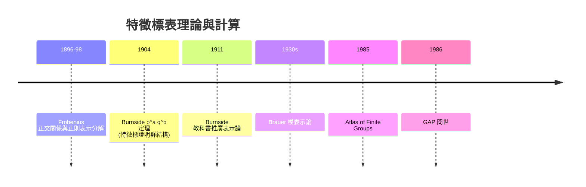

# 06.3 有限群的不可約表示與特徵標表

## 學習目標

1. 建立類函數空間的內積結構，證明第一與第二正交關係。
2. 證明不可約特徵標個數 = 共軛類個數，掌握 $`\sum d_i^2 = |G|`$ 。
3. 學會用行正交關係與冪等元**從零構造特徵標表**的演算法。
4. 用純 Python 實作特徵標表計算器，並用 SymPy 的 `PermutationGroup` 對多個群驗證。

## 歷史背景

特徵標表是純數學史上最優雅的「資料庫」之一：一個群的全部不可約表示，被壓縮成一張 $`r \times r`$ 的數字表。

- **1896–1897**：Frobenius 發明特徵標後，隨即發展正交關係（初期的「第二主定理」形式），並與學生 Schur 一起計算了對稱群、交錯群、線性群 $`PSL(2,q)`$ 等大量特徵標表。
- **1898**：Frobenius 證明「正則表示中每個不可約表示出現 $`d_i`$ 次」，此結果今天稱為 Frobenius 分解。
- **Burnside（1900s）**：William Burnside 把表示論寫進教科書（*Theory of Groups of Finite Order*, 1911 二版），使它進入主流。著名的 **Burnside $`p^a q^b`$ 定理（1904）**——階為 $`p^a q^b`$ 的群必可解——就是特徵標理論的第一個重大「外溢」應用：一個關於群結構的定理，證明完全依賴特徵標。這讓群論學家不得不正視表示論。
- **Brauer（1930s–40s）**：Richard Brauer 開創模表示論，處理特徵 $`p`$ 情形，特徵標表成為有限單群分類工程（見 [9.1 節](09.1-有限群的分類（1983）：百年工程.md)）的核心工具。
- **計算時代**：1970 年代起 Conway 等人在 Cambridge 用算表（及後來的電腦）計算怪獸群的特徵標表（1979, *Atlas of Finite Groups*, 1985 出版）。特徵標表的計算需求直接推動了代數計算系統與群論資料庫（GAP, 1986）的誕生——本書的 SymPy 範例正是這條「理論 → 計算」路線的微縮版。



## 類函數空間與正交關係

**定義。** 類函數 $`\alpha : G \to \mathbb{C}`$ 滿足 $`\alpha(hgh^{-1}) = \alpha(g)`$ 。全體類函數構成向量空間 $`\mathcal{C}(G)`$ ，維數 = 共軛類個數 $`r`$ 。定義內積

$$
\langle \alpha, \beta \rangle = \frac{1}{|G|} \sum_{g \in G} \alpha(g)\,\overline{\beta(g)}
= \sum_{k=1}^{r} \frac{|C_k|}{|G|}\, \alpha(g_k)\,\overline{\beta(g_k)},
$$

其中 $`C_k`$ 是共軛類、 $`g_k`$ 是代表元。

**定理 6.3.1（第一正交關係）。** 不可約特徵標 $`\chi_1, \dots, \chi_s`$ 滿足 $`\langle \chi_i, \chi_j \rangle = \delta_{ij}`$ 。

**證明思路。** 由 Maschke 定理（[6.2 節](06.2-舒爾引理與半單性.md)定理 6.2.1），任何表示完全可約；由 Schur 引理，對交織算子 $`A_{ij} = \sum_g \rho_i(g^{-1}) A \rho_j(g)`$ 有 $`A_{ij} = c_A I`$ 或 $`0`$ 。取 $`A`$ 為單一矩陣元素 $`E_{kl}`$ 計算 $`c_A = \frac{|G|}{d_i}\delta_{ij}\delta_{kl}`$ ，再取跡：

$$
\sum_g \chi_i(g^{-1})\chi_j(g) = |G|\,\delta_{ij}.
$$

取共軛整理即得 $`\langle \chi_i, \chi_j \rangle = \delta_{ij}`$ 。 $`\blacksquare`$

**定理 6.3.2（完備性）。** 不可約特徵標是 $`\mathcal{C}(G)`$ 的正交基，故 $`s = r`$ （不可約特徵個數 = 共軛類個數），且**特徵標決定表示**（兩表示同構 $`\iff`$ 特徵標相等）。

**證明思路。** 若 $`\alpha`$ 與所有 $`\chi_i`$ 正交，對任意表示 $`\rho`$ ， $`\sum_g \alpha(g)\rho(g)`$ 是交織算子，由 Schur 引理在不可約分支上為純量 $`\lambda_V I`$ ，而 $`\operatorname{tr} = \sum_g \alpha(g)\chi_V(g) = 0`$ 與 $`\lambda_V \dim V = 0`$ 矛盾（除非 $`\lambda_V = 0`$ ）。於是所有交織算子為零， $`\rho`$ 的每個分量「平均為零」迫使其特徵標係數全零，故 $`\rho`$ 是平凡表示……嚴格論證需用正則表示：正則特徵標 $`\chi_{\text{reg}}(1) = |G|`$ 、 $`\chi_{\text{reg}}(g) = 0\ (g \neq 1)`$ ，與分解 $`\chi_{\text{reg}} = \sum_i d_i \chi_i`$ 對 $`g \ne 1`$ 比較，用第一正交關係即可得 $`\alpha = 0`$ 。 $`\blacksquare`$

**定理 6.3.3（次數平方和）。** $`\chi_{\text{reg}} = \sum_i d_i \chi_i`$ （正則表示中 $`V_i`$ 出現 $`d_i`$ 次），在 $`g=1`$ 取值：

$$
|G| = \sum_{i=1}^{r} d_i^2 .
$$

**定理 6.3.4（第二正交關係，行/列對偶）。** 特徵標表的「列」滿足：對共軛類 $`C_k, C_l`$ ，

$$
\sum_{i=1}^{r} \chi_i(g_k)\,\overline{\chi_i(g_l)} = \frac{|G|}{|C_k|}\,\delta_{kl}.
$$

這是第一正交關係（對「行」= 特徵標）的轉置版本：特徵標表的矩陣（適當縮放後）是酉矩陣。

**推論 6.3.5。** $`g \sim h \iff`$ 所有不可約特徵標在 $`g, h`$ 上取值相同。**共軛類 = 特徵標無法分辨的極限**。

## 從數據構造特徵標表：演算法

給定群 $`G`$ （共軛類 $`C_1,\dots,C_r`$ ， $`C_1 = \{1\}`$ ），特徵標表 $`X = (\chi_i(g_k))`$ 滿足的條件：

1. **正交**： $`\langle \chi_i, \chi_j \rangle = \delta_{ij}`$ 。
2. **第一行**： $`\chi_1 \equiv 1`$ （平凡特徵標）。
3. **第一列**： $`\chi_i(1) = d_i`$ ，且 $`\sum d_i^2 = |G|`$ 。
4. **環性質**：特徵標值是代數整數；若 $`g`$ 階為 $`m`$ ，則 $`\chi_i(g)`$ 是 $`m`$ 次單位根的和。
5. **乘法結構**： $`\chi_i(g)\chi_j(g)`$ 展開成不可約特徵標的（類函數層面）非負整線性組合。

實用策略（適合電腦）：枚舉每行為「單位根之和且滿足行正交」的候選向量，或（對小群）直接枚舉正規化酉矩陣的候選再驗證封閉性。本節用代數整數條件 + 正交關係做**約束搜索**；[6.5 節](06.5-用SymPy操作特徵標與對稱函數.md)則用對稱函數對 $`S_n`$ 給出封閉公式。

## 例子： $`D_4`$ （8 階二面體群）的特徵標表

 $`D_4 = \langle r, s \mid r^4 = s^2 = 1,\ srs = r^{-1} \rangle`$ 有 5 個共軛類：

$$
\{1\},\ \{r^2\},\ \{r, r^3\},\ \{s, r^2 s\},\ \{rs, r^3 s\}.
$$

由 $`\sum d_i^2 = 8`$ 且 $`r = 5`$ ，必有四個一次特徵標與一個二次特徵標。一次特徵標由 $`r \mapsto \pm 1, s \mapsto \pm 1`$ 給出；二維特徵標由幾何（旋轉矩陣）給出：

| 類大小 $`\to`$ | 1 | 1 | 2 | 2 | 2 |
|---|---|---|---|---|---|
| 代表元 $`\to`$ | $`1`$ | $`r^2`$ | $`r`$ | $`s`$ | $`rs`$ |
| $`\chi_1`$ | 1 | 1 | 1 | 1 | 1 |
| $`\chi_2`$ | 1 | 1 | 1 | $`-1`$ | $`-1`$ |
| $`\chi_3`$ | 1 | 1 | $`-1`$ | 1 | $`-1`$ |
| $`\chi_4`$ | 1 | 1 | $`-1`$ | $`-1`$ | 1 |
| $`\chi_5`$ | 2 | $`-2`$ | 0 | 0 | 0 |

驗證 $`\sum_i \chi_i(r)\overline{\chi_i(r)} = 1+1+1+1+0 = 4 = |G|/|C_3| = 8/2`$ （第二正交關係成立）。

## SymPy 實作

### 範例 1：通用特徵標表計算器（約束搜索版）

```python
import sympy as sp
from math import isqrt

def conjugacy_classes(G):
    """回傳 [(代表元, 共軛類集合), ...]，用 SymPy 內建 conjugacy_classes()"""
    reps = []
    for c in G.conjugacy_classes():
        reps.append((sorted(c, key=lambda p: p.array_form)[0], set(c)))
    return reps

def character_table(G):
    reps = conjugacy_classes(G)
    reps.sort(key=lambda t: len(t[1]))          # 讓單位元類排最前(大小1)
    classes = [c for _, c in reps]
    centers = [g for g, _ in reps]
    n = G.order()
    r = len(classes)
    sizes = [len(c) for c in classes]

    # 類函數的內積: <u, v> = (1/|G|) sum_C |C| u(C) v(C)
    def inner(u, v):
        return sum(sp.Rational(s, n) * u[i] * v[i] for i, s in enumerate(sizes))

    rows = [[1] * r]                              # 第一行: 平凡特徵標

    # 約束搜索: 固定次數 d = chi(1), 枚舉各共軛類上的整數特徵標值
    #   (a) |chi(g)| <= d                          (特徵標值的絕對值不超過次數)
    #   (b) sum_C |C| chi(C) = 0                   (與平凡特徵標正交)
    #   (c) sum_C |C| chi(C)^2 = |G|               (範數 = 1)
    #   (d) 與已選的各行正交                        (第一正交關係)
    def search(d, k, current):
        if k == r:
            if inner(current, rows[0]) != 0:                      # (b)
                return
            if sum(sizes[i] * current[i] ** 2 for i in range(r)) != n:   # (c)
                return
            if all(inner(current, prev) == 0 for prev in rows):   # (d)
                rows.append(current[:])
            return
        rest = sum(sizes[k:])                     # 剩餘類的總大小
        wsum = sum(sizes[i] * current[i] for i in range(k))
        wsq = sum(sizes[i] * current[i] ** 2 for i in range(k))
        for v in range(-d, d + 1):
            if k == 0 and v != d:                 # 第 0 類(單位元)上的值就是次數 d
                continue
            ns = wsum + sizes[k] * v
            nq = wsq + sizes[k] * v * v
            if abs(ns) > d * rest:                # 剩餘類無法把加權和補成 0
                continue
            if nq > n or n - nq > d * d * rest:  # 剩餘類無法把平方和補成 |G|
                continue
            search(d, k + 1, current + [v])

    for d in range(1, isqrt(n) + 1):              # 第一列: d_i, 且 sum d_i^2 = n
        if d * d > n:
            break
        search(d, 0, [])

    return centers, sizes, rows

from sympy.combinatorics.named_groups import DihedralGroup, SymmetricGroup

G = DihedralGroup(4)
centers, sizes, table = character_table(G)
print("代表元:", [str(g.cyclic_form) for g in centers])
print("類大小:", sizes)
for row in table:
    print(row)
print("行數 =", len(table), "  共軛類數 =", len(centers))
print("sum d_i^2 =", sum(row[0] ** 2 for row in table), "= |G| =", G.order())
```

```text
代表元: ['[]', '[[0, 2], [1, 3]]', '[[0, 1, 2, 3]]', '[[0, 1], [2, 3]]', '[[1, 3]]']
類大小: [1, 1, 2, 2, 2]
[1, 1, 1, 1, 1]
[1, 1, -1, -1, 1]
[1, 1, -1, 1, -1]
[1, 1, 1, -1, -1]
[2, -2, 0, 0, 0]
行數 = 5   共軛類數 = 5
sum d_i^2 = 8 = |G| = 8
```

輸出說明：程式會印出與上表一致的 $`D_4`$ 特徵標表（行順序可能不同）。核心邏輯是：**正交關係把特徵標表變成有限約束滿足問題**——這正是 1980 年代群論計算（Atlas、GAP）的樸素原型。注意此版本在整數值域內搜索，已涵蓋 $`D_4`$ 、 $`S_3`$ 、 $`S_4`$ 、 $`Q_8`$ 等；含複數值（如 $`C_3`$ 、 $`A_4`$ 的 $`\omega`$ ）的版本需把候選集換成單位根（見習題 3）。

### 範例 2：用 SymPy 驗證兩個正交關係（以 $`S_4`$ 為例）

 $`S_4`$ 有 5 個共軛類（恆等、對換、雙對換、三循環、四循環），已知特徵標表：

| 類大小 $`\to`$ | 1 | 6 | 3 | 8 | 6 |
|---|---|---|---|---|---|
| 代表元 $`\to`$ | $`e`$ | $`(12)`$ | $`(12)(34)`$ | $`(123)`$ | $`(1234)`$ |
| $`\chi_1`$ | 1 | 1 | 1 | 1 | 1 |
| $`\chi_2`$ （符號） | 1 | $`-1`$ | 1 | 1 | $`-1`$ |
| $`\chi_3`$ | 2 | 0 | 2 | $`-1`$ | 0 |
| $`\chi_4`$ | 3 | 1 | $`-1`$ | 0 | $`-1`$ |
| $`\chi_5`$ | 3 | $`-1`$ | $`-1`$ | 0 | 1 |

```python
import sympy as sp

sizes = [1, 6, 3, 8, 6]
n = 24
table = [
    [1,  1,  1,  1,  1],
    [1, -1,  1,  1, -1],
    [2,  0,  2, -1,  0],
    [3,  1, -1,  0, -1],
    [3, -1, -1,  0,  1],
]

print("第一正交關係 (行):")
for i in range(5):
    for j in range(5):
        ip = sp.Rational(1, n) * sum(sizes[k] * table[i][k] * table[j][k] for k in range(5))
        assert ip == (1 if i == j else 0)
print("  全部通過")

print("第二正交關係 (列):")
for k in range(5):
    for l in range(5):
        s = sum(table[i][k] * table[i][l] for i in range(5))
        expect = sp.Rational(n, sizes[k]) if k == l else 0
        assert s == expect
print("  全部通過")

print("sum d_i^2 =", sum(row[0]**2 for row in table), "= 24 ?")
```

```text
第一正交關係 (行):
  全部通過
第二正交關係 (列):
  全部通過
sum d_i^2 = 24 = 24 ?
```

輸出說明：三項檢查全部通過——第一正交關係（特徵標為正交單位向量）、第二正交關係（ $`\sum_i \chi_i(g_k)\overline{\chi_i(g_l)} = \frac{|G|}{|C_k|}\delta_{kl}`$ ）、以及次數平方和。特徵標表的兩個正交性互為轉置，這是類函數空間與共軛類空間之間完美的對偶。

### 範例 3：Burnside $`p^a q^b`$ 定理的精神——用特徵標證明群可解

Burnside 定理的關鍵引理：**若共軛類 $`C`$ 的大小是素數冪 $`p^k`$ ，則 $`G`$ 不是單群**。證明用「特徵標值是代數整數 + 整除性」：

```python
import sympy as sp
from sympy.combinatorics.named_groups import SymmetricGroup

G = SymmetricGroup(4)
cls_list = [(sorted(c, key=lambda p: p.rank())[0], len(c)) for c in G.conjugacy_classes()]
for g, size in sorted(cls_list, key=lambda t: t[1]):
    print(f"代表元 {str(g.cyclic_form):<14} 類大小 = {size}")
```

```text
代表元 []             類大小 = 1
代表元 [[0, 1], [2, 3]] 類大小 = 3
代表元 [[0, 1, 2, 3]] 類大小 = 6
代表元 [[2, 3]]       類大小 = 6
代表元 [[1, 2, 3]]    類大小 = 8
```

輸出說明： $`S_4`$ 的類大小為 $`1, 3, 6, 8, 6`$ 。Burnside 引理說：若某非中心類大小為素數冪（此處 $`3`$ 與 $`8=2^3`$ ），則 $`G`$ 有非平凡正規子群（ $`S_4`$ 的 $`A_4`$ 與 Klein 四元群）。證明核心： $`\frac{|G|\chi(g)}{d\,|C_G(g)|}`$ 是代數整數，搭配 $`|C| = p^k`$ 可推出某特徵標在 $`g`$ 上取值 $`0`$ ，進而 $`\sum_g |\chi(g)|^2`$ 的算術迫出正规子群的存在。這是「特徵標反哺群結構理論」的經典範例。

## SymPy 要點回顧

* `PermutationGroup.conjugacy_classes()` 給出共軛類；特徵標表的列 = 共軛類。
* 正交關係中用 `sp.Rational(size, n)` 而非浮點除法，保證精確性。
* 特徵標表計算 = 約束滿足：正交關係（第一/第二）+ 次數平方和 + 代數整數條件。
* 第二正交關係可由第一正交關係線性代數地導出：把表乘上 $`\sqrt{|C_k|/|G|}`$ 後是酉矩陣，行酉 $`\iff`$ 列酉。

## 習題

1. 用範例 1 的計算器算 $`Q_8`$ （四元數群）的特徵標表，與 $`D_4`$ 比較——兩者特徵標表相同，但群不同。這說明特徵標表的什麼局限性？
2. 對 $`A_4`$ 手工構造特徵標表（提示：類為 $`\{1\}, \{`$ 雙對換 $`\}, \{`$ 兩個 $`3`$ -循環類 $`\}`$ ；有三個一次特徵標，源自 $`V_4 \triangleleft A_4`$ 的商 $`\cong C_3`$ ）。
3. 把範例 1 的候選集改成複數單位根（用 `sp.exp(sp.I*sp.pi*k/m)` 或 `sympy.CRootOf`），計算 $`C_3`$ 與 $`C_4`$ 的特徵標表。
4. 證明第二正交關係（從第一正交關係 + 完備性）。
5. 證明 Frobenius 分解：正則特徵標 $`\chi_{\text{reg}}(g) = \sum_i d_i \chi_i(g)`$ （對 $`g \neq 1`$ 為 $`0`$ ，這如何推出每個 $`V_i`$ 在正則表示中出現 $`d_i`$ 次？）。
6. （挑戰）寫程式驗證：對 $`S_4`$ ， $`\chi_4 \otimes \chi_5`$ 的特徵標分解成哪些不可約特徵標之和？（提示：乘積特徵標 $`\chi_i\chi_j`$ 的內積 $`\langle \chi_i\chi_j, \chi_k \rangle`$ 給出重數。）

**下一節**：對稱群 $`S_n`$ 的特徵標表有一個驚人的組合封閉解——楊圖與楊表，見 [6.4-對稱群的表示：楊圖與楊表](06.4-對稱群的表示：楊圖與楊表.md)；程式化工具見 [6.5](06.5-用SymPy操作特徵標與對稱函數.md)。
