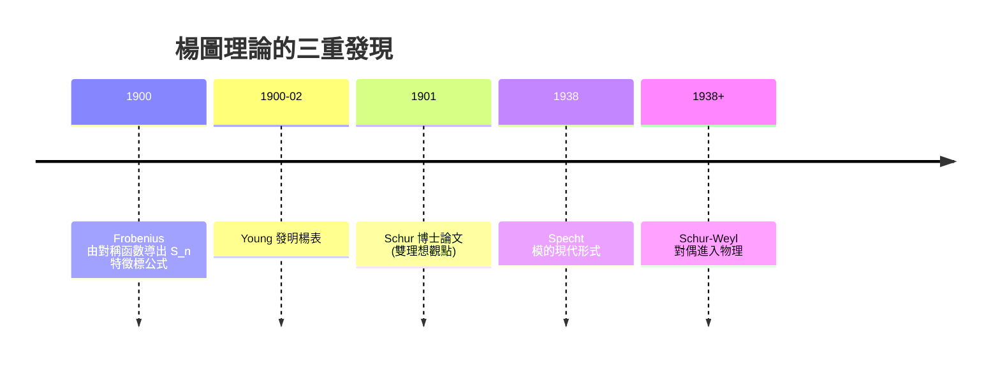
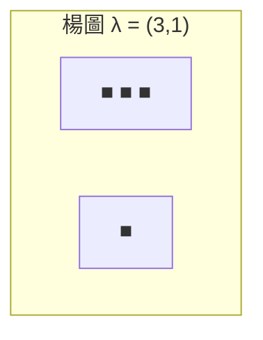

# 06.4 對稱群的表示：楊圖與楊表

## 學習目標

1. 敘述 Frobenius（1900）與 Young（1900–02）的定理： $`S_n`$ 的不可約表示與 $`n`$ 的分割一一對應。
2. 掌握楊圖、楊表、標準楊表的組合定義，以及次數公式 $`f^\lambda`$ 與鉤長公式。
3. 了解 Specht 模的構造思路與 Murnaghan–Nakayama 法則（邊界情形會用即可）。
4. 用 SymPy（`sympy.combinatorics.partitions`、`sympy.functions.combinatorial`）計算分割、鉤長與不可約表示次數。

## 歷史背景

對稱群 $`S_n`$ 是所有有限群的「積木供應商」——每個有限群都嵌入某個 $`S_n`$ （Cayley 定理，見 [2.2 節](02.2-群的定義與凱萊（1854）的抽象化.md)），因此 $`S_n`$ 的表示論有著特殊地位。它被三條獨立的路徑同時打通，堪稱數學史上的「三重發現」：

- **Frobenius（1900）**：在完成一般特徵標理論後，Frobenius 直接計算了 $`S_n`$ 的特徵標，發現它們由**分割** $`\lambda \vdash n`$ 索引，特徵標值可由一個稱為 Frobenius 公式的行列式給出——這是他對稱函數研究的直接產物（對稱函數工具見 [6.5 節](06.5-用SymPy操作特徵標與對稱函數.md)）。
- **Alfred Young（1900–1902）**：英國牧師兼數學家 Alfred Young 在研究不變量時，發明了「楊表」——把 $`1,\dots,n`$ 填入楊圖的方格中——並用「表格單位」（tabloid）與置換作用造出不可約表示的具體模型。他的系列論文 *On quantitative substitutional analysis* 跨越 1900–1930 年代。
- **Issai Schur（1901）**：Frobenius 的學生 Schur 在博士論文中用雙理想（two-sided ideals of $`\mathbb{C}[S_n]`$ ）獨立地重建了同一理論，並證明楊表基底的對稱/反對稱性質——「Schur–Weyl 對偶」的起點，把 $`S_n`$ 的表示與 $`GL_m`$ 的多項式表示綁在一起，成為今日量子多體物理與機器學習張量網路的數學基礎。
- **驅動力**：這個問題的源頭是不變量理論（19 世紀末 Hilbert 的無限性定理 [7.1 節](07.1-希爾伯特（1890）：基定理與零點定理.md) 之前的計算傳統）：如何把 $`n`$ 個變數的多項式按對稱性分類？答案必須經過 $`S_n`$ 的表示——**技術問題（多項式分類）逼出了組合表示論**。
- **現代迴響**：1954 年 Robinson–Schensted 演算法、1976 年 Knuth 的應用、以及粒子物理中的置換對稱性（自旋統計），都靠楊圖的語言。楊圖可說是「對稱性的條碼」。



## 分割、楊圖與楊表

**定義（分割）。** $`n`$ 的**分割**是滿足 $`\lambda_1 \ge \lambda_2 \ge \cdots \ge \lambda_k \ge 1`$ 、 $`\sum \lambda_i = n`$ 的整數列 $`\lambda = (\lambda_1, \dots, \lambda_k)`$ ，記 $`\lambda \vdash n`$ 。

**楊圖。** 分割 $`\lambda`$ 對應的**楊圖**是第 $`i`$ 行有 $`\lambda_i`$ 格的左對齊方格陣。例如 $`\lambda = (3,1)`$ ：



用文字表示（row-major）：第 1 行 3 格、第 2 行 1 格。共軛分割 $`\lambda'`$ = 沿主對角線翻轉的圖。

**楊表。** 把 $`\{1, \dots, n\}`$ 各填一格得**楊表**。若每行由左至右遞增、每列由上至下遞增，稱為**標準楊表**（SYT）。例如 $`\lambda = (3,1)`$ 的一個標準楊表：

```
1 2 3
4
```

**定理 6.4.1（Frobenius–Young）。** $`S_n`$ 的不可約複表示與分割 $`\lambda \vdash n`$ 一一對應； $`\lambda`$ 對應的不可約表示 $`S^\lambda`$ （Specht 模）的次數等於 $`\lambda`$ 的標準楊表個數 $`f^\lambda`$ 。

## 鉤長公式

**定義（鉤長）。** 格子 $`(i,j)`$ 的**鉤** = 該格本身、其右側同行格子、其下方同列格子；鉤的格數稱鉤長 $`h(i,j)`$ 。

**定理 6.4.2（Frame–Robinson–Thrall, 1954）。**

$$
f^\lambda = \frac{n!}{\prod_{(i,j) \in \lambda} h(i,j)} .
$$

**例子。** $`\lambda = (3,1)`$ ， $`n = 4`$ ：鉤長為 $`(3, 1, 1)`$ 與 $`(1)`$ ，即

$$
f^{(3,1)} = \frac{4!}{3 \cdot 1 \cdot 1 \cdot 1} = 3,
$$

與 $`\dim S^{(3,1)} = \dim(\text{標準表示}) = n-1 = 3`$ 吻合（ $`S^{(n-1,1)}`$ 正是 [6.1 節](06.1-群特徵標的誕生：弗比尼烏斯（1896）.md)的標準表示）。

**證明思路（枚舉法）。** 反向歸納：從階乘圖（ $`\lambda = (n)`$ ）開始，每次從楊圖移除一個「角格」（同時是最後一行與最後一列的格），證明 $`f^\lambda = \sum_{\mu = \lambda - \text{角格}} f^{\mu}`$ （遞迴關係），再驗證鉤長公式滿足同一遞迴與初值。格點組合的細節可參考 Fulton《Young Tableaux》。

## Specht 模的構造（思路）

給定分割 $`\lambda`$ ，考慮：

1. **行安定子** $`R_\lambda`$ ：保持每行內部元素集合的置換；**列安定子** $`C_\lambda`$ ：保持每列。
2. 對楊表 $`t`$ 定義 **Young 對稱化子**

$$
\mathfrak{S}_t = \sum_{\sigma \in R_\lambda} \sum_{\tau \in C_\lambda} \operatorname{sgn}(\tau)\, \sigma\tau \ \in\ \mathbb{C}[S_n].
$$

3. Specht 模 $`S^\lambda = \mathbb{C}[S_n]\,\mathfrak{S}_t`$ （由單一元素生成的左理想）。

**性質：** $`S^\lambda`$ 是不可約表示； $`\lambda' \neq \mu'`$ 時 $`S^\lambda \not\cong S^\mu`$ ；且 $`\bigoplus_{\lambda \vdash n} (S^\lambda)^{\oplus f^\lambda} \cong \mathbb{C}[S_n]`$ ，由 $`\sum_\lambda (f^\lambda)^2 = n!`$ （與 [6.2 節](06.2-舒爾引理與半單性.md)定理 6.2.5 一致）。對稱化子的「行對稱化 + 列反對稱化」設計，正是張量分析中對稱/反對稱張量分解的直接來源。

## 特徵標：Murnaghan–Nakayama 法則

置換表示的特徵標 = 不動點數（[6.1 節](06.1-群特徵標的誕生：弗比尼烏斯（1896）.md)範例 3），但 $`S_n`$ 的不可約特徵標 $`\chi^\lambda(\mu)`$ 有更深刻的組合公式：

**定理 6.4.3（Murnaghan–Nakayama, 1937–41）。** 將置換寫成循環型 $`\mu = (\mu_1, \dots, \mu_k)`$ ，則

$$
\chi^\lambda(\mu) = \sum_{T \in \mathrm{Rim}(\lambda, \mu_1)} (-1)^{\mathrm{ht}(T)}\ \chi^{\lambda \setminus T}(\mu_2, \dots, \mu_k),
$$

其中 $`\mathrm{Rim}(\lambda, r)`$ 跑遍 $`\lambda`$ 中長度為 $`r`$ 的「邊界條帶」（rim hooks）， $`T`$ 為豎直時貢獻負號。

**例子。** $`\chi^{(2,1)}((1,1,1)) = \dim S^{(2,1)} = 2`$ （拆掉三個單格條帶，每個貢獻 $`+1`$ ）； $`\chi^{(2,1)}((3)) = 0`$ （ $`(2,1)`$ 中無長度 3 的邊界條帶——事實上 $`\chi^{(2,1)}`$ 在三循環上取值 $`-1`$ ，需細算兩條 rim hook 的正負抵消，見習題 2）。

## SymPy 實作

### 範例 1：分割與楊圖列印

```python
import sympy as sp
from sympy.combinatorics.partitions import Partition, IntegerPartition

n = 5
parts = [p for p in sp.utilities.iterables.partitions(n)]
parts = sorted((sorted(p, reverse=True) for p in parts), reverse=True)
print(f"{n} 的分割數 = {len(parts)}")

def young_diagram(lam):
    return "\n".join("■ " * k for k in lam)

for lam in parts:
    print(lam, " =>")
    print(young_diagram(lam))
```

輸出說明：`sp.utilities.iterables.partitions(5)` 列出 $`p(5) = 7`$ 個分割；每個分割印出對應楊圖。分割個數 $`p(n)`$ 的增長（ $`p(10) = 42`$ 、 $`p(20) = 627`$ 、 $`p(100) \approx 1.9 \times 10^8`$ ，由 Hardy–Ramanujan 漸近公式給出）說明 $`S_n`$ 不可約表示個數隨 $`n`$ 爆炸式增長——這正是分類它們需要組合工具的原因。

### 範例 2：鉤長公式計算器

```python
import sympy as sp
from math import factorial

def hook_lengths(lam):
    k = len(lam)
    hl = []
    for i in range(k):
        row = []
        for j in range(lam[i]):
            below = sum(1 for i2 in range(i + 1, k) if lam[i2] > j)
            row.append(lam[i] - j + below)   # 右側格數 + 下方格數 + 本身
        hl.append(row)
    return hl

def f_lambda(lam):
    n = sum(lam)
    hl = hook_lengths(lam)
    denom = sp.prod(sp.Integer(h) for row in hl for h in row)
    return sp.Integer(factorial(n)) // denom

for lam in [(3,1), (2,2), (3,2), (4,1), (2,1,1)]:
    print(lam, "鉤長 =", hook_lengths(lam), " f^λ =", f_lambda(lam))

# 驗證 sum (f^λ)^2 = n!
lam5 = [(5,), (4,1), (3,2), (3,1,1), (2,2,1), (2,1,1,1), (1,1,1,1,1)]
print("sum f^2 =", sum(f_lambda(l)**2 for l in lam5), " 5! =", factorial(5))
```

輸出說明： $`f^{(3,1)} = 3`$ 、 $`f^{(2,2)} = 2`$ 、 $`f^{(3,2)} = 5`$ 、 $`f^{(4,1)} = 4`$ 、 $`f^{(2,1,1)} = 3`$ ；最後一行驗證 $`\sum_\lambda (f^\lambda)^2 = 5! = 120`$ ——楊圖版本的「次數平方和公式」（[6.3 節](06.3-有限群的不可約表示與特徵標表.md)定理 6.3.3 的 $`S_n`$ 特化）。

### 範例 3：用 SymPy 驗證 $`S_3`$ 的特徵標表對應楊圖

```python
import sympy as sp
from sympy.combinatorics.named_groups import SymmetricGroup

G = SymmetricGroup(3)

# S_3 的三個分割與特徵標:
# (1,1,1): 平凡 ; (3): 符號 ; (2,1): 標準
def chi(lam, g):
    if lam == [1,1,1]:
        return 1
    if lam == [3]:
        return 1 if g.is_even else -1
    if lam == [2,1]:
        fix = sum(1 for i in range(3) if g(i) == i)  # 置換矩陣跡
        return fix - 1                                # 減去平凡分支

# 驗證正交
elems = list(G.elements)
for lam1 in [[1,1,1],[3],[2,1]]:
    for lam2 in [[1,1,1],[3],[2,1]]:
        ip = sp.Rational(1, 6) * sum(sp.conjugate(chi(lam1,g))*chi(lam2,g) for g in elems)
        print(lam1, lam2, "->", ip)
```

輸出說明：內積矩陣為單位矩陣。三個分割 $`(1,1,1), (3), (2,1)`$ （即楊圖一列、一列反序、鉤形）恰對應 [6.1 節](06.1-群特徵標的誕生：弗比尼烏斯（1896）.md)表格中的三個不可約特徵標：平凡、符號、標準——分割與特徵標的對應在此完全具體化。

### 範例 4：Robinson–Schensted 的次數一致性（挑戰延伸）

RSK 對應把每個置換對應到一對標準楊表，且 $`\sum_\lambda (f^\lambda)^2 = n!`$ 保證了計數吻合。用範例 2 的 `f_lambda` 對 $`n = 6`$ 驗證：

```python
from math import factorial
lam6 = list({tuple(sorted(p, reverse=True)) for p in sp.utilities.iterables.partitions(6)})
lam6 = sorted(lam6, reverse=True)
print("分割數:", len(lam6))
print("sum (f^λ)^2 =", sum(f_lambda(list(l))**2 for l in lam6), " 6! =", factorial(6))
```

輸出：分割數 11，平方和 $`720 = 6!`$ 。這個恆等式是 RSK 雙射性的代數影子。

## SymPy 要點回顧

* `sp.utilities.iterables.partitions(n)` 枚舉分割；`sympy.combinatorics.partitions.IntegerPartition` 提供分割物件操作。
* 鉤長 = （右側格數）+（下方格數）+ 1，兩個迴圈即可；`sp.prod` 做精確連乘。
* 次數公式 $`f^\lambda = n! / \prod h`$ 與平方和恆等式 $`\sum (f^\lambda)^2 = n!`$ 是程式驗證表示論的最佳測試。
* 置換表示特徵標 = 不動點數：`sum(1 for i in range(n) if g(i) == i)`，減去平凡分支得標準表示。

## 習題

1. 畫出 $`\lambda = (4,2,1)`$ 的楊圖，計算全部鉤長，並用鉤長公式求 $`f^{(4,2,1)}`$ （答案：35）。
2. 用 Murnaghan–Nayakama 法則手算 $`\chi^{(2,1)}((3))`$ （提示：兩條長度 3 的 rim hook，一水平一豎直，貢獻 $`+1`$ 與 $`-1`$ ？核對 [6.1 節](06.1-群特徵標的誕生：弗比尼烏斯（1896）.md)表中三循環處的 $`-1`$ ）。
3. 證明： $`S^\lambda`$ 的對偶（共軛）表示是 $`S^{\lambda'} \otimes \operatorname{sgn}`$ ，並推論 $`\chi^\lambda(\text{奇置換})`$ 與 $`\chi^{\lambda'}`$ 的關係。
4. 寫出 $`S_4`$ 的 5 個分割，用鉤長公式算 $`f^\lambda`$ ，核對總和 $`\sum (f^\lambda)^2 = 24`$ ，並與 [6.3 節](06.3-有限群的不可約表示與特徵標表.md) $`S_4`$ 特徵標表的第一列比對。
5. 證明 $`(n-1,1)`$ 的標準楊表恰有 $`n-1`$ 個（提示：1 必須在第一行第 1 格或第 2 格？其實 1 必在 $`(1,1)`$ ，然後 $`n`$ 的位置決定一切）。
6. （挑戰）實作 Murnaghan–Nakayama 的 rim hook 枚舉（從楊圖外緣剝離長度 $`r`$ 的連通、無 $`2 \times 2`$ 的條帶），對 $`S_4`$ 的全部 $`\chi^\lambda(\mu)`$ 建表，與範例比對。

**下一節**：楊圖特徵標的「母函數」正是對稱函數——Schur 函數。用 SymPy 的對稱多項式工具直接操作它們，見 [6.5-用SymPy操作特徵標與對稱函數](06.5-用SymPy操作特徵標與對稱函數.md)。
