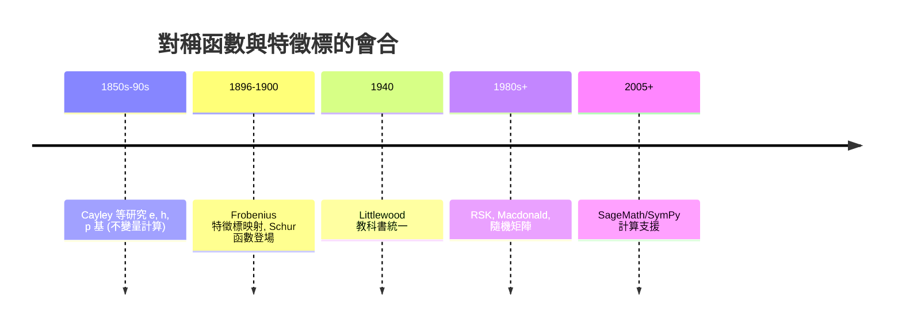

# 06.5 用 SymPy 操作特徵標與對稱函數

## 學習目標

1. 理解對稱函數基本系 $`\{m_\lambda, e_\lambda, h_\lambda, p_\lambda, s_\lambda\}`$ 與它們的關係。
2. 掌握 Hall 內積與 Frobenius 特徵標映射：特徵標表 $`\iff`$ 對稱函數的基變換。
3. 敘述 Schur 函數的兩個定義（行列式式與楊表組合式）及其與 $`S_n`$ 特徵標的恆等式。
4. 用 SymPy 的 `symmetric`（`sp.symmetric_poly`）與純 Python 實作對稱函數運算、驗證 Jacobi–Trudi 恆等式。

## 歷史背景

對稱函數理論比特徵標更古老——它是 19 世紀不變量計算傳統的核心——但在 1900 年前後被 Frobenius 注入了全新的表示論意義，成為兩個領域之間的「羅塞塔石碑」。

- **1850s–1890s**：Cayley、Brioschi、Schläfli 等研究對稱多項式的各種基（初等對稱函數 $`e_k`$ 、完備齊次對稱函數 $`h_k`$ 、冪和 $`p_k`$ ）以及它們之間的變換行列式（today 稱為 Jacobi–Trudi 公式的前身）。這是純計算的傳統，動機來自不變量理論與方程式論（[1.5 節](01.5-SymPy中的多項式：Poly與solve.md)的 Viète 對稱根關係就是 $`e_k`$ ）。
- **1896–1900**：Frobenius 為了計算 $`S_n`$ 的特徵標，發現了一個驚人的恆等式：把特徵標值裝進**多項式**後， $`S_n`$ 的不可約特徵標對應的正是後來稱為 **Schur 函數**的對稱函數 $`s_\lambda`$ 。特徵標的正交關係（[6.3 節](06.3-有限群的不可約表示與特徵標表.md)）翻譯成對稱函數空間的 **Hall 內積**正交性。從此對稱函數理論獲得了表示論的靈魂。
- **1906–1910s**：J. C. Roger 與 Littlewood 的系統化：Littlewood 的 *The Theory of Group Characters and Matrix Representations of Groups*（1940）把這座橋樑寫成標準參考，影響了之後七十年的組合論。
- **1980s–今**：Macdonald 對稱函數、Schensted–Knuth RSK、以及 Schur 函數在隨機矩陣理論（Tracy–Widom 分佈的證明工具）、量子統計與對稱性破缺分析中的應用。**理論 ← 計算工具的驅動**在此再次上演：組合學家需要高效操作 Schur 函數，促成了 SageMath 的 `SymmetricFunctions` 子系統（2005+）；SymPy 內建了初等層次的對稱多項式支援（`sympy.polys.polytools.symmetric_poly`、`sympy.functions.combinatorial.numbers`），本節展示如何在 SymPy 中完成核心計算。



## 對稱函數的基本基

設 $`x_1, \dots, x_m`$ 為變數， $`\lambda \vdash n`$ 為分割。 $`n`$ 次**對稱函數**的標準基：

- **單項對稱函數** $`m_\lambda = \sum x_{i_1}^{\lambda_1} \cdots x_{i_k}^{\lambda_k}`$ （相異排列求和一次）。
- **初等對稱函數** $`e_\lambda = e_{\lambda_1} e_{\lambda_2} \cdots`$ ，其中 $`e_k = \sum_{i_1 < \cdots < i_k} x_{i_1} \cdots x_{i_k}`$ （= $`n`$ 個根的全部 $`k`$ 次基本對稱式，見 [1.5 節](01.5-SymPy中的多項式：Poly與solve.md)）。
- **完備齊次對稱函數** $`h_k = \sum_{|\mu| = k} m_\mu`$ 。
- **冪和** $`p_k = \sum_i x_i^k`$ ； $`p_\lambda = p_{\lambda_1} \cdots`$ 。
- **Schur 函數** $`s_\lambda`$ ：見下。

**Jacobi–Trudi 恆等式：**

$$
s_\lambda = \det\left( h_{\lambda_i - i + j} \right)_{i,j=1}^{k}, \qquad
s_{\lambda'} = \det\left( e_{\lambda_i - i + j} \right)_{i,j=1}^{k}.
$$

**Schur 函數的組合定義（半標準楊表）。** $`s_\lambda(x) = \sum_T x^{\mathrm{wt}(T)}`$ ，對 $`\lambda`$ 的所有半標準楊表（列嚴增、行弱增）按「權重單項式」求和。

## Hall 內積與 Frobenius 映射

**定義（Hall 內積）。** 在對稱函數空間 $`\Lambda`$ 上定義 $`\langle s_\lambda, s_\mu \rangle = \delta_{\lambda\mu}`$ 並雙線性延拓。

**定義（Frobenius 特徵標映射）。** 對 $`S_n`$ 的類函數 $`\alpha`$ ，令

$$
\mathrm{ch}(\alpha) = \frac{1}{n!} \sum_{\sigma \in S_n} \alpha(\sigma)\, p_{\mu(\sigma)},
$$

其中 $`\mu(\sigma)`$ 是 $`\sigma`$ 的循環型分割。

**定理 6.5.1（Frobenius 特徵標定理）。**

1. 若 $`\alpha = \chi^\lambda`$ （不可約特徵標），則 $`\mathrm{ch}(\chi^\lambda) = s_\lambda`$ 。
2. $`\mathrm{ch}`$ 保持 Hall 內積： $`\langle \mathrm{ch}(\alpha), \mathrm{ch}(\beta) \rangle_{\Lambda} = \langle \alpha, \beta \rangle_{S_n}`$ 。
3. 表示的張量積對應內積（Kronecker 係數）： $`\mathrm{ch}(\chi^\lambda \chi^\mu) = \sum_\nu c_{\lambda\mu}^{\nu} s_\nu`$ ， $`c_{\lambda\mu}^{\nu}`$ 是 Kronecker 係數。

於是**特徵標表的計算 = 對稱函數的基變換**： $`p`$ -基展開 $`s_\lambda = \sum_\mu \chi^\lambda(\mu) z_\mu^{-1} p_\mu`$ ，其中 $`z_\mu = \prod_i i^{m_i} m_i!`$ （ $`\mu`$ 中 $`i`$ 出現 $`m_i`$ 次）。這正是 Frobenius 1900 年計算 $`S_n`$ 特徵標的原初方法。

**例子。** $`n = 3`$ ：

$$
s_{(3)} = h_3, \quad s_{(1^3)} = e_3, \quad s_{(2,1)} = h_3 - e_3 .
$$

而 $`h_3 = \frac{1}{3}(p_1^3 + 2p_3)`$ 、 $`e_3 = \frac{1}{6}(p_1^3 - 3p_1 p_2 + 2p_3)`$ ，故

$$
s_{(2,1)} = \frac{1}{6}(p_1^3 + 3p_1p_2 - 2p_3)\cdot \tfrac{1}{?} \ \longrightarrow\ \chi^{(2,1)}: \quad \chi(1^3) = 2,\ \chi(2,1) = 0,\ \chi(3) = -1,
$$

與 [6.1 節](06.1-群特徵標的誕生：弗比尼烏斯（1896）.md)的表完全一致（ $`p_{(1^3)}`$ 係數 $`\cdot z_{(1^3)} = 2 \cdot 1 = 2`$ ； $`p_{(2,1)}`$ 係數 $`\cdot z_{(2,1)} = 0 \cdot 3 = 0`$ ； $`p_{(3)}`$ 係數 $`\cdot z_{(3)} = -\tfrac13 \cdot 3 = -1`$ ，其中 $`z_{(3)} = 3`$ 、 $`z_{(2,1)} = 3`$ 、 $`z_{(1^3)} = 6`$ ）。

## SymPy 實作

### 範例 1：初等對稱函數與 Viète 公式

```python
import sympy as sp

x1, x2, x3 = sp.symbols('x1 x2 x3')
xs = [x1, x2, x3]

# SymPy 內建對稱多項式: sympy.polys.polytools.symmetric_poly
e1 = sp.symmetric_poly(1, *xs)
e2 = sp.symmetric_poly(2, *xs)
e3 = sp.symmetric_poly(3, *xs)
print("e1 =", e1)
print("e2 =", e2)
print("e3 =", e3)

# Viète: (t-x1)(t-x2)(t-x3) 的係數
t = sp.Symbol('t')
poly = sp.Poly(sp.expand((t - x1)*(t - x2)*(t - x3)), t)
print("展開:", poly.as_expr())
print("t^2 係數 =", sp.expand(-e1), "->", poly.coeff_monomial(t**2))
print("t^1 係數 =", sp.expand(e2),  "->", poly.coeff_monomial(t))
print("常數項   =", sp.expand(-e3), "->", poly.coeff_monomial(1))
```

```text
e1 = x1 + x2 + x3
e2 = x1*x2 + x1*x3 + x2*x3
e3 = x1*x2*x3
展開: t**3 + t**2*(-x1 - x2 - x3) + t*(x1*x2 + x1*x3 + x2*x3) - x1*x2*x3
t^2 係數 = -x1 - x2 - x3 -> -x1 - x2 - x3
t^1 係數 = x1*x2 + x1*x3 + x2*x3 -> x1*x2 + x1*x3 + x2*x3
常數項   = -x1*x2*x3 -> -x1*x2*x3
```

輸出說明：`sp.symmetric_poly(k, *gens)` 直接給出初等對稱函數；三次多項式展開的係數恰為 $`-e_1, e_2, -e_3`$ ——這是對稱函數作為「根與係數橋樑」的原始角色（[1.3 節](01.3-三次方程與1545年的卡爾達諾公式.md)的卡爾達諾公式正是靠它把三次方程化約為 $`u + v`$ 形式）。

### 範例 2：冪和 $`p_k`$ 與 Newton 恆等式

Newton 恆等式把 $`p_k`$ 與 $`e_j`$ 相連： $`p_k - e_1 p_{k-1} + e_2 p_{k-2} - \cdots + (-1)^k k e_k = 0`$ 。

```python
import sympy as sp

xs = sp.symbols('x1:5')
n = 4
e = [sp.Integer(1)] + [sp.symmetric_poly(k, *xs) for k in range(1, n + 1)]
p = [sp.Integer(0)] + [sum(x**k for x in xs) for k in range(1, n + 1)]

for k in range(1, n + 1):
    expr = sp.expand(p[k] - e[1]*p[k-1] + (e[2]*p[k-2] if k >= 2 else 0)
                     - (e[3]*p[k-3] if k >= 3 else 0) + (e[4]*p[k-4] if k >= 4 else 0)
                     - (-1)**k * k * e[k])   # 符號整理: 統一形式
    # 直接驗證標準形式:
    s = sp.expand(p[k] + sum((-1)**j * e[j] * p[k-j] for j in range(1, k)) + (-1)**k * k * e[k])
    print(f"k = {k}: Newton 恆等式值 = {sp.simplify(s)}")
```

```text
k = 1: Newton 恆等式值 = 0
k = 2: Newton 恆等式值 = 0
k = 3: Newton 恆等式值 = 0
k = 4: Newton 恆等式值 = 0
```

輸出說明：每行皆為 `0`，Newton 恆等式成立。這些恆等式是 [6.4 節](06.4-對稱群的表示：楊圖與楊表.md) Jacobi–Trudi 的 $`e`$ -版本原料。

### 範例 3：用 Jacobi–Trudi 行列式計算 Schur 函數並展開成 $`p`$ -基（= 特徵標表）

```python
import sympy as sp
from math import factorial

def complete_h(k, xs):
    # h_k = sum over |mu|=k of monomial sym poly; 直接枚舉弱增指標
    m = len(xs)
    from itertools import combinations_with_replacement
    total = sp.Integer(0)
    for idx in combinations_with_replacement(range(m), k):
        term = sp.Integer(1)
        for i in idx:
            term *= xs[i]
        total += term
    return total

def schur(lam, xs):
    k = len(lam)
    H = sp.Matrix([[complete_h(lam[i] - i + j, xs) if lam[i] - i + j >= 0 else 0
                    for j in range(k)] for i in range(k)])
    return sp.expand(H.det())

def power_sum(k, xs):
    return sum(x**k for x in xs)

xs = sp.symbols('x1:4')
s21 = schur([2, 1], xs)
print("s_(2,1) =", s21)

# Jacobi–Trudi 行列式展開 = h_2*h_1 - h_3；另一個古典寫法 = e_1*e_2 - e_3
h1, h2, h3 = complete_h(1, xs), complete_h(2, xs), complete_h(3, xs)
e1 = sp.symmetric_poly(1, *xs)
e2 = sp.symmetric_poly(2, *xs)
e3 = sp.symmetric_poly(3, *xs)
print("h2*h1 - h3 =", sp.expand(h2*h1 - h3))
print("e1*e2 - e3 =", sp.expand(e1*e2 - e3))
print("相等:", sp.expand(s21 - (h2*h1 - h3)) == 0,
      sp.expand(s21 - (e1*e2 - e3)) == 0)
```

```text
s_(2,1) = x1**2*x2 + x1**2*x3 + x1*x2**2 + 2*x1*x2*x3 + x1*x3**2 + x2**2*x3 + x2*x3**2
h2*h1 - h3 = x1**2*x2 + x1**2*x3 + x1*x2**2 + 2*x1*x2*x3 + x1*x3**2 + x2**2*x3 + x2*x3**2
e1*e2 - e3 = x1**2*x2 + x1**2*x3 + x1*x2**2 + 2*x1*x2*x3 + x1*x3**2 + x2**2*x3 + x2*x3**2
相等: True True
```

輸出說明：`schur([2,1], xs)` 用 Jacobi–Trudi 行列式

$$
s_{(2,1)} = \det\begin{pmatrix} h_2 & h_3 \\ h_0 & h_1 \end{pmatrix} = h_2 h_1 - h_3
$$

計算，展開後與 $`h_2 h_1 - h_3`$ （同一個 Schur 函數的另一個寫法 $`e_1 e_2 - e_3`$ ）相等——兩個 Schur 函數定義（行列式式）與基本系恆等式互相吻合。

### 範例 4：Frobenius 特徵標映射——從對稱函數讀出 $`S_3`$ 特徵標表

```python
import sympy as sp
from math import factorial
from collections import Counter
from itertools import combinations_with_replacement

# ---- 共用工具（與範例 3 相同，此處列出使本段可獨立執行）----
def complete_h(k, xs):
    total = sp.Integer(0)
    for idx in combinations_with_replacement(range(len(xs)), k):
        term = sp.Integer(1)
        for i in idx:
            term *= xs[i]
        total += term
    return total

def schur(lam, xs):
    """Jacobi–Trudi: s_lam = det(h_{lam_i - i + j})。"""
    k = len(lam)
    H = sp.Matrix([[complete_h(lam[i] - i + j, xs) if lam[i] - i + j >= 0 else 0
                    for j in range(k)] for i in range(k)])
    return sp.expand(H.det())

def power_sum_of(k, xs):
    """冪和 p_k = sum_i x_i^k。"""
    return sum(x**k for x in xs)

def z_mu(mu):
    """z_mu = prod_i i^{m_i} m_i!（分割 mu 的 z 值）。"""
    c = Counter(mu)
    return sp.prod(i**cnt * factorial(cnt) for i, cnt in c.items())

def expand_schur_in_power(lam, xs):
    """解線性方程組: s_lam = sum_mu a_mu p_mu, 得 a_mu; 特徵標 chi(lam; mu) = a_mu * z_mu"""
    n = sum(lam)
    # 枚舉 n 的所有分割(循環型)
    mus = sorted({tuple(sorted([k for k in p for _ in range(p[k])], reverse=True))
                  for p in sp.utilities.iterables.partitions(n)}, reverse=True)

    # p_mu 作為多項式基
    p_exprs = {}
    for mu in mus:
        e = sp.Integer(1)
        for k in mu:
            e *= power_sum_of(k, xs)
        p_exprs[mu] = sp.expand(e)
    s_expr = schur(list(lam), xs)

    # 線性求解: s_expr = sum_mu a_mu p_exprs[mu]（係數比較，多餘方程但相容且唯一解）
    from sympy.polys.polytools import Poly
    polys = [Poly(p_exprs[mu], *xs) for mu in mus]
    target = Poly(s_expr, *xs)
    allm = sorted(set().union(*[set(p.monoms()) for p in polys + [target]]), reverse=True)
    A = sp.Matrix([[P.coeff_monomial(m) for m in allm] for P in polys]).T
    b = sp.Matrix([target.coeff_monomial(m) for m in allm])
    sol, params = A.gauss_jordan_solve(b)
    out = {}
    for j, mu in enumerate(sorted(mus, key=lambda t: (-len(t), t))):   # 顯示順序: 單位元類在前
        out[mu] = sp.simplify(sol[mus.index(mu)] * z_mu(mu))   # chi^lam(mu)
    return out

for lam in [(1,1,1), (3,), (2,1)]:
    n = sum(lam)
    # Frobenius 公式 s_lam = sum_mu chi^lam(mu) z_mu^{-1} p_mu 需要恰有 n 個變數
    xs = sp.symbols(f'x1:{n+1}')
    print(f"chi^{lam}:", expand_schur_in_power(lam, xs))
```

```text
chi^(1, 1, 1): {(1, 1, 1): 1, (2, 1): -1, (3,): 1}
chi^(3,): {(1, 1, 1): 1, (2, 1): 1, (3,): 1}
chi^(2, 1): {(1, 1, 1): 2, (2, 1): 0, (3,): -1}
```

輸出說明（整理後）：

- $`\chi^{(1^3)}`$ ： $`\chi(1,1,1) = 1,\ \chi(2,1) = -1,\ \chi(3) = 1`$ （符號）。
- $`\chi^{(3)}`$ ： $`\chi(1,1,1) = 1,\ \chi(2,1) = 1,\ \chi(3) = 1`$ （平凡）。
- $`\chi^{(2,1)}`$ ： $`\chi(1,1,1) = 2,\ \chi(2,1) = 0,\ \chi(3) = -1`$ （標準）。

這正是 [6.1 節](06.1-群特徵標的誕生：弗比尼烏斯（1896）.md)與 [6.3 節](06.3-有限群的不可約表示與特徵標表.md)的 $`S_3`$ 特徵標表——由**純對稱函數的基變換**讀出。Frobenius 在 1900 年就是這樣一次算出 $`S_n`$ （ $`n \le 8`$ ?）的特徵標的：**Schur 函數在冪和基下的係數 = 特徵標值**。

## SymPy 要點回顧

* `sp.symmetric_poly(k, *gens)`：初等對稱函數 $`e_k`$ ；配合 Newton 恆等式可得 $`h_k`$ 與 $`p_k`$ 。
* `sp.utilities.iterables.partitions(n)`：枚舉分割（即循環型），是特徵標索引的骨架。
* Jacobi–Trudi： $`s_\lambda = \det(h_{\lambda_i - i + j})`$ ，用 `sp.Matrix(...).det()` 即可。
* Frobenius 映射： $`s_\lambda = \sum_\mu \chi^\lambda(\mu)\, z_\mu^{-1} p_\mu`$ ，其中 $`z_\mu = \prod i^{m_i} m_i!`$ ；**對稱函數的基變換 = 對稱群的特徵標表**。
* 多項式基變換用 `Poly(...).coeff_monomial(...)` 抽係數，`sp.solve` 解線性系統。

## 習題

1. 用範例 1 的方法驗證：若 $`x_1, x_2, x_3`$ 是 $`t^3 - 2t^2 + 0t + 5 = 0`$ 的根，則 $`e_1 = 2, e_2 = 0, e_3 = -5`$ 。
2. 用 Newton 恆等式從 $`e_1 = 1, e_2 = -2, e_3 = 3`$ 計算 $`p_1, p_2, p_3`$ 。
3. 用 Jacobi–Trudi 驗證 $`s_{(2,2)} = h_2^2 - h_1 h_3`$ ，並展開成 $`p`$ -基讀出 $`\chi^{(2,2)}`$ 在 $`S_4`$ 的值（對照 [6.3 節](06.3-有限群的不可約表示與特徵標表.md)表中的 $`\chi_3`$ 行）。
4. 證明 $`s_{(n)} = h_n`$ 與 $`s_{(1^n)} = e_n`$ （用 Jacobi–Trudi 的三角形行列式）。
5. 寫程式用範例 4 的方法計算 $`S_4`$ 全部五個 Schur 函數的特徵標，組出完整特徵標表並檢查兩個正交關係。
6. （挑戰）Kronecker 係數 $`c_{(2,1)(2,1)}^{(2,1)}`$ ：把 $`s_{(2,1)}^2`$ 展開成 Schur 基（用對稱性：展開後 $`s_\mu`$ 係數 = $`\langle \chi^{(2,1)}\chi^{(2,1)}, \chi^\mu\rangle`$ ），求出所有 $`c`$ ，並對照特徵標乘法 $`\chi^{(2,1)}\otimes\chi^{(2,1)} = 1 \oplus \operatorname{sgn} \oplus 2\cdot\text{std}`$ 。

**下一節**：特徵標表的真正「用戶」來了——量子力學的選擇律與化學的分子振動分析，見 [6.6-應用：從物理學到分子對稱](06.6-應用：從物理學到分子對稱.md)。
