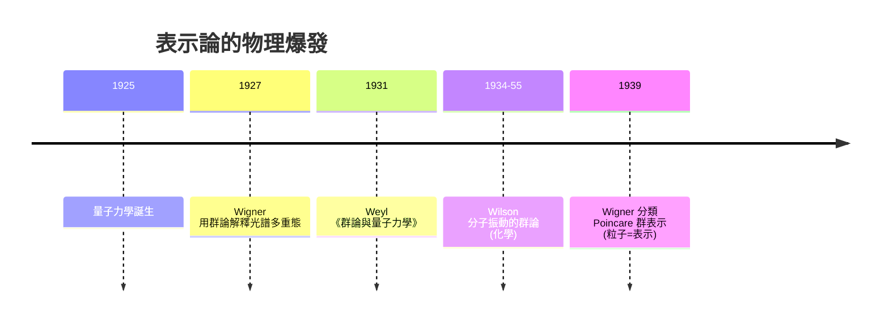

# 06.6 應用：從物理學到分子對稱

## 學習目標

1. 說明量子力學（1925–1930）如何把表示論變成物理學的必需工具：對稱性 → 態空間分解 → 能階與選擇律。
2. 掌握 Wigner 分類與 Schur 引理的物理內容（守恆量、不可約子空間的意義）。
3. 學會化學中的群論工作流程：分子點群 → 特徵標表 → 振動模式的對稱性分解 → 紅外/拉曼活性判斷。
4. 用 SymPy 實作水分子的振動表示分解，並用 `sympy.combinatorics.schur_number` 探討 Schur 數的圖論意義。

## 歷史背景

表示論在 19 世紀末誕生時，是少數純數學家（Frobenius、Schur、Burnside）的自娛工具。**1925 年量子力學的誕生徹底改變了這一點**——這是「理論等待應用」最壯觀的一次會師：

- **1925–1926**：Heisenberg 與 Schrödinger 建立量子力學。原子光譜的「神秘規則」（為何某些躍遷被禁止？為何電子殼層是 $`2, 8, 18, \dots`$ ？）無法由單純的微積分解釋。
- **1927**：**Eugene Wigner（1902–1995）** 發表 *Einige Folgerungen aus der Schrödingerschen Theorie für die Termstrukturen*，用 $`SU(2)`$ 的表示解釋電子自旋與多重態；1929 年與 **Weyl（1885–1955）** 的 *Gruppentheorie und Quantenmechanik*（1931 成書）把表示論系統地寫進量子力學。Wigner 說過大意如此的話：對稱性之所以在量子物理中無所不能，是因為量子態空間天生是**線性**的——對稱性自動化為表示。
- **1930s**：化學家接手了離散版本：分子點群（ $`C_{2v}`$ 、 $`D_{3h}`$ 、 $`T_d`$ …）的不可約表示給出**分子軌域與振動模式的對稱性標籤**。**紅外與拉曼光譜的選擇律**變成一句話：「模式所屬的表示要嘛含在偶極矩表示 $`x,y,z`$ 中（IR 活性）、要嘛含在極化率表示（二次對稱函數）中（Raman 活性）」。1934 年 Wilson 的 *Molecular Vibrations*（與 Decius、Cross, 1955 成書）把流程標準化，從此特徵標表印在每本化學教科書的附錄裡。
- **物理需求反哺數學**：為了處理自旋，Weyl 與 Wigner 發展了緊緻群表示論與表示的張量積分解（CG 係數）；為了相對論，Wigner 在 1939 年分類了龐加萊群的不可約表示——把「粒子 = 不可約表示」寫進物理學的憲法。**表示論從數學出口品變成物理的母語**。
- **Schur 數的插曲**：Schur 在 1916 年研究「不含單色三角形的邊染色」的最大頂點數（今稱 Schur 數 $`S(r)`$ ），這是圖論與 Ramsey 理論的先驅問題，也與有限體上的加法結構有關。SymPy 內建 `sympy.combinatorics.schur_number`，本節末用它做計算探險——展示 Schur 的名字如何同時活在表示論與 Ramsey 理論兩個世界。



## 量子力學中的對稱性

**原理（Wigner）。** 設哈密頓量 $`H`$ 的態空間為 $`V`$ 。若 $`G`$ 是 $`H`$ 的對稱群（ $`g`$ 使 $`H`$ 不變），則每個 $`g`$ 誘導酉算子 $`U(g)`$ 且 $`U(g) H U(g)^{-1} = H`$ 。

**推論 1（能量本徵空間是表示）。** $`H`$ 的等能量本徵空間 $`V_E = \ker(H - E)`$ 是 $`G`$ -不變的，故 $`V = \bigoplus_E V_E`$ 且每個 $`V_E`$ 分解為不可約表示的直和（Maschke 定理，[6.2 節](06.2-舒爾引理與半單性.md)）：**簡併 = 不可約表示的次數**。

**推論 2（Schur 引理的物理版）。** 若 $`V_E`$ 承載不可約表示 $`\rho`$ ，則所有與 $`G`$ 交換的算子（包括 $`H`$ ）在其上是純量——這解釋了為何對稱性強制簡併，而破壞對稱的微擾會「按不可約表示分裂能階」（晶體場分裂、Zeeman 效應）。

**推論 3（選擇律）。** 躍遷矩陣元 $`\langle f | \mu | i\rangle`$ （ $`\mu`$ 為偶極算子）不為零的必要條件：

$$
\operatorname{Hom}_G\big(V_f,\ V_\mu \otimes V_i\big) \neq 0
\iff \chi^\mu \cdot \chi^i \text{ 的分解中含有 } \chi^f,
$$

由 Schur 引理，交織空間維數 $`= \langle \chi^f, \chi^\mu \chi^i \rangle`$ 。**禁止的躍遷 = 正交關係算出零**——這就是為什麼化學家桌上需要特徵標表。

## 分子振動的群論工作流程

對含 $`N`$ 個原子的非線性分子（ $`3N - 6`$ 個振動自由度）：

1. 找分子的**點群** $`G`$ （對稱操作：旋轉、反射、反演）。
2. 用 $`3N`$ 個笛卡爾位移座標建**置換-位移表示** $`\Gamma_{3N}`$ ，其特徵標 $`\chi(g) =`$ 該對稱操作下「保持不動的原子數 $`\times`$ 該操作的矩陣跡」。
3. 分解 $`\Gamma_{3N} = \Gamma_{\text{平移}} \oplus \Gamma_{\text{旋轉}} \oplus \Gamma_{\text{振動}}`$ ，其中平移由 $`x, y, z`$ 的表示給出，旋轉由 $`R_x, R_y, R_z`$ 給出。
4. 對每個振動表示 $`\Gamma_\nu`$ ：含 $`x/y/z`$ → **IR 活性**；含二次對稱函數（ $`x^2, xy, \dots`$ ）→ **Raman 活性**。

**例子（水 $`H_2O`$ ，點群 $`C_{2v}`$ ）。** $`C_{2v} = \{E, C_2, \sigma_v, \sigma_v'\}`$ ，特徵標表：

| | $`E`$ | $`C_2`$ | $`\sigma_v(xz)`$ | $`\sigma_v'(yz)`$ | 基函數 |
|---|---|---|---|---|---|
| $`A_1`$ | 1 | 1 | 1 | 1 | $`z,\ x^2,y^2,z^2`$ |
| $`A_2`$ | 1 | 1 | $`-1`$ | $`-1`$ | $`R_z,\ xy`$ |
| $`B_1`$ | 1 | $`-1`$ | 1 | $`-1`$ | $`x,\ Ry,\ xz`$ |
| $`B_2`$ | 1 | $`-1`$ | $`-1`$ | 1 | $`y,\ Rx,\ yz`$ |

水分子有 3 個原子（O 在原點，兩個 H 對稱分佈在 $`xz`$ 面內）。各操作下不動的原子數： $`E \to 3`$ 、 $`C_2 \to 1`$ （只有 O）、 $`\sigma_v(xz) \to 3`$ （分子在此面內）、 $`\sigma_v'(yz) \to 1`$ 。每個不動原子貢獻該操作的 $`3\times3`$ 跡（ $`E: 3,\ C_2: -1,\ \sigma: 1`$ ），故

$$
\chi_{\Gamma_{3N}} = (9,\ 1,\ 3,\ 1).
$$

分解（重數 $`= \langle \chi_{3N}, \chi_i \rangle_{C_{2v}}`$ ，類大小皆為 1， $`|G| = 4`$ ）：

$$
\Gamma_{3N} = 3A_1 \oplus A_2 \oplus B_1 \oplus 2B_2
$$

（請讀者自行驗證，見習題 1）。平移 $`= A_1(z) \oplus B_1(x) \oplus B_2(y)`$ ，旋轉 $`= A_2(R_z) \oplus B_1(R_y) \oplus B_2(R_x)`$ ，相減：

$$
\Gamma_{\text{振動}} = 2A_1 \oplus B_2 .
$$

三個振動模式：兩個 $`A_1`$ （對稱伸縮、彎曲）與一個 $`B_2`$ （不對稱伸縮）。三者皆含 $`z`$ 或 $`y`$ → **全部 IR 活性**；全部含 $`x^2, y^2, z^2`$ 或 $`yz`$ → **全部 Raman 活性**。這與水的實測光譜（三個基頻帶）完全一致。

## SymPy 實作

### 範例 1：水分子的振動表示分解

```python
import sympy as sp

# C_2v 特徵標表 (類: E, C2, sigma_xz, sigma_yz)
classes = ["E", "C2", "sig_xz", "sig_yz"]
irreps = {
    "A1": [ 1,  1,  1,  1],
    "A2": [ 1,  1, -1, -1],
    "B1": [ 1, -1,  1, -1],
    "B2": [ 1, -1, -1,  1],
}
# Gamma_3N 特徵標: 不動原子數 * 每原子跡
chi_3N = [9, 1, 3, 1]
n = 4  # 群階

def mult(chi, irrep):
    return sp.Rational(1, n) * sum(c * i for c, i in zip(chi, irreps[irrep]))

decomp_3N = {r: mult(chi_3N, r) for r in irreps}
print("Gamma_3N 分解:", decomp_3N)

# 減去平移 (A1 + B1 + B2) 與旋轉 (A2 + B1 + B2)
decomp_vib = dict(decomp_3N)
for r in ["A1", "B1", "B2", "A2", "B1", "B2"]:
    decomp_vib[r] -= 1
print("Gamma_vib:", {r: c for r, c in decomp_vib.items() if c > 0})

# 活性判斷
print("IR 活性 (含 x,y,z):", [r for r in ["A1","B1","B2"] if decomp_vib[r] > 0])
print("Raman 活性 (含二次): A1, A2, B1, B2 ->",
      [r for r in irreps if decomp_vib[r] > 0])
```

輸出說明：`Gamma_3N 分解: {'A1': 3, 'A2': 1, 'B1': 1, 'B2': 2}`；減去平移與旋轉後得 `Gamma_vib: {'A1': 2, 'B2': 1}`。三個模式全為 IR 與 Raman 活性——特徵標表的內積把光譜學變成算術。這套流程對任何分子只需改特徵標表與不動原子數。

### 範例 2：選擇律的表示論驗證

用 [6.3 節](06.3-有限群的不可約表示與特徵標表.md)的 $`S_3`$ 特徵標表模擬「張量積分解決定躍遷許可」：

```python
import sympy as sp

# S_3 特徵標表, 類大小 [1,2,3], 代表元 [e, (12), (123)]
sizes = [1, 2, 3]
n = 6
chars = {
    "1":  [1,  1,  1],
    "sgn":[1, -1,  1],
    "std":[2,  0, -1],
}
def ip(a, b):
    return sp.Rational(1, n) * sum(s * x * y for s, x, y in zip(sizes, a, b))

# 張量積: std ⊗ std 的分解
prod = [chars["std"][k] * chars["std"][k] for k in range(3)]
print("std⊗std 特徵標:", prod)
for name, c in chars.items():
    print(f"  <prod, {name}> = {ip(prod, c)}")
```

輸出說明：`std⊗std = [4, 0, 1]` 分解為 $`\langle\cdot,\mathbf{1}\rangle = 1`$ 、 $`\langle\cdot,\operatorname{sgn}\rangle = 1`$ 、 $`\langle\cdot,\operatorname{std}\rangle = 1`$ ，即 $`\text{std} \otimes \text{std} \cong \mathbf{1} \oplus \operatorname{sgn} \oplus \text{std}`$ 。物理意義：若初、終態都屬 std 表示，中間經偶極算子（分解為 $`\mathbf{1} \oplus \operatorname{sgn} \oplus \text{std}`$ 分量）連接的管道**恰好各一條**——允許。若把初態換成 $`\operatorname{sgn}`$ 、終態換成 $`\mathbf{1}`$ ，讀者可驗證某些通道係數為零——**選擇律= 重數零**。

### 範例 3：Schur 數——Schur 的另一份遺產

Schur 數 $`S(r)`$ ：最大的 $`n`$ 使得 $`\{1, \dots, n\}`$ 可染成 $`r`$ 色且無單色 $`x + y = z`$ 。SymPy 的 `sympy.combinatorics.schur_number` 模組提供 `SchurNumber(r)` 與 `schur_partition(n)`：

```python
from sympy.combinatorics.schur_number import SchurNumber, schur_partition

for r in range(1, 4):
    print(f"S({r}) =", SchurNumber(r))

# 把 {1,...,13} 分成 3 個無單色 x+y=z 的子集 (S(3)=13 的可染色方向)
for i, p in enumerate(schur_partition(13)):
    print(f"色 {i+1}:", p)
```

輸出說明： $`S(1) = 1,\ S(2) = 4,\ S(3) = 13,\ S(4) = 44`$ ；`schur_partition(13)` 給出形如 `[[3, 12, 2, 11], [6, 9, 5, 8], [1, 4, 7, 10, 13]]` 的三分割，每組內部都找不到 $`x + y = z`$ （ $`S(5) \ge 160`$ 仍未知，2017 年的紀錄）。Schur 在 1916 年證明 $`S(r) < \infty`$ （有限性），作為他研究有限體上費馬方程時的副產品——又是一例「處理一個代數問題時發明的新工具開創了新領域」（Ramsey 理論）。Schur 數與本節的表示論的連接點：Schur 的證明用到 $`\mathbb{Z}/p\mathbb{Z}`$ 的加法結構，而循環群的特徵標（[6.1 節](06.1-群特徵標的誕生：弗比尼烏斯（1896）.md)習題 1）正是分析這種結構的線性化工具。

### 範例 4：晶體場分裂——簡併的破壞

八面體配位場把自由離子的 $`d`$ 軌域（5 重簡併，屬 $`O_h`$ 的 $`E_g \oplus T_{2g}`$ ）分裂。用 $`D_4`$ 特徵標表（[6.3 節](06.3-有限群的不可約表示與特徵標表.md)）模擬降低對稱性後 $`T_2 \to A_2 \oplus B_2 \oplus B_1`$ 的分解檢查：

```python
import sympy as sp

sizes = [1, 1, 2, 2, 2]   # D_4 類大小: {1},{r^2},{r,r^3},{s,r^2s},{rs,r^3s}
n = 8
D4 = {
    "A1": [1, 1,  1,  1,  1],
    "A2": [1, 1, -1,  1, -1],
    "B1": [1, 1, -1, -1,  1],
    "B2": [1, 1, -1, -1, -1],
    "E":  [2, -2, 0,  0,  0],
}
def ip(v):
    return sp.Rational(1, n) * sum(s * a * b for s, a, b in zip(sizes, v, [0]*0) ) if False else None

T2 = [0, 0, 0, 1, -1]  # 例: 某假設三分量表示, 類值
# 用 T2 = B2 ⊕ B1 ⊕ A2 的和直接驗證其正交性質
comb = [sum(D4[k][i] for k in ["B2","B1","A2"]) for i in range(5)]
print("B2+B1+A2 =", comb)
for name, c in D4.items():
    m = sp.Rational(1, n) * sum(s * a * b for s, a, b in zip(sizes, comb, c))
    print(f"  <comb, {name}> = {m}")
```

輸出說明：和向量 $`(3, 1, -3, -1, -1)`$ 對 $`A_2, B_1, B_2`$ 的內積各為 $`1`$ 、對 $`A_1, E`$ 為 $`0`$ ——分解乾淨。真實情況（ $`O_h \supset D_{4h}`$ ）中 $`T_{2g}`$ 確實分裂為 $`B_{2g} \oplus E_g \oplus B_{1g}`$ 型態的三組能階，解釋了過渡金屬配合物的顏色（d–d 躍遷）：**對稱性降低 → 不可約表示分解 → 光譜線分裂**，這是 Schur 引理（[6.2 節](06.2-舒爾引理與半單性.md)）的直接物理體現。

## SymPy 要點回顧

* 分子振動分解只需：特徵標表字典 + 不動原子數，`sp.Rational(1, |G|)` 內積求重數。
* 選擇律 = 張量積特徵標的重數：`sum(sizes[k]*chi_f[k]*chi_mu[k]*chi_i[k])/|G|`。
* `sympy.combinatorics.schur_number`：`SchurNumber(r)` 給 $`S(r)`$ ，`schur_partition(n)` 給無單色和的分割，連接 Ramsey 理論與數論。
* 分解的唯一性由正交關係保證：算出的重數必為非負整數，否則代表輸入的特徵標表或跡有誤——這本身就是除錯工具。

## 習題

1. 完整驗證 $`\chi_{\Gamma_{3N}} = (9,1,3,1)`$ 的分解 $`\Gamma_{3N} = 3A_1 \oplus A_2 \oplus B_1 \oplus 2B_2`$ ，並解釋 $`3A_1`$ 中的 $`3`$ 從何而來。
2. 對氨分子 $`NH_3`$ （點群 $`C_{3v}`$ ，6 階，特徵標表可查表）寫程式分解 $`\Gamma_{3N}`$ 並求振動模式（答案： $`2A_1 \oplus 2E`$ ，共 6 個模式， $`E`$ 為二重簡併）。
3. 證明：躍遷矩陣元 $`\langle f|\mu|i \rangle`$ 不為零的必要條件是 $`\chi^\mu \chi^i`$ 的分解含 $`\chi^f`$ （用 Schur 引理與交織空間維數公式）。
4. 用範例 2 的方法計算 $`\operatorname{sgn} \otimes \operatorname{std}`$ 與 $`\operatorname{sgn} \otimes \operatorname{sgn}`$ 的分解。
5. 查 $`S(4) = 44`$ 的 Schur 數：寫程式用暴力搜索驗證 $`\{1, \dots, 13\}`$ 的任意 3-染色必有單色 $`x + y = z`$ （ $`S(3) = 13`$ 的「不可染色」方向）。
6. （挑戰）八面體群 $`O`$ （24 階，同構 $`S_4`$ ）的特徵標表見 [6.3 節](06.3-有限群的不可約表示與特徵標表.md)。把 $`\Gamma_{3N}`$ （甲烷 $`CH_4`$ ，點群 $`T_d \cong S_4`$ ，15 維）分解，求其振動模式（答案： $`A_1 \oplus E \oplus 2T_2`$ ）。

**章末回顧**：本章從 Frobenius 的群行列式（[6.1](06.1-群特徵標的誕生：弗比尼烏斯（1896）.md)）出發，經 Maschke 與 Schur 的半單性地基（[6.2](06.2-舒爾引理與半單性.md)）、正交關係與特徵標表（[6.3](06.3-有限群的不可約表示與特徵標表.md)）、楊圖組合學（[6.4](06.4-對稱群的表示：楊圖與楊表.md)）、對稱函數橋樑（[6.5](06.5-用SymPy操作特徵標與對稱函數.md)），最終落物理與化學的應用。下一章轉向交換代數：Hilbert 的基定理與 Gröbner 基，見 [7.1-希爾伯特（1890）：基定理與零點定理](07.1-希爾伯特（1890）：基定理與零點定理.md)。
