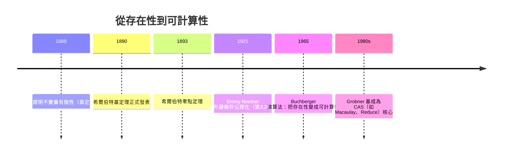

# 7.1 希爾伯特（1890）：基定理與零點定理

## 學習目標

- 理解**希爾伯特基定理**（Hilbert Basis Theorem）的敘述與證明思路。
- 理解**希爾伯特零點定理**（Hilbert's Nullstellensatz）的弱形式與強形式。
- 認識這兩個定理如何把「解方程組」轉化為「研究理想」。
- 學會用 SymPy 驗證有限生成理想的結構，並體會「存在性」與「可計算性」的鴻溝——這正是 7.3 節 Grobner 基登場的伏筆。

## 歷史背景

1888 年，Paul Gordan（1837–1912）是當時不變量理論（invariant theory）的巨人。不變量理論研究群作用下的多項式不變量，核心問題是：**不變量的環是否由有限個基本不變量生成？** Gordan 花了二十年，用極其繁複的「窮舉式構造法」證明了二元、三元情形的有限性，被稱為「不變量理論之王」。

1888 年，27 歲的 David Hilbert（1862–1943）用全新的抽象手法，一舉證明了**任意個變數**的不變量皆有限生成。他的方法是反證法：假設存在無限生成的不變量理想，構造出嚴格遞增的理想鏈而導出矛盾。這個證明**沒有給出任何計算不變量的方法**。

Gordan 看到後丟下那句流傳百年的評語：

> 「Das ist nicht Mathematik. Das ist Theologie.」
> （這不是數學，這是神學。）

有趣的是，Gordan 後來仔細研讀後改口：「我確信神學也有其價值。」而希爾伯特的「神學」最終成為整個交換代數與代數幾何的基石。1893 年希爾伯特更證明了零點定理，把代數（理想）與幾何（點集）綁在一起。但希爾伯特的存在性證明有一個致命弱點：**它不告訴你怎麼算**。這個「怎麼算」的問題，直到 1965 年 Buchberger 的博士論文才被解決（見 7.3 節）。



## 7.1.1 多項式環與理想的回顧

設 $`K`$ 是一個體（例如 $`\mathbb{Q}`$ 、 $`\mathbb{R}`$ 、 $`\mathbb{C}`$ ）， $`K[x_1, \dots, x_n]`$ 是 $`n`$ 個變數的多項式環。回顧 3.2 節：理想 $`I \subseteq K[x_1,\dots,x_n]`$ 是一個加法子群，且對任意的 $`f \in I`$ 、 $`g \in K[x_1,\dots,x_n]`$ 有 $`fg \in I`$ 。

給定多項式 $`f_1, \dots, f_s`$ ，它們**生成的理想**是

$$
\langle f_1, \dots, f_s \rangle = \left\{ \sum_{i=1}^{s} h_i f_i \;\middle|\; h_i \in K[x_1, \dots, x_n] \right\}
$$

幾何直覺： $`\langle f_1,\dots,f_s \rangle`$ 是「所有在 $`f_1 = \cdots = f_s = 0`$ 的公共零點上必然消失的多項式」的集合。

## 7.1.2 希爾伯特基定理

> **定理（Hilbert Basis Theorem, 1890）**
> 若 $`K`$ 是體（更一般地，若 $`R`$ 是諾特環），則多項式環 $`K[x_1, \dots, x_n]`$ 中每個理想都是有限生成的。等價地， $`K[x_1,\dots,x_n]`$ 是諾特環。

**定義（諾特環）**：環 $`R`$ 稱為諾特環，若下列等價條件之一成立：

1. （ACC）每個嚴格遞增的理想鏈 $`I_1 \subsetneq I_2 \subsetneq \cdots`$ 必在有限步後穩定。
2. （有限生成）每個理想都由有限個元素生成。
3. （極大元）每個非空理想集合（依包含關係偏序）都有極大元。

**證明思路（一元情形 $`n=1`$ ）**：設 $`I \subseteq K[x]`$ 是理想。取 $`I`$ 中次數最低的非零多項式 $`f`$ 。對任意 $`g \in I`$ ，用帶餘除法： $`g = qf + r`$ ，其中 $`\deg r < \deg f`$ 。由理想封閉性 $`r = g - qf \in I`$ ，但 $`f`$ 已是最低次，故 $`r = 0`$ 。因此 $`I = \langle f \rangle`$ 是主理想。這說明 $`K[x]`$ 是主理想整環（PID），當然諾特。

**多元情形的推進**：關鍵引理是「若 $`R`$ 諾特，則 $`R[x]`$ 諾特」。設 $`I \subseteq R[x]`$ ，考慮 $`I`$ 中多項式的**首項係數**構成的理想 $`J \subseteq R`$ 。由 $`R`$ 諾特， $`J = \langle a_1, \dots, a_m \rangle`$ ，取對應的 $`f_1, \dots, f_m \in I`$ 。任何 $`g \in I`$ 都可用這些 $`f_i`$ 的首項把次數「壓下去」，歸納地使 $`I = \langle f_1, \dots, f_m \rangle`$ 。再對 $`n`$ 歸納，即得 $`K[x_1,\dots,x_n]`$ 諾特。

注意這個證明的精神：**用首項（leading term）控制整個理想**。60 多年後 Buchberger 把「首項」精煉成「單項式序下的首單項」，催生了 Grobner 基——這是同一思想的計算化版本。

**歷史意義**：基定理直接解決了不變量有限性問題。希爾伯特證明：不變量構成的環 $`K[V]^G`$ 是 $`K[x_1,\dots,x_n]`$ 中某理想的商結構，因而是諾特環的子環，結合更多論證可得有限生成。

## 7.1.3 代數集與零點定理

**定義（代數集）**：對 $`S \subseteq K[x_1,\dots,x_n]`$ ，定義其**簇**（variety）

$$
\mathbf{V}(S) = \{ a \in K^n \mid f(a) = 0 \text{ 對所有 } f \in S \}
$$

反過來，對子集 $`V \subseteq K^n`$ ，定義

$$
\mathbf{I}(V) = \{ f \in K[x_1,\dots,x_n] \mid f(a) = 0 \text{ 對所有 } a \in V \}
$$

這樣我們得到兩個方向的映射 $`\mathbf{V}: \text{理想} \to \text{點集}`$ 與 $`\mathbf{I}: \text{點集} \to \text{理想}`$ 。這是「代數與幾何的對偶」，7.5 節將深入探討。

> **定理（弱零點定理，Weak Nullstellensatz）**
> 設 $`K`$ 是代數閉體（如 $`\mathbb{C}`$ ）， $`I \subseteq K[x_1,\dots,x_n]`$ 是理想。則 $`\mathbf{V}(I) = \emptyset`$ 若且唯若 $`I = K[x_1,\dots,x_n]`$ （即 $`1 \in I`$ ）。

換句話說：在 $`\mathbb{C}^n`$ 上，一組多項式方程**要麼有解，要麼 $`1`$ 可表示為它們的線性組合**（係數是多項式）。這就是「無解的代數證明」。

> **定理（強零點定理，Hilbert's Nullstellensatz, 1893）**
> 設 $`K`$ 代數閉， $`I \subseteq K[x_1,\dots,x_n]`$ 為理想， $`f`$ 為多項式。若 $`f`$ 在 $`\mathbf{V}(I)`$ 上恆為零，則存在 $`m \geq 1`$ 與 $`g_1,\dots,g_s \in K[x_1,\dots,x_n]`$ 使得
> 

$$
> f^m = g_1 f_1 + \cdots + g_s f_s, \qquad f_i = \text{ $`I`$ 的生成元}
>
$$

> 即 $`f \in \sqrt{I}`$ （ $`I`$ 的**根理想** radical）。

**證明思路（Rabinowitsch 技巧，1929）**：強形式可化歸為弱形式。引入新變數 $`y`$ ，考慮理想 $`J = \langle f_1, \dots, f_s, 1 - yf \rangle \subseteq K[x_1,\dots,x_n,y]`$ 。若 $`f`$ 在 $`\mathbf{V}(I)`$ 上為零，則 $`\mathbf{V}(J) = \emptyset`$ ，由弱形式 $`1 \in J`$ 。把 $`1`$ 的表達式對 $`y`$ 消去（乘上 $`1 + yf + \cdots + (yf)^{m-1}`$ ），即可得 $`f^m \in I`$ 。這個巧妙的一行技巧把幾何命題完全代數化了。

**例子**：考慮 $`I = \langle x^2 \rangle \subseteq \mathbb{C}[x]`$ 。則 $`\mathbf{V}(I) = \{0\}`$ ，故 $`x \in \mathbf{I}(\mathbf{V}(I))`$ ，但 $`x \notin I`$ 。由強零點定理 $`x \in \sqrt{I}`$ ——確實 $`x^2 = x \cdot x \in I`$ ，故 $`x \in \sqrt{\langle x^2 \rangle} = \langle x \rangle`$ 。這顯示 $`\mathbf{V}`$ 與 $`\mathbf{I}`$ 並非一一對應，必須取根理想才嚴謹： $`\mathbf{V}(I) = \mathbf{V}(\sqrt{I})`$ 。

## 7.1.4 存在性 vs 可計算性：希爾伯特留下的鴻溝

基定理說「有限生成元存在」，零點定理說「解的存在性可由代數條件判斷」。但兩者都是**非構造性**的：

- 給定一組生成元，如何找出**更簡潔的**等價生成元？（理想成員問題）
- 給定 $`f`$ 與 $`I`$ ，如何實際檢驗 $`f \in \sqrt{I}`$ ？
- 給定方程組，如何把 $`\mathbf{V}(I)`$ **顯式列出**？

19 世紀末的數學家對這些問題束手無策。直到 1920 年代 Grete Hermann 給出消去理論的複雜度估計，1965 年 Buchberger 發明 Grobner 基演算法（7.3 節），這個鴻溝才被填平。**理論（希爾伯特）→ 實踐瓶頸 → 理論（Buchberger）→ 應用爆發（機器人學、密碼學，見 7.4 節）**，這是數學與計算互相驅動的教科書案例。

## 7.1.5 用 SymPy 探索

### 範例 1：理想的成員與根理想

```python
import sympy as sp

x, y = sp.symbols('x y')

# 檢驗多項式是否屬於理想（用 groebner 做成員測試，詳見 7.3、7.4 節）
G = sp.groebner([x**2], x, y, order='lex')
print(G.contains(x))        # False：x 不在 <x^2> 中
print(G.contains(x**3))     # True：x^3 = x * x^2

# 強零點定理的驗證：x 在 V(<x^2>) 上為零，故 x^m ∈ <x^2>
print(G.contains(x**2))     # True
```

輸出說明：`contains` 用 Grobner 基做除法判定理想成員。 $`x \notin \langle x^2 \rangle`$ 但 $`x^2, x^3 \in \langle x^2 \rangle`$ ，且 $`\sqrt{\langle x^2 \rangle} = \langle x \rangle`$ ，完全符合零點定理的預言。

### 範例 2：弱零點定理——無解方程組的可判定性

```python
import sympy as sp

x, y = sp.symbols('x y')

# 方程組 x^2 + y^2 + 1 = 0, x = 0 在實數上無解，但在複數上也無解！
# 因為 x=0 代入得 y^2 = -1，在 C 中有解 —— 這個例子有解，換一個真正無解的：
f1 = x*y - 1
f2 = x - 1
f3 = y - 2   # x=1, y=2 與 xy=1 矛盾

G = sp.groebner([f1, f2, f3], x, y, order='lex')
print(G)          # GroebnerBasis([1], ...) —— 基就是 {1}！
print(G.contains(sp.Integer(1)))  # True，由弱零點定理：V = ∅
```

輸出說明：Grobner 基為 `[1]` 表示理想是整個環，弱零點定理保證 $`\mathbf{V}(I) = \emptyset`$ ——方程組無解被「代數地證明」了。

### 範例 3：不變量有限性的小例子

```python
import sympy as sp

x, y = sp.symbols('x y')

# 對稱群 S2 作用於 (x, y)：交換兩變數。不變量是對稱多項式。
# 基定理的具體化身：所有對稱多項式由 e1 = x+y, e2 = xy 生成（對稱多項式基本定理）
f = x**3 + y**3
e1, e2 = x + y, x*y
# x^3 + y^3 = e1^3 - 3*e1*e2
print(sp.expand(f - (e1**3 - 3*e1*e2)))   # 0
print(sp.symmetrize(f, [x, y], formal=True))
# 出現基本對稱多項式的多項式表示 —— 有限生成性的具體示範
```

輸出說明：`symmetrize` 把 $`x^3+y^3`$ 表為 $`e_1^3 - 3e_1e_2`$ ，展示不變量環 $`\mathbb{Q}[x,y]^{S_2} = \mathbb{Q}[e_1, e_2]`$ 的有限生成。希爾伯特 1888 年的定理說：**任何**群作用的不變量環都如此有限生成。

## 7.1.6 小結與展望

| 定理 | 年代 | 內容 | 性質 |
|---|---|---|---|
| 基定理 | 1890 | 理想皆有限生成 | 存在性 |
| 零點定理（弱） | 1893 | 無解 ⟺ $`1 \in I`$ | 存在性 |
| 零點定理（強） | 1893 | $`f \in \sqrt{I}`$ | 存在性 |
| Buchberger 演算法 | 1965 | 可計算地建構標準基 | 構造性 |

希爾伯特給了我們「地圖」（理想與簇的對偶），Buchberger 給了我們「交通工具」（演算法）。下一節 7.2 先把理想本身解剖：素理想與極大理想是這張地圖上的「基本地形」。

## 習題

1. 證明 $`K[x]`$ 是主理想整環：每個理想形如 $`\langle f \rangle`$ 。（提示：帶餘除法 + 最小次數元素。）
2. 計算 $`\sqrt{\langle x^2, xy \rangle} \subseteq K[x,y]`$ 。（答案： $`\langle x \rangle`$ 。用 SymPy 的 `sp.polys.polytools` 或手工論證。）
3. 用 Rabinowitsch 技巧的思路，手算說明為何 $`x \in \sqrt{\langle x^2 \rangle}`$ ：在 $`\langle x^2, 1-yx \rangle`$ 中把 $`1`$ 展開並消去 $`y`$ 。
4. 用 SymPy 驗證 $`I = \langle x+y, y^2-1 \rangle`$ 的 Grobner 基不是 $`\{1\}`$ ，並用 `sp.solve_poly_system` 求出 $`\mathbf{V}(I)`$ （在 $`\mathbb{C}`$ 上有幾個點？）。
5. 設 $`G = \{1, -1\}`$ 以 $`g \cdot (x,y) = (y,x)`$ 作用於 $`\mathbb{Q}[x,y]`$ 。找出不變量環 $`\mathbb{Q}[x,y]^G`$ 的最小生成元組，並用 `symmetrize` 驗證某個三次對稱多項式可由它們表示。
6. （挑戰）證明：若 $`K`$ 非代數閉（如 $`\mathbb{R}`$ ），弱零點定理會失效。找一個 $`\mathbb{R}[x]`$ 中的理想 $`I \ne \mathbb{R}[x]`$ 使 $`\mathbf{V}(I) = \emptyset`$ 。

## SymPy 要點回顧

- `sp.groebner(F, *gens, order='lex')`：計算 Grobner 基，回傳 `GroebnerBasis` 物件（原理見 7.3）。
- `G.contains(f)`：判斷 $`f`$ 是否屬於 $`\langle F \rangle`$ ——理想成員問題的計算解。
- `sp.symmetrize(f, [x, y], formal=True)`：把對稱多項式表為基本對稱多項式，示範不變量有限生成。
- `sp.solve_poly_system([f1, ...], x, y)`：解多項式聯立方程（見 7.4）。
- 記住核心對偶： $`1 \in \langle F \rangle`$ ⟺ 方程組在代數閉體上無解。

---
*下一節：[7.2 理想的分解：素理想與極大理想](07.2-理想的分解：素理想與極大理想.md)*
