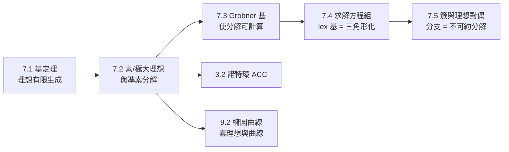

# 7.2 理想的分解：素理想與極大理想

## 學習目標

- 掌握**素理想**與**極大理想**的定義及其幾何意義。
- 理解商環 $`R/I`$ 如何把理想變成「點」： $`I`$ 極大 ⟺ $`R/I`$ 是體。
- 認識**準素分解**（primary decomposition）與 Lasker–Noether 定理。
- 用 SymPy 計算理想的根、檢驗極大性，並把代數條件翻譯成幾何圖像。

## 歷史背景

理想的概念源自 19 世紀的**代數數論**：Kummer（1847）研究費馬大定理時發現， $`\mathbb{Z}[\zeta]`$ 中「素數分解唯一性」會崩壞。他發明「理想數」來修復唯一分解。Dedekind（1871）把理想數抽象為環的子集——**理想**誕生，並證明在數環中每個理想都可唯一分解為素理想之積。

但在一般多元多項式環 $`K[x_1,\dots,x_n]`$ 中，理想**並不能**分解為素理想的交（例如 $`\langle x^2 \rangle`$ ）。真正的定理由 Emanuel Lasker（1868–1941，也就是國際象棋世界冠軍 Lasker！）在 1905 年證明：任意諾特環中的理想可分解為**準素理想**的交。1921 年 Emmy Noether（1882–1935）以升鏈條件（ACC）重新公理化整個理論，證明 Lasker–Noether 定理在一切諾特環上成立——這是 3.2 節諾特環概念的直接延伸。

Lasker 是個傳奇：他既是代數學家又是棋王（持有世界冠軍頭銜 27 年）。他證明準素分解時用的正是棋手式的「系統性窮舉」思維；Noether 則把它提煉成今天教科書裡的優雅形式。這再次印證本書的主題：**新數學問題（分解唯一性）驅動新數學結構（理想），新結構又反哺計算技術**。

## 7.2.1 素理想與極大理想

> **定義（素理想）**：真理想 $`P \subsetneq R`$ 稱為**素的**，若 $`ab \in P \implies a \in P`$ 或 $`b \in P`$ 。等價地， $`R/P`$ 是整環。

> **定義（極大理想）**：真理想 $`M \subsetneq R`$ 稱為**極大的**，若不存在理想 $`I`$ 使 $`M \subsetneq I \subsetneq R`$ 。等價地， $`R/M`$ 是體。

**立即推論**：體是整環，故**每個極大理想都是素理想**；反之不然。

**幾何直覺**（ $`R = \mathbb{C}[x,y]`$ ）：

| 理想 | 商環 | 幾何對象 | 類型 |
|---|---|---|---|
| $`\langle x - a, y - b \rangle`$ | $`\mathbb{C}`$ | 點 $`(a,b)`$ | 極大 |
| $`\langle y - mx - b \rangle`$ | $`\mathbb{C}[x]`$ | 直線 | 素而非極大 |
| $`\langle xy \rangle`$ | 有零因子 | 座標軸（可約曲線） | 非素 |
| $`\langle x^2, y \rangle`$ | 有冪零元 | 「加厚的」點（重根） | 非素、非極大 |

規律：**素理想對應不可約代數集，極大理想對應點，含冪零元的理想對應帶「無窮小厚度」的概形**（現代代數幾何的萌芽，見 7.5 節）。

**例子**： $`\langle x \rangle \subseteq \mathbb{C}[x,y]`$ ：商環 $`\mathbb{C}[x,y]/\langle x \rangle \cong \mathbb{C}[y]`$ 是整環非體，故素非極大。而 $`\langle x, y-1 \rangle`$ ：商環 $`\cong \mathbb{C}`$ ，極大。幾何上前者是 $`y`$ 軸（一條線），後者是點 $`(0,1)`$ 。

## 7.2.2 Zariski 引理與零點定理的精煉

7.1 節的零點定理有一個更銳利的代數形式：

> **引理（Zariski, 1947）**：設 $`K`$ 是體， $`M \subseteq K[x_1,\dots,x_n]`$ 是極大理想，則 $`K[x_1,\dots,x_n]/M`$ 是 $`K`$ 的**有限**代數擴張。

**推論**：當 $`K = \mathbb{C}`$ 代數閉時，有限代數擴張只能是 $`\mathbb{C}`$ 本身，故 $`\mathbb{C}[x_1,\dots,x_n]/M \cong \mathbb{C}`$ ，即 $`M = \langle x_1 - a_1, \dots, x_n - a_n \rangle`$ ，**每個極大理想都是一個點**。這就是 $`\mathbb{C}^n`$ 的點與極大理想之間的一一對應。

這個對應在非代數閉體上會破壞： $`\mathbb{R}[x]`$ 的極大理想 $`\langle x^2+1 \rangle`$ 對應的不是實數點，而是共軛對 $`\{\pm i\}`$ 。這正是代數幾何偏愛代數閉體的原因。

## 7.2.3 準素分解與 Lasker–Noether 定理

> **定義（準素理想）**：理想 $`Q`$ 稱為**準素的**，若 $`ab \in Q`$ 、 $`a \notin Q`$ 則存在 $`m`$ 使 $`b^m \in Q`$ 。等價地， $`R/Q`$ 中每個零因子都是冪零的。

顯然素理想準素；準素但非素的典型是 $`\langle x^2 \rangle`$ ： $`xy = 0 \bmod \langle x^2\rangle`$ 而 $`x \ne 0`$ ，但 $`y^2`$ 也不在——不對，檢驗： $`x \cdot y \in \langle x^2 \rangle`$ 、 $`x \notin \langle x^2 \rangle`$ 、 $`y^m \notin \langle x^2 \rangle`$ ，所以 $`\langle x^2 \rangle`$ 在 $`\mathbb{C}[x,y]`$ 中其實**不是**準素的！但在 $`\mathbb{C}[x]`$ 中 $`\langle x^2 \rangle`$ 是準素的。這提醒我們準素性依賴環境環。

> **定理（Lasker 1905；Noether 1921）**
> 在諾特環中，每個理想 $`I`$ 皆可寫成有限個準素理想之交：
> 

$$
> I = Q_1 \cap Q_2 \cap \cdots \cap Q_r
>
$$

> 取根後得 $`\sqrt{I} = \sqrt{Q_1} \cap \cdots \cap \sqrt{Q_r}`$ ，其中 $`\sqrt{Q_i}`$ 均為素理想（稱為 $`I`$ 的**相伴素理想**）。

**幾何翻譯**： $`\mathbf{V}(I) = \bigcup_i \mathbf{V}(Q_i)`$ ——**代數集分解為有限個不可約分支**。例如 $`\mathbf{V}(xy) = \mathbf{V}(x) \cup \mathbf{V}(y)`$ ：座標軸的十字由兩條不可約直線組成。

**例子**： $`I = \langle xy, xz - y^2 \rangle \subseteq \mathbb{C}[x,y,z]`$ （這是著名的例子）。可以驗證

$$
I = \langle x, y \rangle \cap \langle y^2, x - z \rangle \cap \langle y^3, z - x y? \rangle \cdots
$$

（確切的分解較微妙，正是 Grobner 基演算法在 1980 年代被用來機械化此類分解的動機之一。）

## 7.2.4 用 SymPy 探索

### 範例 1：檢驗素性與極大性

```python
import sympy as sp

x, y, z = sp.symbols('x y z')

# <x, y-1> 應該是極大理想（對應點 (0,1)）
G1 = sp.groebner([x, y - 1], x, y, order='lex')
print("Grobner basis of <x, y-1>:", G1)
# 基就是 {y-1, x}：首單項是 x 和 y，幾乎「線性代數化」了 —— 商環是 0 維，即一個點

# <xy> 非素：xy ∈ <xy> 但 x, y 都不在
G2 = sp.groebner([x*y], x, y, order='lex')
print("contains x:", G2.contains(x))    # False
print("contains y:", G2.contains(y))    # False
print("contains xy:", G2.contains(x*y)) # True  → 非素理想

# 根理想：radical(<x^2>) = <x>
G3 = sp.groebner([x**2], x, y, order='lex')
print("x^2 in I:", G3.contains(x**2))   # True
print("x in I:", G3.contains(x))        # False → radical 更大
```

輸出說明：`contains` 判定顯示 $`xy \in \langle xy \rangle`$ 而 $`x, y \notin`$ ，故 $`\langle xy \rangle`$ 非素。 $`\langle x^2 \rangle`$ 與其根 $`\langle x \rangle`$ 有相同的簇（都是 $`y`$ 軸），但前者帶「重數」，這是 7.5 節交點重數理論的種子。

### 範例 2：簇的不可約分解

```python
import sympy as sp

x, y = sp.symbols('x y')

# V(xy) 分解為兩個不可約分支（正維數，solve_poly_system 不適用，
# 我們用 factor 看多項式的不可約因子 —— 幾何分解的代數影子）
print(sp.factor(x*y))               # x*y：兩個素因子 → 兩個不可約分支
print(sp.factor(x**2 - y**2))       # (x-y)*(x+y)：兩條直線

# 有限個點的情形：V(x^2-1, y) 有兩個點
G = sp.groebner([x**2 - 1, y], x, y, order='lex')
print(G)                            # [y, x^2 - 1]： lexicographic 基「分離」了變數
print(sp.solve_poly_system([x**2 - 1, y], x, y))   # [(-1, 0), (1, 0)]
```

輸出說明：lexicographic Grobner 基 $`\{y, x^2-1\}`$ 呈「三角形」，可逐層回代求解——這正是 7.4 節的主題。兩個解 $`(-1,0)`$ 與 $`(1,0)`$ 對應兩個極大理想 $`\langle x+1, y\rangle`$ 與 $`\langle x-1, y \rangle`$ ，而 $`\sqrt{\langle x^2-1, y\rangle}`$ 正是這兩個極大理想之交。

### 範例 3：相伴素理想的手動追蹤

```python
import sympy as sp

x, y = sp.symbols('x y')

# I = <x^2 - y^2> = <x-y> ∩ <x+y>，兩個素理想，簇是兩條相交直線
I_gens = [x**2 - y**2]
print(sp.factor(x**2 - y**2))    # (x - y)*(x + y)

# 商環 <x^2-y^2> 中 x-y 與 x+y 都是零因子（它們的積是 0）
G = sp.groebner(I_gens, x, y, order='lex')
print(G.contains((x - y)*(x + y)))   # True
print(G.contains(x - y))             # False
print(G.contains(x + y))             # False → 非素，分解為兩素分支
```

## 7.2.5 與前後節的聯繫



準素分解在實務上很難直接計算（需要根理想、分離零因子等），實際的 CAS 都透過 Grobner 基來實作。這是 7.3 節的核心：**Buchberger 演算法把 7.2 節所有抽象分解理論變成了按一個按鈕就能跑的程式**。

## 習題

1. 證明： $`P`$ 是素理想 ⟺ $`R/P`$ 是整環； $`M`$ 是極大理想 ⟺ $`R/M`$ 是體。並證明極大 ⟹ 素。
2. 在 $`\mathbb{C}[x,y]`$ 中，寫出對應點 $`(2,-3)`$ 的極大理想，並用 SymPy 驗證其 Grobner 基的形狀。
3. 分解 $`I = \langle x^2 - y^2, x - y^2 \rangle`$ ：先求 Grobner 基，再解方程組找出 $`\mathbf{V}(I)`$ 的所有點，最後寫出 $`\sqrt{I}`$ 的極大理想分解。
4. 證明 $`\langle x^2 \rangle \subseteq \mathbb{C}[x]`$ 是準素的，但在 $`\mathbb{C}[x,y]`$ 中不是（找出具體的反例三元組）。
5. 用 SymPy 檢驗： $`\langle y - x^2 \rangle \subseteq \mathbb{C}[x,y]`$ 是素理想嗎？（提示：商環同構於 $`\mathbb{C}[x]`$ ，因為 $`y`$ 可被 $`x^2`$ 消去。）這條拋物線為何不可約？
6. （挑戰）Zariski 引理在 $`K = \mathbb{R}`$ 時：找出 $`\mathbb{R}[x,y]`$ 中一個極大理想 $`M`$ 使 $`\mathbb{R}[x,y]/M \cong \mathbb{C}`$ ，並幾何地說明 $`\mathbf{V}(M)`$ 在 $`\mathbb{R}^2`$ 中是空集但在 $`\mathbb{C}^2`$ 中是一個點。

## SymPy 要點回顧

- `sp.groebner(gens, *variables, order='lex')`：理想成員測試與理想結構分析的基本工具。
- `G.contains(f)`：判定 $`f \in I`$ ； $`f, g \in I`$ 而 $`fg \notin I`$ 即證非素。
- `sp.factor(f)`：一元/多元分解；素因子對應不可約分支。
- `sp.solve_poly_system`：列出零維簇的所有點，每個點對應一個極大理想。
- 心法：**代數問題 → Grobner 基 → 線性代數化**；點 ⟺ 極大理想、曲線 ⟺ 素理想、重根 ⟺ 準素理想。

---
*上一節：[7.1 希爾伯特基定理與零點定理](07.1-希爾伯特（1890）：基定理與零點定理.md)* | *下一節：[7.3 Buchberger 與 Grobner 基的發明](07.3-Buchberger（1965）：Grobner基的發明.md)*
