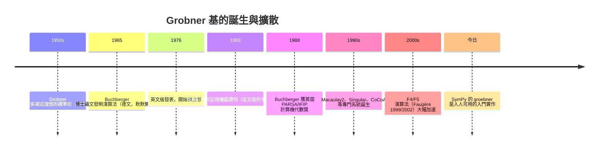
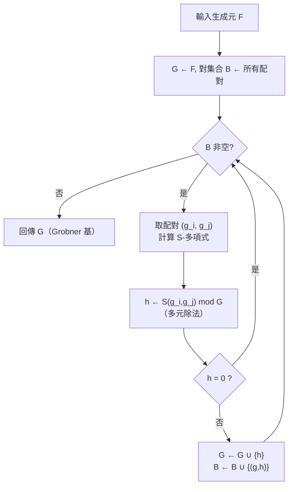

# 7.3 Buchberger（1965）：Grobner 基的發明

## 學習目標

- 理解**單項式序**（monomial order）與**首單項**的定義。
- 掌握 **S-多項式**的定義，以及 **Buchberger 判準**的敘述與證明思路。
- 能寫出並手動執行 **Buchberger 演算法**的偽代碼。
- 了解 Grobner 基如何一口氣解決理想成員問題、消去理論與方程組求解。

## 歷史背景

Bruno Buchberger（1942– ）是奧地利數學家 Heinz Grobner（1911–1986，生於 Göttingen，後任職於因斯布魯克）的學生。1965 年，Buchberger 在因斯布魯克大學的**博士論文**《Ein Algorithmus zum Auffinden der Basiselemente des Restklassenringes nach einem nulldimensionalen Polynomideal》（「求零維多項式理想商環之基元素的一個演算法」）中發明了這套演算法。他把方法命名為「Grobner 基」，以紀念恩師——Grobner 在 1950 年代曾研究過多項式理想的標準形，但未發展出完整演算法。

當時的背景：機器人運動學、電路設計、幾何定理證明等應用迫切需要**機械化解多項式方程組**的能力。傳統的消去理論（結式 resultant，可追溯至 17–19 世紀的 Bézout、Sylvester）在變數一多時就爆炸。Buchberger 的洞見是把希爾伯特基定理證明中的「首項控制」思想變成一套**可執行的疊代程序**。

起初這項工作近乎無人問津。1976 年 Buchberger 獨立再發表英文版本，1980 年代起被納入 Macsyma、Reduce、Maple 等系統，如今 **SymPy、Mathematica、Maple、SageMath 的多項式方程組求解核心都是 Grobner 基**。一份博士論文成為所有計算機代數系統（CAS）的引擎——這是「理論與技術互相驅動」最戲劇性的例子：

- **技術需求**（機器人學、密碼學見 7.4 節）催生演算法；
- **演算法**（Buchberger）反過來驗證了 7.1 的存在性定理、實現了 7.2 的分解理論、開啟了 7.5 的計算代數幾何。



## 7.3.1 單項式序

要「除法」，先要能比較項的大小。

> **定義（單項式序）**： $`K[x_1,\dots,x_n]`$ 的全體單項式 $`x^\alpha = x_1^{\alpha_1}\cdots x_n^{\alpha_n}`$ （ $`\alpha \in \mathbb{Z}_{\ge 0}^n`$ ）上的一個全序 $`\succ`$ 稱為**單項式序**，若：
> 1. $`\succ`$ 是良序（任何非空單項式集合有最小元）；
> 2. 對任意單項式 $`x^\alpha`$ 與 $`x^\beta \ne 1`$ ，有 $`x^\alpha \succ x^\beta \implies x^{\alpha+\gamma} \succ x^{\beta+\gamma}`$ 。

兩個常用序（SymPy 的 `sympy.polys.orderings` 都支援）：

- **lex（字典序）**：先比 $`x_1`$ 的次數，同則比 $`x_2`$ ，依此類推。例： $`x^2 \succ_{lex} y^5`$ （當 $`x \succ y`$ ）。
- **grevlex（分次反向字典序）**：先比全次數 $`\deg`$ ，同次數時反向比（次數**小**的變數優先）。它在實務上效率最高。

**例子**（ $`x \succ y \succ z`$ ）：多項式 $`f = xy^2 + x^3 - z`$ ，

| 序 | 首單項 |
|---|---|
| lex | $`x^3`$ |
| grevlex | $`xy^2`$ |

> **定義**：給定單項式序，多項式 $`f`$ 的**首單項**（leading monomial） $`\mathrm{LM}(f)`$ 、首係數 $`\mathrm{LC}(f)`$ 、首項 $`\mathrm{LT}(f) = \mathrm{LC}(f)\cdot\mathrm{LM}(f)`$ 。

## 7.3.2 多項式除法與餘式

固定單項式序與一組多項式 $`F = (f_1, \dots, f_s)`$ ，可以把一元多項式長除法推廣為**多元除法**：

```text
輸入：f, F = (f_1, ..., f_s)
輸出：商 (q_1,...,q_s) 與餘式 r，滿足 f = Σ q_i f_i + r

r ← 0;  q_i ← 0
p ← f
當 p ≠ 0 迴圈：
    若存在 i 使 LT(f_i) 整除 LT(p)：
        q_i ← q_i + LT(p)/LT(f_i)
        p  ← p − (LT(p)/LT(f_i)) · f_i
    否則：
        r  ← r + LT(p)
        p  ← p − LT(p)
結束
```

**問題**：餘式 $`r`$ （記作 $`f \bmod F`$ ）**依賴於 $`f_i`$ 的排列順序**！例如 $`F = (y - 1, x - y)`$ ，計算 $`f = x^2 - 1`$ 用不同順序除法，會得到不同的餘式 $`x+1`$ 或 $`-2x`$ （讀者可手算驗證）。這使得「 $`r = 0 \iff f \in \langle F \rangle`$ 」只有單向成立（ $`r=0 \implies f \in I`$ ），反過來會誤判。

**解法**：找一組特殊的生成元 $`G`$ ，使除法餘式**唯一**。

## 7.3.3 Grobner 基與 Buchberger 判準

> **定義（Grobner 基）**：理想 $`I`$ 的生成元集合 $`G = \{g_1, \dots, g_t\}`$ 稱為（對某單項式序的）**Grobner 基**，若 $`I`$ 中所有多項式的首單項都被 $`\{ \mathrm{LM}(g_i) \}`$ 中某個整除，即
> 

$$
> \langle \mathrm{LM}(f) \mid f \in I \rangle = \langle \mathrm{LM}(g_1), \dots, \mathrm{LM}(g_t) \rangle
>
$$

> **定理（Grobner 基的基本性質）**： $`G`$ 是 Grobner 基 ⟺ 對任意 $`f`$ ，除法餘式 $`f \bmod G`$ 唯一。此時
> 

$$
> f \in I \iff f \bmod G = 0
>
$$

> **理想成員問題就此解決。**

**唯一性與存在性**：由希爾伯特基定理（7.1 節），首項理想 $`\langle \mathrm{LM}(f) \mid f \in I\rangle`$ 有限生成，其生成元可取自 $`I`$ 的有限個元素之首項——對應的那些元素構成一個 Grobner 基。希爾伯特的「神學」在 Buchberger 手裡變成了「工程學」。

### S-多項式

那麼如何**檢驗**一個生成元集是不是 Grobner 基？關鍵是首項相消。

> **定義（lcm 與 S-多項式）**：設 $`g_i, g_j`$ 的首單項為 $`x^{\alpha_i}, x^{\alpha_j}`$ ，令 $`x^{\gamma} = \mathrm{lcm}(x^{\alpha_i}, x^{\alpha_j})`$ 。定義
> 

$$
> S(g_i, g_j) = \frac{x^{\gamma}}{\mathrm{LT}(g_i)}\, g_i \;-\; \frac{x^{\gamma}}{\mathrm{LT}(g_j)}\, g_j
>
$$

> 定義上 $`S(g_i,g_j)`$ 的兩個首項**恰好相消**。

> **定理（Buchberger 判準，1965）**： $`G`$ 是 $`I`$ 的 Grobner 基 ⟺ 對**每一對** $`g_i \ne g_j`$ ，都有
> 

$$
> S(g_i, g_j) \bmod G = 0
>
$$

**證明思路**：（⟸ 方向是精華）設 $`f \in I`$ 非零。要證 $`\mathrm{LM}(f)`$ 被 $`G`$ 的首項整除。把 $`f`$ 寫成 $`\sum h_k g_k`$ ，取使 $`\mathrm{LT}`$ 和最小的表示法；若最小和中出現首項相消，對應的項組合正是某個 $`S(g_i,g_j)`$ 的倍式，而假設說它可以被 $`G`$ 約化為零，於是可以**改寫**表示法使首項和更小——矛盾。故 $`f`$ 的首項直接來自某 $`g_k`$ 的首項。∎

### 手算 S-多項式範例

取 $`G = \{g_1, g_2\} = \{ x^2 - y,\; x - y^2 \}`$ （lex， $`x \succ y`$ ），首項 $`\mathrm{LT}(g_1) = x^2`$ 、 $`\mathrm{LT}(g_2) = x`$ 。

 $`\mathrm{lcm}(x^2, x) = x^2`$ ，

$$
S(g_1, g_2) = \frac{x^2}{x^2}(x^2 - y) - \frac{x^2}{x}(x - y^2) = x^2 - y - x^2 + xy^2 = xy^2 - y
$$

用 $`G`$ 約化： $`xy^2`$ 不被 $`x^2`$ 或 $`x`$ 整除（因 $`xy^2`$ 的 $`x`$ 次數是 1 但 $`y`$ 次數 2， $`x`$ 整除它！ $`\frac{xy^2}{x} = y^2`$ ）：

$$
xy^2 - y - y^2(x - y^2) = xy^2 - y - xy^2 + y^4 = y^4 - y
$$

餘式 $`y^4 - y \neq 0`$ ，所以 $`G`$ **不是** Grobner 基。把 $`y^4 - y`$ 加進去，繼續疊代——這正是 Buchberger 演算法。

## 7.3.4 Buchberger 演算法

```text
演算法：Buchberger(F)  →  I = <F> 的 Grobner 基 G
輸入：生成元 F = (f_1, ..., f_s)
輸出：Grobner 基 G

G ← F
B ← { (g_i, g_j) | i < j }        # 待檢驗的對
當 B ≠ ∅ 迴圈：
    選取 (g_i, g_j) ∈ B；B ← B \ {(g_i, g_j)}
    h ← S(g_i, g_j) mod G          # 用 G 做除法
    若 h ≠ 0：
        對每個 g ∈ G：B ← B ∪ {(g, h)}
        G ← G ∪ {h}               # 加入新基元素
結束
回傳 G
```

**正確性**：每次加入的 $`h`$ （非零餘式）的首項**不被**現有首項整除，故首項理想嚴格增大。由希爾伯特基定理（ACC，見 3.2 與 7.1），首項理想不能無限增大，演算法必終止；終止時所有 S-多項式餘式為零，由 Buchberger 判準即得 Grobner 基。**存在性證明（7.1）+ ACC = 終止性證明**，理論在此完全反哺演算法。

**繼續上面的例子**：加入 $`g_3 = y^4 - y`$ 。新對的檢驗：
- $`S(g_1, g_3)`$ ： $`\mathrm{lcm}(x^2, y^4) = x^2 y^4`$ ， $`S = y^3(x^2-y) - x^2(y^4 - y) = x^2y^3 - y^4 - x^2 y^4 + x^2 y = \ldots`$ 用 $`G`$ 約化後為 $`0`$ 。
- $`S(g_2, g_3)`$ ： $`\mathrm{lcm}(x, y^4) = xy^4`$ ， $`S = y^4(x - y^2) - x(y^4 - y) = xy^4 - y^6 - xy^4 + xy = xy - y^6`$ ，再用 $`g_2`$ 約化： $`\frac{xy}{x} = y`$ ， $`xy - y^6 - y(x - y^2) = xy - y^6 - xy + y^3 = y^3 - y^6`$ ；用 $`g_3`$ ： $`y^3 - y^6 + y^3(y^4 - y)\cdot?`$ ——細算可得 $`S(g_2,g_3) \bmod G = 0`$ 。

最終 Grobner 基（grevlex 下）： $`\{\, y^4 - y,\; x - y^2 \,\}`$ （ lex 下則為 $`\{\, y^4 - y,\; x - y^2\,\}`$ 經自動約簡後相同形狀）。它呈「三角形」：先解 $`y^4 = y`$ （得 $`y = 0, \pm 1, \pm i`$ 中屬於 $`K`$ 的），再回代 $`x = y^2`$ ——**方程組求解被機械化了**，這是 7.4 節的主題。

### 演算法流程圖



## 7.3.5 用 SymPy 執行

### 範例 1：完整重現上面的手算

```python
import sympy as sp
from sympy.polys.orderings import lex, grevlex

x, y = sp.symbols('x y')

# 原始生成元
F = [x**2 - y, x - y**2]
G = sp.groebner(F, x, y, order='lex')
print(G)                       # GroebnerBasis([y**4 - y, x - y**2], ...)
# SymPy 的 GroebnerBasis 物件以 .exprs 取出基多項式
print(G.exprs)                 # [y**4 - y, x - y**2]

# 理想成員：x^3 - y^3 是否在 <F> 中？
print(G.contains(x**3 - y**3))  # True
# 用 reduce 顯示商與餘式
print(G.reduce(x**3 - y**3))    # (quotients, remainder) 餘式為 0
```

輸出說明：SymPy 算出的基與手算一致： $`\{\,y^4 - y,\; x - y^2\,\}`$ 。`reduce` 回傳的餘式為 0 表示 $`x^3-y^3 \in I`$ 。注意基已「約簡」：每個基元素的首項不被其他首項整除。

### 範例 2：S-多項式的直接計算

```python
import sympy as sp

x, y = sp.symbols('x y')

g1 = sp.Poly(x**2 - y, x, y)
g2 = sp.Poly(x - y**2, x, y)

# lcm 的次數向量：max 的逐項最大
# LT(g1)=x^2, LT(g2)=x，lcm = x^2
S = (x**2 - y) - x*(x - y**2)     # S(g1, g2)
print(sp.expand(S))               # x*y**2 - y

# 用 G 約化 S
G = sp.groebner([x**2 - y, x - y**2], x, y, order='lex')
q, r = G.reduce(sp.expand(S))
print("quotients:", q)
print("remainder:", r)            # 對最終基而言，原對的 S 餘式自然為 0
```

輸出說明：手算的 $`S(g_1,g_2) = xy^2 - y`$ ，進一步約化得 $`y^4 - y`$ （這個中間餘式正是被演算法加入基的元素）；對**最終**基檢驗時所有 S-餘式歸零——演算法的不動點。

### 範例 3：不同單項式序的比較

```python
import sympy as sp
from sympy.polys.orderings import lex, grevlex

x, y, z = sp.symbols('x y z')

F = [x*y**2 + z, x**3 - y - z]
for order in ['lex', 'grevlex']:
    G = sp.groebner(F, x, y, z, order=order)
    print(order, "->", G.exprs)
```

輸出說明：lex 基會把 $`x`$ 「消到只剩自己」，適合**逐變數求解**；grevlex 基通常項數最少、計算最快，適合作為內部表示。實務流程：先用 grevlex 算基，再經 **FGLM 演算法（Faugère–Gianni–Lazard–Mora, 1990）**轉換成 lex 基求解——又一次「理論（序的選擇）驅動技術（轉換演算法）」。

### 範例 4：從零寫一個迷你 Buchberger（教學版）

```python
import sympy as sp

def spoly(f, g, gens):
    """S-多項式：以 sp.Poly 取首項（LT 回傳 (單項式, 係數)）。"""
    Pf, Pg = sp.Poly(f, *gens), sp.Poly(g, *gens)
    lt_f, lc_f = Pf.LT()
    lt_g, lc_g = Pg.LT()
    e = tuple(max(a, b) for a, b in zip(lt_f, lt_g))     # lcm 的次數向量
    m1 = sp.Poly.from_dict({tuple(a - b for a, b in zip(e, lt_f)): 1}, gens=gens)
    m2 = sp.Poly.from_dict({tuple(a - b for a, b in zip(e, lt_g)): 1}, gens=gens)
    return sp.expand((m1 * Pf / lc_f - m2 * Pg / lc_g).as_expr())

x, y = sp.symbols('x y')
print(spoly(x**2 - y, x - y**2, (x, y)))   # x*y**2 - y，與手算一致
print(spoly(x**2 - 1, x - y, (x, y)))      # x*y - 1

def remainder(f, G, gens):
    """用 G 做多元除法：反覆用可整除首項的 g 消去首項。"""
    r = f
    while r != 0:
        for g in G:
            Pf, Pg = sp.Poly(r, *gens), sp.Poly(g, *gens)
            lt_r, lc_r = Pf.LT()
            lt_g, lc_g = Pg.LT()
            if all(a >= b for a, b in zip(lt_r, lt_g)):   # LT(g) 整除 LT(r)
                m = sp.Poly.from_dict({tuple(a - b for a, b in zip(lt_r, lt_g)): 1}, gens=gens)
                r = sp.expand(r - (m * Pg / lc_g * lc_r).as_expr())
                break
        else:
            return r          # 沒有任何 g 能整除 → 終止，回傳餘式

G = sp.groebner([x**2 - y, x - y**2], x, y, order='lex')
print(remainder(spoly(x**2 - y, x - y**2, (x, y)), G.exprs, (x, y)))
# 0 —— 對最終基檢驗，S-多項式餘式為零（Buchberger 判準的不動點）
```

## 7.3.6 複雜度與後續發展

- Buchberger 演算法在最壞情況是**雙指數級**（Mayr–Meyer, 1982：理想成員問題是 EXPSPACE-hard）。這不是演算法的失敗，而是問題本身的複雜度。
- 實務加速：**F4（1999）**把多個 S-多項式的約化包裝成一次稀疏線性代數消元；**F5（2002）**加入「簽章」避免零約化，是目前最快的公開演算法（Faugère 用 F5 破解了數個密碼學挑戰，見 7.4 節）。
- SymPy 的實作是教學級的純 Buchberger（可選 `method` 參數），但對教學與中小型問題完全足夠。

## 習題

1. 對 $`f = x^2 y + xy^2 - y`$ 、序取 lex（ $`x \succ y`$ ），寫出 $`\mathrm{LM}(f), \mathrm{LC}(f), \mathrm{LT}(f)`$ ；再對 grevlex 重做一次。
2. 手算 $`G = \{ x - y, y - 1 \}`$ （lex）下 $`f = x^2 - 1`$ 的除法餘式，驗證 $`f \in \langle G \rangle`$ 且餘式為 0。
3. 用 Buchberger 判準手動驗證 $`\{ x^2 - y, x - y^2 \}`$ 不是 Grobner 基（計算 $`S`$ -多項式與其餘式），再用 SymPy 求出完整 Grobner 基比對。
4. 證明：若 $`G`$ 是 Grobner 基且每個 $`g_i`$ 對 $`G \setminus \{g_i\}`$ 的餘式為 0，則 $`G`$ 中元素個數由理想唯一決定（這種 $`G`$ 稱為**約簡 Grobner 基**，它唯一——SymPy 回傳的就是它）。
5. （實作）補完 7.3.5 範例 4 的 `remainder` 函數：實作單項式序比較與完整多元除法，然後對習題 3 的資料驗證你的輸出與 `sp.groebner(...).reduce(...)` 一致。
6. （挑戰）Buchberger 演算法的終止性依賴 ACC。請說明：若把「加入 $`h`$ 」改成「加入 $`h`$ 的某個非零倍式」是否仍正確？若把 S-多項式改成不消首項的普通組合 $`g_i + g_j`$ ，演算法還會終止嗎？

## SymPy 要點回顧

- `sp.groebner(F, *gens, order='lex'|'grevlex')`：核心 API；回傳 `GroebnerBasis`。
- `G.exprs`：基多項式列表；`G.reduce(f)`：回傳 `(商列表, 餘式)`，餘式為 0 ⟺ $`f \in I`$ ；`G.contains(f)`：成員測試的糖衣。
- `sp.Poly(f, x, y)`：`.LT()`、`.LM()`、`.LC()` 提取首項資訊，`sympy.polys.orderings` 提供 `lex`、`grevlex` 等序。
- 心法：**Buchberger = 希爾伯特基定理的計算化身**；S-多項式餘式為零是「基已標準」的不動點條件。

---
*上一節：[7.2 素理想與極大理想](07.2-理想的分解：素理想與極大理想.md)* | *下一節：[7.4 用 SymPy 的 groebner 求解多項式聯立方程](07.4-用SymPy的groebner求解多項式聯立方程.md)*
