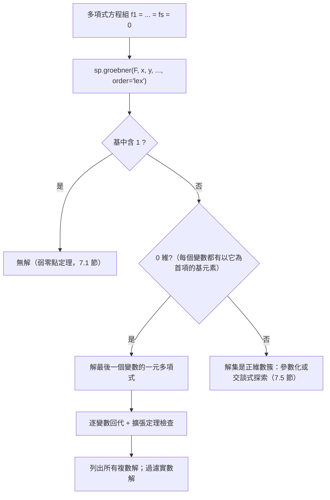

# 7.4 用 SymPy 的 groebner 求解多項式聯立方程

## 學習目標

- 理解 lexicographic Grobner 基的「三角形化」性質與**消去定理**。
- 掌握用 `sp.groebner` + `sp.solve_poly_system` 求解多項式方程組的完整流程。
- 了解**擴張定理**（extension theorem）與解在複數/實數上的差異。
- 見識真實應用：機器人運動學、密碼學（HFE）中的 Grobner 基。

## 歷史背景

解聯立方程的「消去法」有悠久的歷史：中國宋代的**天元術**與**四元術**（朱世傑《四元玉鑑》，1303 年）就用逐次消元解多項式組；西方的 Bézout（1764）與 Sylvester（1840）發展結式理論。但這些方法在變數超過三四個時，中間多項式的次數與項數會爆炸。

1965 年 Buchberger 的演算法（7.3 節）提供了系統化出路：**lexicographic 序的 Grobner 基自動完成「類高斯消去」**，把非線性方程組化成逐變數回代的形式。1980 年代起，兩股技術需求把 Grobner 基推上舞台中央：

1. **機器人運動學**：六軸機器手臂的正逆運動學是非線性多項式方程組。1980 年代，Duffy、Lazard 等人用 Grobner 基與消去理論證明：一般 6R 機器手臂的正運動學至多有 16 個實數解（Lazard, 1993 嚴格證明）。沒有 Grobner 基，這類問題只能靠數值法猜。
2. **密碼學**：多變數公開金鑰密碼（如 HFE，1996 年 Patarin 提出）的安全性依賴「解大型隨機二次方程組很難」。而 Faugère 的 **F5 演算法（2002）**直接攻破了 HFE 挑戰（80 變數的 Quadratic Challenge）。**攻擊者與防禦者都靠 Grobner 基**——計算代數幾何成為密碼分析的核心武器。

同一時期，吳文俊（1978）獨立發展的**吳特徵列方法**（characteristic set method，源自 Ritt 1950）達成類似的三角形化，並成功用於幾何定理機器證明（如自動證明 Morley 三分角定理）。吳方法與 Grobner 基是東西方並行的兩條計算路線，今日在 SymPy 等系統中仍可並列比較。

## 7.4.1 消去定理與擴張定理

> **定理（消去定理，Elimination Theorem）**
> 設 $`G`$ 是 $`I \subseteq K[x_1, \dots, x_n]`$ 對 lex 序（ $`x_1 \succ x_2 \succ \cdots \succ x_n`$ ）的 Grobner 基。則對每個 $`1 \le t \le n`$ ：
> 

$$
> G \cap K[x_{t+1}, \dots, x_n] = \text{第 $`t`$ 個消去理想 } I \cap K[x_{t+1}, \dots, x_n] \text{ 的 Grobner 基}
>
$$

白話：**lex 基中「不含 $`x_1`$ 的那些多項式」恰好生成消去 $`x_1`$ 後的方程組**。這直接把非線性方程組分解成：

$$
\text{原方程組} \supset \text{少一個變數的方程組} \supset \cdots \supset \text{一元多項式}
$$

最後解一元多項式（有公式或數值法），再逐層**回代**——結構完全類比線性代數的高斯消去與階梯形。

> **定理（擴張定理，Extension Theorem）**
> 設 $`I_{t+1} = I \cap K[x_{t+1},\dots,x_n]`$ ，取其在 lex 序下（ $`x_{t+1} \succ \cdots`$ ）的 Grobner 基。若 $`c = (c_{t+1}, \dots, c_n) \in \mathbf{V}(I_{t+1})`$ 且**某個**含 $`x_t`$ 的基多項式以 $`x_t`$ 為主變數、其首項係數在 $`c`$ 處不為零，則 $`c`$ 可擴張為解 $`(c_t, c_{t+1}, \dots, c_n) \in \mathbf{V}(I)`$ 。

**警告**：擴張不總是可能。例如 $`I = \langle xy - 1, y \rangle`$ ：消去 $`x`$ 得 $`\{y\}`$ ， $`y=0`$ 是消去理想之解，但代回 $`xy=1`$ 無解——因為首項係數（ $`x`$ 的係數 $`y`$ ）在 $`y = 0`$ 處為零。擴張定理的條件正是排除這種「在特殊點上退化」的情形。無窮多解的偵測也靠它：若 Grobner 基中每個含 $`x_t`$ 的多項式首項都不含 $`x_t`$ ，則解集對 $`x_t`$ 可能是無限的。

## 7.4.2 求解流程總覽



## 7.4.3 SymPy 實戰

### 範例 1：基本流程——三角形化與回代

```python
import sympy as sp

x, y = sp.symbols('x y')

# 方程組：x^2 + y^2 = 4, xy = 1（圓與雙曲線的交點）
F = [x**2 + y**2 - 4, x*y - 1]
G = sp.groebner(F, x, y, order='lex')
print(G.exprs)
# 輸出形如 [2*y**4 - 4*y**2 + 1, x**2 + y**2 - 4] 的一部分：
# y 被消去成一個一元四次多項式！ —— 消去定理的化身

# 直接求解
sols = sp.solve_poly_system(F, x, y)
print(sols)
# [(-sqrt(...), sqrt(...)), (sqrt(...), sqrt(...)), ...] 共 4 個複數解
# 實數解個數：y^2 需為實數且 y^2 ∈ [(2-sqrt(2))/2 ...] —— 可驗證恰有 4 個實數解

# 驗證：代回原方程
for sx, sy in sols:
    print(sp.simplify(sx**2 + sy**2 - 4), sp.simplify(sx*sy - 1))
    # 0, 0
```

輸出說明：lex 基的第一個元素只含 $`y`$ ——這就是「消去 $`x`$ 」。一元四次 $`2y^4 - 4y^2 + 1 = 0`$ 有 4 個根，每個根回代 $`x^2 = 4 - y^2`$ 得 2 個 $`x`$ ，但配對由 $`xy = 1`$ 限定為 1 個，故恰 4 個解。幾何上：單位雙曲線與半徑 2 的圓交於 4 點。

### 範例 2：無解的偵測與正維數解集

```python
import sympy as sp

x, y = sp.symbols('x y')

# (a) 無解：Grobner 基是 {1}
G1 = sp.groebner([x*y - 1, x - 1, y - 2], x, y, order='lex')
print(G1.exprs)                 # [1] → 無解（弱零點定理）

# (b) 無窮多解：V(x*y) 是兩條直線（1 維簇）
G2 = sp.groebner([x*y], x, y, order='lex')
print(G2.exprs)                 # [x*y] —— 本身就是基，無法三角形化
# 每個變數的首項都不是「自己單獨出現」→ 正維數 → 無窮多解
# 註：solve_poly_system 只支援零維系統，對此會 raise NotImplementedError；
# 正維數解集需手動讀基：<x*y> 的簇 = {x=0} ∪ {y=0}（見 7.5 節）
```

輸出說明：`solve_poly_system` 對零維（有限解）系統給出完整解列表；對正維數系統回傳帶自由變數的解族——正好對應 7.2 節「簇的不可約分解」與 7.5 節的對偶理論。

### 範例 3：機器人運動學——二連桿平面臂

```python
import sympy as sp

# 平面二連桿機器臂：兩段長度各為 1，末端在 (cx, cy) = (3/2, 1/2)。
# 未知數是各關節的 (cos, sin)：
c1, s1, c2, s2 = sp.symbols('c1 s1 c2 s2')
cx, cy = sp.Rational(3, 2), sp.Rational(1, 2)

eqs = [
    c1 + c2 - cx,          # x 座標：l1*cos(θ1) + l2*cos(θ1+θ2)
    s1 + s2 - cy,          # y 座標
    c1**2 + s1**2 - 1,     # 單位圓約束
    c2**2 + s2**2 - 1,
]
G = sp.groebner(eqs, c1, s1, c2, s2, order='lex')
print(len(G.exprs), "個基多項式")
print(G.exprs)

# 解出所有姿態
sols = sp.solve_poly_system(eqs, c1, s1, c2, s2)
print("共", len(sols), "組解")
for sol in sols:
    print([sp.simplify(v) for v in sol])
```

輸出說明：這個可達點 $`(3/2, 1/2)`$ 對應**兩組**關節角（肘向上、肘向下）——逆運動學的多解性由 Grobner 基精確列舉。真實的六軸手臂問題是 16 個多項式、最多 16 組解（Lazard 1993），原理完全相同：**把三角約束多項式化，再用 lex 基三角形化**。這是 Grobner 基在工業機器人軟體（如符號預解式預計算）中的實際用途。

### 範例 4：密碼學視角——小型 HFE 式方程組的攻擊模擬

```python
import sympy as sp

# 模擬多變數密碼的核心難題：解「隨機」二次方程組。
# 這裡造一個小的可解實例（真實 HFE 有 80+ 變數，SymPy 只能處理玩具規模）
x, y = sp.symbols('x y')
p1 = x**2 + x*y + 3*y**2 + 2*x + 1      # 公鑰多項式 f1 = 0
p2 = x*y + y**2 + x + 5*y + 2           # 公鑰多項式 f2 = 0

G = sp.groebner([p1, p2], x, y, order='lex')
print(G.exprs)
sols = sp.solve_poly_system([p1, p2], x, y)
print(sols)   # 列出 GF(2^k)（此處為 Q 上）的全部候選金鑰

# 在有限體 GF(7) 上同樣可行：
G7 = sp.groebner([sp.Poly(p1, x, y, modulus=7),
                  sp.Poly(p2, x, y, modulus=7)], x, y, order='lex')
print(G7.exprs)
```

輸出說明：對二次系統，Grobner 基把「暴力搜尋 $`q^n`$ 個候選」降為符號消元。Faugère 的 F5 在 2002 年以類似原理（但用了簽章與稀疏線性代數）破解 80 變數 HFE 挑戰——**密碼學家因此設計「Grobner 基抵抗型」體制**，攻防兩端都被同一個 1965 年的博士論文驅動。

### 範例 5：與吳方法對照（選學）

```python
import sympy as sp

x, y = sp.symbols('x y')

# SymPy 沒有內建吳特徵列，但 lex Grobner 基的三角形結構可與之對照
F = [x**2 - y, y**2 - x]
G = sp.groebner(F, x, y, order='lex')
print(G.exprs)   # [y**3 - y, x**2 - y] 之類的三角形
print(sp.solve_poly_system(F, x, y))
# [(0,0), (1,1), (共軛複數解, ...)]：兩條拋物線的交點
```

## 7.4.4 實務建議

| 情境 | 建議 |
|---|---|
| 要求所有解 | `lex` 基 + `solve_poly_system` |
| 只想判斷有無解 | 任一序；基含 $`1`$ ⟺ 無解 |
| 變數多、只求效率 | `grevlex` 算基，必要時 FGLM 轉 lex（SymPy 未內建） |
| 有限體上的密碼學規模 | SymPy 玩具級；正式工作用 `SageMath`、`Singular`、`msolve` 或 `FGb` |
| 正維數系統 | 參數化或先做 7.5 節的簇分析 |

## 習題

1. 用消去定理手動預測 $`I = \langle x^2 + y^2 - 1,\; x - y \rangle`$ 的 lex 基中「只含 $`y`$ 」的多項式，再用 SymPy 驗證，並解出 $`\mathbf{V}(I)`$ 的全部點。
2. 解釋為何 $`I = \langle xy - 1, y \rangle`$ 的解 $`y = 0`$ 不能擴張，並對照擴張定理中首項係數的條件。
3. 求方程組 $`x + y + z = 1,\; x^2+y^2+z^2 = 3,\; x^3+y^3+z^3 = 9`$ 的全部解。（提示：對稱多項式結構會讓基特別乾淨；這類「冪和約束」也是密碼學中 HFE 的原型。）
4. 把範例 3 的二連桿臂改為兩段長度 $`2`$ 與 $`1`$ 、末端 $`(1, 1)`$ ，求所有關節解；說明幾何上為何解的個數改變。
5. （實作）寫一個函數 `count_solutions(F, gens)`：用 lex 基判斷系統是否零維、是否無解，若零維則回傳複數解個數（可用基的次數乘積或直接數 `solve_poly_system` 的結果），並用三個不同系統測試。
6. （挑戰）查閱並簡述 Faugère F5 的「簽章」思想：為何避免「零約化」能加速 Buchberger？（不需完整證明，寫出直覺與一個文獻參考即可。）

## SymPy 要點回顧

- `sp.groebner(F, *gens, order='lex')`：`G.exprs` 中「不含 $`x_1`$ 的元素」生成消去理想——消去定理的直接讀法。
- `sp.solve_poly_system(F, x, y, ...)`：零維系統回傳全部解；正維數系統回傳解族；底層就是 Grobner 基。
- `sp.Poly(f, x, y, modulus=7)`：在有限體上做基與求解（密碼學場景）。
- `G.reduce(f)` / `G.contains(f)`：餘式與成員測試，用於驗證回代結果。
- 心法：**lex 基 = 非線性高斯消去**；解的個數、存在性、可解性全部讀自基的形狀。

---
*上一節：[7.3 Buchberger 與 Grobner 基的發明](07.3-Buchberger（1965）：Grobner基的發明.md)* | *下一節：[7.5 代數幾何初探：簇與理想的對偶](07.5-代數幾何初探：簇與理想的對偶.md)*
