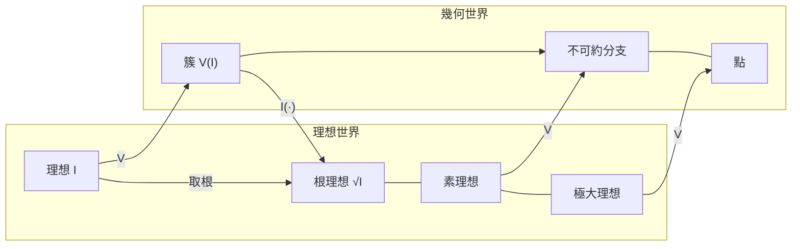

# 7.5 代數幾何初探：簇與理想的對偶

## 學習目標

- 掌握對應 $`\mathbf{V} \dashleftarrow \dashrightarrow \mathbf{I}`$ 的完整性質與「取根後的一一對應」。
- 理解 **Zariski 拓撲**與不可約分解的幾何意義。
- 認識**座標環** $`K[V] = K[x_1,\dots,x_n]/\mathbf{I}(V)`$ 與射影空間的入門。
- 用 SymPy 畫出簇、計算交點與重數，體會 Grobner 基如何成為代數幾何的計算引擎。

## 歷史背景

把「多項式方程組的解集」當作幾何對象來研究，是 19 世紀義大利學派的傳統（Cremona、Castelnuovo、Enriques），但他們的工具主要是手算與幾何直覺。真正的轉折在：

- **1890–1893**：希爾伯特的基定理與零點定理（7.1 節）把理想與簇繫在一起，代數方法取得主導權。
- **1920–1930**：Noether 學派（van der Waerden、Zariski）把抽象環論全面引入幾何。Zariski（1899–1986）發展出以**多項式開集為開集**的拓撲——今日稱 **Zariski 拓撲**——並用它重建意大利學派的結果。
- **1946**：Weil 論文《Foundations of Algebraic Geometry》為證明 Riemann 假設的函數體版本鋪路。
- **1960**：Grothendieck（1928–2014）的 **scheme（概形）**理論把「帶冪零元的座標環」也當作空間，徹底統一數論與幾何；Fermat 大定理的證明（Wiles, 1994–95，見 9.2 節）就是住在概形世界裡的。
- **1965–**：Buchberger 的演算法（7.3 節）讓上述一切**可以計算**。1980 年代 Macaulay、Singular 等專門軟體誕生；今日研究橢圓曲線密碼、奇點理論、統計模型（代數統計）的人，都在用 Grobner 基。

驅動鏈條再一次清晰：**數論問題（Fermat）→ 概形理論 → 需要計算 → 演算法（Buchberger/F4/F5）→ 反過來服務密碼學（橢圓曲線、HFE）**。理論與技術的螺旋在這一章達到頂點。

## 7.5.1 簇與理想的對偶

回顧 7.1 節定義：對理想 $`I`$ ， $`\mathbf{V}(I) = \{ a \in K^n : f(a) = 0,\ \forall f \in I \}`$ ；對子集 $`S \subseteq K^n`$ ， $`\mathbf{I}(S) = \{ f : f \text{ 在 } S \text{ 上為零} \}`$ 。

**基本性質**：

1. $`I \subseteq J \implies \mathbf{V}(J) \subseteq \mathbf{V}(I)`$ （**包含反轉**）；反之 $`S \subseteq T \implies \mathbf{I}(T) \subseteq \mathbf{I}(S)`$ 。
2. $`\mathbf{V}(\sum I_\alpha) = \bigcap_\alpha \mathbf{V}(I_\alpha)`$ ， $`\mathbf{V}(I \cap J) = \mathbf{V}(I) \cup \mathbf{V}(J)`$ ， $`\mathbf{V}(fg) = \mathbf{V}(f) \cup \mathbf{V}(g)`$ 。
3. $`I \subseteq \mathbf{I}(\mathbf{V}(I))`$ ，且由**強零點定理**（ $`K`$ 代數閉）： $`\mathbf{I}(\mathbf{V}(I)) = \sqrt{I}`$ 。
4. $`\mathbf{V}(\mathbf{I}(S)) = \overline{S}`$ （ $`S`$ 的 Zariski 閉包）。

**Gal 對應式的圖像**：



**核心結論**：當 $`K`$ 代數閉時，

$$
I \mapsto \mathbf{V}(I) \text{ 誘導 } \{\text{根理想}\} \xleftrightarrow{\;1:1\;} \{\text{代數集}\}, \qquad
\{\text{素理想}\} \xleftrightarrow{\;1:1\;} \{\text{不可約代數集}\}
$$

7.2 節的「素理想 ⟺ 不可約、極大理想 ⟺ 點」在此獲得幾何的全貌。而 **Grobner 基是讀出這些對應的計算介面**：給定基，我們能算出簇的點、維數與分解。

## 7.5.2 Zariski 拓撲與維數

> **定義（Zariski 拓撲）**： $`K^n`$ 的**代數集**宣告為閉集，空集與全空間亦然。這構成一個拓撲（性質 2 保證有限併與任意交封閉）。

與歐氏拓撲相比：Zariski 開集「非常大」（稠密）、不可度量，但完美匹配多項式的代數行為。例如 $`\mathbb{C}`$ 的 Zariski 閉集恰為有限集或全空間——一元多項式只有有限個根！

> **定義（維數）**：簇 $`V`$ 的維數是其不可約分支中鏈長的最大值
> 

$$
> \dim V = \max\{\, \text{鏈 } V_0 \subsetneq V_1 \subsetneq \cdots \subsetneq V_m \subseteq V \text{ 的長度 } m \,\}
>
$$

> 代數對偶： $`\dim V = \dim K[x]/\mathbf{I}(V)`$ （Krull 維數），等於 $`\mathbf{I}(V)`$ 的 Grobner 基中首項理想的**標準單項式個數的增長階**（這正是 Grobner 基算 Hilbert 多項式的原理）。

**例子**： $`\mathbf{V}(xy) \subseteq \mathbb{C}^2`$ 是十字，維數 1； $`\mathbf{V}(x, y)`$ 是點，維數 0； $`\mathbf{V}(0)`$ 是整個平面，維數 2。Grobner 基 $`\{xy\}`$ 的首項理想 $`\langle xy \rangle`$ 的標準單項式是「 $`x`$ 的冪或 $`y`$ 的冪」， $`k`$ 次以下共有 $`2k+1`$ 個——線性增長 ⟹ 維數 1。**維數是從 Grobner 基「數單項式」數出來的**，這是計算代數幾何最漂亮的一招。

## 7.5.3 座標環與交點重數

> **定義（座標環）**：簇 $`V = \mathbf{V}(I)`$ 的**座標環**是
> 

$$
> K[V] = K[x_1,\dots,x_n]/\mathbf{I}(V) = K[x_1,\dots,x_n]/\sqrt{I}
>
$$

> 它是把「在 $`V`$ 上相等的多項式等同」後得到的環；其元素就是 $`V`$ 上的多項式函數。

座標環承載簇的全部代數資訊： $`K[V]`$ 是整環 ⟺ $`V`$ 不可約； $`K[V]`$ 是體 ⟺ $`V`$ 是點； $`\dim K[V] = \dim V`$ 。

**交點重數**：兩條平面曲線 $`f = 0`$ 、 $`g = 0`$ 的交點個數由 **Bézout 定理**（1779）給出：在射影平面上，若無公共分支，交點數（計重數）為 $`\deg f \cdot \deg g`$ 。重數的代數化正是**局部化的商環維數**：

$$
\text{交點重數} = \dim_K \left( K[x,y]_{(x-a, y-b)} / \langle f, g \rangle \right)
$$

當 $`I = \langle f, g \rangle`$ 是零維理想時，重數可以更簡單地讀出： $`K[x,y]/I`$ 作為向量空間的維數等於所有交點重數之和（含無窮遠的貢獻）。**Grobner 基讓 $`K[x,y]/I`$ 的維數變成「數標準單項式」**。

**例子**：圓 $`x^2 + y^2 = 1`$ 與拋物線 $`y = x^2`$ 相交：基會顯示 $`K[x,y]/I`$ 維數為 4，對應 4 個複數交點（Bézout： $`2 \times 2 = 4`$ ），其中可能有共軛複數對。

## 7.5.4 SymPy 實戰

### 範例 1：對偶的數值體檢

```python
import sympy as sp

x, y = sp.symbols('x y')

# (a) I = <x^2>：V(I) 是 y 軸，但 I(V(I)) = <x> ≠ I —— 需取根
G = sp.groebner([x**2], x, y, order='lex')
print(G.contains(x))            # False → x 不在 I 中
# 註：solve_poly_system 只支援零維系統；V(x^2) 是 1 維的 y 軸，
# 幾何上與 V(<x>) 相同 → V(I) = V(√I)，需手動讀出

# (b) 完整的往返：I → V → I(V)
F = [x*y - 1, x**2 + y**2 - 4]
G2 = sp.groebner(F, x, y, order='lex')
pts = sp.solve_poly_system(F, x, y)
print("交點：", pts)
# 對每個點寫出極大理想，驗證 √I = ∩ 極大理想（零維情形的準素分解）
```

輸出說明：(a) 顯示 $`\mathbf{V}`$ 「壓扁」重根： $`I \ne \sqrt{I}`$ 但簇相同，所以對偶必須取根才是一一對應。(b) 示範零維簇的標準分解：每個點對應一個極大理想， $`\sqrt{I}`$ 是它們的交——7.2 節準素分解幾何化的具體實例。

### 範例 2：從 Grobner 基「數」維數

```python
import sympy as sp
from itertools import product

x, y = sp.symbols('x y')

def hilbert_function_from_gb(G_exprs, vars, upto=8):
    """計算首項理想的標準單項式個數 H(k)：維數 = H(k) 增長多項式的次數。"""
    lts = [sp.Poly(g, *vars).LM() for g in G_exprs]
    def divisible(m):
        for lt in lts:
            if all(mi >= li for mi, li in zip(m, lt)):
                return True
        return False
    H = []
    for k in range(upto + 1):
        cnt = 0
        for m in product(range(k + 1), repeat=len(vars)):
            if sum(m) <= k and not divisible(m):
                cnt += 1
        H.append(cnt)
    return H

# 十字 V(xy)：首項理想 <xy>，標準單項式 = x^i 或 y^j → 線性增長 → 維數 1
G1 = sp.groebner([x*y], x, y, order='grevlex')
print("xy :", hilbert_function_from_gb(G1.exprs, (x, y)))
# [1, 3, 5, 7, ...] → 差分恆為 2 → 維數 1

# 一個點 V(x, y-1)：標準單項式只有 1 → 常數 → 維數 0
G2 = sp.groebner([x, y - 1], x, y, order='grevlex')
print("點 :", hilbert_function_from_gb(G2.exprs, (x, y)))
# [1, 1, 1, ...] → 維數 0

# 拋物線 V(y - x^2)：標準單項式 = 所有 x^i → 線性 → 維數 1
G3 = sp.groebner([y - x**2], x, y, order='grevlex')
print("拋物線 :", hilbert_function_from_gb(G3.exprs, (x, y)))
```

輸出說明： $`H(k)`$ 的**增長度**就是維數（ $`k`$ 次以下標準單項式數 $`\sim c \cdot k^{\dim}`$ ）。這段程式把「維數 = 首項理想的組合學」完整實作——Macaulay2 與 Singular 內建 Hilbert 多項式演算法正是這個思想的工業級版本。

### 範例 3：座標環與 Bézout 定理

```python
import sympy as sp

x, y = sp.symbols('x y')

# 圓與拋物線：deg 2 × deg 2 → Bézout 預言 4 個複數交點
f = x**2 + y**2 - 1
g = y - x**2
G = sp.groebner([f, g], x, y, order='lex')
print(G.exprs)

pts = sp.solve_poly_system([f, g], x, y)
print("解：", pts)
print("個數：", len(pts))   # 4（含共軛複數對）—— Bézout 精確成立

# 相切時重數 > 1：拋物線 y = x^2 與直線 y = 0 在原點相切
G2 = sp.groebner([y - x**2, y], x, y, order='lex')
print(G2.exprs)             # [y, x**2] → 商環標準單項式 {1, x} → 維數 2 → 重數 2！
```

輸出說明：`solve_poly_system` 列出 4 個複數解，驗證 Bézout。相切的例子更深刻： $`\langle y, x^2 \rangle`$ 的商環有標準單項式 $`\{1, x\}`$ ，維數 2——**重數 2 的交點被 Grobner 基直接「量」出來**。這是現代交截理論（intersection theory）的最小樣本，也是 9.2 節橢圓曲線論證的基礎技術。

### 範例 4：畫出簇與不可約分解

```python
import sympy as sp
import matplotlib
matplotlib.use('Agg')
import matplotlib.pyplot as plt
import numpy as np

x, y = sp.symbols('x y')

# 分解示範：V(x^2 - y^2) 的兩條直線
f = x**2 - y**2
X, Y = np.meshgrid(np.linspace(-2, 2, 400), np.linspace(-2, 2, 400))
F = sp.lambdify((x, y), f, 'numpy')(X, Y)

fig, ax = plt.subplots()
ax.contour(X, Y, F, levels=[0], colors='k')
ax.set_aspect('equal'); ax.set_title('$V(x^2 - y^2)$：兩條不可約直線')
fig.savefig('variety.png', dpi=100)
# SymPy 側確認分解：
print(sp.factor(f))                       # (x - y)*(x + y)
print(sp.groebner([f], x, y, order='lex').exprs)
# 幾何分解（兩直線）⟷ 代數分解（兩素因子）
```

輸出說明：圖像顯示兩條對角直線；`factor` 給出兩個素因子——**幾何的不可約分支與代數的素因子一一對應**（因為 $`\mathbb{C}[x,y]`$ 是 UFD，主理想的分解即因子分解；一般理想則需準素分解 + Grobner 基）。

## 7.5.5 全章總結

| 節 | 角色 | 關鍵定理/演算法 |
|---|---|---|
| 7.1 | 存在性地圖 | 基定理、零點定理 |
| 7.2 | 地形分類 | 素/極大理想、準素分解 |
| 7.3 | 交通工具 | Buchberger 演算法、S-多項式 |
| 7.4 | 實際駕駛 | 消去/擴張定理、`solve_poly_system` |
| 7.5 | 目的地 | 簇–理想對偶、Zariski 拓撲、座標環 |

一章讀完，讀者已握有計算代數幾何的入門鑰匙：**任何代數命題（成員、分解、維數、重數）都能翻譯成 Grobner 基的計算**。通往更深處的門：射影空間與齊次理想、概形（Grothendieck）、以及應用戰場——第 9.2 節的橢圓曲線與費馬大定理。

## 習題

1. 證明性質 2： $`\mathbf{V}(I \cap J) = \mathbf{V}(I) \cup \mathbf{V}(J)`$ 與 $`\mathbf{V}(fg) = \mathbf{V}(f) \cup \mathbf{V}(g)`$ ，並說明這正是「代數集的併仍是代數集」的原因。
2. 計算並解釋： $`\mathbf{I}(\mathbf{V}(x^2 + y^2))`$ 在 $`K = \mathbb{C}`$ 與 $`K = \mathbb{R}`$ 中各是什麼？（提示： $`x^2 + y^2 = (x+iy)(x-iy)`$ 。）
3. 用範例 2 的程式計算 $`\mathbf{V}(y - x^2,\; z) \subseteq \mathbb{C}^3`$ 型簇的 Hilbert 函數並讀出維數。
4. 求 $`\mathbb{C}^2`$ 中 $`y^2 = x^3`$ （尖點曲線）與 $`y = x`$ 的交點與總重數，並對照 Bézout 定理（ $`\deg 2 \times \deg 3 = 6`$ ，缺的交點在哪裡？提示：射影化的無窮遠處）。
5. （實作）寫函數 `is_zero_dimensional(G, gens)`：由 lex Grobner 基判斷簇是否零維（每個變數是否「單獨」出現在某個首項中），再用它分類五個不同的方程組。
6. （挑戰）座標環 $`K[V] = K[x,y]/\langle y^2 - x^3 \rangle`$ 中，元素 $`\bar{x}`$ 有逆嗎？找出 $`V`$ 上「多項式函數但不是多項式」的現象（例如 $`y/x`$ 在原點外有定義），說明座標環如何捕捉簇的奇異性——這是 Grothendieck 概形理論的起點之一。

## SymPy 要點回顧

- `sp.solve_poly_system`：列舉零維簇的點；配合 `sp.factor` 讀出不可約分支。
- Grobner 基首項理想的**標準單項式計數**：零維時給總重數（交截論）、正維時增長度給維數（Hilbert 函數）。
- `sp.lambdify` + matplotlib：把簇畫出來，對照代數分解。
- `sp.Poly(g, *gens).LM()`：提取首單項，用於自製維數/重數計算。
- 心法：**Grobner 基是簇的「顯影劑」**——點、分支、維數、重數，全部從基的形狀讀出；這就是 7.1 存在性、7.3 可計算性、7.5 幾何對偶三者的會師。

---
*上一節：[7.4 用 SymPy 的 groebner 求解多項式聯立方程](07.4-用SymPy的groebner求解多項式聯立方程.md)*
